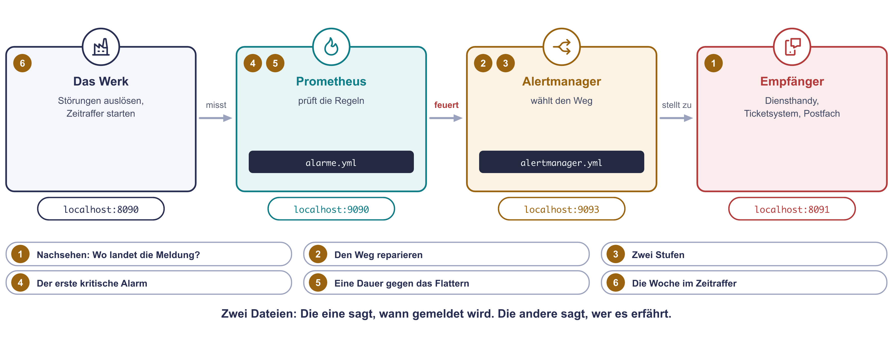
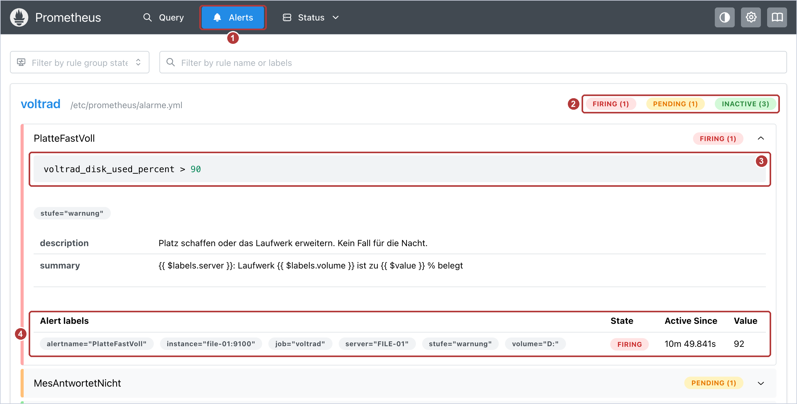
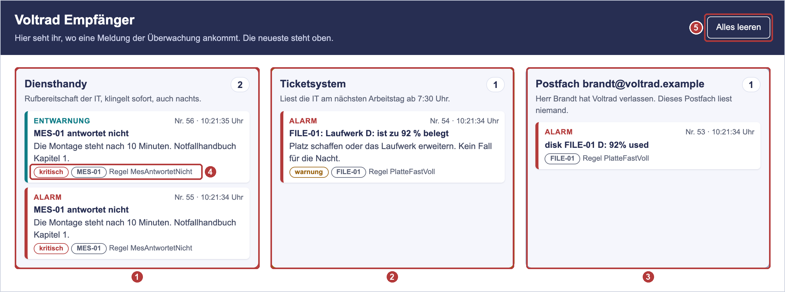
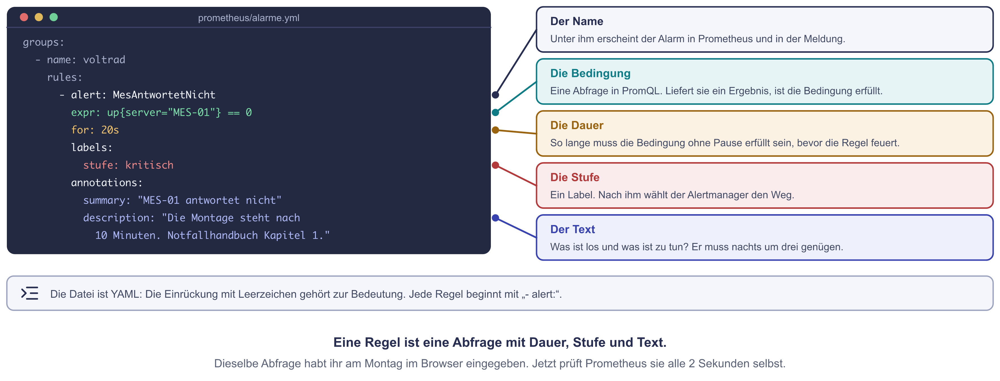

# Praxis: Alarmierung für Voltrad

In der [ersten Praxis](praxis-monitoring.md) habt ihr gemessen und gesehen.
Euer Dashboard hat die Zeichen des Angriffs gezeigt: ein neues Konto bei den
Administratoren und Daten, die nachts abfließen. Gesehen hätte das nur, wer
in diesem Augenblick hingeschaut hat.

Die alte Überwachung auf MON-01 war einen Schritt weiter. Sie hat elf
Warnungen verschickt. Alle gingen an `brandt@voltrad.example`, das Postfach
des früheren Administrators. Heute baut ihr den Teil, der bei Voltrad
gefehlt hat: Die richtige Meldung kommt bei der richtigen Person an. Am Ende
läuft die Woche vor dem Angriff noch einmal im Zeitraffer und ihr messt, wie
viele Stunden Vorsprung eure Alarme gebracht hätten.

!!! abstract "Ziel"
    Am Ende könnt ihr:

    - den Weg eines Alarms von der Regel bis zum Empfänger verfolgen
    - Meldungen nach ihrer Stufe an verschiedene Empfänger leiten
    - eine Alarmregel für Prometheus schreiben, prüfen und auslösen
    - mit einer Dauer verhindern, dass ein pendelnder Wert ständig meldet
    - eine Meldung so formulieren, dass sie nachts um drei genügt

    Für die Schnellen gibt es drei Bonus-Aufgaben und eine Denkaufgabe.

!!! note "Windows-Hinweis"
    Unter Windows nutzt ihr die **PowerShell** im Terminal von VS Code
    (**Terminal → Neues Terminal**, englisch **Terminal → New Terminal**).
    Die `docker`-Befehle sind auf Windows, macOS und Linux gleich.
    **Docker Desktop** muss gestartet sein.

!!! tip "So arbeitet ihr heute"
    Die Stationen 1 bis 5 macht jede Person am eigenen Rechner. Im Raum teilt
    immer eine Person ihren Bildschirm, die anderen bauen mit. Station 6
    macht ihr im Team. Ihr ändert heute zwei Dateien. Nach jeder Änderung
    kommen dieselben drei Handgriffe: **speichern, prüfen, neu starten**.
    Die Befehle dazu stehen im Kasten unten. Die Stationen bauen aufeinander
    auf, haltet deshalb die Reihenfolge ein.

??? info "Alertmanager und Empfänger-Seite in Kürze"
    | | Alertmanager | Empfänger-Seite |
    |---|---|---|
    | **Was das ist** | Ein Programm, das die Alarme von Prometheus annimmt und zustellt. Es bündelt gleiche Meldungen, wählt den Weg und erinnert, solange ein Alarm besteht. | Eine Seite der Übung, die drei Empfänger zeigt: das Diensthandy, das Ticketsystem und das Postfach von Herrn Brandt. |
    | **Warum gerade das** | Der Alertmanager gehört zu Prometheus. Regeln und Wege stehen getrennt in zwei Dateien. | Im Betrieb gingen die Meldungen an ein echtes Handy und an ein Ticketsystem. Hier seht ihr alle drei Ziele nebeneinander. |
    | **So arbeiten wir heute damit** | Den Weg in der Datei `alertmanager.yml` ändern. | Zusehen und zählen, was wo ankommt. |

    Das Prinzip gilt für jedes Werkzeug: Eine Regel entscheidet, ob gemeldet
    wird. Ein Weg entscheidet, wer es erfährt.

## Was ihr heute macht

| Station | Was passiert | Form | Zeit |
|---|---|---|---|
| 1 | Starten und nachsehen: Wo landet die Meldung heute? | jede Person | 7 Min. |
| 2 | Den Weg reparieren: vom Postfach zum Diensthandy | jede Person | 8 Min. |
| 3 | Zwei Stufen: die Warnung geht ins Ticketsystem | jede Person | 10 Min. |
| 4 | Der erste kritische Alarm: MES-01 antwortet nicht | jede Person | 12 Min. |
| 5 | Eine Dauer gegen das Flattern | jede Person | 10 Min. |
| 6 | Die Woche vor dem Angriff, diesmal mit Alarmen | im Team | 15 Min. |

{ .diagramm }

## Die beiden Dateien und die drei Handgriffe

| Datei | Was darin steht | Wer sie liest |
|---|---|---|
| `prometheus/alarme.yml` | die **Regeln**: Wann wird gemeldet? | Prometheus |
| `alertmanager/alertmanager.yml` | der **Weg**: Wer erfährt es? | Alertmanager |

Beide Dateien sind YAML. Die Einrückung mit Leerzeichen gehört zur
Bedeutung. Nach jeder Änderung:

1. **Speichern** in VS Code.
2. **Prüfen**, ob die Datei gültig ist. Für die Regeln:

    ```bash
    docker compose exec prometheus promtool check rules /etc/prometheus/alarme.yml
    ```

    Für den Weg:

    ```bash
    docker compose exec alertmanager amtool check-config /etc/alertmanager/alertmanager.yml
    ```

    Beide antworten mit `SUCCESS`, wenn alles stimmt. Sonst nennen sie die
    Zeile mit dem Fehler.

3. **Neu starten**, damit die Datei gelesen wird:

    ```bash
    docker compose restart prometheus
    ```

    ```bash
    docker compose restart alertmanager
    ```

??? info "Die Befehle im Einzelnen"
    - `docker compose exec prometheus` führt den folgenden Befehl im
      laufenden Container `prometheus` aus.
    - `promtool check rules` ist das Prüfprogramm von Prometheus für
      Regeldateien. Der Pfad ist der Ort der Datei im Container. Euer Ordner
      `prometheus` ist dort als `/etc/prometheus` eingebunden.
    - `amtool check-config` ist das Gegenstück für den Alertmanager.
    - `docker compose restart` hält einen Dienst an und startet ihn wieder.
      Nach dem Neustart des Alertmanagers erscheint jeder bestehende Alarm
      nach etwa 15 Sekunden neu bei seinem Empfänger.

---

## Station 1: Starten und nachsehen (7 Minuten, jede Person)

**Was ihr hier tut:** Ihr startet den Stack vom letzten Mal und verfolgt eine
Meldung von der Regel bis zum Empfänger.

1. Startet Docker Desktop, öffnet den Ordner `voltrad-monitoring` in VS Code
   und startet im Terminal den Stack:

    ```bash
    docker compose up -d
    ```

    ??? info "Der Befehl im Einzelnen"
        - `up -d` startet alle fünf Container im Hintergrund. Die Abbilder
          sind schon auf eurem Rechner, es wird nichts mehr geladen.
        - Euer Dashboard und die Zielliste vom letzten Mal sind erhalten.

2. Öffnet **Prometheus** (<http://localhost:9090>) und prüft unter
   **Status → Target health**, ob sieben Ziele antworten.

    ??? warning "Sind es nur sechs, oder habt ihr die erste Praxis verpasst?"
        Wer die erste Praxis verpasst hat, macht dort zuerst
        [Station 1](praxis-monitoring.md#station-1-den-stack-starten-10-minuten-jede-person).
        Fehlt nur MES-01, ergänzt in `prometheus/prometheus.yml` unter
        `static_configs` diesen Block, genauso tief eingerückt wie die
        anderen Ziele:

        ```yaml
              - targets: ["mes-01:9100"]
                labels:
                  server: "MES-01"
        ```

        Danach `docker compose restart prometheus`.

3. Klickt in Prometheus oben auf **Alerts**. Dort steht eine Regel aus der
   alten Überwachung: `PlatteFastVoll`. Klappt sie mit einem Klick auf.

    - Wie lautet ihre Bedingung?
    - In welchem Zustand ist sie: `INACTIVE`, `PENDING` oder `FIRING`?

    { .diagramm }

    Das Foto stammt vom Ende der Übung, bei euch steht erst eine Regel in
    der Liste. Markierung 2 zeigt die Zustände aller Regeln, Markierung 3
    die Bedingung, Markierung 4 jeden einzelnen Alarm mit Zustand und Wert.

4. Öffnet die **Empfänger-Seite** (<http://localhost:8091>). Sie zeigt drei
   Empfänger nebeneinander.

    - Bei wem kommt die Meldung an?
    - Was sagt ihr Text darüber, wie eilig es ist und was zu tun wäre?

    { .diagramm }

    Auch dieses Foto zeigt einen späteren Stand: je Empfänger ein Beispiel.
    Markierung 4 zeigt Stufe, Server und Regel einer Meldung, Markierung 5
    leert die Seite.

5. Die Meldung kommt wieder, solange der Alarm besteht. Lest in der
   Zwischenzeit die Datei `alertmanager/alertmanager.yml`: An welchen
   Empfänger geht alles? Nach wie vielen Sekunden wird erinnert? Zählt nach
   drei Minuten, wie viele Meldungen angekommen sind.

??? tip "Hinweis zu Station 1"
    In `alertmanager.yml` steht der Empfänger hinter `receiver:`, die
    Erinnerung hinter `repeat_interval:`. Für die Übung ist sie kurz
    eingestellt.

Die Lösung besprechen wir gemeinsam nach der Praxiszeit.

---

## Station 2: Den Weg reparieren (8 Minuten, jede Person)

**Was ihr hier tut:** Ihr leitet die Meldungen an die Rufbereitschaft um. Das
ist die Reparatur, die bei Voltrad gefehlt hat.

1. Öffnet `alertmanager/alertmanager.yml`. Ändert unter `route:` den
   Empfänger:

    ```yaml
      receiver: diensthandy
    ```

    Die drei Empfänger stehen weiter unten in der Datei unter `receivers:`.
    Jeder hat einen Namen und eine Adresse.

2. Speichern, prüfen, neu starten:

    ```bash
    docker compose exec alertmanager amtool check-config /etc/alertmanager/alertmanager.yml
    ```

    ```bash
    docker compose restart alertmanager
    ```

3. Seht auf die Empfänger-Seite. Nach etwa 15 Sekunden erscheint die Meldung
   auf dem Diensthandy.

4. Lasst sie drei Minuten laufen. Das Diensthandy klingelt jetzt alle
   96 Sekunden mit derselben Meldung. Im Zeitraffer wäre das einmal am Tag.
   Beantwortet für diese Meldung die drei Alarmfragen:

    - Merkt es jemand außerhalb der IT?
    - Kann jemand etwas tun?
    - Muss es jetzt sein, auch nachts?

??? tip "Hinweis 1 zu Station 2"
    Es ändert sich genau ein Wort in einer Zeile. Die Einrückung bleibt, wie
    sie ist: zwei Leerzeichen vor `receiver`.

??? tip "Hinweis 2 zu Station 2"
    Für die Alarmfragen: Das Laufwerk ist zu 92 Prozent belegt und wächst um
    25 GB im Monat. Frei sind 160 GB.

Die Lösung besprechen wir gemeinsam nach der Praxiszeit.

---

## Station 3: Zwei Stufen (10 Minuten, jede Person)

**Was ihr hier tut:** Ihr trennt Warnung und kritischen Alarm. Die Regel
bekommt eine Stufe als Label. Der Alertmanager wählt nach diesem Label den
Weg: Warnungen gehen ins Ticketsystem, alles andere aufs Diensthandy.

1. **Die Stufe an die Regel hängen.** Öffnet `prometheus/alarme.yml` und
   ergänzt bei der Regel `PlatteFastVoll` zwischen `expr` und `annotations`
   zwei Zeilen:

    ```yaml
            labels:
              stufe: warnung
    ```

2. **Den Text verbessern.** Ersetzt die Zeile mit `summary` durch zwei
   Zeilen, die sagen, was los ist und was zu tun ist:

    ```yaml
              summary: "{{ $labels.server }}: Laufwerk {{ $labels.volume }} ist zu {{ $value }} % belegt"
              description: "Platz schaffen oder das Laufwerk erweitern. Kein Fall für die Nacht."
    ```

    ??? info "Die Zeilen im Einzelnen"
        - `labels` hängt eigene Etiketten an den Alarm. `stufe` ist ein Name,
          den wir selbst gewählt haben.
        - `annotations` sind die Texte der Meldung. `summary` ist die
          Überschrift, `description` die Erklärung darunter.
        - `{{ $labels.server }}` setzt Prometheus beim Auslösen den Wert des
          Labels `server` ein, hier `FILE-01`. `{{ $value }}` ist der
          gemessene Wert.

3. **Den Weg für Warnungen eintragen.** Öffnet
   `alertmanager/alertmanager.yml` und ergänzt unter `route:`, nach der
   Zeile mit `repeat_interval`, diesen Block:

    ```yaml
      routes:
        - matchers:
            - stufe="warnung"
          receiver: ticketsystem
          repeat_interval: 12h
    ```

    ??? info "Die Zeilen im Einzelnen"
        - `routes` sind Abzweigungen vom Hauptweg. Der Alertmanager prüft sie
          der Reihe nach.
        - `matchers` nennt die Bedingung: Das Label `stufe` hat den Wert
          `warnung`.
        - Trifft sie zu, geht die Meldung an `ticketsystem`, mit einer
          Erinnerung alle 12 Stunden.
        - Trifft keine Abzweigung zu, gilt der Empfänger des Hauptwegs: das
          Diensthandy.

4. Speichern, beide Dateien prüfen, beide Dienste neu starten:

    ```bash
    docker compose exec prometheus promtool check rules /etc/prometheus/alarme.yml
    ```

    ```bash
    docker compose exec alertmanager amtool check-config /etc/alertmanager/alertmanager.yml
    ```

    ```bash
    docker compose restart prometheus alertmanager
    ```

5. Klickt auf der Empfänger-Seite auf **Alles leeren** und wartet
   20 Sekunden. Wo kommt die Meldung jetzt an? Was steht darin?

??? tip "Hinweis 1 zu Station 3"
    `labels` und `annotations` stehen gleich tief eingerückt: acht
    Leerzeichen. Die Zeilen darunter zehn.

??? tip "Hinweis 2 zu Station 3"
    `routes` steht genauso tief wie `receiver` und `repeat_interval`
    darüber: zwei Leerzeichen. Meldet `amtool` einen Fehler, vergleicht die
    Einrückung Zeile für Zeile mit dem Block oben.

??? tip "Hinweis 3 zu Station 3"
    Kommt die Meldung weiter auf dem Diensthandy an, fehlt der Regel das
    Label oder es ist anders geschrieben als im Alertmanager. Unter
    **Alerts** in Prometheus seht ihr bei der Regel, welche Labels sie
    trägt.

Die Lösung besprechen wir gemeinsam nach der Praxiszeit.

---

## Station 4: Der erste kritische Alarm (12 Minuten, jede Person)

**Was ihr hier tut:** Ihr schreibt eine Regel selbst. Fällt das
Fertigungsleitsystem aus, stehen nach zehn Minuten die Bänder. Das ist ein
Fall für das Diensthandy.

{ .diagramm }

1. **Die Regel schreiben.** Ergänzt in `prometheus/alarme.yml` eine zweite
   Regel unter der ersten. Lasst eine Leerzeile dazwischen. Die Bausteine:

    | Baustein | Was hinein soll |
    |---|---|
    | `alert` | der Name `MesAntwortetNicht` |
    | `expr` | die Bedingung: MES-01 hat Prometheus nicht geantwortet. Die Abfrage kennt ihr aus der ersten Praxis, Station 3. |
    | `for` | die Dauer: `20s` |
    | `labels` | die Stufe `kritisch` |
    | `annotations` | `summary`: was los ist. `description`: was zu tun ist. Die Montage steht nach 10 Minuten, die Alarmierung steht im Notfallhandbuch in Kapitel 1. |

2. Speichern, prüfen, Prometheus neu starten:

    ```bash
    docker compose exec prometheus promtool check rules /etc/prometheus/alarme.yml
    ```

    ```bash
    docker compose restart prometheus
    ```

    `promtool` meldet jetzt `2 rules found`.

3. **Auslösen.** Legt drei Seiten nebeneinander: das Werk, in Prometheus die
   Seite **Alerts** und die Empfänger-Seite. Klickt im Werk bei **MES-01
   fällt aus** auf **auslösen** und seht zu.

    - Welche Zustände durchläuft die Regel unter **Alerts**? Die Seite
      aktualisiert sich nicht von selbst, ladet sie alle paar Sekunden neu.
    - Nach wie vielen Sekunden steht die Meldung auf dem Diensthandy?

4. **Beheben.** Klickt im Werk ein zweites Mal. Was kommt auf dem Diensthandy
   an? Nach wie vielen Sekunden?

5. Notiert: Was würde sich mit `for: 5m` ändern? Wäre das für MES-01 gut?

??? tip "Hinweis 1 zu Station 4"
    Nehmt die Regel `PlatteFastVoll` als Muster. Die neue Regel beginnt
    genauso tief eingerückt mit `- alert:`. `for` steht auf derselben Höhe
    wie `expr`.

??? tip "Hinweis 2 zu Station 4"
    Die Bedingung: `up` ist 1, wenn ein Ziel geantwortet hat, sonst 0. Mit
    einem Label in geschweiften Klammern wählt ihr MES-01 aus, mit `== 0`
    den Fall, dass es nicht antwortet.

??? tip "Kommt ihr nicht weiter? Die fertige Regel zeigen"
    ```yaml
          - alert: MesAntwortetNicht
            expr: up{server="MES-01"} == 0
            for: 20s
            labels:
              stufe: kritisch
            annotations:
              summary: "MES-01 antwortet nicht"
              description: "Die Montage steht nach 10 Minuten. Notfallhandbuch Kapitel 1."
    ```

Die Lösung besprechen wir gemeinsam nach der Praxiszeit.

---

## Station 5: Eine Dauer gegen das Flattern (10 Minuten, jede Person)

**Was ihr hier tut:** Ein Kollege schlägt eine Regel vor: Alarm, sobald die
CPU der Datenbank über 90 Prozent liegt. Ihr probiert aus, was diese Regel
anrichtet. Dann bändigt ihr sie.

1. Ergänzt die Regel des Kollegen in `prometheus/alarme.yml`:

    ```yaml
          - alert: ErpCpuHoch
            expr: voltrad_cpu_usage_percent{server="ERP-DB"} > 90
            labels:
              stufe: kritisch
            annotations:
              summary: "ERP-DB: CPU über 90 %"
              description: "Im Dashboard nachsehen, was die Datenbank beschäftigt."
    ```

2. Speichern, prüfen, Prometheus neu starten. Leert die Empfänger-Seite.

3. **Vorhersage:** Im Werk gibt es die Störung **ERP-DB: Die CPU-Last
   pendelt um 90 Prozent**. Der Wert liegt abwechselnd zwölf Sekunden
   darüber und zwölf Sekunden darunter. Wie viele Meldungen kommen in zwei
   Minuten auf dem Diensthandy an? Notiert eure Zahl.

4. Löst die Störung aus, wartet zwei Minuten und zählt.

5. **Bändigen.** Ergänzt bei der Regel unter `expr` eine Dauer:

    ```yaml
            for: 1m
    ```

    Speichern, prüfen, Prometheus neu starten, Empfänger-Seite leeren. Wartet
    wieder zwei Minuten. Wie viele Meldungen sind es jetzt?

6. **Gegenprobe.** Behebt die Störung und löst stattdessen **ERP-DB: Die
   CPU-Last liegt dauerhaft bei 97 Prozent** aus. Kommt der Alarm noch?
   Nach wie vielen Sekunden? Behebt die Störung danach.

7. Notiert: Ist `kritisch` für diese Regel die richtige Stufe? Wendet die
   drei Alarmfragen an.

??? tip "Hinweis 1 zu Station 5"
    Zu jedem Alarm gehört eine Entwarnung. Zählt beides.

??? tip "Hinweis 2 zu Station 5"
    Mit `for: 1m` muss die Bedingung eine Minute ohne Unterbrechung erfüllt
    sein. Beim Pendeln reißt sie alle zwölf Sekunden ab.

Die Lösung besprechen wir gemeinsam nach der Praxiszeit.

---

## Station 6: Die Woche vor dem Angriff, diesmal mit Alarmen (15 Minuten, im Team)

**Was ihr hier tut:** In der ersten Praxis habt ihr zwei Zeichen des
Angriffs auf dem Dashboard gesehen. Jetzt schreibt ihr für beide eine Regel,
lasst die Woche noch einmal laufen und lest ab, wann das Diensthandy
geklingelt hätte.

Eine Person teilt ihren Bildschirm mit Empfänger-Seite und Werk
nebeneinander, eine zweite schreibt mit.

1. **Zwei Regeln schreiben.** Ergänzt sie in `prometheus/alarme.yml`. Die
   Texte formuliert ihr selbst: Was ist los, was ist zu tun?

    | Name | Bedingung in Worten | Dauer | Stufe |
    |---|---|---|---|
    | `NeuerAdministrator` | Die Gruppe Domain Admins hat mehr als 3 Mitglieder. Der Messwert heißt `voltrad_group_members`. | keine | kritisch |
    | `DatenabflussFile01` | FILE-01 sendet mehr als 1 MB je Sekunde, also mehr als 1000000 Bytes. Der Zähler heißt `voltrad_network_sent_bytes_total`, das Fenster ist `[10s]`. | `8s` | kritisch |

    Die Dauer von 8 Sekunden entspricht im Zeitraffer zwei Stunden. Am Tag
    sendet FILE-01 bis zu 0,7 MB je Sekunde.

2. Speichern und prüfen. `promtool` meldet `5 rules found`. Leert die
   Empfänger-Seite und startet dann beide Dienste neu:

    ```bash
    docker compose restart prometheus alertmanager
    ```

3. Wartet 20 Sekunden, bis die Warnung zum Laufwerk im Ticketsystem steht.
   Klickt dann im Werk auf **Zeitraffer starten**.

4. **Beobachten.** Jede Meldung trägt jetzt zusätzlich die Zeit im Werk.
   Notiert, während die Woche läuft:

    ```text
    Werkszeit        Empfänger     Meldung
    ---------------  ------------  ----------------------------
    ```

5. **Auswerten**, wenn der Zeitraffer am Montag um 6:10 Uhr endet:

    1. Zu welcher Werkszeit kam die erste Meldung auf dem Diensthandy?
    2. Wie viele Stunden Vorsprung sind das bis zum Anruf um 6:10 Uhr?
    3. Wie viele Alarme kamen in der ganzen Woche auf dem Diensthandy an,
       wie viele im Ticketsystem?
    4. Angenommen, Herr Kaya hat Bereitschaft und bekommt die erste Meldung.
       Was tut er als Erstes?

6. Klickt im Werk auf **Zurück in den Normalbetrieb**.

??? tip "Hinweis 1 zu Station 6"
    Beide Bedingungen sind Vergleiche wie in Station 5. Bei der ersten
    wählt ihr mit dem Label `group="Domain Admins"` die Gruppe aus.

??? tip "Hinweis 2 zu Station 6"
    Ein Zähler braucht `rate()`. Die Abfrage kennt ihr vom Dashboard:
    `rate(voltrad_network_sent_bytes_total[10s])`. Mit dem Label
    `server="FILE-01"` vor dem Fenster grenzt ihr sie auf einen Server ein.

??? tip "Kommt ihr nicht weiter? Die beiden Bedingungen zeigen"
    ```yaml
            expr: voltrad_group_members{group="Domain Admins"} > 3
    ```

    ```yaml
            expr: rate(voltrad_network_sent_bytes_total{server="FILE-01"}[10s]) > 1000000
            for: 8s
    ```

Die Lösung besprechen wir gemeinsam nach der Praxiszeit.

---

## Bonus für die Schnellen

Die Bonus-Aufgaben haben ihre Musterlösung gleich dabei.

### Bonus 1: Restlaufzeit statt Prozent (8 Minuten)

Die Regel `PlatteFastVoll` meldet 92 Prozent, ob das Laufwerk in sechs
Monaten voll ist oder in sechs Minuten. Eine zweite Regel soll nur den
eiligen Fall melden.

1. Ergänzt diese Regel:

    ```yaml
          - alert: PlatteBaldVoll
            expr: predict_linear(voltrad_disk_used_percent{server="FILE-01", volume="D:"}[1m], 600) > 100
            for: 20s
            labels:
              stufe: kritisch
            annotations:
              summary: "FILE-01: Laufwerk D: ist in weniger als 10 Minuten voll"
              description: "Prüfen, welcher Ordner wächst. Betriebshandbuch FILE-01, Abschnitt Speicher."
    ```

2. Speichern, prüfen, Prometheus neu starten. Bleibt die Regel im
   Normalbetrieb ruhig?
3. Löst im Werk **FILE-01: Laufwerk D: läuft voll** aus. Nach wie vielen
   Sekunden klingelt das Diensthandy? Bei wie viel Prozent steht das
   Laufwerk in diesem Augenblick?
4. Behebt die Störung.

??? info "Die Regel im Einzelnen"
    - `predict_linear( … [1m], 600)` legt eine Gerade durch die Werte der
      letzten Minute und liest ab, wo sie in 600 Sekunden steht.
    - `> 100` heißt: In zehn Minuten wäre das Laufwerk voll.
    - Zehn Minuten sind der Maßstab der Übung. Im Betrieb stünde dort eine
      Woche, also 604800 Sekunden. Das Fenster wäre dann ein Tag.

??? success "Musterlösung zu Bonus 1"
    Im Normalbetrieb wächst das Laufwerk kaum, die Gerade bleibt bei
    92 Prozent und die Regel ruht. Während der Störung steigt die Belegung
    um 1,5 Punkte je Minute. Die Gerade liegt damit 15 Punkte über dem
    aktuellen Wert, also über 100. Nach knapp einer Minute feuert die Regel,
    das Laufwerk steht dann bei gut 93 Prozent. Die Minute braucht die
    Gerade, bis der Anstieg das Fenster füllt.

    Die Prozentregel hätte bei 93 Prozent dasselbe gemeldet wie seit
    Monaten. Erst die Restlaufzeit macht aus dem Wert eine Aussage über die
    Dringlichkeit.

### Bonus 2: Stummschalten für eine Wartung (7 Minuten)

Am Samstag wird MES-01 aktualisiert und dafür fünf Minuten abgeschaltet. Die
Rufbereitschaft soll deswegen nicht geweckt werden.

1. Öffnet den **Alertmanager** (<http://localhost:9093>) und klickt oben
   rechts auf **New Silence**.
2. Tragt ein: bei **Duration** `5m`, bei **Matchers**
   `alertname="MesAntwortetNicht"` und danach ein Klick auf das Pluszeichen
   daneben, bei **Creator** euren Namen, bei **Comment**
   `Wartung MES-01`. Klickt auf **Create**.
3. Leert die Empfänger-Seite und löst im Werk **MES-01 fällt aus** aus.
   Wartet eine Minute. Was zeigt Prometheus unter **Alerts**, was kommt auf
   dem Diensthandy an?
4. Behebt die Störung. Unter **Silences** im Alertmanager steht eure
   Stummschaltung mit ihrer Endzeit.

??? success "Musterlösung zu Bonus 2"
    Die Regel feuert wie immer, Prometheus zeigt `FIRING`. Der Alertmanager
    stellt die Meldung aber nicht zu, auf dem Diensthandy bleibt es still.
    Nach fünf Minuten endet die Stummschaltung von selbst.

    Darauf kommt es an: Stummgeschaltet wird befristet, mit Namen und mit
    Grund. Eine Stummschaltung ohne Ende ist das Postfach von Herrn Brandt in
    anderer Form.

### Bonus 3: Der Text für nachts um drei (5 Minuten)

Lest eure fünf Meldungen noch einmal so, als hättet ihr gerade geschlafen.

1. Steht in jeder `summary`, was los ist und auf welchem System?
2. Steht in jeder `description` eine Handlung, die man ohne Rechner
   versteht?
3. Die Regel `PlatteFastVoll` zeigt den Wert mit vielen Nachkommastellen,
   sobald er krumm ist. Rundet ihn:

    ```yaml
              summary: "{{ $labels.server }}: Laufwerk {{ $labels.volume }} ist zu {{ printf \"%.0f\" $value }} % belegt"
    ```

??? info "Die Zeile im Einzelnen"
    - `printf "%.0f"` formatiert eine Zahl ohne Nachkommastellen, `"%.1f"`
      mit einer.
    - Die Anführungszeichen innerhalb des Textes tragen einen umgekehrten
      Schrägstrich davor. Sonst hielte YAML den Text an dieser Stelle für
      beendet.

??? success "Musterlösung zu Bonus 3"
    Eine brauchbare Meldung nennt in der Überschrift das System und den
    Zustand: „MES-01 antwortet nicht“. Darunter steht die erste Handlung und
    wo der Rest zu finden ist: „Die Montage steht nach 10 Minuten.
    Notfallhandbuch Kapitel 1.“ Fehlt die Handlung, ist es kein Alarm,
    sondern ein Ticket oder ein Wert für das Dashboard.

### Denkaufgabe: Ein Alarmplan für Voltrad (12 Minuten)

Frau Vogt will den Alarmplan auf einer Seite. Füllt ihn für diese acht
Ereignisse aus: Geht es auf das Diensthandy, ins Ticketsystem oder nur auf
das Dashboard? Welche Dauer gehört an die Regel? Was steht als Handlung in
der Meldung?

1. MES-01 antwortet nicht, die Schicht läuft.
2. Laufwerk `D:` von FILE-01 ist in weniger als 60 Tagen voll.
3. Die Sicherung der letzten Nacht ist fehlgeschlagen.
4. Im Serverraum sind es mehr als 30 °C.
5. Die Gruppe Domain Admins hat ein neues Mitglied.
6. Die CPU von ERP-DB liegt über 90 Prozent.
7. Das Zertifikat des Händlerportals läuft in 20 Tagen ab.
8. Die Internetleitung des Werks ist ausgefallen.

??? success "Musterlösung zur Denkaufgabe"
    | Ereignis | Empfänger | Dauer | Handlung in der Meldung |
    |---|---|---|---|
    | 1. MES-01 antwortet nicht | Diensthandy | 20 Sekunden | Die Montage steht nach 10 Minuten. Notfallhandbuch Kapitel 1. |
    | 2. Laufwerk in 60 Tagen voll | Ticketsystem | 1 Stunde | Erweiterung bestellen oder aufräumen, bis zum genannten Datum. |
    | 3. Sicherung fehlgeschlagen | Ticketsystem, beim zweiten Mal in Folge Diensthandy | keine | Protokoll der Sicherung prüfen, Lauf von Hand wiederholen. |
    | 4. Serverraum über 30 °C | Diensthandy | 5 Minuten | Klimaanlage prüfen. Ab 35 °C Server nach Liste herunterfahren. |
    | 5. Neues Mitglied der Domain Admins | Diensthandy | keine | Konto prüfen und im Zweifel sperren. Wer hat es angelegt? |
    | 6. CPU über 90 % | Dashboard, ab 10 Minuten Ticketsystem | 10 Minuten | Welche Abfrage läuft? Kein Alarm, solange die Antwortzeiten stimmen. |
    | 7. Zertifikat läuft in 20 Tagen ab | Ticketsystem | keine | Zertifikat erneuern, zuständig laut Betriebshandbuch WEB-01. |
    | 8. Internetleitung ausgefallen | Diensthandy in der Betriebszeit, sonst Ticketsystem | 2 Minuten | Störung beim Anbieter melden, Rufnummer und Kundennummer stehen im Handbuch. |

    Zwei Dinge fallen auf. Nur drei oder vier der acht Ereignisse wecken
    jemanden. Und bei Nummer 8 muss die Meldung über einen Weg kommen, der
    die Internetleitung nicht braucht, zum Beispiel über das Mobilfunknetz.

---

## Aufräumen

Nach der Auswertung braucht ihr den Stack nicht mehr. Wer ihn behalten will,
hält ihn nur an:

```bash
docker compose stop
```

Wer ihn ganz entfernen will, löscht Container, Netz und die beiden Volumes:

```bash
docker compose down -v
```

??? info "Die Befehle im Einzelnen"
    - `stop` hält die Container an und löscht nichts.
    - `down` entfernt die Container und das Netz des Stacks. Mit `-v`
      verschwinden auch die Volumes und damit das Dashboard und die
      gesammelten Messwerte.
    - Die vier Abbilder bleiben in beiden Fällen auf eurem Rechner. Wer den
      Platz braucht, entfernt sie in Docker Desktop unter **Images**.

---

## Wenn es klemmt

| Was ihr seht | Woran es liegt | Was hilft |
|---|---|---|
| `promtool` meldet `FAILED` und `yaml: line 6: mapping values are not allowed in this context` | Die Einrückung in dieser Zeile stimmt nicht | Die Zeile mit der Regel `PlatteFastVoll` vergleichen: `expr`, `for`, `labels` und `annotations` stehen gleich tief. |
| `promtool` meldet `could not parse expression` | Tippfehler in der Bedingung, oft eine fehlende Klammer oder ein fehlendes Anführungszeichen | Die Bedingung in Prometheus unter **Query** ausprobieren. Dort zeigt die Seite die Stelle an. |
| `amtool` meldet `failed to validate` | Einrückung in `alertmanager.yml` oder ein Empfänger, den es unter `receivers` nicht gibt | Die Zeilen darüber lesen, dort steht der Grund. Namen der Empfänger genau vergleichen. |
| `service "prometheus" is not running` beim Prüfen | Prometheus ist beim letzten Neustart an einer fehlerhaften Datei gescheitert | `docker compose logs prometheus` zeigt in der letzten Zeile den Fehler. Datei korrigieren, dann `docker compose up -d`. |
| Unter **Alerts** fehlt die neue Regel | Datei nicht gespeichert oder Prometheus nicht neu gestartet | Speichern, prüfen, `docker compose restart prometheus`. |
| Die Regel steht auf `PENDING` | Die Dauer ist noch nicht um | Warten und die Seite neu laden. |
| Die Regel steht auf `FIRING`, aber es kommt nichts an | Der Alertmanager läuft nicht, oder die Meldung geht an einen anderen Empfänger als erwartet | `docker compose ps` prüfen. Unter <http://localhost:9093> steht jeder Alarm mit seinem Empfänger. |
| Die Warnung kommt weiter auf dem Diensthandy an | Das Label `stufe` fehlt an der Regel oder ist anders geschrieben als im Weg | Unter **Alerts** die Labels der Regel ansehen, mit `stufe="warnung"` in `alertmanager.yml` vergleichen. |
| Nach einem Neustart kommt eine alte Meldung noch einmal | Der Alertmanager meldet nach jedem Neustart jeden bestehenden Alarm neu | Nichts zu tun, das ist für die Übung so eingestellt. |
| Im Werk lassen sich keine Störungen auslösen | Der Zeitraffer läuft oder ist beendet | **Zurück in den Normalbetrieb** klicken. |
| Im Zeitraffer feuert `DatenabflussFile01` nicht | Das Fenster ist größer als `[10s]` oder die Dauer länger als `8s` | Im Zeitraffer vergeht eine Stunde in vier Sekunden. Fenster und Dauer wie in der Tabelle der Station wählen. |
| Alles andere | | Die Tabelle [„Wenn es klemmt“ der ersten Praxis](praxis-monitoring.md#wenn-es-klemmt) hilft bei Docker, Ports und der Zielliste. |

---

## Was ihr zur Auswertung mitbringt

1. Wo landete die Meldung am Anfang? Was habt ihr geändert?
2. Soll die Meldung zum Laufwerk nachts jemanden wecken? Eure drei Antworten.
3. Wie viele Sekunden lagen zwischen dem Ausfall von MES-01 und der Meldung?
4. Eure zwei Zahlen aus dem Flattern: ohne und mit Dauer.
5. Die Werkszeit der ersten Meldung im Zeitraffer und euer Vorsprung in
   Stunden.
6. Denkfrage: Das Diensthandy klingelt nachts um halb drei. Niemand geht
   ran. Was jetzt?

---

## Weiterlesen

- [Monitoring & Betrieb](monitoring.md): Schwellenwerte, Alarmierung,
  Eskalationsstufen und Alarmmüdigkeit ausführlich
- [Praxis: Monitoring für Voltrad](praxis-monitoring.md): der erste Teil,
  messen und sehen
- [Praxis: Notfall bei Voltrad](praxis-notfall.md): was passiert, wenn aus
  dem Alarm ein Notfall wird
- [Incident Response & Business Continuity](incident-und-bcm.md): Stufen,
  Rollen und Notfallhandbuch
