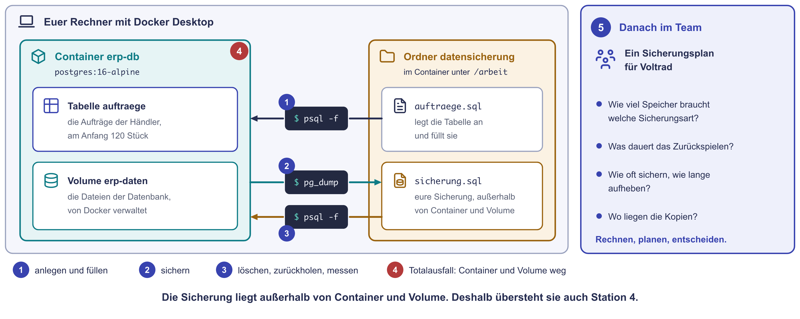

# Praxis: Datensicherung für Voltrad

Herr Kaya wollte eine Testtabelle löschen und hat die falsche erwischt: die
Aufträge der Warenwirtschaft. Ein zweiter Server, der jede Änderung sofort
übernimmt, hätte nichts genützt. Er hätte das Löschen ebenfalls übernommen.
Helfen kann jetzt nur eine Sicherung, also ein früherer Stand auf einem
anderen Gerät.

Heute spielt ihr genau das durch. Die Warenwirtschaft läuft als
**PostgreSQL-Datenbank in einem Container** auf eurem Rechner. Ihr sichert
sie, löscht die Tabelle mit den Aufträgen, holt sie zurück und messt dabei
zwei Zahlen: wie viele Aufträge verloren sind und wie lange es gedauert hat.
Danach plant ihr im Team, wie Voltrad seine Daten künftig sichert.

!!! abstract "Ziel"
    Am Ende könnt ihr:

    - eine Datenbank mit ihrem eigenen Werkzeug sichern und zurückspielen
    - an einer eigenen Messung erklären, was RPO und RTO bedeuten
    - zeigen, warum eine Sicherung außerhalb von Container und Volume liegen muss
    - voll, differenziell und inkrementell nach Speicherbedarf und Aufwand beim Zurückholen vergleichen
    - einen Sicherungsplan mit Generationen und Kopien nach 3-2-1-1-0 entwerfen

    Für die Schnellen gibt es drei Bonus-Aufgaben und eine Denkaufgabe.

!!! note "Windows-Hinweis"
    Unter Windows nutzt ihr die **PowerShell** im Terminal von VS Code
    (**Terminal → Neues Terminal**, englisch **Terminal → New Terminal**).
    Alle Befehle mit `docker` laufen in PowerShell, im Terminal von macOS und
    unter Linux gleich. Wo sich etwas unterscheidet, gibt es Tabs. Die
    Eingabeaufforderung (CMD) und Git Bash nutzt ihr heute nicht.

!!! info "Was ihr braucht"
    **Docker Desktop** vom Docker-Abend und **VS Code**. Startet Docker
    Desktop gleich zu Beginn, der Start dauert eine Minute. Läuft Docker bei
    euch nicht, arbeitet ihr am geteilten Bildschirm einer anderen Person aus
    eurem Raum mit. Station 5 braucht nur einen Taschenrechner.

??? info "pg_dump und psql in Kürze"
    PostgreSQL kennt ihr vom Docker-Abend. Neu sind zwei Programme, die im
    Image `postgres:16-alpine` schon enthalten sind:

    | | pg_dump | psql |
    |---|---|---|
    | **Was das ist** | Ein Programm, das eine Datenbank in eine Datei schreibt: Tabellen und Daten als SQL-Befehle zum Zurückspielen. | Ein Programm, das SQL-Befehle an die Datenbank schickt und ihre Antwort zeigt. |
    | **Warum gerade das** | Es liefert einen stimmigen Stand aus einem Zeitpunkt, auch wenn währenddessen Aufträge eingehen. Eine Kopie der Datenbankdateien im laufenden Betrieb tut das nicht. | Es spielt eine Sicherung von pg_dump wieder ein und zählt danach nach, was zurück ist. |
    | **So arbeiten wir heute damit** | Ein Befehl im Container schreibt die Sicherung in euren Ordner. | Immer über `docker exec` im Container: Tabelle anlegen, zählen, löschen, zurückspielen. |

    Jede Datenbank hat so ein Werkzeug. Voltrads echte Warenwirtschaft läuft
    mit SQL Server, dort heißt es anders, das Prinzip ist dasselbe.

!!! tip "So arbeitet ihr heute"
    Die Stationen 1 bis 4 macht jede Person am eigenen Rechner. Station 5
    macht ihr im Team: Eine Person teilt den Bildschirm, eine zweite schreibt
    die Ergebnisse auf. Ihr schreibt keinen Code selbst, Befehle und die
    Datei kopiert ihr von dieser Seite. Unter den Stationen stehen Hinweise
    zum Aufklappen. Notiert eure Vorhersagen, bevor ihr einen Befehl
    ausführt.

## Was ihr heute baut

| Station | Was passiert | Form | Zeit |
|---|---|---|---|
| 1 | Die Warenwirtschaft im Container starten und mit 120 Aufträgen füllen | allein | 10 Min. |
| 2 | Sichern mit `pg_dump` und die Sicherung ansehen | allein | 10 Min. |
| 3 | Neue Aufträge, der Fehler, zurückspielen, messen | allein | 15 Min. |
| 4 | Totalausfall: Container und Volume weg, neu aufbauen | allein | 10 Min. |
| 5 | Ein Sicherungsplan für Voltrad | im Team | 20 Min. |

{ .diagramm }

**Euer Messprotokoll.** In Station 2 und 3 notiert ihr Uhrzeiten. Legt dafür
in VS Code oder auf Papier eine Notiz an und übertragt diese Tabelle:

| Was | Uhrzeit | Aufträge laut Zählung |
|---|---|---|
| Sicherung mit `pg_dump` (Station 2) | | |
| Neue Aufträge angelegt (Station 3) | | |
| Fehler: Tabelle gelöscht (Station 3) | | |
| Zurückgespielt und gezählt (Station 3) | | |

---

## Station 1: Die Warenwirtschaft im Container (10 Minuten, allein)

**Was ihr hier tut:** Ihr startet eine PostgreSQL-Datenbank als Container
und legt darin die Tabelle der Aufträge an.

1. Startet **Docker Desktop** und wartet, bis es läuft. Öffnet dann in VS
   Code über **Datei → Ordner öffnen** einen neuen, leeren Ordner
   `datensicherung`, zum Beispiel unter Dokumente. Öffnet darin ein Terminal
   (**Terminal → Neues Terminal**). Es steht jetzt in diesem Ordner. Prüft,
   ob Docker antwortet:

    ```bash
    docker ps
    ```

    Kommt eine Tabellenzeile mit `CONTAINER ID`, läuft Docker. Kommt eine
    Fehlermeldung, seht in [Wenn es klemmt](#wenn-es-klemmt) nach.

2. Legt in VS Code im Ordner eine neue Datei `auftraege.sql` an und kopiert
   diesen Inhalt hinein. Speichern nicht vergessen.

    ```sql
    -- Die Warenwirtschaft von Voltrad, stark vereinfacht:
    -- eine Tabelle mit den Aufträgen der Fachhändler.
    -- Läuft die Datei ein zweites Mal, beginnt die Tabelle von vorn.
    DROP TABLE IF EXISTS auftraege;

    CREATE TABLE auftraege (
      nr       serial PRIMARY KEY,            -- fortlaufende Auftragsnummer
      haendler text NOT NULL,                 -- welcher Fachhändler bestellt hat
      modell   text NOT NULL,                 -- welches Modell
      eingang  timestamp(0) NOT NULL DEFAULT now()  -- wann der Auftrag einging
    );

    -- Die Aufträge der letzten acht Stunden: 120 Stück,
    -- so viele Räder baut Voltrad am Tag.
    INSERT INTO auftraege (haendler, modell, eingang)
    SELECT 'Fachhandel ' || (1 + mod(g * 37, 600)),
           (ARRAY['City', 'Trekking', 'Cargo'])[1 + mod(g, 3)],
           now() - interval '8 hours' + g * interval '4 minutes'
    FROM generate_series(1, 120) AS g;
    ```

3. Startet den Container. Der Befehl ist eine einzige lange Zeile, kopiert
   ihn mit dem Knopf rechts im Kasten:

    ```bash
    docker run -d --name erp-db -e POSTGRES_USER=voltrad -e POSTGRES_PASSWORD=Uebung2026 -e POSTGRES_DB=erp -e TZ=Europe/Berlin -v erp-daten:/var/lib/postgresql/data -v "${PWD}:/arbeit" postgres:16-alpine
    ```

    Beim ersten Mal lädt Docker das Image herunter, das kann eine Minute
    dauern. Die Teile bedeuten:

    | Teil | Bedeutung |
    |---|---|
    | `--name erp-db` | Der Container heißt `erp-db`. |
    | `-e POSTGRES_USER=voltrad` und die beiden folgenden | Benutzer, Übungspasswort und Name der Datenbank `erp`. |
    | `-e TZ=Europe/Berlin` | Die Datenbank rechnet mit unserer Uhrzeit. |
    | `-v erp-daten:/var/lib/postgresql/data` | Die Dateien der Datenbank liegen im Volume `erp-daten`. |
    | `-v "${PWD}:/arbeit"` | Euer Ordner `datensicherung` erscheint im Container als `/arbeit`. `${PWD}` steht für den Ordner, in dem das Terminal gerade steht. |

4. Wartet etwa zehn Sekunden, bis die Datenbank bereit ist. Dann legt ihr
   die Tabelle an:

    ```bash
    docker exec erp-db psql -U voltrad -d erp -f /arbeit/auftraege.sql
    ```

    Die Ausgabe endet mit `INSERT 0 120`. Die Zeile `NOTICE: table
    "auftraege" does not exist, skipping` davor ist nur ein Hinweis: Beim
    ersten Mal gab es noch keine Tabelle zum Entfernen.

5. Zählt die Aufträge und seht euch die drei neuesten an:

    ```bash
    docker exec erp-db psql -U voltrad -d erp -c "SELECT count(*) FROM auftraege"
    ```

    ```bash
    docker exec erp-db psql -U voltrad -d erp -c "SELECT * FROM auftraege ORDER BY nr DESC LIMIT 3"
    ```

    Ihr seht 120 Aufträge. Der neueste hat die Nummer 120 und als Eingang
    ungefähr die jetzige Uhrzeit.

??? tip "Hinweise zu Station 1"
    Öffnet die Hinweise nacheinander.

    1. `docker exec erp-db` heißt: Führe den folgenden Befehl im Container
       `erp-db` aus. `psql -U voltrad -d erp` meldet sich als Benutzer
       `voltrad` an der Datenbank `erp` an. `-f` nimmt die Befehle aus einer
       Datei, `-c` nimmt genau einen Befehl.
    2. Findet `psql` die Datei `/arbeit/auftraege.sql` nicht, war das
       Terminal beim `docker run` in einem anderen Ordner. Prüft mit `ls`, ob
       `auftraege.sql` im aktuellen Ordner liegt. Seht dann in „Wenn es
       klemmt“ nach.

---

## Station 2: Sichern (10 Minuten, allein)

**Was ihr hier tut:** Ihr sichert die Datenbank mit `pg_dump` in euren
Ordner und seht euch an, was in einer Sicherung steht.

1. Sichert die Datenbank:

    ```bash
    docker exec erp-db pg_dump -U voltrad -d erp --clean --if-exists -f /arbeit/sicherung.sql
    ```

    Kommt keine Ausgabe, hat es geklappt. `--clean --if-exists` schreibt vor
    jede Tabelle einen Befehl, der eine vorhandene Fassung erst entfernt. So
    lässt sich die Sicherung auch über eine beschädigte Tabelle
    zurückspielen.

2. Tragt die **Uhrzeit** und die Zahl der Aufträge in euer Messprotokoll ein.

3. Öffnet `sicherung.sql` in VS Code, die Datei steht links im Explorer.
   Sucht diese drei Stellen:

    - den Befehl, der die Tabelle `auftraege` neu anlegt
    - den Block mit den Aufträgen selbst und darin den Auftrag 120
    - die Zeile, die festlegt, welche Nummer der nächste Auftrag bekommt

4. **Frage:** Die Sicherung liegt jetzt neben dem Container auf eurem
   Rechner. Welche der drei Eigenschaften einer Sicherung erfüllt sie schon:
   zeitversetzt, unabhängig, geprüft? Was fehlt noch?

??? tip "Hinweise zu Station 2"
    1. Sucht in VS Code mit ++ctrl+f++ (Mac: ++cmd+f++) nach `CREATE TABLE`
       und nach `COPY`.
    2. Die Aufträge stehen zwischen der Zeile mit `COPY` und einer Zeile, auf
       der nur `\.` steht.
    3. Die nächste Nummer verwaltet eine eigene Zählstelle der Datenbank, eine
       Sequenz. Sucht nach `setval`.
    4. Zur Frage: Was passiert mit der Datei, wenn euer Laptop ausfällt? Und
       hat schon jemand ausprobiert, ob sie sich zurückspielen lässt?

---

## Station 3: Der Fehler (15 Minuten, allein)

**Was ihr hier tut:** Nach der Sicherung gehen weitere Aufträge ein. Dann
löscht Herr Kaya die Tabelle. Ihr holt sie zurück und messt, was verloren
ist und wie lange es gedauert hat.

1. Es kommen 15 neue Aufträge herein:

    ```bash
    docker exec erp-db psql -U voltrad -d erp -c "INSERT INTO auftraege (haendler, modell) SELECT 'Fachhandel ' || g, 'Cargo' FROM generate_series(601, 615) AS g"
    ```

    Zählt nach und tragt Uhrzeit und Zahl ins Messprotokoll ein:

    ```bash
    docker exec erp-db psql -U voltrad -d erp -c "SELECT count(*) FROM auftraege"
    ```

2. Jetzt passiert der Fehler. Tragt die **Uhrzeit** ein, sobald ihr den
   Befehl ausgeführt habt. Ab diesem Moment läuft eure Wiederherstellung.

    ```bash
    docker exec erp-db psql -U voltrad -d erp -c "DROP TABLE auftraege"
    ```

    Zählt noch einmal. Die Datenbank meldet, dass es die Tabelle nicht mehr
    gibt:

    ```bash
    docker exec erp-db psql -U voltrad -d erp -c "SELECT count(*) FROM auftraege"
    ```

3. Spielt die Sicherung zurück:

    ```bash
    docker exec erp-db psql -U voltrad -d erp -f /arbeit/sicherung.sql
    ```

    Es laufen viele Zeilen durch. Achtet auf die Zeile, die mit `COPY`
    beginnt.

4. **Vorhersage:** Wie viele Aufträge zählt die Datenbank jetzt? Notiert
   eure Zahl, dann prüft. Tragt danach die **Uhrzeit** ins Messprotokoll
   ein.

    ```bash
    docker exec erp-db psql -U voltrad -d erp -c "SELECT count(*) FROM auftraege"
    ```

5. Rechnet mit eurem Messprotokoll:

    - **RPA** (Recovery Point Actual): Wie viel Zeit liegt zwischen der
      Sicherung und dem Fehler? Wie viele Aufträge fehlen?
    - **RTA** (Recovery Time Actual): Wie viel Zeit liegt zwischen dem Fehler
      und dem Moment, in dem ihr gezählt habt? Wie viel davon hat allein das
      Zurückspielen gedauert?

6. Ein Händler bestellt gleich nach der Rücksicherung ein neues Rad. Welche
   Nummer bekommt sein Auftrag?

    ```bash
    docker exec erp-db psql -U voltrad -d erp -c "INSERT INTO auftraege (haendler, modell) VALUES ('Fachhandel 7', 'City') RETURNING nr"
    ```

**Frage 1:** Was bedeutet diese Nummer für den Händler, der heute schon einen
der verlorenen Aufträge abgeschickt hat?

**Frage 2:** Herr Becker erlaubt höchstens eine Stunde Datenverlust. Reicht
eine Sicherung pro Nacht? Wie oft müsste Voltrad die Warenwirtschaft
sichern?

??? tip "Hinweise zu Station 3"
    1. Die Sicherung kennt nur den Stand aus Station 2. Alles, was danach
       kam, steht nicht darin.
    2. Die Zeile `COPY 120` sagt, wie viele Datensätze zurückgespielt wurden.
    3. Für die RTA zählt die ganze Zeit vom Fehler bis zur Prüfung: merken,
       den richtigen Befehl finden, zurückspielen, zählen.
    4. Zu Frage 1: Die Sicherung hat auch den Stand der Zählstelle
       gespeichert, die die Nummern vergibt.
    5. Zu Frage 2: Der Abstand zwischen zwei Sicherungen ist der größte
       mögliche Datenverlust.

---

## Station 4: Totalausfall (10 Minuten, allein)

**Was ihr hier tut:** Diesmal ist nicht nur eine Tabelle weg, sondern der
ganze Server mit seinen Platten. Ihr baut ihn neu auf und spielt die
Sicherung ein.

1. Der Server fällt aus. Ihr löscht den Container und das Volume mit den
   Dateien der Datenbank:

    ```bash
    docker rm -f erp-db
    ```

    ```bash
    docker volume rm erp-daten
    ```

2. Neuer Server, leere Datenbank: Startet den Container mit demselben
   Befehl wie in Station 1, Schritt 3. Mit der Pfeiltaste nach oben holt ihr
   frühere Befehle zurück, meist braucht es mehrere Tastendrücke. Wartet danach etwa zehn
   Sekunden.

3. **Vorhersage:** Was meldet die Zählung jetzt? Notiert es, dann prüft:

    ```bash
    docker exec erp-db psql -U voltrad -d erp -c "SELECT count(*) FROM auftraege"
    ```

4. Spielt die Sicherung zurück und zählt noch einmal:

    ```bash
    docker exec erp-db psql -U voltrad -d erp -f /arbeit/sicherung.sql
    ```

    ```bash
    docker exec erp-db psql -U voltrad -d erp -c "SELECT count(*) FROM auftraege"
    ```

**Frage 3:** Warum hat das funktioniert, obwohl Container und Volume weg
waren? Was wäre passiert, wenn `sicherung.sql` im Volume gelegen hätte? Und
was, wenn statt des Containers euer ganzer Laptop ausfällt?

??? tip "Hinweise zu Station 4"
    1. Ein frisches Volume enthält nur eine leere Datenbank `erp`, ohne
       Tabellen.
    2. Wo liegt die Datei `sicherung.sql`? Im Container, im Volume oder in
       eurem Ordner?
    3. Denkt an die Regel 3-2-1 aus dem Speicher-Abend.

---

## Station 5: Ein Sicherungsplan für Voltrad (20 Minuten, im Team)

**Was ihr hier tut:** Ihr plant, wie Voltrad nach dem Sollkonzept seine
Daten im Werk sichert. Ihr rechnet, füllt einen Plan aus und trefft eine
Entscheidung. Alle Zahlen stehen auf der Karte.

{ .diagramm }

??? note "Die Karte als Text"
    | Was | Wert |
    |---|---|
    | Virtuelle Maschinen (Warenwirtschaft, Fertigung, Anmeldung, Druck, Broker) | 1.400 GB, davon ändern sich je Tag 30 GB |
    | CAD-Daten der Konstruktion | 600 GB, davon ändern sich je Tag 20 GB |
    | Zusammen | 2.000 GB, je Tag 50 GB. Angenommen: jeden Tag andere Daten. |
    | Vollsicherung | samstags |
    | Weitere Läufe | Montag bis Freitag um 22 Uhr, nach der Spätschicht |
    | Durchsatz zum Sicherungsziel | 100 MB/s. Rechnet mit 1 GB = 1.000 MB. |
    | Annahme für Teil a | Am Freitag um 14 Uhr fällt der Speicher im Werk aus. |

    - Herr Becker, Finanzen: „Höchstens die Buchungen der letzten Stunde
      dürfen fehlen.“
    - Herr Lindner, Konstruktion: „Einen Arbeitstag holen wir nach. Oft
      merken wir erst nach Wochen, dass jemand eine Zeichnung überschrieben
      hat.“
    - Frau Vogt, IT: „Wir sind zu zweit. Nachts und am Wochenende ist
      niemand da.“

### Teil a: Rechnen

1. Wie viel Speicher braucht eine Woche auf dem Sicherungsziel, wenn Voltrad
   (a) jeden Lauf als Vollsicherung macht, (b) samstags voll und Montag bis
   Freitag **differenziell** sichert, (c) samstags voll und Montag bis
   Freitag **inkrementell** sichert?
2. Am Freitag um 14 Uhr fällt der Speicher aus. Welche Sicherungsläufe
   braucht ihr bei (a), (b) und (c) zum Zurückspielen? Wie viele GB sind das
   jeweils?
3. Wie lange dauert es, diese Datenmenge bei 100 MB/s zurückzuspielen?
   Vergleicht mit Herrn Yilmaz: Nach zehn Minuten stehen die Bänder.
4. Wie viele Stunden Buchungen fehlen der Warenwirtschaft, wenn nur nachts
   gesichert wird? Vergleicht mit Herrn Becker.

### Teil b: Den Plan ausfüllen

Übertragt die Tabelle in eure Notiz und füllt sie aus. Für die Spalte
„Aufheben“ hilft die Folie zu den Generationen: Sohn, Vater, Großvater.

| System | Vorgabe der Fachabteilung | Sicherungsart und Rhythmus | Wie lange aufheben? |
|---|---|---|---|
| Warenwirtschaft (Datenbank) | | | |
| CAD-Daten | | | |
| Übrige virtuelle Maschinen | | | |

Legt danach fest, wo die Kopien liegen. Nennt für jede Ziffer der Regel
3-2-1-1-0 einen konkreten Ort oder eine Maßnahme bei Voltrad.

### Teil c: Entscheiden

Differenziell oder inkrementell für die Läufe von Montag bis Freitag?
Begründet eure Wahl in zwei Sätzen mit euren Zahlen aus Teil a.

??? tip "Hinweise zu Station 5"
    Öffnet die Hinweise nacheinander.

    1. **Teil a, Frage 1:** Eine Woche hat hier sechs Läufe, samstags und
       Montag bis Freitag. Differenziell sammelt alles seit der letzten
       Vollsicherung: am Montag 50 GB, am Dienstag 100 GB und so weiter.
    2. **Teil a, Frage 2:** Der letzte Lauf vor Freitag 14 Uhr war am
       Donnerstag um 22 Uhr. Differenziell braucht die Vollsicherung und den
       letzten differenziellen Lauf, inkrementell jeden Lauf seit der
       Vollsicherung.
    3. **Teil a, Frage 3:** GB mal 1.000 ergibt MB, geteilt durch 100 MB/s
       ergibt Sekunden. Was heißt das Ergebnis für ein System, das nach zehn
       Minuten wieder laufen muss?
    4. **Teil b:** Eine Datenbank kann zusätzlich ihr Transaktionsprotokoll
       sichern. Dort schreibt sie jede Änderung zuerst hinein. Herr Lindners
       zweiter Satz entscheidet, wie weit die CAD-Daten zurückreichen
       müssen.
    5. **Kopien:** Wo stand BACKUP-01 in der Bestandsaufnahme? Was
       übersteht einen Brand im Werk, was einen Angreifer mit Adminrechten?

Die Lösung besprechen wir gemeinsam nach der Praxiszeit.

---

## Bonus für die Schnellen

Die Reihenfolge ist frei. Die ersten drei Aufgaben dauern je etwa fünf bis
acht Minuten, die Denkaufgabe etwa zwölf.

### Bonus 1: Die Probe in einer eigenen Datenbank (5 Minuten)

Eine Probe-Rücksicherung spielt man nicht über die laufende Datenbank,
sondern daneben. Legt eine zweite Datenbank `erp_probe` an und spielt die
Sicherung dort ein:

```bash
docker exec erp-db createdb -U voltrad erp_probe
```

```bash
docker exec erp-db psql -U voltrad -d erp_probe -f /arbeit/sicherung.sql
```

```bash
docker exec erp-db psql -U voltrad -d erp_probe -c "SELECT count(*) FROM auftraege"
```

Warum testet man nicht einfach in `erp`?

??? success "Musterlösung Bonus 1"
    In `erp_probe` stehen danach die 120 Aufträge aus der Sicherung. Die
    Datenbank `erp` läuft in der Zeit unverändert weiter, mit allen
    Aufträgen, die seit der Sicherung dazugekommen sind.

    Eine Probe über die laufende Datenbank würde genau diese Aufträge
    überschreiben. Deshalb prüft man in einer eigenen Datenbank oder, bei
    ganzen Servern, in einer abgetrennten Testumgebung. Dort lässt sich
    zählen, öffnen und vergleichen, ohne den Betrieb zu stören.

### Bonus 2: Eine Million Aufträge (8 Minuten)

Mit 120 Aufträgen dauert das Zurückspielen weniger als eine Sekunde. Wie
sieht es mit dem Archiv der letzten Jahre aus? Legt eine Million alte
Aufträge an:

```bash
docker exec erp-db psql -U voltrad -d erp -c "INSERT INTO auftraege (haendler, modell, eingang) SELECT 'Archiv ' || mod(g, 600), 'Trekking', now() - g * interval '1 minute' FROM generate_series(1, 1000000) AS g"
```

Messt, wie lange Sichern und Zurückspielen dauern. Für das Zurückspielen
braucht ihr `erp_probe` aus Bonus 1.

=== "Windows (PowerShell)"

    ```powershell
    Measure-Command { docker exec erp-db pg_dump -U voltrad -d erp --clean --if-exists -f /arbeit/gross.sql }
    ```

    ```powershell
    Measure-Command { docker exec erp-db psql -q -U voltrad -d erp_probe -f /arbeit/gross.sql }
    ```

    Die Dauer steht in der Zeile `TotalSeconds`.

=== "macOS / Linux"

    ```bash
    time docker exec erp-db pg_dump -U voltrad -d erp --clean --if-exists -f /arbeit/gross.sql
    ```

    ```bash
    time docker exec erp-db psql -q -U voltrad -d erp_probe -f /arbeit/gross.sql
    ```

    Die Dauer steht in der Zeile mit `real` oder `total`.

Seht im Explorer von VS Code nach, wie groß `gross.sql` ist. Rechnet dann
grob hoch: Wie lange dauert das Zurückspielen bei einer Datenbank mit 80 GB?

??? success "Musterlösung Bonus 2"
    Auf einem aktuellen Laptop dauern Sichern und Zurückspielen je wenige
    Sekunden, die Datei ist rund 45 MB groß. Beispiel: 2,4 Sekunden für 45
    MB. 80 GB sind 80.000 MB, also gut das 1.700-Fache. 2,4 Sekunden mal
    1.700 sind rund 4.000 Sekunden, also über eine Stunde.

    Die Rechnung ist grob: Echte Datenbanken haben Indizes, die beim
    Zurückspielen neu aufgebaut werden. Auch die Platten im Rechenzentrum
    sind anders schnell. Die Richtung stimmt aber: Mit der Datenmenge wächst
    die Zeit zum Zurückspielen und damit die RTO, die sich überhaupt
    einhalten lässt. Genau das zeigt eine Probe-Rücksicherung in echter
    Größe.

### Bonus 3: Ist die Kopie heil? (5 Minuten)

Eine Sicherung, die beim Kopieren beschädigt wurde, merkt man erst beim
Zurückspielen. Eine Prüfsumme zeigt es sofort: Ändert sich auch nur ein
Zeichen, ändert sich die ganze Summe. Kopiert eure Sicherung und vergleicht:

=== "Windows (PowerShell)"

    ```powershell
    Copy-Item sicherung.sql kopie.sql
    ```

    ```powershell
    Get-FileHash sicherung.sql, kopie.sql
    ```

=== "macOS"

    ```bash
    cp sicherung.sql kopie.sql
    ```

    ```bash
    shasum -a 256 sicherung.sql kopie.sql
    ```

=== "Linux"

    ```bash
    cp sicherung.sql kopie.sql
    ```

    ```bash
    sha256sum sicherung.sql kopie.sql
    ```

Öffnet danach `kopie.sql` in VS Code, ändert bei einem Auftrag eine einzige
Ziffer, speichert und berechnet die Prüfsummen noch einmal.

??? success "Musterlösung Bonus 3"
    Direkt nach dem Kopieren sind beide Prüfsummen gleich: Die Kopie ist
    Zeichen für Zeichen identisch. Nach der Änderung einer einzigen Ziffer
    ist die Prüfsumme von `kopie.sql` eine völlig andere.

    Sicherungsprogramme nutzen genau das. Sie speichern zu jeder Sicherung
    eine Prüfsumme und vergleichen sie beim Prüflauf. So fällt eine
    beschädigte Kopie auf, bevor man sie im Ernstfall braucht. Das ist ein
    Teil der Null in 3-2-1-1-0. Den Test durch eine echte Rücksicherung
    ersetzt es aber nicht: Die Prüfsumme sagt nur, dass die Datei
    unverändert ist, nicht, dass sich daraus ein laufendes System machen
    lässt.

### Denkaufgabe: Wiederanlauf nach dem Brand (12 Minuten)

In der Nacht zum Dienstag brennt Voltrads Serverraum aus. Am Dienstagmorgen
stehen neue Hosts und ein neuer Switch in einem Ausweichraum, Strom und
Internetleitung sind da. Die Sicherung liegt als Kopie in der Cloud. Frau
Vogt und Herr Kaya sind zu zweit.

Bringt diese Systeme in eine Reihenfolge und begründet die ersten fünf
Schritte: Anmeldung (DC-01, DC-02), CAD-Daten, Druckserver, Fertigungsleitsystem
(MES-01), Firewall (FW-01), MQTT-Broker, Monitoring (MON-01), neuer
Sicherungsserver, Virtualisierungshosts mit Speicher, Warenwirtschaft
(ERP-DB und ERP-APP).

Schreibt zu jedem Schritt ein Prüfkriterium: Woran erkennt ihr, dass er
geklappt hat?

??? success "Musterlösung Denkaufgabe"
    Eine gut begründete Reihenfolge, andere sind möglich, solange keine
    Abhängigkeit verletzt wird:

    | Schritt | System | Warum hier | Prüfkriterium |
    |---|---|---|---|
    | 1 | Firewall FW-01 und Netz | Ohne Netz kommt keine Sicherung aus der Cloud und kein System ist erreichbar. | Der Ausweichraum erreicht das Internet, intern antworten die Hosts. |
    | 2 | Virtualisierungshosts mit Speicher | Auf ihnen laufen alle anderen Server. | Beide Hosts melden sich, der Speicher ist auf beiden sichtbar. |
    | 3 | Neuer Sicherungsserver | Ohne ihn lässt sich nichts zurückspielen. Er holt die Kopie aus der Cloud. | Die Sicherungen sind gelistet, eine Prüfsumme stimmt. |
    | 4 | Monitoring MON-01 | Ab jetzt sieht die IT, was läuft und was nicht, statt jedes System von Hand zu prüfen. | Die Hosts erscheinen im Monitoring. |
    | 5 | Anmeldung DC-01, DC-02 | Sie liefern die Anmeldung und meist auch die Namensauflösung. Ohne sie finden und starten die anderen Server nicht sauber. Die Uhrzeit muss stimmen, sonst scheitert die Anmeldung. | Ein Testkonto meldet sich an, die Uhrzeit stimmt. |
    | 6 | Warenwirtschaft: erst ERP-DB, dann ERP-APP | Das Fertigungsleitsystem holt seine Aufträge dort ab. Die Datenbank kommt vor der Anwendung. | Eine Testabfrage liefert Aufträge, ein Auftrag lässt sich öffnen. |
    | 7 | Fertigungsleitsystem MES-01 | Danach laufen die Bänder wieder. | Ein Montageplatz zeigt seinen nächsten Auftrag. |
    | 8 | MQTT-Broker | Die Prüfstände melden ihre Messwerte. Er hängt an keinem anderen System und darf auch parallel zu Schritt 6 starten. | Ein Prüfstand meldet einen Messwert. |
    | 9 | CAD-Daten | Die Konstruktion kann einen Tag nacharbeiten, die Datenmenge ist groß. | Eine Zeichnung lässt sich öffnen. |
    | 10 | Druckserver | Am wenigsten dringend. Bis dahin druckt die Halle nicht. | Ein Testdruck kommt an. |

    Zwei Gedanken dahinter: Zuerst kommt alles, wovon andere abhängen, also
    Netz, Hosts, die Sicherung selbst und die Anmeldung. Danach entscheidet
    das Geschäft: Die Fertigung kommt vor der Konstruktion und dem Druck.
    Zwei Personen schaffen nicht alles gleichzeitig. Deshalb lohnt es sich,
    diese Liste vorher aufzuschreiben und nicht erst im Ausweichraum.

    Und eine Rechnung, die oft vergessen wird: Liegen 2.000 GB in der Cloud,
    dauert allein der Download bei 1 Gbit/s, also rund 100 MB/s, gut fünf
    Stunden. Deshalb holt man zuerst die Sicherungen der Systeme, die
    zuerst gebraucht werden.

---

## Aufräumen

Den Container und das Volume braucht ihr nicht mehr:

```bash
docker rm -f erp-db
```

```bash
docker volume rm erp-daten
```

Den Ordner `datensicherung` könnt ihr behalten oder im Explorer löschen.
Das Image `postgres:16-alpine` bleibt auf eurem Rechner. Wer den Platz
zurückhaben möchte, entfernt es mit `docker image rm postgres:16-alpine`.

---

## Wenn es klemmt

| Was ihr seht | Woran es liegt | Was hilft |
|---|---|---|
| `error during connect` oder `Cannot connect to the Docker daemon` | Docker Desktop läuft nicht | Docker Desktop starten und warten, bis unten links „Engine running“ steht. Dann den Befehl wiederholen. |
| `Die Benennung "docker" wurde nicht als Name eines Cmdlet … erkannt` oder `The term 'docker' is not recognized` | Docker Desktop ist nicht installiert oder das Terminal kennt es noch nicht | VS Code ganz schließen und neu öffnen. Hilft das nicht, arbeitet ihr am Bildschirm einer anderen Person mit. |
| `Conflict. The container name "/erp-db" is already in use` | Es gibt schon einen Container mit diesem Namen | In Station 1: `docker rm -f erp-db` und `docker volume rm erp-daten`, dann `docker run` noch einmal. |
| `connection to server on socket ... failed: No such file or directory` | Die Datenbank startet noch | Zehn Sekunden warten und den Befehl wiederholen. |
| `/arbeit/auftraege.sql: No such file or directory` | Die Datei fehlt im Ordner, heißt anders oder das Terminal stand beim `docker run` in einem anderen Ordner | Mit `ls` prüfen, ob `auftraege.sql` im Ordner liegt. Wenn ja: `docker rm -f erp-db`, `docker volume rm erp-daten`, dann `docker run` aus diesem Ordner noch einmal. |
| `invalid reference format` beim `docker run` | Die lange Zeile wurde nicht vollständig kopiert | Mit dem Kopierknopf rechts im Kasten neu kopieren und einfügen. |
| `volume is in use` beim Löschen des Volumes | Der Container existiert noch | Erst `docker rm -f erp-db`, dann das Volume löschen. |
| `ERROR: relation "auftraege" does not exist` | Die Tabelle gibt es nicht | In Station 3 nach dem Fehler und in Station 4 nach dem Neuaufbau ist das gewollt. Sonst die Datei `auftraege.sql` erneut ausführen. |
| Der Pfad `/arbeit` wird zu `C:/Program Files/Git/arbeit` | Ihr arbeitet in Git Bash, das Pfade umschreibt | Ein PowerShell-Terminal öffnen: in VS Code rechts neben dem Plus im Terminal den Pfeil, dann PowerShell. |
| macOS: `Mounts denied` | Der Ordner liegt außerhalb eures Benutzerordners | Den Ordner `datensicherung` unter Dokumente anlegen und dort neu starten. |
| Die Zählung zeigt mehr Aufträge als erwartet | Ein Befehl lief zweimal, zum Beispiel die 15 neuen Aufträge | Kein Problem. Rechnet mit euren eigenen Zahlen aus dem Messprotokoll. |

---

## Was ihr zur Auswertung mitbringt

1. Was stand in eurer Datei `sicherung.sql`? Woran erkennt ihr, dass die
   Aufträge darin sind?
2. Eure Messung: Wie viele Aufträge fehlten, wie lange hat es gedauert? Was
   hat die Zeit gekostet?
3. Warum hat Station 4 geklappt? Was hätte die Rücksicherung dort
   verhindert?
4. Euer Plan: Wie oft sichert Voltrad die Warenwirtschaft und wo liegen die
   Kopien?
5. Denkfrage: Montag, 6:10 Uhr, auf den Bildschirmen der Montage steht eine
   Lösegeldforderung. Die Sicherung ist da. Wer entscheidet jetzt, was
   zuerst passiert?

---

## Weiterlesen

- [Backup & Recovery](backup-und-recovery.md): Sicherungsarten,
  3-2-1-1-0, Generationen, RTO und RPO, Wiederanlaufplan
- [Hochverfügbarkeit & Redundanz](hochverfuegbarkeit.md): warum Redundanz
  den Betrieb hält, aber keine Sicherung ersetzt
- [Speicherlösungen](../infrastruktur-planung/speicherloesungen.md): RAID und
  die Regel 3-2-1
