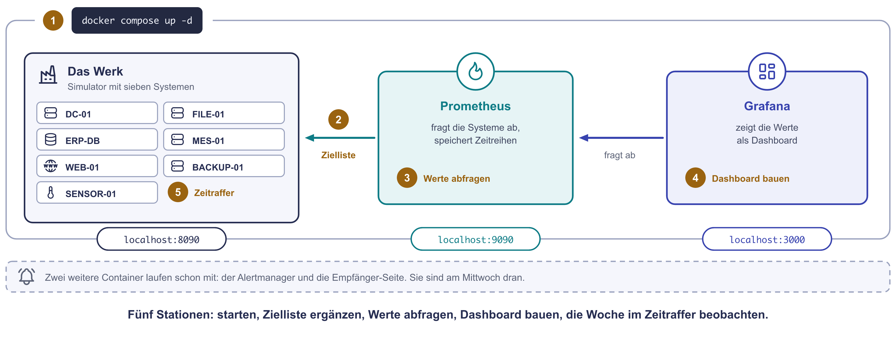
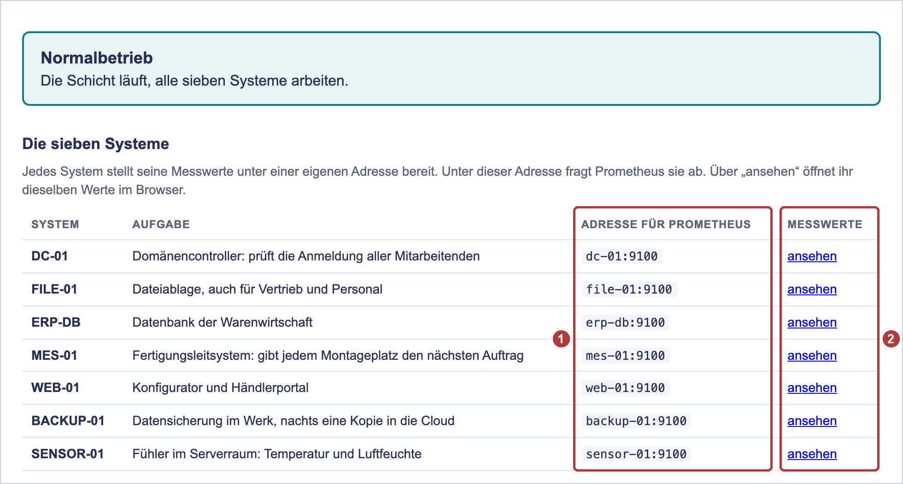
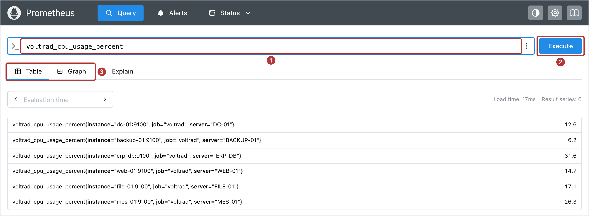
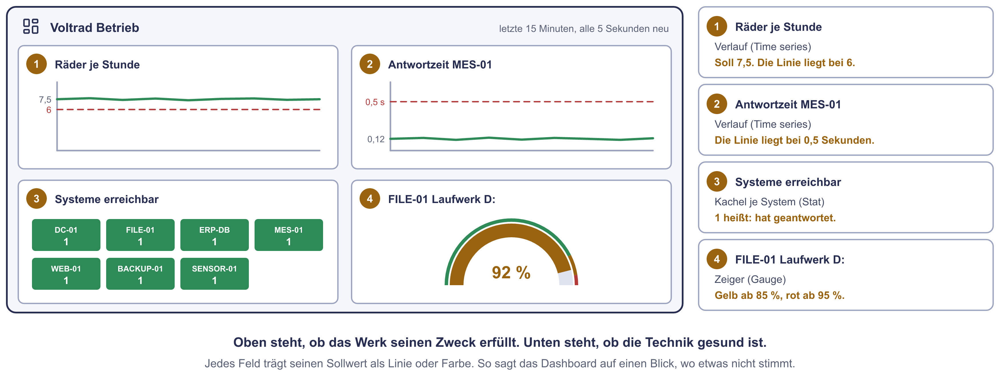
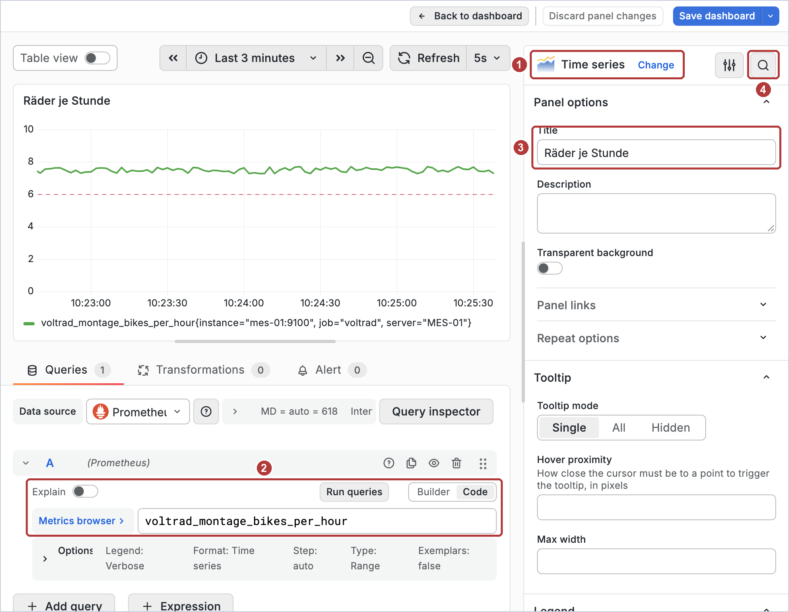
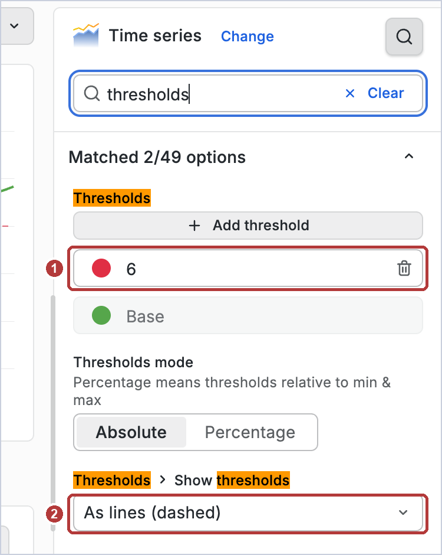
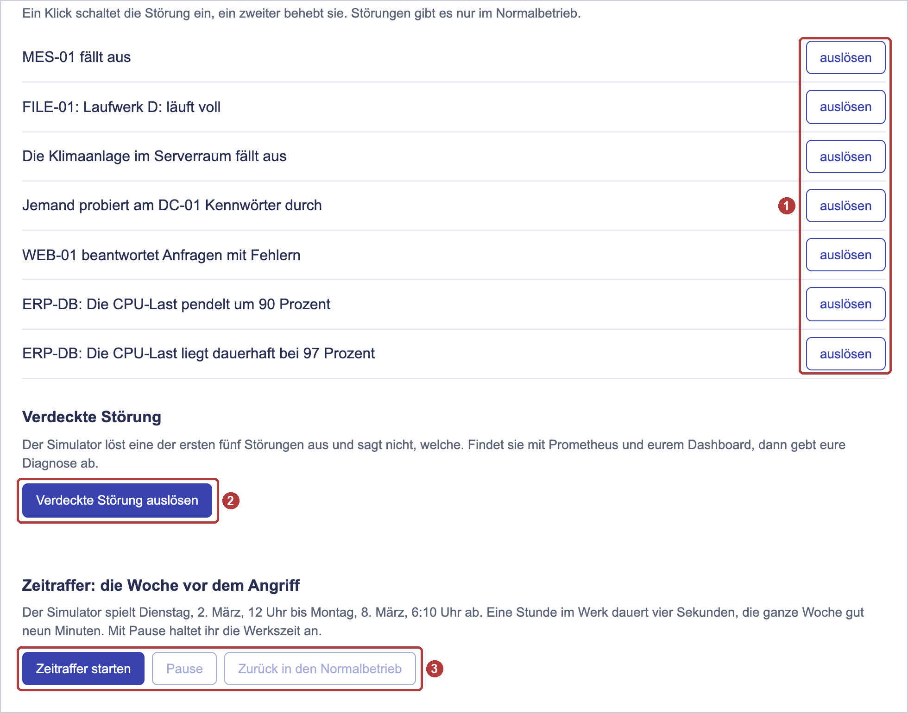

# Praxis: Monitoring für Voltrad

Im Planspiel habt ihr die Spur des Angreifers im Protokoll gefunden. Dieselbe
Datei zeigt noch etwas: Der Überwachungsserver MON-01 hat in der Woche vor
dem Angriff elf Warnungen verschickt. Die erste kam am Donnerstag um
2:32 Uhr, vier Tage vor dem Anruf von Herrn Yilmaz. Alle elf gingen an
`brandt@voltrad.example`, das Postfach des früheren Administrators.

Der Stab hat daraus eine Maßnahme gemacht: Frau Vogt baut die Überwachung
neu auf. Ihr seid ihr Team. Heute baut ihr den ersten Teil: messen und
sehen. Ihr startet ein simuliertes Werk mit sieben Systemen, lasst
Prometheus die Werte einsammeln und baut in Grafana ein Dashboard. Zum
Schluss läuft die Woche vor dem Angriff im Zeitraffer und ihr prüft, ob euer
Dashboard ihn gezeigt hätte. Das Alarmieren folgt in der
[zweiten Praxis](praxis-alarmierung.md).

!!! abstract "Ziel"
    Am Ende könnt ihr:

    - einen Überwachungsstack aus Prometheus und Grafana starten und prüfen
    - ein System in die Zielliste von Prometheus eintragen
    - Messwerte mit PromQL abfragen: mit Namen, Label, Vergleich und `rate()`
    - ein Dashboard bauen, in dem jedes Feld eine Einheit und einen Sollwert hat
    - an einem Verlauf erkennen, was üblich ist und was nicht

    Für die Schnellen gibt es drei Bonus-Aufgaben und eine Denkaufgabe.

!!! note "Windows-Hinweis"
    Unter Windows nutzt ihr die **PowerShell** im Terminal von VS Code
    (**Terminal → Neues Terminal**, englisch **Terminal → New Terminal**).
    Die `docker`-Befehle sind auf Windows, macOS und Linux gleich.
    **Docker Desktop** muss gestartet sein.

!!! tip "So arbeitet ihr heute"
    Die Stationen 1 bis 4 macht jede Person am eigenen Rechner. Im Raum teilt
    immer eine Person ihren Bildschirm, die anderen bauen mit. Station 5
    macht ihr im Team: Eine Person startet den Zeitraffer und teilt ihr
    Dashboard, eine zweite schreibt mit. Wer kein laufendes Docker hat,
    arbeitet am Bildschirm einer anderen Person mit. Die Stationen bauen
    aufeinander auf, haltet deshalb die Reihenfolge ein. Unter jeder Station
    stehen Hinweise zum Aufklappen. Öffnet sie nacheinander, nicht alle auf
    einmal.

??? info "Prometheus und Grafana in Kürze"
    | | Prometheus | Grafana |
    |---|---|---|
    | **Was das ist** | Ein Programm, das Systeme in festem Takt abfragt und die Antworten mit Uhrzeit speichert. So entstehen Zeitreihen. | Eine Weboberfläche, die Werte aus Prometheus abfragt und als Felder zeichnet. Ein Feld heißt dort Panel. |
    | **Warum gerade das** | Kostenlos, weit verbreitet, in einer Datei eingerichtet und als Container sofort gestartet. | Der übliche Partner von Prometheus. Liest auch viele andere Datenquellen. |
    | **So arbeiten wir heute damit** | Zielliste prüfen und ein Ziel ergänzen, Werte im Browser mit der Abfragesprache PromQL abfragen. | Ein Dashboard mit vier Feldern bauen, jedes mit Einheit und Sollwert. |

    Dieselben Begriffe tragen in anderen Werkzeugen, die euch im Betrieb
    begegnen, zum Beispiel Checkmk, Zabbix, PRTG oder Icinga: Ziel, Messwert,
    Sollwert, Schwelle.

## Was ihr heute macht

| Station | Was passiert | Form | Zeit |
|---|---|---|---|
| 1 | Den Stack starten: fünf Container, drei Seiten im Browser | jede Person | 10 Min. |
| 2 | Wen fragt Prometheus? Ein System fehlt in der Zielliste | jede Person | 10 Min. |
| 3 | Werte abfragen mit PromQL | jede Person | 12 Min. |
| 4 | Das Dashboard „Voltrad Betrieb“ mit vier Feldern | jede Person | 18 Min. |
| 5 | Die Woche vor dem Angriff im Zeitraffer | im Team | 13 Min. |

{ .diagramm }

## Die Lage

Die sieben Systeme kennt ihr aus der Bestandsaufnahme und aus dem Planspiel:

| System | Aufgabe |
|---|---|
| **DC-01** | Domänencontroller: prüft die Anmeldung aller Mitarbeitenden |
| **FILE-01** | Dateiablage, auch für Vertrieb und Personal |
| **ERP-DB** | Datenbank der Warenwirtschaft |
| **MES-01** | Fertigungsleitsystem (Manufacturing Execution System): gibt jedem Montageplatz den nächsten Auftrag |
| **WEB-01** | Konfigurator und Händlerportal |
| **BACKUP-01** | Datensicherung im Werk, nachts eine Kopie in die Cloud |
| **SENSOR-01** | Fühler im Serverraum: Temperatur und Luftfeuchte |

Die echten Server stehen im Werk. Für die Übung spielt ein kleines Programm
alle sieben Systeme: der **Werk-Simulator**. Er liefert Messwerte, so wie es
im Betrieb ein Agent auf jedem Server täte. Außerdem kann er Störungen
auslösen.
Was im Werk geschieht, seht ihr nur in eurer Überwachung.

---

## Station 1: Den Stack starten (10 Minuten, jede Person)

**Was ihr hier tut:** Ihr holt den fertigen Stack auf euren Rechner und
startet ihn mit einem Befehl. Stack heißt: mehrere Container, die zusammen
gehören und in einer Datei `compose.yaml` beschrieben sind.

1. Startet **Docker Desktop** und wartet, bis unten links **Engine running**
   steht. Prüft im Terminal, ob Docker antwortet:

    ```bash
    docker ps
    ```

    Kommt eine Kopfzeile mit `CONTAINER ID`, läuft Docker.

    ??? info "Der Befehl im Einzelnen"
        - `docker` ist das Kommandozeilenprogramm von Docker.
        - `ps` listet die laufenden Container auf. Läuft noch keiner, seht
          ihr nur die Kopfzeile.

2. Ladet die Datei
   [voltrad-monitoring.zip](../assets/dateien/voltrad-monitoring.zip){ download="voltrad-monitoring.zip" }
   herunter und entpackt sie, zum Beispiel neben euren Ordner
   `verfuegbarkeit`.

    === "Windows"

        Rechtsklick auf die Datei, dann **Alle extrahieren**. Es entsteht ein
        Ordner `voltrad-monitoring`.

    === "macOS"

        Doppelklick auf die Datei. Es entsteht ein Ordner
        `voltrad-monitoring`.

3. Öffnet den Ordner in VS Code über **Datei → Ordner öffnen**. Links im
   Explorer von VS Code muss `compose.yaml` direkt zu sehen sein, daneben die
   Ordner `werk`, `prometheus`, `grafana`, `alertmanager` und `empfaenger`.
   Seht ihr stattdessen nur einen zweiten Ordner `voltrad-monitoring`, habt
   ihr eine Ebene zu hoch geöffnet. Öffnet dann den inneren Ordner.

4. Öffnet das Terminal (**Terminal → Neues Terminal**) und startet den Stack:

    ```bash
    docker compose up -d
    ```

    Beim ersten Mal lädt Docker vier Abbilder herunter, zusammen rund
    470 MB. Das dauert je nach Leitung einige Minuten.

    ??? info "Der Befehl im Einzelnen"
        - `docker compose` arbeitet mit der Datei `compose.yaml` im aktuellen
          Ordner.
        - `up` legt alle Container an, die darin beschrieben sind, und
          startet sie.
        - `-d` steht für „detached“: Die Container laufen im Hintergrund,
          das Terminal bleibt frei.

5. Prüft, ob alle fünf Container laufen:

    ```bash
    docker compose ps
    ```

    In der Spalte `STATUS` steht bei jedem **Up**.

    ??? info "Der Befehl im Einzelnen"
        - `ps` zeigt hier nur die Container dieses Stacks, nicht alle auf
          eurem Rechner.
        - Zwei der fünf Container braucht ihr erst in der zweiten Praxis:
          `alertmanager` und `empfaenger`. Sie laufen schon mit.

6. Öffnet drei Seiten im Browser, jede in einem eigenen Tab:

    | Adresse | Was ihr dort findet |
    |---|---|
    | <http://localhost:8090> | das **Werk**: die sieben Systeme, Störungen und der Zeitraffer |
    | <http://localhost:9090> | **Prometheus**: die Zielliste und die Abfragen |
    | <http://localhost:3000> | **Grafana**: später euer Dashboard |

    Grafana öffnet sich ohne Anmeldung. Das ist für die Übung so
    eingestellt.

??? tip "Hinweis zu Station 1"
    Startet der Stack nicht, lest die letzte Zeile der Fehlermeldung und
    seht unten in „Wenn es klemmt“ nach. Die häufigsten Ursachen: Docker
    Desktop läuft nicht, das Terminal steht im falschen Ordner oder ein Port
    ist schon belegt.

---

## Station 2: Wen fragt Prometheus? (10 Minuten, jede Person)

**Was ihr hier tut:** Ihr seht euch an, was ein System auf die Frage von
Prometheus antwortet. Dann prüft ihr die Zielliste. Dort fehlt ein System.

1. Öffnet das **Werk** (<http://localhost:8090>). In der Tabelle „Die sieben
   Systeme“ steht zu jedem System die Adresse, unter der Prometheus es
   abfragt (Markierung 1). Klickt bei **FILE-01** auf **ansehen**
   (Markierung 2).

    { .diagramm }

    Ihr seht die Antwort, die Prometheus von FILE-01 bekommt: je Messwert
    eine Zeile mit Name und Zahl. Darüber stehen zwei Zeilen, die mit `#`
    beginnen. `# HELP` erklärt den Messwert, `# TYPE` nennt seinen Typ.

    - Zu wie viel Prozent ist Laufwerk `D:` belegt?
    - Welcher Messwert von FILE-01 ist ein Zähler (`counter`)?

2. Öffnet **Prometheus** (<http://localhost:9090>) und dort oben im Menü
   **Status → Target health**. Die Seite zeigt jedes Ziel, das Prometheus
   abfragt. Daneben steht, ob es antwortet.

    - Wie viele Ziele stehen dort?
    - Vergleicht mit der Tabelle im Werk: Welches System fehlt?

3. Tragt das fehlende System ein. Öffnet dazu in VS Code die Datei
   `prometheus/prometheus.yml`. Unter `static_configs` steht für jedes Ziel
   ein Block aus drei Zeilen. Ergänzt einen solchen Block für das fehlende
   System. Die Adresse steht in der Tabelle im Werk. Achtet auf die
   Einrückung: Sie muss genau so tief sein wie bei den anderen Zielen.
   Speichern nicht vergessen.

4. Prometheus liest die Datei nur beim Start. Startet es deshalb neu:

    ```bash
    docker compose restart prometheus
    ```

    ??? info "Der Befehl im Einzelnen"
        - `restart` hält einen Container an und startet ihn wieder.
        - `prometheus` ist der Name des Dienstes in der `compose.yaml`. Die
          anderen vier Container laufen weiter.
        - Die gesammelten Messwerte bleiben erhalten. Sie liegen in einem
          Volume, nicht im Container.

5. Ladet die Seite **Target health** neu. Jetzt stehen dort sieben Ziele,
   alle mit dem Zustand **UP**.

6. Notiert: Was hätte ein Dashboard über das fehlende System gezeigt,
   solange es nicht in der Zielliste stand?

??? tip "Hinweis 1 zu Station 2"
    Zählt die Zeilen auf der Seite **Target health** und vergleicht die Namen
    hinter `server=` mit der Tabelle im Werk.

??? tip "Hinweis 2 zu Station 2"
    Es fehlt das Fertigungsleitsystem. Seine Adresse lautet `mes-01:9100`,
    sein Name `MES-01`.

??? tip "Hinweis 3 zu Station 2"
    Kopiert den Block eines anderen Ziels und ändert die zwei Stellen. So
    stimmt die Einrückung von selbst:

    ```yaml
          - targets: ["mes-01:9100"]
            labels:
              server: "MES-01"
    ```

    Erscheint das Ziel nach dem Neustart nicht, läuft Prometheus vielleicht
    gar nicht mehr. Dann steht der Grund in der Ausgabe von
    `docker compose logs prometheus`, meist ein Fehler in der Einrückung.

Die Lösung besprechen wir gemeinsam nach der Praxiszeit.

---

## Station 3: Werte abfragen mit PromQL (12 Minuten, jede Person)

**Was ihr hier tut:** Ihr fragt die gesammelten Werte ab. Die Sprache dafür
heißt **PromQL**. Jede Abfrage beginnt mit dem Namen eines Messwerts.

Öffnet in Prometheus oben im Menü **Query**. Gebt die Abfrage in das Feld
ein (Markierung 1) und klickt auf **Execute** (Markierung 2). Unter dem Feld
wählt ihr zwischen **Table** für die aktuellen Werte und **Graph** für den
Verlauf (Markierung 3).

{ .diagramm }

Das Foto zeigt eine Abfrage, die nicht zu den Aufgaben gehört: die CPU-Last
aller Server. Jede Zeile des Ergebnisses ist eine Zeitreihe.

**a) Der Name allein.** Wie viele Zeitreihen gibt es für die Belegung der
Laufwerke? Schätzt zuerst, dann fragt ab:

```promql
voltrad_disk_used_percent
```

??? info "Die Abfrage im Einzelnen"
    - Der Name allein liefert alle Zeitreihen dieses Messwerts.
    - In geschweiften Klammern stehen die Labels jeder Zeitreihe. `server`
      stammt aus eurer Zielliste, `volume` liefert das System selbst.
    - `instance` und `job` setzt Prometheus bei jedem Ziel von selbst.

**b) Labels als Filter.** Ihr wollt nur Laufwerk `D:` von FILE-01 sehen:

```promql
voltrad_disk_used_percent{server="FILE-01", volume="D:"}
```

??? info "Die Abfrage im Einzelnen"
    - In den geschweiften Klammern steht, welche Labels eine Zeitreihe
      haben muss.
    - Mehrere Bedingungen trennt ein Komma. Sie müssen alle zutreffen.
    - Die Werte stehen in doppelten Anführungszeichen. Groß- und
      Kleinschreibung zählt.

**c) Ein Vergleich.** **Vorhersage:** Welche Laufwerke bleiben übrig, wenn
ihr nur die über 80 Prozent sehen wollt? Notiert es, dann:

```promql
voltrad_disk_used_percent > 80
```

??? info "Die Abfrage im Einzelnen"
    - Der Vergleich wirkt wie ein Sieb: Zeitreihen, deren Wert die Bedingung
      nicht erfüllt, fallen aus dem Ergebnis.
    - Erlaubt sind `>`, `<`, `>=`, `<=`, `==` und `!=`.
    - Aus solchen Vergleichen bestehen später die Alarmregeln.

**d) Antwortet jedes Ziel?** Den Messwert `up` setzt Prometheus selbst: 1,
wenn ein Ziel geantwortet hat, sonst 0.

1. Fragt ab:

    ```promql
    up
    ```

2. Öffnet das Werk und klickt bei **MES-01 fällt aus** auf **auslösen**.
3. Fragt nach etwa zehn Sekunden noch einmal ab, diesmal so:

    ```promql
    up == 0
    ```

4. Behebt die Störung im Werk mit einem zweiten Klick.

??? info "Die Abfrage im Einzelnen"
    - `up` gibt es für jedes Ziel der Zielliste, ohne dass das System ihn
      liefern muss.
    - `up == 0` zeigt nur die Ziele, die nicht geantwortet haben. Antworten
      alle, ist das Ergebnis leer.

**e) Ein Zähler.** WEB-01 zählt jede beantwortete Anfrage.

1. Fragt den Zähler ab und führt die Abfrage zwei-, dreimal aus:

    ```promql
    voltrad_http_requests_total
    ```

2. **Vorhersage:** Wie sieht der Verlauf unter **Graph** aus?
3. Jetzt mit `rate()`:

    ```promql
    rate(voltrad_http_requests_total[1m])
    ```

    Wie viele Anfragen je Sekunde beantwortet WEB-01 mit dem Code 200?

??? info "Die Abfrage im Einzelnen"
    - Ein Zähler steigt nur. Der Wert selbst sagt wenig, erst der Anstieg.
    - `rate( … [1m])` rechnet den Anstieg je Sekunde, gemittelt über die
      letzte Minute. `[1m]` heißt Fenster.
    - Das Label `code` ist der Antwortcode von HTTP: 200 heißt in Ordnung,
      404 nicht gefunden, 500 Fehler auf dem Server.

??? tip "Hinweis 1 zu Station 3"
    Kommt „Empty query result“, ist der Name richtig, aber der Filter passt
    auf keine Zeitreihe. Prüft Schreibweise und Anführungszeichen. Bei c
    und d kann ein leeres Ergebnis auch die richtige Antwort sein.

??? tip "Hinweis 2 zu Station 3"
    Zu a: Zählt in der Tabelle „Die Lage“ die Server und überlegt, wie viele
    Laufwerke jeder haben könnte. Zu e: Der Verlauf eines Zählers ist eine
    steigende Linie. Erst `rate()` macht daraus einen Wert, den man mit
    einem Sollwert vergleichen kann.

Die Lösung besprechen wir gemeinsam nach der Praxiszeit.

---

## Station 4: Das Dashboard „Voltrad Betrieb“ (18 Minuten, jede Person)

**Was ihr hier tut:** Ihr baut in Grafana ein Dashboard mit vier Feldern.
Jedes Feld bekommt eine Abfrage, eine passende Darstellung, eine Einheit und
einen Sollwert als Schwelle. Erst mit dem Sollwert sagt ein Feld, ob etwas
nicht stimmt.

{ .diagramm }

Die Oberfläche von Grafana ist englisch. Die wichtigsten Wörter: **Panel**
ist ein Feld, **Query** die Abfrage, **Unit** die Einheit, **Thresholds**
sind die Schwellen.

### Vorbereitung: ein leeres Dashboard

1. Öffnet Grafana (<http://localhost:3000>). Klickt links im Menü auf
   **Dashboards**, dann oben rechts auf **New** und auf **New dashboard**.
2. Stellt oben rechts den Zeitraum ein: Klickt auf **Last 6 hours** und wählt
   **Last 15 minutes**. Klickt dann auf den kleinen Pfeil rechts neben
   **Refresh** und wählt **5s**. Das Dashboard zeigt jetzt die letzten
   15 Minuten und zeichnet alle 5 Sekunden neu.
3. Klickt auf **Add visualization** und wählt im Fenster
   **Select data source** die Zeile **Prometheus**.

### Feld 1: Räder je Stunde

Ihr seid jetzt im Editor für ein Feld. Oben links seht ihr die Vorschau,
darunter die Abfrage, rechts die Einstellungen.

{ .diagramm }

1. **Darstellung** (Markierung 1): Rechts ist die Liste der Darstellungen
   offen. Wählt **Time series**. Danach steht die Darstellung oben rechts.
   Über **Change** daneben könnt ihr sie später ändern.
2. **Abfrage** (Markierung 2): Schaltet unten rechts neben **Run queries** von
   **Builder** auf **Code** um. Tragt die Abfrage in das Feld ein und klickt
   auf **Run queries**:

    ```promql
    voltrad_montage_bikes_per_hour
    ```

    In der Vorschau erscheint eine Linie bei etwa 7,5.

3. **Titel** (Markierung 3): Tragt rechts unter **Panel options** bei
   **Title** `Räder je Stunde` ein.
4. **Achse** (Markierung 4): Klickt rechts oben auf die Lupe und tippt `min`.
   Tragt bei **Standard options › Min** eine `0` ein. Tippt dann `max` in die
   Suche und tragt bei **Standard options › Max** eine `10` ein.
5. **Sollwert:** Tippt in dieselbe Suche `thresholds`. Dort stehen zwei
   Stufen: **Base** in Grün und **80** in Rot. Ändert die `80` in `6`. Wählt
   darunter bei **Show thresholds** den Eintrag **As lines (dashed)**.

    { .diagramm }

    In der Vorschau liegt jetzt eine gestrichelte rote Linie bei 6. Fällt
    die Kurve darunter, stimmt in der Montage etwas nicht.

6. Klickt oben auf **Back to dashboard**, dann oben rechts auf
   **Save dashboard**. Ersetzt bei **Title** den Text `New dashboard` durch
   `Voltrad Betrieb` und klickt auf **Save**.

??? info "Die Einstellungen im Einzelnen"
    - **Time series** zeichnet einen Verlauf über die Zeit. Das passt zu
      allem, bei dem ihr sehen wollt, seit wann sich etwas ändert.
    - **Min** und **Max** legen die Achse fest. Ohne sie zoomt Grafana auf
      den Bereich der Werte. Eine Linie zwischen 7,4 und 7,6 sieht dann
      aus wie eine Achterbahn.
    - **Thresholds** sind die Schwellen: Jede Stufe hat einen Wert und eine
      Farbe. **Base** gilt für alles unter der ersten Stufe.
    - 7,5 Räder je Stunde ist der Sollwert der Montage: 120 Räder in
      16 Stunden. Die Linie bei 6 lässt etwas Luft für kurze Schwankungen.

### Feld 2 bis 4

Jedes weitere Feld beginnt gleich: oben rechts **Edit**, dann **Add** und
**Visualization**. Die Liste der Darstellungen ist wieder offen. Am Ende
jedes Feldes **Back to dashboard**, nach dem letzten **Save dashboard** und
**Save**.

| Feld | Darstellung | Abfrage | Einstellungen |
|---|---|---|---|
| **Antwortzeit MES-01** | Time series | `voltrad_mes_response_seconds` | **Unit**: `seconds` suchen, **Time / seconds (s)** wählen. **Min** `0`, **Max** `1`. **Thresholds**: `80` in `0.5` ändern, **As lines (dashed)**. |
| **Systeme erreichbar** | Stat | `up` | Unter der Abfrage **Options** aufklappen, bei **Legend** den Eintrag **Custom** wählen und `{{server}}` eintragen. **Thresholds**: `80` in `1` ändern und die Farbe auf Grün stellen, **Base** auf Rot. Suche `mode`: **Color mode** auf **Background Solid**, **Graph mode** auf **None**. |
| **FILE-01 Laufwerk D:** | Gauge | `voltrad_disk_used_percent{server="FILE-01", volume="D:"}` | **Unit**: `percent` suchen, **Misc / Percent (0-100)** wählen. **Thresholds**: `80` in `85` ändern und die Farbe auf Gelb stellen, dann **Add threshold** mit `95` in Rot. |

Die Farbe einer Stufe ändert ihr mit einem Klick auf den farbigen Punkt vor
dem Wert. Dezimalzahlen schreibt Grafana mit Punkt: `0.5`.

**Zur Probe:** Löst im Werk die Störung **MES-01 fällt aus** aus und seht
30 Sekunden zu. Welche Felder reagieren? Was zeigen sie? Behebt die Störung
danach wieder.

Zieht die Felder am Titel an ihren Platz und an der unteren rechten Ecke auf
die passende Größe, wenn ihr noch Zeit habt. Dafür muss oben **Edit** aktiv
sein. Speichern nicht vergessen.

??? tip "Hinweis 1 zu Station 4"
    Zeigt ein Feld „No data“, prüft zuerst die Abfrage: Liefert sie in
    Prometheus unter **Query** ein Ergebnis? Bei den Feldern 1 und 2 muss
    MES-01 in der Zielliste stehen, sonst gibt es die Messwerte nicht.

??? tip "Hinweis 2 zu Station 4"
    Die Einheit und die Schwellen findet ihr rechts in den Einstellungen des
    Feldes. Am schnellsten geht es über das Suchfeld dort: Tippt `unit` oder
    `thresholds`.

Die Lösung besprechen wir gemeinsam nach der Praxiszeit.

---

## Station 5: Die Woche vor dem Angriff (13 Minuten, im Team)

**Was ihr hier tut:** Der Simulator spielt die Zeit von Dienstag, 2. März,
12 Uhr bis Montag, 8. März, 6:10 Uhr noch einmal ab. Eine Stunde im Werk
dauert vier Sekunden, die ganze Woche gut neun Minuten. Ihr beobachtet euer
Dashboard und prüft: Hättet ihr den Angriff gesehen?

Eine Person teilt ihren Bildschirm mit Dashboard und Werk nebeneinander,
eine zweite schreibt mit.

1. **Zwei Felder ergänzen.** Ihr wisst aus dem Planspiel, was der Angreifer
   getan hat. Baut dafür zwei Felder wie in Station 4:

    | Feld | Darstellung | Abfrage | Einstellungen |
    |---|---|---|---|
    | **Domain Admins** | Stat | `voltrad_group_members` | **Thresholds**: `80` in `4` ändern. |
    | **Gesendete Daten je Server** | Time series | `rate(voltrad_network_sent_bytes_total[10s])` | **Unit**: `bytes/sec` suchen, **Data rate / bytes/sec(SI)** wählen. **Legend**: **Custom**, `{{server}}`. |

    **Domain Admins** ist die Gruppe der Administratoren der Windows-Domäne.
    Wer dazugehört, darf auf jedem Server alles. Der Messwert zählt ihre
    Mitglieder.

    Das Fenster ist hier `[10s]` statt `[1m]`: Im Zeitraffer vergeht eine
    Stunde in vier Sekunden. Ein Fenster von einer Minute würde 15 Stunden
    zu einem Wert mitteln.

2. **Starten.** Öffnet das Werk und klickt unten auf **Zeitraffer starten**
   (Markierung 3). Oben auf der Seite läuft jetzt die Werkszeit mit.

    { .diagramm }

3. **Beobachten.** Seht auf das Dashboard. Fällt euch etwas auf, drückt im
   Werk auf **Pause** und notiert die Werkszeit:

    ```text
    Werkszeit        Feld                     Was fällt auf?
    ---------------  -----------------------  ----------------------------
    ```

    Mit **Weiter** läuft die Zeit weiter. Der Zeitraffer endet am Montag um
    6:10 Uhr mit dem Anruf von Herrn Yilmaz.

4. **Auswerten.**

    1. Was war das erste Zeichen? Zu welcher Werkszeit kam es?
    2. BACKUP-01 sendet jede Nacht viele Daten. Woran erkennt ihr, dass das
       normal ist und die Daten von FILE-01 nicht?
    3. Wie viele Stunden vor dem Anruf um 6:10 Uhr kam das erste Zeichen?
    4. Was ist am Montagmorgen auf dem Dashboard zu sehen?

5. Klickt im Werk auf **Zurück in den Normalbetrieb**.

??? tip "Hinweis 1 zu Station 5"
    Ihr kennt den Weg des Angreifers aus dem Planspiel: ein neues Konto bei
    den Administratoren, danach flossen in drei Nächten Daten ab. Für beides
    gibt es einen Messwert. Seht in die Rohdaten von DC-01 und FILE-01.

??? tip "Hinweis 2 zu Station 5"
    Achtet in den ersten zwei Nächten darauf, welcher Server nachts sendet.
    Das ist euer Vergleichswert für die Nächte danach.

??? tip "Hinweis 3 zu Station 5"
    Für den Vorsprung rechnet ihr von der Werkszeit des ersten Zeichens bis
    Montag, 6:10 Uhr: erst die vollen Tage, dann die Stunden.

Die Lösung besprechen wir gemeinsam nach der Praxiszeit.

---

## Bonus für die Schnellen

Die Bonus-Aufgaben haben ihre Musterlösung gleich dabei.

### Bonus 1: Die verdeckte Störung (10 Minuten)

Im Betrieb sagt euch niemand, was kaputt ist. Der Simulator kann das
nachstellen.

1. Klickt im Werk auf **Verdeckte Störung auslösen**. Der Simulator startet
   eine von fünf Störungen und sagt nicht, welche.
2. Seht zuerst auf euer Dashboard: Welches Feld verändert sich?
3. Bleibt alles ruhig, sucht in Prometheus unter **Query** weiter. Diese
   Abfragen helfen:

    ```promql
    voltrad_room_temperature_celsius
    ```

    ```promql
    rate(voltrad_logins_total[30s])
    ```

    ```promql
    rate(voltrad_http_requests_total[30s])
    ```

4. Gebt im Werk eure Diagnose ab. Spielt zwei oder drei Runden.

??? success "Woran ihr die fünf Störungen erkennt"
    | Störung | Auf dem Dashboard | In Prometheus |
    |---|---|---|
    | MES-01 fällt aus | Die Kachel MES-01 wird rot, Räder je Stunde und Antwortzeit brechen ab. | `up == 0` nennt MES-01. |
    | FILE-01: Laufwerk D: läuft voll | Der Zeiger steigt, erst gelb, dann rot. | `voltrad_disk_used_percent` wächst um 1,5 Punkte je Minute. |
    | Die Klimaanlage fällt aus | Nach gut einer Minute steigt die Antwortzeit, die Räder je Stunde sinken. | `voltrad_room_temperature_celsius` steigt um 5 °C je Minute. |
    | Jemand probiert Kennwörter durch | Nichts. Alle vier Felder bleiben grün. | `rate(voltrad_logins_total[30s])` zeigt bei `result="failed"` etwa 3 je Sekunde. |
    | WEB-01 beantwortet Anfragen mit Fehlern | Nichts. Alle vier Felder bleiben grün. | `rate(voltrad_http_requests_total[30s])` zeigt bei `code="500"` etwa 1 je Sekunde. |

    Zwei der fünf Störungen zeigt euer Dashboard nicht. Ein grünes Dashboard
    heißt nur: Alles, was darauf steht, ist in Ordnung.

### Bonus 2: Ein Fall, drei Arten von Daten (8 Minuten)

1. Löst im Werk die Störung **Die Klimaanlage im Serverraum fällt aus** aus
   und lasst sie drei Minuten laufen.
2. Verfolgt in dieser Zeit drei Werte, auf dem Dashboard oder in Prometheus
   unter **Graph**:

    | Art | Messwert |
    |---|---|
    | Prozessdaten | `voltrad_montage_bikes_per_hour` |
    | Betriebsdaten | `voltrad_mes_response_seconds` und `voltrad_cpu_usage_percent{server="MES-01"}` |
    | Sensordaten | `voltrad_room_temperature_celsius` |

3. In welcher Reihenfolge verändern sich die Werte? Welcher zeigt, dass es
   ein Problem gibt, welcher den Ort, welcher die Ursache?
4. Behebt die Störung.

??? success "Musterlösung zu Bonus 2"
    Zuerst steigt die Temperatur, sie ist die Ursache. Ab etwa 28 °C steigen
    CPU-Last und Antwortzeit von MES-01, das ist der Ort. Zuletzt sinken die
    Räder je Stunde, das ist das Symptom, das der Betrieb merkt.

    Gelesen wird in der umgekehrten Reihenfolge: Die Prozessdaten sagen, ob
    es ein Problem gibt und wie groß es ist. Die Betriebsdaten sagen, wo es
    klemmt. Die Sensordaten erklären, warum. Nach drei Minuten stehen etwa
    37 °C, eine gute Sekunde Antwortzeit und weniger als 5 Räder je Stunde
    auf den Anzeigen.

### Bonus 3: Wann ist Laufwerk D: voll? (5 Minuten)

Laufwerk `D:` von FILE-01 fasst 2.000 GB und ist zu 92 Prozent belegt. Im
Monat kommen 25 GB dazu.

1. Rechnet aus: Wie viele GB sind frei? Wie viele Monate reicht das?
2. Löst im Werk die Störung **FILE-01: Laufwerk D: läuft voll** aus.
3. Prometheus kann einen Verlauf gerade in die Zukunft verlängern. Fragt
   ab, wo der Wert in fünf Minuten stünde:

    ```promql
    predict_linear(voltrad_disk_used_percent{server="FILE-01", volume="D:"}[1m], 300)
    ```

4. Behebt die Störung.

??? info "Die Abfrage im Einzelnen"
    - `predict_linear( … [1m], 300)` legt eine Gerade durch die Werte der
      letzten Minute und liest ab, wo sie in 300 Sekunden steht.
    - Ein Ergebnis über 100 heißt: Das Laufwerk ist vorher voll.
    - Aus dieser Abfrage wird in der zweiten Praxis eine Alarmregel.

??? success "Musterlösung zu Bonus 3"
    Frei sind 8 Prozent von 2.000 GB, also 160 GB. Geteilt durch 25 GB je
    Monat ergibt das 6,4 Monate. Im Normalbetrieb ist das kein Fall für die
    Rufbereitschaft.

    Während der Störung steigt die Belegung um 1,5 Punkte je Minute.
    `predict_linear` liefert deshalb rund 7,5 Punkte mehr als der aktuelle
    Wert. Von 92 Prozent aus ist das Laufwerk nach gut fünf Minuten voll.
    Die Prozentzahl allein sagt das nicht, erst der Verlauf.

### Denkaufgabe: Was steht noch nicht in der Überwachung? (10 Minuten)

Die Zielliste hat sieben Einträge. Die Bestandsaufnahme von Voltrad kennt
mehr. Wählt vier der folgenden Dinge aus und notiert zu jedem: Was würdet
ihr messen? Von außen oder von innen? Woher käme der Wert?

Die USV im Serverraum, der Core-Switch, die Internetleitung, das NAS der
Konstruktion, der MQTT-Broker in der Halle, das Zertifikat des
Händlerportals, die Kopie der Sicherung in der Cloud, MON-01 selbst.

??? success "Musterlösung zur Denkaufgabe"
    | Was | Messen | Blick | Quelle |
    |---|---|---|---|
    | USV | Läuft sie auf Batterie? Wie lange reicht die Batterie, meldet sie „ersetzen“? | von innen | SNMP |
    | Core-Switch | Zustand der Anschlüsse, Fehlerzähler, Auslastung | von innen | SNMP |
    | Internetleitung | Ist eine Adresse im Internet erreichbar, wie lange dauert die Antwort? | von außen | Abfrage in festem Takt, Auslastung zusätzlich per SNMP am Router |
    | NAS der Konstruktion | Belegung, Zustand der Platten | von innen | SNMP |
    | MQTT-Broker | Nimmt er Verbindungen an? Kam in der letzten Minute eine Meldung der Prüfstände? | von außen | Abfrage in festem Takt, dazu eine Lebendüberwachung der Meldungen |
    | Zertifikat des Händlerportals | Tage bis zum Ablauf | von außen | Abfrage in festem Takt |
    | Kopie in der Cloud | Alter der letzten Kopie, Größe im Vergleich zum Vortag | von innen | Meldung des Sicherungsprogramms |
    | MON-01 selbst | Antwortet die Überwachung noch? | von außen | Prüfung von einem zweiten System aus |

    Der letzte Punkt wird gern vergessen: Fällt die Überwachung aus, meldet
    das niemand. Stille sieht dann aus wie Ruhe.

---

## Aufhören für heute

Den Stack braucht ihr in der zweiten Praxis wieder. Haltet ihn nur an:

```bash
docker compose stop
```

??? info "Der Befehl im Einzelnen"
    - `stop` hält die Container an, löscht aber nichts. Euer Dashboard und
      die gesammelten Messwerte bleiben in zwei Volumes erhalten.
    - Mit `docker compose up -d` läuft beim nächsten Mal alles weiter.
    - Nehmt **nicht** `docker compose down -v`: Das `-v` löscht die Volumes
      und damit euer Dashboard.

---

## Wenn es klemmt

| Was ihr seht | Woran es liegt | Was hilft |
|---|---|---|
| `docker` wird nicht gefunden | Docker Desktop ist nicht installiert oder das Terminal kennt es noch nicht | VS Code ganz schließen und neu öffnen. Fehlt Docker, arbeitet ihr am Bildschirm einer anderen Person mit. |
| `error during connect` mit `dockerDesktopLinuxEngine` (Windows) oder `Cannot connect to the Docker daemon` (macOS) | Docker Desktop läuft nicht | Docker Desktop starten und warten, bis unten links **Engine running** steht. |
| `no configuration file provided: not found` | Das Terminal steht im falschen Ordner | Im Explorer von VS Code prüfen: Ist `compose.yaml` direkt zu sehen? Sonst den inneren Ordner `voltrad-monitoring` öffnen. |
| `Bind for 0.0.0.0:3000 failed: port is already allocated` | Ein anderes Programm oder ein alter Container nutzt den Port | In der `compose.yaml` bei diesem Dienst die linke Zahl ändern, zum Beispiel `"3001:3000"`. Die Seite dann unter dem neuen Port öffnen. Genauso bei 8090, 8091, 9090 und 9093. Danach noch einmal `docker compose up -d`. |
| `ports are not available` und `An attempt was made to access a socket in a way forbidden` (Windows) | Windows hat den Port für sich reserviert | Wie in der Zeile davor auf einen anderen Port ausweichen. |
| `pull access denied` oder `TLS handshake timeout` beim ersten Start | Das Netz blockiert Docker Hub, das kommt in Firmennetzen vor | Am Bildschirm einer anderen Person mitarbeiten. |
| Der Download dauert sehr lange | Das größte Abbild hat rund 300 MB | Laufen lassen. Lest in der Zwischenzeit Station 2 und 3. |
| Prometheus ist nach dem Neustart nicht erreichbar, `docker compose ps` zeigt es nicht mehr | Prometheus ist an der Datei `prometheus.yml` gescheitert, meist an der Einrückung | `docker compose logs prometheus` zeigt in der letzten Zeile den Fehler mit Zeilennummer. Datei korrigieren, dann `docker compose up -d`. |
| Ein Ziel steht auf **DOWN** mit `server returned HTTP status 503` | Im Werk läuft die Störung „MES-01 fällt aus“ oder der Zeitraffer ist am Ende | Im Werk die Störung beheben oder **Zurück in den Normalbetrieb** klicken. |
| Ein Ziel steht auf **DOWN** mit `no such host` | Tippfehler in der Adresse des Ziels | Adresse mit der Tabelle im Werk vergleichen, Prometheus neu starten. |
| Ein Feld in Grafana zeigt **No data** | Die Abfrage liefert nichts oder wurde noch nicht ausgeführt | **Run queries** klicken. Die Abfrage in Prometheus unter **Query** prüfen. Bei Feldern zu MES-01: Steht MES-01 in der Zielliste? |
| Im Werk lassen sich keine Störungen auslösen | Der Zeitraffer läuft oder ist beendet | **Zurück in den Normalbetrieb** klicken. |
| Prometheus sieht dunkel aus, auf den Folien war es hell | Die Seite folgt der Einstellung eures Browsers | Nichts zu tun. Oben rechts lässt sich das Design umschalten. |

---

## Was ihr zur Auswertung mitbringt

1. Welches System fehlte in der Zielliste? Was hätte ein Dashboard dazu
   gezeigt?
2. Was bleibt beim Vergleich mit 80 übrig? Was ändert `rate()` an einem
   Zähler?
3. Euer Dashboard: Welches Feld trägt welchen Sollwert?
4. Was war das erste Zeichen des Angriffs? Wie viele Stunden vor dem Anruf?
5. Denkfrage: Euer Dashboard hat es gezeigt. Wer hätte bei Voltrad am
   Donnerstag um 2:31 Uhr hingeschaut?

---

## Weiterlesen

- [Monitoring & Betrieb](monitoring.md): die vier Signale, aktiv und passiv,
  Schwellenwerte, Alarmierung, SNMP und Syslog ausführlich
- [Betriebsdaten analysieren](betriebsdaten-analysieren.md): Sollwert,
  Baseline und Benchmark, Trend und Korrelation
- [Praxis: Alarmierung für Voltrad](praxis-alarmierung.md): der zweite Teil,
  vom Messwert zum Alarm beim richtigen Empfänger
- [Monitoring mit Prometheus & Grafana](../monitoring-praxis/index.md): mehr
  Übung mit denselben Werkzeugen an einem anderen Beispiel
