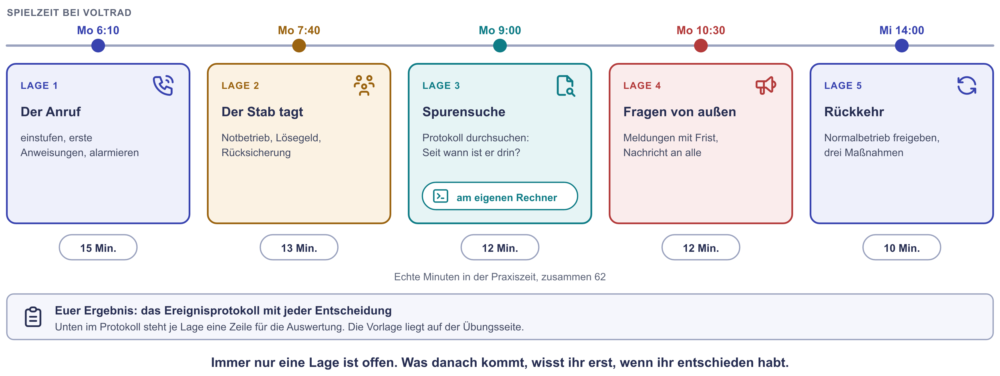
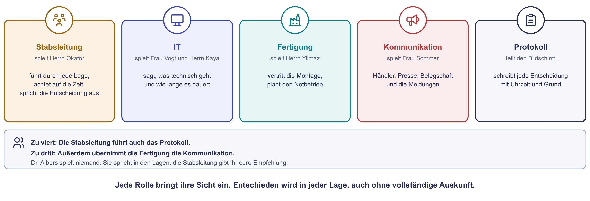
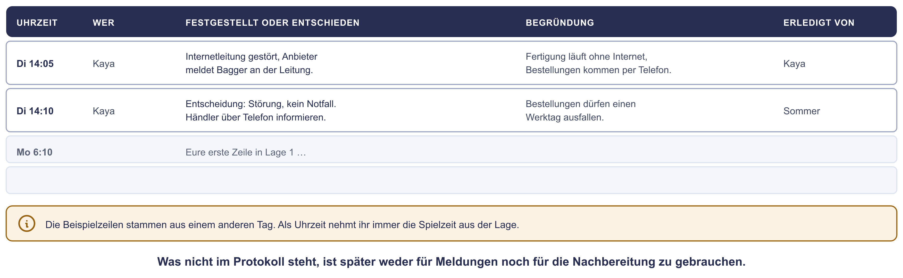
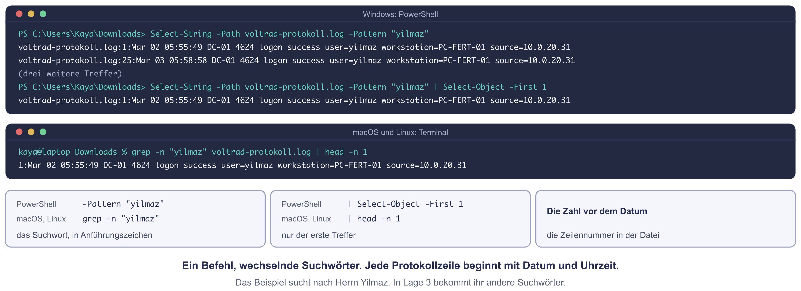

# Praxis: Notfall bei Voltrad

Ein Montagmorgen im März bei der Voltrad GmbH. Um 6:10 Uhr klingelt das
Diensthandy der IT: An allen Rechnern in der Montage steht eine
Lösegeldforderung, die Bänder stehen. Eine Sicherung gibt es, ein
Notfallhandbuch auch. Jetzt muss jemand entscheiden.

Ihr seid der **Stab**, der diesen Notfall bewältigt. In fünf Lagen spielt ihr
ihn durch, vom ersten Anruf bis zur Rückkehr in den Normalbetrieb. Jede Lage
bringt neue Nachrichten und verlangt eine Entscheidung, bevor ihr alles
wisst. In Lage 3 sucht ihr am eigenen Rechner in einem Protokoll nach der
Spur des Angreifers.

!!! abstract "Ziel"
    Am Ende könnt ihr:

    - eine Lage als Störung, Notfall oder Krise einstufen und das begründen
    - in den ersten Minuten richtig handeln: trennen statt ausschalten, melden, alarmieren
    - einen Notbetrieb mit Notbetriebsniveau und Nacherfassung planen
    - in einer Protokolldatei mit `Select-String` oder `grep` den ersten Zugriff finden
    - eine saubere Sicherung bestimmen und begründen, was zurückgespielt wird
    - Meldepflichten mit ihren Fristen nennen und eine Nachricht an die Belegschaft schreiben
    - aus einem Vorfall Maßnahmen mit Namen und Termin ableiten

    Für die Schnellen gibt es drei Bonus-Aufgaben und eine Denkaufgabe.

!!! note "Windows-Hinweis"
    Nur Lage 3 braucht das Terminal. Unter Windows nutzt ihr die
    **PowerShell**, im Windows-Terminal oder im Terminal unten in VS Code
    (**Terminal → Neues Terminal**, englisch **Terminal → New Terminal**). Wo
    sich Windows und macOS unterscheiden, gibt es Tabs mit der passenden
    Variante.

!!! tip "So arbeitet ihr im Team"
    Jede Person öffnet diese Seite selbst. Ihr verteilt zuerst die Rollen.
    Die Protokollführung teilt ihren Bildschirm und schreibt das
    Ereignisprotokoll. **Öffnet immer nur eine Lage**, entscheidet, schreibt
    die Entscheidung ins Protokoll und öffnet erst dann die nächste. Wer
    vorausliest, nimmt der Gruppe den Kern der Übung: entscheiden, ohne alles
    zu wissen. Unter jeder Lage stehen Hinweise zum Aufklappen, öffnet sie
    nacheinander.

??? info "Planspiel und Select-String in Kürze"
    | | Das Planspiel | Select-String und grep |
    |---|---|---|
    | **Was das ist** | Ein Notfall wird am Tisch durchgespielt, Lage für Lage, ohne dass etwas ausfällt. Der Fachbegriff ist Planbesprechung, englisch Tabletop. | Ein Befehl, der aus einer Textdatei alle Zeilen zeigt, in denen ein Suchwort vorkommt. |
    | **Warum gerade das** | Es findet Lücken in Zuständigkeit und Meldewegen und kostet nur Zeit. | Protokolle haben viele Zeilen. Gefiltert bleibt übrig, was zum Vorfall gehört. |
    | **So arbeiten wir heute damit** | Fünf Lagen bei Voltrad, Rollen im Breakout, jede Entscheidung ins Ereignisprotokoll | Windows: `Select-String` in der PowerShell. macOS und Linux: `grep`. Eine Datei, fünf Suchwörter. |

## Der Ablauf

| Lage | Spielzeit | Was passiert | Zeit |
|---|---|---|---|
| 1 | Montag, 6:10 Uhr | Rollen verteilen, einstufen, erste Anweisungen, alarmieren | 15 Min. |
| 2 | Montag, 7:40 Uhr | Der Stab tagt: Notbetrieb, Lösegeld, Rücksicherung | 13 Min. |
| 3 | Montag, 9:00 Uhr | Spurensuche im Protokoll, am eigenen Rechner | 12 Min. |
| 4 | Montag, 10:30 Uhr | Fragen von außen: Meldungen mit Frist, Nachricht an die Belegschaft | 12 Min. |
| 5 | Mittwoch, 14:00 Uhr | Rückkehr in den Normalbetrieb, drei Maßnahmen | 10 Min. |

{ .diagramm }

---

## Die Lage im März

Die Voltrad GmbH baut mit 280 Mitarbeitenden 120 E-Bikes am Tag. Nach der
[Bestandsaufnahme](../infrastruktur-planung/praxis-bestandsaufnahme.md) hat
die IT einiges umgesetzt: Es gibt eine **IT-Notfallnummer** mit
Rufbereitschaft, ein **Notfallhandbuch** auf Papier und eine **Kopie der
Sicherung in der Cloud**, die 30 Tage lang niemand ändern oder löschen kann.
Anderes ist noch offen. WEB-01 mit Konfigurator und Händlerportal läuft
weiter im Werk, der Umzug in die Cloud ist für Mai geplant. Herr Brandt, der
frühere Administrator, ist seit dem letzten Sommer im Ruhestand.

Es ist **Montag, der 8. März**. Die Frühschicht hat um 6 Uhr begonnen. Frau
Vogt kommt um 7:30 Uhr. Herr Kaya hat diese Woche Rufbereitschaft und trägt
das Diensthandy.

Aus dem Notfallhandbuch braucht ihr drei Seiten:

=== "Prozesse"

    | Prozess | braucht | darf höchstens ausfallen | Notbetrieb |
    |---|---|---|---|
    | Montage | MES-01, Warenwirtschaft | 4 Stunden | Laufzettel nach dem gedruckten Wochenplan, 72 Räder am Tag, nur feste Aufträge. Alles liegt im Ordner „Notbetrieb Montage“ in der Fertigungsleitung. Der Notbetrieb läuft spätestens 2 Stunden nach dem Ausrufen des Notfalls. |
    | Bestellungen der Händler | WEB-01, Warenwirtschaft | 1 Werktag | Bestellungen per Telefon und E-Mail annehmen, später nacherfassen |
    | Rechnungen und Zahlungen | Warenwirtschaft | 3 Werktage | keiner |

    **Wann die Rufbereitschaft hochstuft:** Sie ruft den Notfall nicht
    selbst aus, aber sie empfiehlt ihn, sobald eine dieser Bedingungen
    zutrifft: Ein zeitkritischer Prozess steht, es gibt Verdacht auf
    Schadsoftware, mehrere Systeme sind betroffen oder personenbezogene
    Daten könnten betroffen sein.

=== "Erreichbarkeit"

    | Wer | Aufgabe im Notfall | Erreichbar |
    |---|---|---|
    | IT-Notfallnummer, diese Woche Herr Kaya | nimmt Meldungen an, bewertet, alarmiert | rund um die Uhr |
    | Frau Vogt | IT-Leitung im Stab | mobil, rund um die Uhr |
    | Dr. Albers, Geschäftsführerin | ruft den Notfall aus, entscheidet über Geld und Aussagen nach außen | mobil |
    | Herr Okafor, Finanzen | leitet den Stab, vertritt Dr. Albers | mobil |
    | Herr Yilmaz, Fertigungsleiter | Notbetrieb in der Montage | in der Halle ab 5:30 Uhr |
    | Frau Sommer, Vertrieb | Kommunikation mit Belegschaft, Händlern und Presse | mobil |
    | Datenschutzbeauftragte, extern | bewertet Meldepflichten nach der Datenschutz-Grundverordnung (DSGVO) | werktags ab 8 Uhr |
    | IT-Dienstleister mit Notfallvertrag | Unterstützung vor Ort | rund um die Uhr, vor Ort binnen 4 Stunden |
    | Cyberversicherung | nimmt den Schaden auf, vermittelt Fachleute | Hotline rund um die Uhr |
    | Polizei, Zentrale Ansprechstelle Cybercrime (ZAC) | Anzeige und Beratung | Rufnummer im Handbuch |

=== "Systeme"

    Die Kürzel aus der Bestandsaufnahme:

    | Kürzel | Was das ist |
    |---|---|
    | **DC-01, DC-02** | Domänencontroller: prüfen die Anmeldung aller Mitarbeitenden |
    | **FILE-01** | Dateiablage, dort liegen auch die Ordner von Vertrieb und Personal |
    | **ERP-APP, ERP-DB** | Warenwirtschaft (Enterprise Resource Planning): Anwendung und Datenbank |
    | **MES-01** | Fertigungsleitsystem (Manufacturing Execution System): zeigt jedem Montageplatz den nächsten Auftrag |
    | **WEB-01** | Konfigurator und Händlerportal, steht in der DMZ, einer abgetrennten Netzzone für Server, die aus dem Internet erreichbar sind |
    | **BACKUP-01** | Datensicherung im Werk, schickt jede Nacht eine Kopie in die Cloud |
    | **MON-01** | Monitoring: zeichnet Auslastung und Störungen auf und sammelt die Protokolle |

## Eure Rollen

{ .diagramm }

| Rolle | Spielt | Aufgabe |
|---|---|---|
| **Stabsleitung** | Herrn Okafor | führt durch jede Lage, achtet auf die Zeit und spricht die Entscheidung aus |
| **IT** | Frau Vogt und Herrn Kaya | sagt, was technisch geht und wie lange es dauert |
| **Fertigung** | Herrn Yilmaz | vertritt die Montage und plant den Notbetrieb |
| **Kommunikation** | Frau Sommer | kümmert sich um Händler, Presse, Belegschaft und die Meldungen |
| **Protokoll** | | teilt den Bildschirm und schreibt jede Entscheidung mit Uhrzeit und Grund |

Seid ihr zu viert, führt die Stabsleitung auch das Protokoll. Zu dritt
übernimmt außerdem die Fertigung die Kommunikation. Dr. Albers spielt
niemand: Sie spricht in den Lagen, die Stabsleitung gibt ihr eure
Empfehlung.

## Das Ereignisprotokoll

Die Protokollführung kopiert diese Vorlage in eine Textdatei oder ein
gemeinsames Dokument und teilt den Bildschirm. Als Uhrzeit nehmt ihr immer
die Spielzeit aus der Lage. Die erste Zeile zeigt ein Beispiel von einem
anderen Tag.

```text
EREIGNISPROTOKOLL VOLTRAD · Notfall vom Montag, 8. März

Uhrzeit  | Wer  | Festgestellt oder entschieden                      | Begründung                          | Erledigt von
Di 14:05 | Kaya | Internetleitung gestört. Entscheidung: Störung,    | Die Fertigung läuft ohne Internet,  | Sommer
         |      | kein Notfall. Händler telefonisch informieren.     | Bestellungen dürfen 1 Tag ausfallen. |
Mo 6:10  |      |                                                    |                                     |

FÜR DIE AUSWERTUNG
Lage 1  Einstufung:                      Zuerst alarmiert:
Lage 2  Notbetrieb:                      Empfehlung zum Lösegeld:
Lage 3  Erster Zugriff:                  Diese Kopie spielen wir zurück:
Lage 4  Erste fällige Meldung, bis:      Nachricht an die Belegschaft:
Lage 5  Drei Maßnahmen, mit Namen und Termin:
```

{ .diagramm }

---

## Lage 1: Der Anruf (15 Minuten)

Verteilt zuerst die Rollen, das dauert höchstens drei Minuten. Dann öffnet
ihr die Lage.

??? warning "Lage 1 · Montag, 6:10 Uhr"
    Das Diensthandy klingelt. Herr Kaya ist noch zu Hause, 25 Minuten vom
    Werk entfernt. Am Apparat ist Herr Yilmaz:

    > „An allen Rechnern in der Montage steht dieselbe Meldung: Ihre Dateien
    > sind verschlüsselt, lesen Sie LIESMICH-VOLTRAD.txt. Das
    > Fertigungsleitsystem antwortet seit kurz nach sechs nicht mehr, die
    > Bänder stehen. Ein Kollege will die Rechner ausschalten und neu
    > starten. Soll er?“

    **Eure Aufgaben**

    1. Störung, Notfall oder Krise? Begründet mit dem Auszug aus dem
       Notfallhandbuch.
    2. Was sagt Herr Kaya Herrn Yilmaz? Formuliert drei klare Anweisungen,
       die auch ohne IT-Wissen funktionieren.
    3. Wen alarmiert Herr Kaya, in welcher Reihenfolge? Wer ruft den Notfall
       aus?
    4. Schreibt die ersten Zeilen ins Ereignisprotokoll.

??? tip "Hinweis 1 zu Lage 1"
    Vergleicht zwei Zeiten: Wie lange darf die Montage laut Handbuch
    stehen? Und wie lange dauert es, verschlüsselte Server neu aufzubauen?

??? tip "Hinweis 2 zu Lage 1"
    Für die Anweisungen: Was stoppt die Ausbreitung? Was löscht Spuren, die
    später gebraucht werden? Seht euch dazu auf der Theorieseite die
    [Eindämmung](incident-und-bcm.md#3-eindammung) an.

??? tip "Hinweis 3 zu Lage 1"
    Wer darf laut Erreichbarkeitsliste den Notfall ausrufen? Wen braucht der
    Stab als Nächstes, damit er arbeiten kann? Und wer kann vor Ort helfen?

Die Lösung besprechen wir gemeinsam nach der Praxiszeit.

---

## Lage 2: Der Stab tagt (13 Minuten)

??? warning "Lage 2 · Montag, 7:40 Uhr"
    Um 6:30 Uhr hat Dr. Albers den Notfall ausgerufen. Herr Kaya war um
    6:40 Uhr im Werk und hat die Verbindung zwischen Serverraum und Internet
    getrennt. Um 7:00 Uhr hat sich der Stab zum ersten Mal am Telefon
    abgestimmt. Jetzt sitzt er im Besprechungsraum. Frau Vogt berichtet nach
    der ersten Prüfung:

    - Verschlüsselt sind alle Windows-Server (DC-01, DC-02, FILE-01, ERP-DB,
      ERP-APP, MES-01) und alle Windows-Rechner, die eingeschaltet waren.
      Sie sind vom Netz getrennt und laufen weiter.
    - Die Hosts VH-01 und VH-02 laufen. MON-01 auf VH-02 arbeitet mit Linux
      und ist nicht betroffen.
    - Auf BACKUP-01 sind die Sicherungen im Werk gelöscht. Die Kopien in der
      Cloud sind vollständig da, die neueste ist vom Sonntag, 7. März,
      23:38 Uhr.
    - Es laufen außerdem WEB-01 und der Mini-PC mit dem MQTT-Broker in der
      Halle. Microsoft 365 funktioniert, E-Mail geht.
    - Der IT-Dienstleister ist um 10 Uhr vor Ort. Seine Schätzung: Netz und
      Server neu aufbauen dauert drei Tage. Das Fertigungsleitsystem läuft
      frühestens Donnerstag früh.

    Herr Yilmaz: „Der Wochenplan liegt ausgedruckt im Ordner. Laufzettel
    haben wir für eine Woche.“

    Die Erpresser verlangen 80.000 Euro in Bitcoin bis Mittwoch, 12 Uhr.
    Sonst veröffentlichen sie 200 GB Daten, die sie kopiert haben.

    Dr. Albers: „Drei Tage Stillstand kosten uns mehr. Wenn wir zahlen, sind
    wir morgen wieder da.“

    **Eure Aufgaben**

    1. Notbetrieb in der Montage: ja oder nein? Wenn ja: Was braucht Herr
       Yilmaz und wie stellt ihr sicher, dass später nichts fehlt?
    2. Was empfehlt ihr Dr. Albers zum Lösegeld? Nennt zwei Gründe.
    3. Herr Kaya will die Kopie vom Sonntag sofort zurückspielen. Was muss
       vorher geklärt sein?
    4. Ins Protokoll damit.

??? tip "Hinweis 1 zu Lage 2"
    Notbetrieb: Was steht dazu im Handbuch? Welche Systeme braucht der
    Notbetrieb überhaupt? Und was passiert später mit jedem Laufzettel?

??? tip "Hinweis 2 zu Lage 2"
    Lösegeld: Das BSI (Bundesamt für Sicherheit in der Informationstechnik)
    hat dazu ein kurzes Kapitel im Arbeitspapier
    [Erste Hilfe bei einem schweren IT-Sicherheitsvorfall](https://www.bsi.bund.de/SharedDocs/Downloads/DE/BSI/Cyber-Sicherheit/Themen/Ransomware_Erste-Hilfe-IT-Sicherheitsvorfall.pdf?__blob=publicationFile&v=3){ target=_blank },
    Abschnitt 3.9. Denkt außerdem daran, was die Erpresser schon haben.

??? tip "Hinweis 3 zu Lage 2"
    Rücksicherung: Wisst ihr schon, wie der Angreifer hereinkam? Ist er
    vielleicht noch im Netz? Was würde er mit frisch zurückgespielten
    Servern tun?

Die Lösung besprechen wir gemeinsam nach der Praxiszeit.

---

## Lage 3: Spurensuche am Rechner (12 Minuten)

Diese Lage macht jede Person am eigenen Rechner. Vergleicht danach eure
Ergebnisse in der Gruppe.

??? warning "Lage 3 · Montag, 9:00 Uhr"
    Der IT-Dienstleister ruft an: „Seit wann ist der Angreifer im Netz?
    Davon hängt ab, welche Kopie ihr zurückspielen könnt.“

    MON-01 sammelt die Protokolle der Firewall und der Server. Frau Vogt hat
    die letzten sieben Tage als Datei exportiert. Der Dienstleister hat auf
    WEB-01 schon eine verdächtige Adresse gefunden: `203.0.113.77`.

    Im Protokoll steht das Datum englisch: `Mar 08` ist heute, Montag, der
    8. März. `Mar 04` ist also der Donnerstag davor.

    **1. Die Datei holen.** Klickt auf
    [voltrad-protokoll.log herunterladen](../assets/dateien/voltrad-protokoll.log){ download="voltrad-protokoll.log" }.
    Der Browser legt sie in euren Ordner **Downloads**.

    **2. Ins Terminal, in den Ordner Downloads.**

    === "Windows (PowerShell)"

        ```powershell
        cd $HOME\Downloads
        ```

        ```powershell
        Get-ChildItem voltrad*
        ```

    === "macOS / Linux"

        ```bash
        cd ~/Downloads
        ```

        ```bash
        ls voltrad*
        ```

    Die Datei `voltrad-protokoll.log` muss in der Liste stehen.

    **3. Suchen.** Der Befehl zeigt alle Zeilen, in denen das Suchwort
    vorkommt. `SUCHWORT` ersetzt ihr jeweils durch eines aus der Tabelle
    unten, die Anführungszeichen bleiben.

    === "Windows (PowerShell)"

        ```powershell
        Select-String -Path voltrad-protokoll.log -Pattern "SUCHWORT"
        ```

        Nur der erste Treffer:

        ```powershell
        Select-String -Path voltrad-protokoll.log -Pattern "SUCHWORT" | Select-Object -First 1
        ```

    === "macOS / Linux"

        ```bash
        grep -n "SUCHWORT" voltrad-protokoll.log
        ```

        Nur der erste Treffer:

        ```bash
        grep -n "SUCHWORT" voltrad-protokoll.log | head -n 1
        ```

    { .diagramm }

    **4. Fünf Suchwörter, fünf Fragen.** Geht sie der Reihe nach durch.
    Jede Antwort führt zum nächsten Suchwort.

    | Nr. | Suchwort | Frage |
    |---|---|---|
    | 1 | `vlk` | Wann begann die Verschlüsselung und unter welchem Konto lief sie? |
    | 2 | `svc-update` | Wann wurde dieses Konto angelegt und von wem? |
    | 3 | `user=brandt` | Wann und von welchem Rechner kam diese Anmeldung? Warum hätte es das Konto gar nicht mehr geben dürfen? |
    | 4 | `203.0.113.77` | Wann taucht die Adresse zum ersten Mal auf und was passiert da? Wann kam der Angreifer tatsächlich hinein? |
    | 5 | `cloud copy` | Welche Kopie in der Cloud war fertig, bevor der Angreifer hereinkam? |

    **5. Entscheiden.** Welche Kopie spielt ihr zurück? Unterscheidet dabei
    zwischen den **Daten** der Warenwirtschaft und den **Servern** selbst,
    also Betriebssystem, Programmen und Konten. Schreibt die Entscheidung
    mit Begründung ins Protokoll.

??? note "Kein Download möglich? Den Inhalt kopieren"
    Kopiert den Inhalt mit dem Knopf oben rechts im Kasten. Legt in VS Code
    eine neue Datei an (**Datei → Neue Textdatei**), fügt den Inhalt ein und
    speichert sie als `voltrad-protokoll.log` im Ordner Downloads.

    ```text
    --8<-- "assets/dateien/voltrad-protokoll.log"
    ```

??? tip "Hinweis 1 zu Lage 3"
    Jede Zeile beginnt mit Datum und Uhrzeit, die Datei ist zeitlich
    sortiert. Der erste Treffer ist also der früheste.

??? tip "Hinweis 2 zu Lage 3"
    Die Adresse `203.0.113.77` taucht an zwei Tagen auf. Ein Status `404`
    heißt: Diese Seite gibt es nicht. Ein Status `500` heißt: Der Server
    ist bei der Anfrage auf einen Fehler gelaufen. Was passiert direkt
    danach auf WEB-01?

??? tip "Hinweis 3 zu Lage 3"
    Eine Kopie ist sauber, wenn sie fertig war, bevor der Angreifer
    hereinkam. Seht auf die Zeilen mit `completed`. Und überlegt, ob ihr
    wirklich alles aus einer so alten Kopie nehmen müsst.

Die Lösung besprechen wir gemeinsam nach der Praxiszeit.

---

## Lage 4: Fragen von außen (12 Minuten)

??? warning "Lage 4 · Montag, 10:30 Uhr"
    Seit 9:30 Uhr ist WEB-01 vom Netz, Konfigurator und Händlerportal sind
    nicht erreichbar. Seit 8:20 Uhr montiert die Frühschicht nach
    Laufzetteln.

    - Bei Frau Sommer haben 14 Händler angerufen. Einer schreibt in einem
      sozialen Netzwerk: „Voltrad gehackt? Portal seit Stunden tot.“
    - Die Lokalzeitung bittet bis 14 Uhr um eine Stellungnahme.
    - Die Erpresser schreiben noch einmal. Sie haben die Händlerliste mit
      allen Ansprechpartnern und die Gehaltsabrechnungen der Belegschaft.
      Als Beweis hängen drei Gehaltsabrechnungen an.
    - Die Büro-Mitarbeitenden kommen gerade an und fragen, ob sie ihre
      Rechner einschalten dürfen. Der Betriebsrat fragt, was los ist.
    - Die Datenschutzbeauftragte ist am Telefon: „Seit wann wisst ihr, dass
      personenbezogene Daten betroffen sind?“

    Voltrad stellt Fahrzeuge her und hat 280 Beschäftigte. Damit ist Voltrad
    nach dem BSI-Gesetz eine **wichtige Einrichtung** und muss erhebliche
    Sicherheitsvorfälle melden.

    **Eure Aufgaben**

    1. Wer muss was bis wann melden? Übernehmt die Tabelle ins Protokoll und
       tragt für jede Zeile ein, an wen die Meldung geht und bis wann
       spätestens.

        | Meldung | An wen | Bis spätestens |
        |---|---|---|
        | Frühwarnung zum Sicherheitsvorfall | | |
        | Meldung zum Sicherheitsvorfall | | |
        | Datenschutzverletzung | | |
        | Benachrichtigung der Betroffenen | | |
        | Strafanzeige und Versicherung | | |

    2. Schreibt die Nachricht an die Belegschaft, höchstens fünf Sätze.
    3. Wer beantwortet die Zeitung? Schreibt den ersten Satz.
    4. Ins Protokoll damit.

??? tip "Hinweis 1 zu Lage 4"
    Ab wann läuft eine Frist? Ab der Kenntnis vom Vorfall, nicht ab seiner
    Aufklärung. Wer ab dem ersten Anruf rechnet, ist auf der sicheren Seite.
    Die Fristen stehen auf der Theorieseite unter
    [Fristen laufen unabhängig von der Technik](incident-und-bcm.md#der-kommunikationsplan).

??? tip "Hinweis 2 zu Lage 4"
    Gehaltsabrechnungen sind personenbezogene Daten mit hohem Risiko für die
    Betroffenen. Was verlangt die DSGVO in diesem Fall zusätzlich zur
    Meldung an die Behörde?

??? tip "Hinweis 3 zu Lage 4"
    Eine gute Nachricht hat vier Bausteine: was passiert ist, soweit
    bekannt, was jetzt gilt, was bitte niemand tun soll und wann die
    nächste Information kommt. Nach außen spricht nur eine Person.

Die Lösung besprechen wir gemeinsam nach der Praxiszeit.

---

## Lage 5: Zurück in den Normalbetrieb (10 Minuten)

??? warning "Lage 5 · Mittwoch, 14:00 Uhr"
    Der Dienstleister hat Netz und Server neu aufgebaut. Die Domäne ist
    neu, alle Kennwörter sind neu, das Konto `brandt` gibt es nicht mehr.
    Die Datenbank der Warenwirtschaft ist aus der Kopie vom 7. März
    zurückgespielt und mit der Kopie vom 3. März verglichen. WEB-01 bleibt
    aus, bis die Lücke geschlossen ist. Das Fertigungsleitsystem soll am
    Donnerstag um 6 Uhr wieder laufen.

    Im Notbetrieb hat die Montage 169 Räder gebaut, die Laufzettel N-001
    bis N-169 liegen im Ordner. 85 Bestellungen von Händlern kamen per
    E-Mail.

    **Eure Aufgaben**

    1. Was muss passieren, bevor die Montage am Donnerstag wieder mit dem
       Fertigungsleitsystem arbeitet? Nennt mindestens drei Schritte. Wer
       erklärt den Normalbetrieb?
    2. Hat die Montage die Vorgaben aus dem Notfallhandbuch gehalten? Die
       Bänder standen von 6:04 bis 8:20 Uhr.
    3. Drei Maßnahmen aus euren Funden in Lage 3, jede mit
       verantwortlicher Person und Termin.
    4. Füllt die Zeilen „Für die Auswertung“ im Protokoll.

??? tip "Hinweis 1 zu Lage 5"
    Was muss geprüft sein, bevor jemand dem Fertigungsleitsystem wieder
    vertraut? Was passiert mit den Laufzetteln und den E-Mails aus dem
    Notbetrieb?

??? tip "Hinweis 2 zu Lage 5"
    Zwei Vorgaben stehen im Handbuch: wie lange die Montage höchstens
    stehen darf und wie schnell der Notbetrieb nach dem Ausrufen laufen
    muss. Rechnet beide Zeiten aus.

??? tip "Hinweis 3 zu Lage 5"
    Geht eure Funde aus Lage 3 durch: Welche Lücke hat der Angreifer an
    welcher Stelle genutzt? Aus jeder Lücke wird eine Maßnahme.

Die Lösung besprechen wir gemeinsam nach der Praxiszeit.

---

## Bonus für die Schnellen

### Bonus 1: Die Notfallkarte (5 Minuten)

An jedem Arbeitsplatz bei Voltrad soll eine Karte hängen, so wie der
Aushang „Verhalten im Brandfall“. Schreibt sie: höchstens sechs Zeilen.
Was soll jemand tun, auf dessen Bildschirm plötzlich eine Lösegeldforderung
steht?

??? success "Musterlösung Bonus 1"
    ```text
    IT-NOTFALL? Ruhe bewahren und sofort melden.
    IT-Notfallnummer: 0xxx xxxxxx, rund um die Uhr
    Sagen Sie: wer Sie sind, welches Gerät, was Sie sehen, seit wann, wo das Gerät steht.
    Netzwerkkabel ziehen, WLAN aus. Das Gerät NICHT ausschalten.
    Nichts anklicken, nichts löschen, nicht selbst reparieren.
    Keine Auskunft nach außen. Lieber einmal zu oft anrufen als einmal zu wenig.
    ```

    Das BSI stellt dafür eine Vorlage bereit, die
    [IT-Notfallkarte](https://www.bsi.bund.de/DE/Themen/Unternehmen-und-Organisationen/Informationen-und-Empfehlungen/Empfehlungen-nach-Angriffszielen/Unternehmen-allgemein/IT-Notfallkarte/IT-Notfallkarte/it-notfallkarte_node.html){ target=_blank }.
    Sie rät, Gegenmaßnahmen nur nach Absprache zu ergreifen. Voltrad
    schreibt deshalb die eine erlaubte Sofortmaßnahme ausdrücklich auf die
    Karte: das Netzwerkkabel ziehen.

### Bonus 2: Wie viel ist abgeflossen? (8 Minuten)

Die Erpresser behaupten, 200 GB kopiert zu haben. Stimmt das? Sucht im
Protokoll nach der zweiten verdächtigen Adresse `203.0.113.140`.

1. In welchen Nächten floss etwas ab und wie viel jeweils?
2. Von welchem Server kamen die Daten? Die Adresse `10.0.10.21` steht in
   einer der Zeilen neben einem Namen.
3. Wie viele Zeilen enthalten das Wort `sent=`? Zählen lassen geht so:

    === "Windows (PowerShell)"

        ```powershell
        (Select-String -Path voltrad-protokoll.log -Pattern "sent=").Count
        ```

    === "macOS / Linux"

        ```bash
        grep -c "sent=" voltrad-protokoll.log
        ```

??? success "Musterlösung Bonus 2"
    Drei Nächte, jeweils kurz vor Mitternacht beginnend: Freitag 71,4 GB,
    Samstag 68,9 GB, Sonntag 61,3 GB. Zusammen sind das **201,6 GB**. Die
    Erpresser haben also nicht übertrieben. Die Daten kamen von
    `10.0.10.21`, das ist FILE-01: Die Warnzeilen von MON-01 nennen den
    Namen. Der Zähler ergibt 3.

    Für die Meldung an die Datenschutzaufsicht heißt das: Der Abfluss ist
    nicht nur angedroht, er ist im Protokoll belegt. Auf FILE-01 liegen
    die Ordner von Vertrieb und Personal.

### Bonus 3: Störung, Notfall oder Krise? (5 Minuten)

Stuft jeden Fall ein und begründet in einem Satz. Nehmt den Auszug aus dem
Notfallhandbuch dazu.

1. Ein Prüfstand meldet seit einer Stunde keine Messwerte. Die Montage
   läuft weiter.
2. Ein Kollege aus dem Vertrieb hat auf einen Link in einer E-Mail geklickt
   und dort sein Kennwort eingegeben.
3. Freitagabend, 22 Uhr: Im Serverraum ist ein Rohr geplatzt, in beiden
   Schränken steht Wasser.
4. Die Erpresser veröffentlichen die Konstruktionszeichnungen der neuen
   Modelle. Fachpresse und Wettbewerber greifen das auf.

??? success "Musterlösung Bonus 3"
    1. **Störung.** Kein zeitkritischer Prozess steht. Das behebt die IT im
       Normalbetrieb, die Prüferin trägt die Werte solange von Hand ein.
    2. **Störung mit Verdacht auf einen Angriff.** Die Rufbereitschaft
       bewertet sofort: Konto sperren, Kennwort neu, Anmeldungen der
       letzten Stunden prüfen. Zum Notfall wird es erst, wenn sich der
       Angreifer ausbreitet und ein zeitkritischer Prozess in Gefahr ist.
    3. **Notfall**, sofort auszurufen. Am Montag um 6 Uhr muss die Montage
       laufen. Server ersetzen dauert länger als 4 Stunden, für die
       Montage gibt es einen Notbetrieb. Das Wochenende verschafft Zeit,
       ändert aber nichts an der Einstufung: Es genügt die Gefahr.
    4. **Krise.** Für die Veröffentlichung von Geschäftsgeheimnissen gibt
       es keinen Plan im Handbuch. Der Schaden trifft die ganze Firma, der
       Stab entscheidet nach Lage, die Geschäftsführung führt.

### Denkaufgabe: Ein Notfallplan für die Montage (12 Minuten)

Schreibt für die Montage den Plan, der im Notfallhandbuch fehlt, auf einer
Seite. Der Fachbegriff ist **Geschäftsfortführungsplan**: Er beschreibt, wie
ein Prozess ohne seine IT weiterläuft. Klärt dabei:

1. Wann wird er ausgelöst und wer entscheidet das?
2. Welches Notbetriebsniveau gilt?
3. Welches Material liegt wo?
4. Wie läuft ein Auftrag im Notbetrieb vom Wochenplan bis zum fertigen Rad?
5. Wie kommen die Daten später ins System?
6. Wer beendet den Notbetrieb und wann wird geübt?

??? success "Musterlösung Denkaufgabe"
    **Geschäftsfortführungsplan Montage**

    1. **Auslöser:** Das Fertigungsleitsystem oder die Warenwirtschaft
       fällt aus und die Wiederherstellung dauert voraussichtlich länger
       als 2 Stunden. Den Notbetrieb ordnet Herr Yilmaz an, sobald der
       Notfall ausgerufen ist. Vertretung: die Schichtleitung.
    2. **Notbetriebsniveau:** 72 Räder am Tag, nur Aufträge aus dem
       gedruckten Wochenplan. Keine Sonderwünsche, keine Eilaufträge.
    3. **Material:** Der Ordner „Notbetrieb Montage“ in der
       Fertigungsleitung, eine Kopie im Büro der Geschäftsführung. Darin:
       der Wochenplan, jeden Freitag neu gedruckt, Laufzettel für eine
       Woche mit den Nummern N-001 bis N-400, Montageanleitungen der
       laufenden Modelle auf Papier.
    4. **Ablauf:** Die Schichtleitung nimmt den nächsten Auftrag aus dem
       Wochenplan und schreibt ihn auf den nächsten freien Laufzettel. Der
       Laufzettel begleitet das Rad durch alle Stationen. Die Prüferin
       trägt das Prüfergebnis ein und zeichnet ab. Fertige Laufzettel kommen
       nach Nummer sortiert in den Ordner.
    5. **Nacherfassung:** Nach der Wiederherstellung erfasst die
       Fertigungsleitung jeden Laufzettel in der Warenwirtschaft, in der
       Reihenfolge der Nummern. Fehlende Nummern werden geklärt, bevor der
       Normalbetrieb erklärt wird. Danach wird das Lager abgeglichen.
    6. **Ende und Übung:** Den Notbetrieb beendet der Stab ausdrücklich,
       wenn ein Testauftrag durch beide Systeme gelaufen ist. Geübt wird
       einmal im Jahr: eine Stunde mit Laufzetteln in einer Schicht, danach
       wird der Plan nachgebessert.

---

## Aufräumen

Die Datei `voltrad-protokoll.log` könnt ihr nach dem Abend löschen. Das
Ereignisprotokoll eurer Gruppe dürft ihr behalten.

---

## Wenn es klemmt

| Was ihr seht | Woran es liegt | Was hilft |
|---|---|---|
| Der Browser zeigt die Datei als Text an, statt sie zu speichern | Manche Browser öffnen Textdateien direkt | Mit ++ctrl+s++ (Mac: ++cmd+s++) speichern, Name `voltrad-protokoll.log`, Ordner Downloads. Oder den Inhalt aus dem Kasten „Kein Download möglich?“ in Lage 3 kopieren. |
| `Get-ChildItem` oder `ls` zeigt keine Datei | Der Browser hat die Datei woanders abgelegt | Im Browser die Liste der Downloads öffnen und **Im Ordner anzeigen** wählen. Unter Windows 11 dort Rechtsklick in den Ordner und **Im Terminal öffnen**. |
| Die Datei heißt `voltrad-protokoll.log.txt` | Der Browser hat eine Endung angehängt | Im Befehl einfach diesen Namen nehmen. |
| `Select-String` wird nicht erkannt | Ihr seid in der Eingabeaufforderung (CMD), nicht in der PowerShell | Im Terminal von VS Code über den Pfeil neben dem Plus **PowerShell** wählen oder `powershell` eintippen. |
| `Cannot find path` oder `Der Pfad ... kann nicht gefunden werden` | Das Terminal steht nicht im Ordner der Datei | Noch einmal `cd $HOME\Downloads`, dann `Get-ChildItem voltrad*`. |
| `No such file or directory` | wie oben, unter macOS oder Linux | Noch einmal `cd ~/Downloads`, dann `ls voltrad*`. |
| Keine Ausgabe | Das Suchwort ist falsch geschrieben. `grep` unterscheidet außerdem Groß- und Kleinschreibung | Das Suchwort aus der Tabelle kopieren. |
| Die Zeilen brechen um und sind schwer zu lesen | Das Terminal ist schmal | Das Fenster breiter ziehen oder nur den ersten Treffer anzeigen lassen. |

---

## Was ihr zur Auswertung mitbringt

Je Gruppe stellt eine Person eine Lage vor, drei Minuten. Die Zeilen „Für
die Auswertung“ aus eurem Protokoll reichen.

1. Lage 1: Störung, Notfall oder Krise? Wen habt ihr zuerst alarmiert?
2. Lage 2: Notbetrieb ja oder nein? Was empfehlt ihr Dr. Albers zum
   Lösegeld?
3. Lage 3: Seit wann war der Angreifer im Netz? Welche Kopie spielt ihr
   zurück?
4. Lage 4: Welche Meldung ist zuerst fällig, bis wann? Lest eure Nachricht
   an die Belegschaft vor.
5. Lage 5: Eure drei Maßnahmen, jede mit Namen und Termin.
6. Denkfrage: Woran hätte Voltrad den Angriff früher bemerken können,
   bevor die Montage anruft?

---

## Weiterlesen

- [Incident Response & Business Continuity](incident-und-bcm.md): Stufen,
  Ablauf, Rollen, Kommunikation, Notbetrieb und Übungen ausführlich
- [Backup & Recovery](backup-und-recovery.md): Sicherungen und
  Wiederherstellung
- [Übung: Notfallübung](uebung-notfalluebung.md): ein zweites Planspiel mit
  einem anderen Unternehmen
