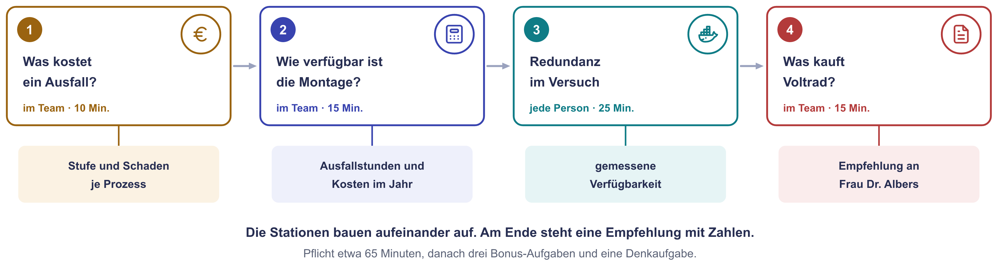
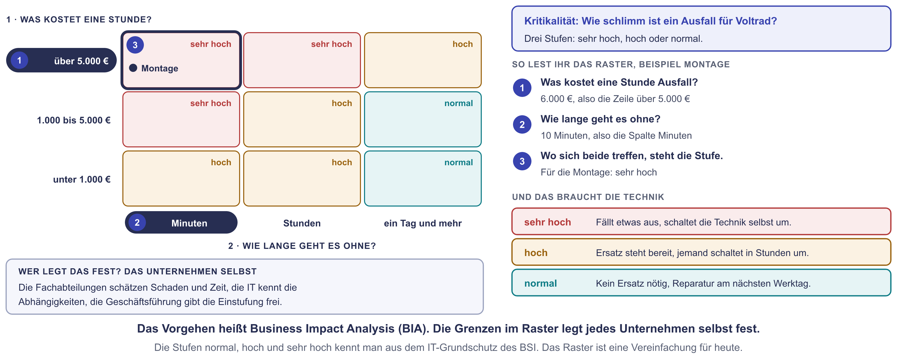
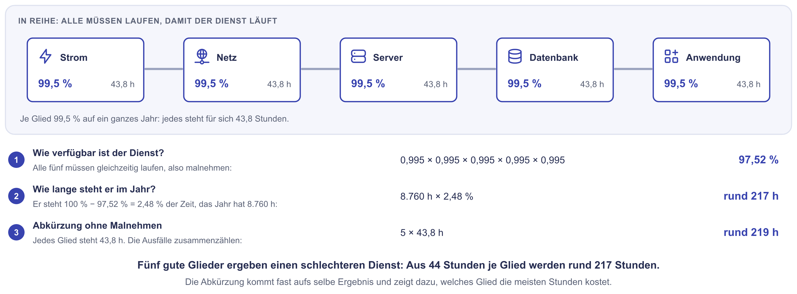
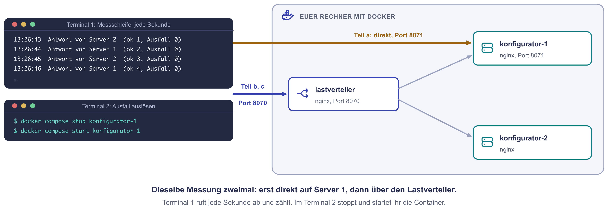

# Praxis: Verfügbarkeit bei Voltrad

In der Bestandsaufnahme habt ihr die schwachen Stellen der Voltrad GmbH
gefunden: eine USV mit defekter Batterie, ein einziger Core-Switch, alte
Server ohne Ersatz. Die Geschäftsführerin Frau Dr. Albers fragt jetzt zwei
Dinge: Was kostet uns das heute? Und was sollen wir kaufen?

Heute beantwortet ihr beides mit Zahlen. Ihr bewertet den Schaden eines
Ausfalls und rechnet aus, wie verfügbar die Montage heute ist. Dann probiert
ihr Redundanz an eurem eigenen Rechner aus: zwei Webserver hinter einem
Lastverteiler. Am Ende steht eine Empfehlung, die Frau Dr. Albers
nachrechnen kann.

!!! abstract "Ziel"
    Am Ende könnt ihr:

    - Geschäftsprozesse nach Schaden je Stunde und tolerierbarer Ausfallzeit einstufen
    - die Verfügbarkeit einer Kette rechnen und in Ausfallstunden umrechnen
    - Redundanz mit einem Lastverteiler aufbauen und die Verfügbarkeit von außen messen
    - Redundanzmaßnahmen über Kosten und Nutzen vergleichen und eine Empfehlung begründen

    Für die Schnellen gibt es drei Bonus-Aufgaben und eine Denkaufgabe.

!!! note "Windows-Hinweis"
    Unter Windows nutzt ihr die **PowerShell** im Terminal von VS Code
    (**Terminal → Neues Terminal**, englisch **Terminal → New Terminal**).
    Die `docker`-Befehle sind auf Windows, macOS und Linux gleich. Nur die
    Messschleife in Station 3 unterscheidet sich, dafür gibt es Tabs.
    **Docker Desktop** muss gestartet sein.

!!! tip "So arbeitet ihr heute"
    Die Stationen 1, 2 und 4 macht ihr im Team: Eine Person teilt ihren
    Bildschirm, eine zweite schreibt die Ergebnisse mit. Station 3 macht
    jede Person am eigenen Rechner. Wer kein laufendes Docker hat, arbeitet
    dort am Bildschirm einer anderen Person mit. Die Stationen bauen
    aufeinander auf, haltet deshalb die Reihenfolge ein. Unter jeder Station
    stehen Hinweise zum Aufklappen. Öffnet sie nacheinander, nicht alle auf
    einmal.

??? info "nginx und die Messschleife in Kürze"
    | | nginx als Lastverteiler | Die Messschleife |
    |---|---|---|
    | **Was das ist** | Ein verbreiteter Webserver, der Anfragen auch an andere Server weiterreichen kann. In dieser Rolle heißt er Lastverteiler (Load Balancer). | Eine Zeile in PowerShell oder bash, die jede Sekunde eine Webseite abruft und Erfolge und Ausfälle zählt. |
    | **Warum gerade das** | Kostenlos, im Betrieb weit verbreitet und als Container in Sekunden gestartet. | So messen auch Überwachungsdienste die Verfügbarkeit: von außen, in festen Abständen. |
    | **So arbeiten wir heute damit** | Dreimal nginx in einer `compose.yaml`: zwei Server mit einer Startseite, einer verteilt die Anfragen. | Kopieren, im ersten Terminal laufen lassen, mit ++ctrl+c++ beenden. |

    Den Load Balancer kennt ihr aus dem Cloud-Rennen. Dort war er ein
    fertiger Dienst von AWS, heute baut ihr ihn selbst.

## Was ihr heute macht

| Station | Was passiert | Form | Zeit |
|---|---|---|---|
| 1 | Was kostet ein Ausfall? Prozesse einstufen, zwei Ausfälle rechnen | im Team | 10 Min. |
| 2 | Wie verfügbar ist die Montage? Eine Kette aus fünf Gliedern | im Team | 15 Min. |
| 3 | Redundanz im Versuch: messen ohne und mit Lastverteiler | jede Person | 25 Min. |
| 4 | Was kauft Voltrad? Fünf Maßnahmen, ein Budget, eine Empfehlung | im Team | 15 Min. |

{ .diagramm }

## Die Lage

Die Voltrad GmbH baut mit 280 Mitarbeitenden 120 E-Bikes am Tag. Die
Montage läuft in zwei Schichten, montags bis freitags von 6 bis 22 Uhr. Das
sind 4.160 Stunden Betriebszeit im Jahr. Jede Montagelinie bekommt ihre
Aufträge vom Fertigungsleitsystem MES-01, das sie aus der Warenwirtschaft
ERP-APP holt. Die Warenwirtschaft speichert in der Datenbank ERP-DB. Alle
Server hängen an einem Core-Switch und an einer USV, deren Batterie seit
Wochen „Batterie ersetzen“ meldet.

Wer die Bestandsaufnahme verpasst hat, findet den ganzen Bestand unter
[Praxis: Bestandsaufnahme bei Voltrad](../infrastruktur-planung/praxis-bestandsaufnahme.md).
Für heute genügt diese Seite.

---

## Station 1: Was kostet ein Ausfall? (10 Minuten, im Team)

**Was ihr hier tut:** Ihr stuft Voltrads Geschäftsprozesse danach ein, wie
teuer und wie schnell ein Ausfall wird. Das ist der Kern einer **Business
Impact Analysis (BIA)**, einer Folgenabschätzung je Geschäftsprozess. Sie
entscheidet später, wo Redundanz hingehört.

Herr Becker aus den Finanzen hat geschätzt, was eine Stunde Stillstand in der
Betriebszeit kostet. Frau Vogt aus der IT hat mit den Abteilungen geklärt, nach
welcher Zeit ein Ausfall nicht mehr hinnehmbar ist.

| Prozess | Braucht | Schaden je Stunde | Kritisch nach |
|---|---|---|---|
| Montage | MES-01, ERP-APP, ERP-DB, Strom und Netz im Serverraum | 6.000 € | 10 Minuten, dann stehen die Bänder |
| Händlerportal | WEB-01, Internetleitung | montags 7 bis 12 Uhr 3.000 €, sonst 1.000 € | 2 Stunden, dann rufen die Händler an |
| Konfigurator | WEB-01, Internetleitung | März bis Mai 900 €, sonst 150 € | im Frühjahr 1 Stunde, sonst 1 Tag |
| Büro: Einkauf, Buchhaltung, Vertrieb | DC-01 oder DC-02, FILE-01, ERP-APP, ERP-DB | 800 € | 4 Stunden |
| E-Mail und Office | Microsoft 365, Internetleitung | 600 € | 4 Stunden |
| Konstruktion | NAS, CAD-Arbeitsplätze | 250 € | 2 Tage |

Die 6.000 € der Montage setzen sich so zusammen: Die Schicht mit 60 Personen
steht und wird bezahlt (2.400 €), die fehlenden Räder werden am Samstag mit
Zuschlag nachgebaut (3.600 €).

{ .diagramm }

1. Ordnet jeden Prozess einer Stufe zu: **sehr hoch**, **hoch** oder
   **normal**. Nehmt das Raster im Bild.
2. Ein Montag im November, 7 Uhr: Die **Internetleitung** des Werks fällt für
   drei Stunden aus. Welche Prozesse stehen? Was kostet der Ausfall?
3. Gleicher Montag, gleiche drei Stunden, aber diesmal fällt die
   **Datenbank ERP-DB** aus. Welche Prozesse stehen? Was kostet es? Rechnet
   mit den vollen drei Stunden.
4. Wo braucht Voltrad deshalb zuerst Redundanz? Ein Satz genügt.

??? tip "Hinweis 1 zu Station 1"
    Lest beide Spalten zusammen. Ein Prozess, der teuer ist und schon nach
    Minuten weh tut, steht ganz oben. Ein Prozess, der billig ist und Tage
    warten kann, ganz unten.

??? tip "Hinweis 2 zu Station 1"
    Für die Rechnungen: Welche Prozesse haben die Internetleitung in der
    Spalte „Braucht“, welche die ERP-DB? Prüft auch die Uhrzeit und den Monat:
    Montag 7 bis 10 Uhr, November.

??? tip "Hinweis 3 zu Station 1"
    Je betroffenem Prozess: Stunden × Schaden je Stunde. Dann addieren.

Die Lösung besprechen wir gemeinsam nach der Praxiszeit.

---

## Station 2: Wie verfügbar ist die Montage heute? (15 Minuten, im Team)

**Was ihr hier tut:** Ihr rechnet aus, wie viele Stunden die Montage heute im
Jahr steht und welches System daran schuld ist. Die Montage braucht fünf
Glieder **gleichzeitig**. Fällt eines aus, steht sie. Das ist eine
**Reihenschaltung**: Die Verfügbarkeiten werden multipliziert.

So geht das an einem Beispiel mit fünf gleichen Gliedern:

{ .diagramm }

Das Beispiel rechnet mit dem ganzen Jahr (8.760 h). Ihr rechnet gleich mit
der Betriebszeit der Fertigung (4.160 h).

Frau Vogt hat aus dem Monitoring und dem Störungsprotokoll der letzten zwei
Jahre die Verfügbarkeit jedes Glieds ermittelt. Gemessen wurde nur in der
Betriebszeit von 4.160 Stunden im Jahr.

| Glied | Verfügbarkeit in der Betriebszeit |
|---|---|
| Strom im Serverraum, USV mit defekter Batterie | 99,90 % |
| Core-Switch SW-CORE | 99,95 % |
| Datenbank ERP-DB | 99,60 % |
| Warenwirtschaft ERP-APP | 99,90 % |
| Fertigungsleitsystem MES-01 | 99,80 % |

1. Wie verfügbar ist die Montage insgesamt?
2. Wie viele Stunden steht die Montage dadurch im Jahr? Rechnet einmal genau
   mit dem Ergebnis aus Frage 1 und einmal mit der Faustregel: Stunden je
   Glied ausrechnen und addieren.
3. Welches Glied kostet die meisten Stunden?
4. Was kostet der Stillstand die Montage im Jahr? Den Schaden je Stunde kennt
   ihr aus Station 1.
5. Im Lastenheft aus der Bestandsaufnahme steht für das Fertigungsleitsystem:
   99,5 % in der Betriebszeit. Die Montage braucht aber die ganze Kette.
   Erreicht sie den Wert?

??? tip "Hinweis 1 zu Station 2"
    Rechnet mit Dezimalzahlen: 99,9 % sind 0,999. Multipliziert alle fünf.

??? tip "Hinweis 2 zu Station 2"
    Rechnen könnt ihr im Taschenrechner oder direkt in PowerShell. Dort tippt
    ihr Zahlen mit Punkt statt Komma, zum Beispiel `0.99 * 0.98`, dann
    ++enter++. Die Antwort kann mit Komma erscheinen.

??? tip "Hinweis 3 zu Station 2"
    Stunden eines Glieds: 4.160 h × (100 % − Verfügbarkeit des Glieds). Für
    Frage 5: Wie viele Stunden erlauben 99,5 % in der Betriebszeit?

Die Lösung besprechen wir gemeinsam nach der Praxiszeit.

---

## Station 3: Redundanz im Versuch (25 Minuten, jede Person)

**Was ihr hier tut:** Ihr startet zwei gleiche Webserver und davor einen
Lastverteiler, alles als Container auf eurem Rechner. Eine Messschleife ruft
jede Sekunde die Seite ab und zählt Erfolge und Ausfälle. Dann legt ihr einen
Server lahm: einmal ohne Lastverteiler, einmal mit.

{ .diagramm }

### Vorbereitung (5 Minuten)

1. Startet **Docker Desktop** und wartet, bis unten links **Engine running**
   steht. Prüft im Terminal, ob Docker antwortet:

    ```bash
    docker ps
    ```

    Kommt eine Kopfzeile mit `CONTAINER ID`, läuft Docker. Kommt ein Fehler,
    seht in „Wenn es klemmt“ nach.

2. Legt im Explorer (Windows) oder Finder (macOS) einen neuen Ordner
   `verfuegbarkeit` an, zum Beispiel neben eurem Ordner `voltrad`. Öffnet ihn
   in VS Code über **Datei → Ordner öffnen**.

3. Legt in VS Code eine neue Datei `compose.yaml` an (im Explorer von VS Code
   das Symbol **Neue Datei**) und kopiert diesen Inhalt hinein. Speichern
   nicht vergessen.

    ```yaml
    # Voltrads Konfigurator auf zwei Servern, davor ein Lastverteiler
    services:
      konfigurator-1:
        image: nginx:alpine
        ports:
          - "8071:80"   # nur für Teil a: Server 1 direkt
        # legt eine Startseite mit dem Namen des Servers an und startet nginx
        command: ["sh", "-c", "echo 'Antwort von Server 1' > /usr/share/nginx/html/index.html; exec nginx -g 'daemon off;'"]

      konfigurator-2:
        image: nginx:alpine
        command: ["sh", "-c", "echo 'Antwort von Server 2' > /usr/share/nginx/html/index.html; exec nginx -g 'daemon off;'"]

      lastverteiler:
        image: nginx:alpine
        ports:
          - "8070:80"   # Teil b und c: über den Lastverteiler
        configs:
          - source: lastverteilung
            target: /etc/nginx/conf.d/default.conf
        depends_on:
          - konfigurator-1
          - konfigurator-2

    configs:
      lastverteilung:
        content: |
          upstream konfigurator {
            zone konfigurator 64k;           # gemeinsamer Speicher, nötig für resolve
            resolver 127.0.0.11 valid=5s;    # Namensdienst von Docker, alle 5 s neu fragen
            server konfigurator-1:80 resolve;
            server konfigurator-2:80 resolve;
          }
          server {
            listen 80;
            location / {
              proxy_pass http://konfigurator;   # an den nächsten Server der Gruppe
              proxy_connect_timeout 1s;         # nach 1 s ohne Antwort: der andere Server
            }
          }
    ```

4. Öffnet das Terminal (**Terminal → Neues Terminal**). Es steht schon im
   Ordner `verfuegbarkeit`. Startet die drei Container und prüft, ob sie
   laufen:

    ```bash
    docker compose up -d
    ```

    ```bash
    docker compose ps
    ```

    Beim ersten Mal lädt Docker das Abbild `nginx:alpine` herunter, das dauert
    einige Sekunden. Danach stehen drei Container in der Liste, jeder mit
    **Up** in der Spalte `STATUS`.

5. Öffnet ein zweites Terminal daneben: im Terminalfenster das Symbol
   **Terminal teilen** (englisch **Split Terminal**). Links misst ihr, rechts
   gebt ihr die `docker`-Befehle ein.

### Teil a: ohne Redundanz (8 Minuten)

Die Messschleife ruft **Server 1 direkt** auf, Port 8071. **Vorhersage:** Was
zeigt die Schleife, während Server 1 gestoppt ist? Notiert es.

1. Links die Messschleife starten:

    === "Windows (PowerShell)"

        ```powershell
        $ProgressPreference = "SilentlyContinue"; $ok = 0; $aus = 0; while ($true) { $zeit = Get-Date -Format "HH:mm:ss"; try { $antwort = (Invoke-WebRequest -UseBasicParsing -TimeoutSec 3 http://127.0.0.1:8071).Content.Trim(); $ok++; "$zeit  $antwort  (ok $ok, Ausfall $aus)" } catch { $aus++; "$zeit  AUSFALL  (ok $ok, Ausfall $aus)" }; Start-Sleep -Seconds 1 }
        ```

    === "macOS / Linux"

        ```bash
        ok=0; aus=0; while true; do zeit=$(date +%T); if antwort=$(curl -sf -m 3 http://localhost:8071); then ok=$((ok+1)); echo "$zeit  $antwort  (ok $ok, Ausfall $aus)"; else aus=$((aus+1)); echo "$zeit  AUSFALL  (ok $ok, Ausfall $aus)"; fi; sleep 1; done
        ```

    Jede Sekunde erscheint eine Zeile wie `13:26:00  Antwort von Server 1  (ok 5, Ausfall 0)`.

2. Rechts Server 1 stoppen, etwa 20 Sekunden warten und wieder starten:

    ```bash
    docker compose stop konfigurator-1
    ```

    ```bash
    docker compose start konfigurator-1
    ```

3. Wartet, bis links wieder ein paar Zeilen mit `Antwort von Server 1`
   kommen. Beendet die Schleife mit ++ctrl+c++ (auf deutschen Tastaturen
   Strg+C) und notiert die letzten Zahlen für ok und Ausfall.

### Teil b: mit Lastverteiler (8 Minuten)

Jetzt misst die Schleife **über den Lastverteiler**, Port 8070. Schaut zuerst
eine Weile zu: Wer antwortet?

1. Links die Messschleife mit Port 8070 starten:

    === "Windows (PowerShell)"

        ```powershell
        $ProgressPreference = "SilentlyContinue"; $ok = 0; $aus = 0; while ($true) { $zeit = Get-Date -Format "HH:mm:ss"; try { $antwort = (Invoke-WebRequest -UseBasicParsing -TimeoutSec 3 http://127.0.0.1:8070).Content.Trim(); $ok++; "$zeit  $antwort  (ok $ok, Ausfall $aus)" } catch { $aus++; "$zeit  AUSFALL  (ok $ok, Ausfall $aus)" }; Start-Sleep -Seconds 1 }
        ```

    === "macOS / Linux"

        ```bash
        ok=0; aus=0; while true; do zeit=$(date +%T); if antwort=$(curl -sf -m 3 http://localhost:8070); then ok=$((ok+1)); echo "$zeit  $antwort  (ok $ok, Ausfall $aus)"; else aus=$((aus+1)); echo "$zeit  AUSFALL  (ok $ok, Ausfall $aus)"; fi; sleep 1; done
        ```

2. **Vorhersage:** Was zeigt die Schleife diesmal, wenn Server 1 ausfällt?
   Notiert es. Dann rechts wieder stoppen, etwa 20 Sekunden warten und
   starten:

    ```bash
    docker compose stop konfigurator-1
    ```

    ```bash
    docker compose start konfigurator-1
    ```

3. Achtet nach dem Start auf die Uhrzeit: Schaut in dem Moment, in dem ihr
   rechts Enter drückt, auf die letzte Uhrzeit links. Nach wie vielen
   Sekunden steht dort wieder `Antwort von Server 1`? Beendet die Schleife mit ++ctrl+c++
   und notiert ok und Ausfall.

### Teil c: beide Server fallen aus (4 Minuten)

1. Startet links die Schleife für Port 8070 noch einmal (wie in Teil b).
2. Rechts beide Server stoppen, ein paar Sekunden zusehen, beide starten:

    ```bash
    docker compose stop konfigurator-1 konfigurator-2
    ```

    ```bash
    docker compose start konfigurator-1 konfigurator-2
    ```

3. Schleife mit ++ctrl+c++ beenden. Den Versuch lasst ihr laufen, die
   Bonus-Aufgaben brauchen ihn noch.

### Was ihr notiert

1. Die gemessene Verfügbarkeit in Teil a und in Teil b. Sie ist der Anteil
   der erfolgreichen Abrufe: ok ÷ (ok + Ausfall).
2. Wie viele Sekunden nach dem Start antwortete Server 1 in Teil b wieder?
   Warum nicht sofort? Schaut in die `compose.yaml`.
3. Warum fällt in Teil c trotz Lastverteiler alles aus?
4. Ein Überwachungsdienst ruft nur einmal in der Minute ab. Hätte er den
   Ausfall aus Teil a sicher bemerkt?

??? tip "Hinweis 1 zu Station 3"
    Seht ihr nur `AUSFALL`, obwohl nichts gestoppt ist? Prüft rechts mit
    `docker compose ps`, ob alle drei Container laufen. Prüft auch, ob die
    Schleife den richtigen Port nutzt: 8071 in Teil a, 8070 in Teil b und c.

??? tip "Hinweis 2 zu Station 3"
    Für Frage 2: Der Lastverteiler kennt die Server über ihre Namen. In der
    Zeile `resolver` steht, wie oft er neu nach den Adressen fragt.

??? tip "Hinweis 3 zu Station 3"
    Für Frage 4: Wie lange hat euer Ausfall in Teil a gedauert? Was passiert,
    wenn er genau zwischen zwei Abrufe fällt?

Die Lösung besprechen wir gemeinsam nach der Praxiszeit.

---

## Station 4: Was kauft Voltrad? (15 Minuten, im Team)

**Was ihr hier tut:** Ihr wählt aus fünf Maßnahmen die aus, die sich für die
Montage lohnen. Frau Dr. Albers gibt dafür ein Budget von **30.000 € im
Jahr** frei. Eine Stunde Stillstand der Montage kostet 6.000 €, in Station 2
habt ihr die Stunden je Glied gerechnet.

| | Maßnahme | Kosten im Jahr | Wirkung auf die Montage |
|---|---|---|---|
| **A** | Neue Batterie für die USV und ein Wartungsvertrag, der sie jährlich prüft. Kurze Stromausfälle werden dann überbrückt. | 1.200 € | Strom: 4,2 h → 1,0 h, spart **3,2 h** |
| **B** | Ein zweiter Core-Switch neben SW-CORE. Jeder Server bekommt ein Kabel zu jedem Switch. | 4.000 € | Netz: 2,1 h → 0,1 h, spart **2,0 h** |
| **C** | Ein Verbund aus zwei neuen Hosts mit gemeinsamem Speicher, wie im Sollkonzept. ERP-DB, ERP-APP und MES-01 laufen dort als virtuelle Maschinen. Fällt ein Host aus, startet der andere sie neu. | 22.000 € | Server: 29,1 h → 1,5 h, spart **27,6 h** |
| **D** | Ein Dieselgenerator (Netzersatzanlage), der den Serverraum bei langen Stromausfällen versorgt. Die Halle hängt nicht daran. | 9.000 € | nur zusätzlich zu A: Strom 1,0 h → 0,2 h, spart **0,8 h** |
| **E** | Eine zweite Internetleitung eines anderen Anbieters. | 1.800 € | Montage: **0 h** |

Die Kosten im Jahr sind die Anschaffung, verteilt auf fünf Jahre, dazu
Wartung und Lizenzen.

1. Rechnet für jede Maßnahme den Nutzen im Jahr aus: gesparte Stunden ×
   6.000 €.
2. Vergleicht Nutzen und Kosten. Welche Maßnahmen lohnen sich?
3. Wählt innerhalb des Budgets. Wie viele Stunden steht die Montage danach
   noch im Jahr? Wie verfügbar ist sie dann?
4. In welcher Reihenfolge baut ihr die gewählten Maßnahmen ein? Warum?
5. Schreibt Frau Dr. Albers eine Empfehlung in drei Sätzen: was ihr kauft,
   was nicht und warum.

??? tip "Hinweis 1 zu Station 4"
    Teilt den Nutzen durch die Kosten. Liegt das Ergebnis über 1, verhindert
    jeder Euro mehr als einen Euro Schaden.

??? tip "Hinweis 2 zu Station 4"
    Seht euch D und E genau an: Wem nützen sie? Und bei D: Was passiert mit
    der Montage, wenn der Strom im ganzen Werk weg ist?

??? tip "Hinweis 3 zu Station 4"
    Für die Reihenfolge: An welcher USV und an welchem Switch hängen die
    beiden neuen Hosts aus C, solange A und B fehlen?

Die Lösung besprechen wir gemeinsam nach der Praxiszeit.

---

## Bonus für die Schnellen

### Bonus 1: Wo steckt im Versuch noch ein Single Point of Failure? (5 Minuten)

1. Startet links die Messschleife für Port 8070.
2. Rechts den Lastverteiler stoppen, kurz zusehen und wieder starten:

    ```bash
    docker compose stop lastverteiler
    ```

    ```bash
    docker compose start lastverteiler
    ```

3. Im Versuch steckt noch ein zweiter Single Point of Failure, den ihr nicht
   per Befehl ausprobieren müsst. Welcher?

??? success "Musterlösung Bonus 1"
    Ohne Lastverteiler erreicht die Schleife keinen Server mehr, obwohl beide
    laufen. Er ist selbst ein **Single Point of Failure**: Alle Anfragen gehen
    durch ihn.

    Der zweite ist **euer Rechner**. Alle drei Container laufen auf demselben
    Docker. Beendet ihr Docker Desktop oder fällt der Rechner aus, ist alles
    zugleich weg. Das ist eine gemeinsame Ausfallursache.

    Im Betrieb löst man beides so: zwei Lastverteiler, die sich eine Adresse
    teilen. Fällt der aktive aus, übernimmt der zweite die Adresse, zum
    Beispiel mit keepalived über das Protokoll VRRP (Virtual Router
    Redundancy Protocol). In der Cloud nimmt man
    den Lastverteiler des Anbieters, der selbst über mehrere Zonen verteilt
    ist, wie im Cloud-Rennen. Die Server laufen auf verschiedenen Hosts oder
    in verschiedenen Zonen.

### Bonus 2: Wartung ohne Ausfall (8 Minuten)

Redundanz hilft nicht nur bei Störungen, sondern auch bei geplanter Arbeit.

1. Startet links die Messschleife für Port 8070.
2. Ändert in der `compose.yaml` bei `konfigurator-1` den Text
   `Antwort von Server 1` in `Antwort von Server 1, Version 2` und
   speichert.
3. Rechts nur diesen einen Container neu erstellen:

    ```bash
    docker compose up -d konfigurator-1
    ```

    Docker Compose erkennt die Änderung und ersetzt nur `konfigurator-1`.

4. Beobachtet die Schleife. Macht dasselbe dann für `konfigurator-2`.

**Frage:** Wie viele Ausfälle hat die Schleife gezählt? Was bedeutet das für
Updates bei Voltrad?

??? success "Musterlösung Bonus 2"
    Die Schleife zählt keinen Ausfall. Während `konfigurator-1` ersetzt wird,
    antwortet `konfigurator-2`. Danach erscheint `Antwort von Server 1,
    Version 2`. Einzelne Abrufe dauern dabei kurz länger.

    Dieses Vorgehen heißt **Rolling Update**: ein Server nach dem anderen.
    Mit nur einem Server bedeutet jedes Update einen Ausfall oder ein
    Wartungsfenster am Wochenende. Mit N+1 Servern, also einem mehr als
    nötig, wird Wartung im laufenden Betrieb möglich. Bei der
    Softwareverteilung kommt das wieder.

### Bonus 3: Ein SLA lesen (5 Minuten)

Ein **SLA (Service Level Agreement)** ist die vertragliche Zusage eines
Anbieters über die Qualität seiner Leistung. Darin steht, welche
Verfügbarkeit er zusagt, über welchen Zeitraum gemessen wird und was ihr
bekommt, wenn er die Zusage verfehlt.

Amazon sagt im SLA für EC2 zu: **99,5 %** im Kalendermonat für einen
einzelnen Server und **99,99 %** für die Region, wenn die Server in
mindestens zwei Zonen laufen. Wird die Zusage verfehlt, gibt es eine
Gutschrift auf die EC2-Kosten des Monats: **10 %** unter der Zusage,
**30 %** unter 99,0 %, **100 %** unter 95,0 %.

1. Wie viele Minuten darf ein einzelner Server im November (30 Tage)
   ausfallen, ohne dass Amazon etwas schuldet? Wie viele die Region?
2. Angenommen, der Konfigurator läuft auf einem einzelnen EC2-Server. Der
   Server fällt im November 5 Stunden aus. Er kostet
   60 € im Monat. Wie hoch ist die Gutschrift? Wie hoch ist der Schaden laut
   Station 1?
3. Was folgt daraus für Voltrad?

??? success "Musterlösung Bonus 3"
    1. Der November hat 30 × 24 × 60 = 43.200 Minuten. Ein einzelner Server:
       0,5 % davon sind **216 Minuten**, also 3,6 Stunden. Die Region:
       0,01 % sind **4,3 Minuten**.
    2. 5 Stunden sind 300 Minuten. Der Server war 42.900 von 43.200 Minuten
       verfügbar, also zu 99,31 %. Das liegt unter 99,5 % und über 99,0 %:
       **10 % Gutschrift, also 6 €**. Der Schaden für den Konfigurator im
       November: 5 × 150 € = **750 €**. Läuft auf demselben Server wie heute auf
       WEB-01 auch das Händlerportal, kommen 5 × 1.000 € dazu, montags
       vormittags sogar 5 × 3.000 €.
    3. Ein SLA ersetzt keine Redundanz. Die Gutschrift richtet sich nach der
       Rechnung, nicht nach dem Schaden. Wer die höhere Zusage will, muss
       selbst in zwei Zonen bauen, wie im Cloud-Rennen. Quelle: Amazon
       Compute Service Level Agreement, Stand Mai 2022.

### Denkaufgabe: 100 % für den Konfigurator (10 Minuten)

Frau Dr. Albers sagt: „Für den Konfigurator will ich im Frühjahr 100 %.“
Schreibt ihr eine Antwort in vier bis fünf Sätzen. Sie soll erklären, warum es
100 % nicht gibt, was ihr stattdessen zusagen könnt (mit Zahl, Bezugszeit und
Messverfahren), was jede weitere Neun bringt und wo eure Zusage endet.

??? success "Musterlösung Denkaufgabe"
    Eine mögliche Antwort:

    „100 % kann niemand zusagen, auch kein Cloud-Anbieter. Selbst wenn alle
    Server doppelt laufen, bleiben Fehler in der eigenen Software, Updates
    und Störungen bei den Anbietern. Wir schlagen vor: Der Konfigurator ist
    von März bis Mai in jedem Monat zu mindestens 99,9 % erreichbar, gemessen
    von außen mit einem Abruf der Startseite jede Minute. Das erlaubt 43 bis 45
    Minuten Ausfall im Monat. Dafür laufen zwei Server in zwei Zonen der
    Cloud hinter einem Lastverteiler, wie im Cloud-Rennen. Der Schritt auf
    99,99 % würde im ganzen Frühjahr etwa zwei Stunden Ausfall sparen, bei
    900 € je Stunde also rund 1.800 €. Er kostet deutlich mehr. Was
    außerhalb unserer Umgebung passiert, etwa beim Internetanbieter eines
    Kunden, kann keine Zusage abdecken.“

    Die Rechnung dahinter: März bis Mai haben 92 Tage, also 2.208 Stunden.
    99,9 % erlauben 2,2 Stunden, 99,99 % erlauben 13 Minuten. Die Zusage
    von AWS über 99,99 % für die Region gilt für die Server, nicht für eure
    Anwendung darauf.

---

## Aufräumen

Am Ende der Praxiszeit entfernt ihr die drei Container und ihr Netz. Im
Terminal im Ordner `verfuegbarkeit`:

```bash
docker compose down
```

Das Abbild `nginx:alpine` bleibt auf dem Rechner. Wer Platz braucht, löscht es
mit `docker image rm nginx:alpine`. Den Ordner `verfuegbarkeit` dürft ihr
danach löschen.

---

## Wenn es klemmt

| Was ihr seht | Woran es liegt | Was hilft |
|---|---|---|
| `docker` wird nicht gefunden | Docker Desktop ist nicht installiert oder das Terminal kennt es noch nicht | VS Code ganz schließen und neu öffnen. Fehlt Docker, arbeitet ihr am Bildschirm einer anderen Person mit. |
| `error during connect` mit `dockerDesktopLinuxEngine` (Windows) oder `Cannot connect to the Docker daemon` (macOS) | Docker Desktop läuft nicht | Docker Desktop starten und warten, bis unten links **Engine running** steht. |
| `no configuration file provided: not found` | Das Terminal steht im falschen Ordner, oder die Datei heißt anders | Im Explorer von VS Code prüfen: Ist der Ordner `verfuegbarkeit` offen, heißt die Datei genau `compose.yaml`? |
| `Bind for 0.0.0.0:8070 failed: port is already allocated` | Ein anderes Programm oder ein alter Container nutzt den Port | In der `compose.yaml` `"8070:80"` in `"8072:80"` ändern und in der Messschleife ebenfalls 8072 nehmen. Bei 8071 genauso mit 8073. |
| `ports are not available` und `An attempt was made to access a socket in a way forbidden` (Windows) | Windows hat den Port für sich reserviert | Wie in der Zeile davor auf andere Ports ausweichen, zum Beispiel 8090 und 8091. |
| `Additional property content is not allowed` | Docker Compose ist älter als Version 2.23 | Docker Desktop aktualisieren (Zahnrad, dann **Software updates**) oder am Bildschirm einer anderen Person mitarbeiten. |
| `pull access denied` oder `TLS handshake timeout` beim ersten Start | Das Netz blockiert Docker Hub, das kommt in Firmennetzen vor | Am Bildschirm einer anderen Person mitarbeiten. |
| Die Schleife zeigt nur `AUSFALL`, obwohl nichts gestoppt ist | Falscher Port oder die Container laufen nicht | `docker compose ps` prüfen. 8071 nutzt ihr nur in Teil a, 8070 in Teil b und c. |
| Über 8070 kommt nur `AUSFALL`, `docker compose ps` zeigt nur zwei Container | Der Lastverteiler startet nicht, meist ein Tippfehler bei `zone`, `resolver` oder `resolve` | `docker compose logs lastverteiler` zeigt die Zeile mit `[emerg]`. Datei mit der Vorlage vergleichen, dann `docker compose up -d --force-recreate`. |
| Server 1 bekommt in Teil b auch nach einer Minute keine Anfragen mehr | Das Wort `resolve` hinter den beiden `server`-Zeilen fehlt | Datei vergleichen, dann `docker compose up -d --force-recreate`. |
| Eine geänderte `compose.yaml` wirkt nicht beim Lastverteiler | Docker Compose erkennt geänderten `content` nicht immer von selbst | `docker compose up -d --force-recreate` |
| Unter Windows kommen die Zeilen während eines Ausfalls nur alle zwei bis drei Sekunden | Windows wartet bei einer abgelehnten Verbindung etwas, bevor es aufgibt | Kein Fehler. Die Schleife zählt dadurch weniger Ausfälle, eure Verfügbarkeit in Teil a fällt höher aus als auf dem Mac. Entscheidend ist der Vergleich: Teil a hat Ausfälle, Teil b keine. |
| Die Schleife hört nicht auf | Sie läuft, bis ihr sie beendet | ++ctrl+c++ im Terminal der Schleife. |

---

## Was ihr zur Auswertung mitbringt

1. Welche Prozesse sind bei Voltrad sehr kritisch? Woran habt ihr das
   festgemacht?
2. Wie viele Stunden steht die Montage heute im Jahr? Welches Glied kostet am
   meisten?
3. Welche Verfügbarkeit habt ihr im Versuch gemessen, ohne und mit
   Lastverteiler?
4. Was kauft Voltrad und was nicht? In welcher Reihenfolge?
5. Denkfrage: Herr Kaya löscht aus Versehen eine Tabelle der Warenwirtschaft.
   Der Datenbankserver ist doppelt ausgelegt. Was hilft die Redundanz jetzt?

---

## Weiterlesen

- [Hochverfügbarkeit & Redundanz](hochverfuegbarkeit.md): MTBF und MTTR,
  Reihe und parallel, Cluster mit Quorum, SLA und Business Impact Analysis
  ausführlich
- [Übungen: Verfügbarkeit & Datensicherung](uebungen-verfuegbarkeit.md): eine
  längere Fallaufgabe zum Vertiefen
- [Praxis: Das Cloud-Rennen](../infrastruktur-planung/praxis-cloud-rennen.md):
  zwei Zonen und ein Load Balancer bei AWS
