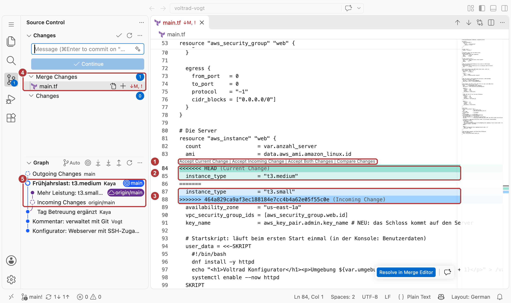
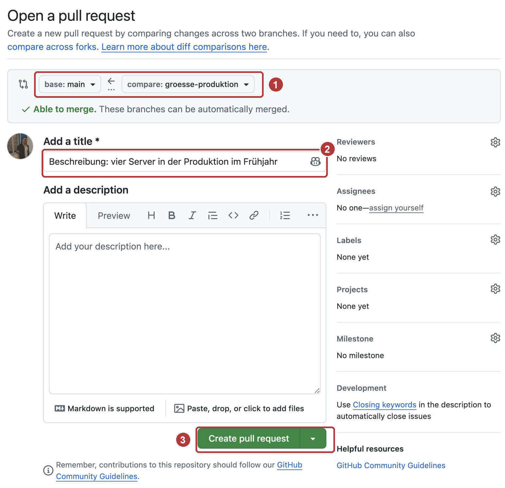
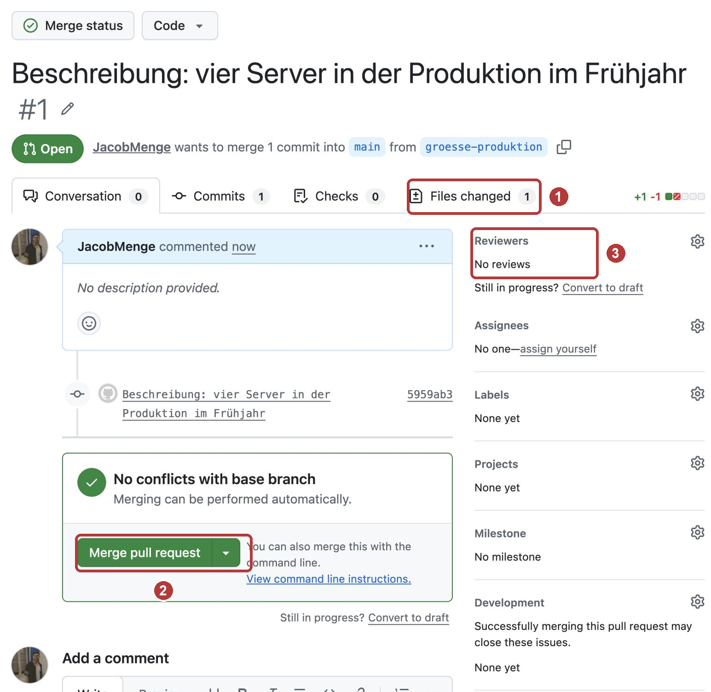

# Praxis: voltrad im Team

In Teil 1 hat euer Ordner `voltrad` einen Verlauf bekommen. Er liegt privat
auf GitHub und ein Gast hat einen ersten Commit beigesteuert. Bisher hat
dabei immer nur eine Person auf einmal geändert.

Heute arbeitet ihr wie ein Team: Zwei Personen ändern dieselbe Zeile und
ihr löst den Konflikt. Ihr nehmt einen fehlerhaften Commit zurück. Ihr arbeitet auf eigenen **Branches** und führt
sie zusammen. Zum Schluss kommt eine Änderung über einen **Pull Request** in
das Repository eines anderen, mit Prüfung durch den Eigentümer.

!!! abstract "Ziel"
    Am Ende könnt ihr:

    - einen Konflikt erkennen, in der Datei entscheiden und abschließen
    - einen Fehler vor dem Push mit `git reset` und nach dem Push mit `git revert` zurücknehmen
    - einen Branch anlegen, wechseln und mit `git merge` zusammenführen
    - eine Änderung als Pull Request vorschlagen, prüfen lassen und übernehmen

    Für die Schnellen gibt es drei kurze Bonus-Aufgaben und eine Denkaufgabe.

!!! note "Windows-Hinweis"
    Unter Windows nutzt ihr wie in Teil 1 die **PowerShell** im Terminal von
    VS Code (**Terminal → Neues Terminal**, englisch **Terminal → New
    Terminal**). Alle Git-Befehle auf dieser Seite sind auf Windows, macOS und
    Linux gleich.

!!! tip "So arbeitet ihr heute"
    Station 1, 3 und 4 macht jede Person für sich. Station 2 und 5 macht ihr
    im Ring eures Breakout-Raums, wie in Teil 1. Ihr braucht zwei
    VS-Code-Fenster: `voltrad` ist euer eigenes Repository, `voltrad-NAME`
    das Repository, in dem ihr Gast seid. Ihr schreibt keinen Code selbst,
    Zeilen und Befehle kopiert ihr von dieser Seite. Wo eine Vorhersage
    steht: erst notieren, dann ausführen. Unter den Stationen stehen Hinweise
    zum Aufklappen.

!!! info "Teil 1 noch nicht fertig?"
    Dann macht ihr in [Teil 1](praxis-voltrad.md) da weiter, wo ihr am
    Mittwoch aufgehört habt, bis einschließlich Station 5. „Üben mit dem
    eigenen Verlauf“ dürft ihr überspringen, die Befehle kommen hier wieder
    vor. Danach geht es hier mit Station 1 weiter.

    Am Mittwoch gefehlt? Dann beginnt ihr in Teil 1 bei Station 1.

    Ist die Person aus eurem Ring noch in Teil 1, wartet ihr nicht auf sie:
    Für Station 2 und 5 gibt es jeweils eine Variante für eine Person.

??? info "Branch und Pull Request in Kürze"
    | | Branch | Pull Request |
    |---|---|---|
    | **Was das ist** | Eine eigene Linie von Commits neben `main`, zum Beispiel für eine einzelne Änderung. | Eine Anfrage auf GitHub: Übernehmt die Commits aus meinem Branch nach `main`. GitHub zeigt dazu die Änderungen Zeile für Zeile. |
    | **Warum gerade das** | Halbfertige Änderungen stören niemanden, der mit `main` arbeitet. Erst wenn die Änderung fertig ist, kommt sie dazu. | Eine zweite Person prüft, bevor etwas auf `main` landet. Kommentare und Entscheidung bleiben auf GitHub nachlesbar. |
    | **So arbeiten wir heute damit** | `git switch -c`, `git switch`, `git merge`, `git branch -d` | Branch hochladen, Pull Request öffnen, Review mit Änderungswunsch, zusammenführen |

    Der Verlauf aus Teil 1 bleibt, wie er ist. Neu ist nur, dass er sich
    verzweigen und wieder zusammenlaufen kann.

## Was ihr heute macht

| Station | Was passiert | Form | Zeit |
|---|---|---|---|
| 1 | Beide Fenster prüfen und auf den neuesten Stand bringen | allein | 5 Min. |
| 2 | Zwei Personen ändern dieselbe Zeile, ihr löst den Konflikt | im Ring | 15 Min. |
| 3 | Einen Fehler zurücknehmen, vor und nach dem Push | allein | 10 Min. |
| 4 | Eine Änderung auf einem Branch bauen und zusammenführen | allein | 15 Min. |
| 5 | Eine Änderung als Pull Request vorschlagen und prüfen lassen | im Ring | 20 Min. |

---

## Station 1: Wieder einsteigen (5 Minuten, allein)

**Was ihr hier tut:** Ihr prüft, ob beide Fenster sauber sind und an der
richtigen Adresse hängen. Dann holt ihr den neuesten Stand.

1. Öffnet in VS Code eure beiden Ordner, jeden in einem eigenen Fenster:
   `voltrad` und `voltrad-NAME`.

2. Im Fenster `voltrad`:

    ```bash
    git status
    ```

    ```bash
    git remote -v
    ```

    `git status` soll `nothing to commit, working tree clean` melden.
    `git remote -v` zeigt zweimal die Adresse eures Repositorys auf GitHub.
    Sie beginnt mit `git@github.com:`, danach steht genau euer
    Benutzername.

3. Holt den neuesten Stand:

    ```bash
    git pull
    ```

4. Dasselbe im Fenster `voltrad-NAME`: `git status`, dann `git pull`.

5. Klärt im Breakout-Chat den Ring für heute: Wer ist euer Gast, bei wem
   seid ihr Gast?

!!! warning "Wenn der Ring heute nicht aufgeht"
    Fehlt jemand aus eurem Ring, rückt ihr zusammen: Wer heute ohne Gast
    ist, lädt die Person ein, die heute ohne Eigentümer ist. Das geht wie in
    Teil 1, Station 5, mit **Settings → Collaborators**. Die neue Person
    klont das Repository mit `git clone` neben ihre Ordner. Bleibt jemand
    allein, nimmt diese Person in Station 2 und 5 die Variante für eine
    Person.

??? tip "Hinweise zu Station 1"
    Meldet `git status` eine geänderte Datei, ist vom Mittwoch noch etwas
    offen. Wollt ihr die Änderung behalten, haltet ihr sie mit
    `git commit -am "…"` fest. Wollt ihr sie verwerfen, holt
    `git restore main.tf` den letzten festgehaltenen Stand zurück. Mehr
    dazu steht unter [Wenn es klemmt](#wenn-es-klemmt).

---

## Station 2: Beide ändern dieselbe Zeile (15 Minuten, im Ring)

**Was ihr hier tut:** Eigentümer und Gast ändern dieselbe Zeile, jeder
anders. Wer als Zweiter hochlädt, muss den Konflikt lösen.

1. **Zuerst alle als Eigentümer**, im eigenen Fenster `voltrad`: Ändert in
   `aws_instance` den Wert von `instance_type` von `"t3.micro"` auf
   `"t3.small"`. Nur der Wert in den Anführungszeichen ändert sich.
   Speichern, dann:

    ```bash
    git commit -am "Mehr Leistung: t3.small"
    ```

    ```bash
    git push
    ```

    `-a` merkt alle geänderten Dateien vor, die Git schon kennt. Das spart
    `git add`. Schreibt danach „gepusht“ in den Chat eures Breakout-Raums.

2. **Danach alle als Gast**, sobald alle in eurem Raum „gepusht“
   geschrieben haben. Im Fenster `voltrad-NAME`, **ohne vorher zu holen**:
   Ändert dort `instance_type` auf `"t3.medium"`, speichert und haltet die
   Änderung fest:

    ```bash
    git commit -am "Frühjahrslast: t3.medium"
    ```

3. **Vorhersage:** Was passiert gleich beim `git push`? Notiert es, dann
   ladet ihr als Gast hoch:

    ```bash
    git push
    ```

    Lest die Meldung genau, sie sagt euch, was zu tun ist.

4. Als Gast holen:

    ```bash
    git pull
    ```

    Öffnet danach `main.tf`. VS Code markiert die umstrittene Stelle farbig.
    Darüber stehen die Knöpfe **Accept Current Change**, **Accept Incoming
    Change**, **Accept Both Changes** und **Compare Changes**.

    { width="560" }

5. Einigt euch mit dem Eigentümer im Breakout-Chat, welcher Wert gelten
   soll. **Current Change** ist eure eigene Fassung, **Incoming Change** die
   vom Eigentümer, die gerade von GitHub kam. Wählt eine Fassung per Knopf
   oder schreibt die Zeile von Hand richtig. Am Ende dürfen in der Datei keine Zeilen mit `<<<<<<<`,
   `=======` oder `>>>>>>>` übrig sein. Speichern, dann:

    ```bash
    git add main.tf
    ```

    ```bash
    git commit -m "Konflikt instance_type gelöst"
    ```

    ```bash
    git push
    ```

6. **Als Eigentümer**, im Fenster `voltrad`: Holt das Ergebnis und seht euch
   die Geschichte als Bild an:

    ```bash
    git pull
    ```

    ```bash
    git log --oneline --graph
    ```

**Frage 1:** Welche Meldung kam beim abgelehnten Push? Was bedeuten die
drei Marken `<<<<<<<`, `=======` und `>>>>>>>` in der Datei?

**Frage 2:** Warum musste der Eigentümer beim letzten `git pull` nichts
entscheiden?

??? note "Allein? So spielt ihr die zweite Person im Browser"
    GitHub kann eine Datei direkt im Browser ändern. Damit übernehmt ihr die
    Rolle des Eigentümers selbst, in eurem eigenen Repository `voltrad`.

    1. Auf GitHub in eurem Repository `main.tf` anklicken, oben rechts auf
       den Stift (**Edit file**).
    2. `instance_type` auf `"t3.small"` ändern. Oben rechts **Commit
       changes...**, Nachricht „Mehr Leistung: t3.small“, die Auswahl
       **Commit directly to the main branch** lassen, dann **Commit
       changes**.
    3. Im Fenster `voltrad`, **ohne vorher zu holen**: `instance_type` auf
       `"t3.medium"` ändern, speichern, dann
       `git commit -am "Frühjahrslast: t3.medium"` und `git push`.
    4. Ab hier weiter mit Schritt 4 oben. Ihr seid jetzt die Person, die als
       Zweite hochlädt.

??? tip "Hinweis 1 zu Station 2"
    Lest die Meldung beim abgelehnten Push bis zum Ende. Der wichtigste
    Teil steht in den Zeilen mit `hint:`.

??? tip "Hinweis 2 zu Station 2"
    **Accept Both Changes** passt hier nicht: Dann stünde `instance_type`
    zweimal in der Datei.

??? tip "Hinweis 3 zu Station 2"
    Nach dem Speichern müsst ihr Git sagen, dass der Konflikt gelöst ist.
    Das geht mit demselben Befehl, mit dem ihr sonst eine Datei vormerkt.

Die Lösung besprechen wir gemeinsam nach der Praxiszeit.

---

## Station 3: Einen Fehler zurücknehmen (10 Minuten, allein)

**Was ihr hier tut:** Ihr macht zweimal denselben Fehler. Einmal merkt ihr
ihn, bevor ihr pusht, einmal erst danach. Je nachdem nehmt ihr ihn anders
zurück. Alles im eigenen Fenster `voltrad`.

**Faustregel:** Vor dem Push springt ihr mit `git reset` zurück, nach dem
Push nehmt ihr den Fehler mit `git revert` zurück.

1. **Fehler vor dem Push.** Setzt in `variable "anzahl_server"` den Wert
   `default` auf `9`, speichert und haltet das fest. Noch **nicht** pushen:

    ```bash
    git commit -am "Neun Server für den Lasttest"
    ```

2. Zeigt den Verlauf:

    ```bash
    git log --oneline
    ```

    Oben steht der Fehler, in der zweiten Zeile der Stand davor. Notiert die
    Kennung aus der **zweiten** Zeile, die sieben Zeichen vorne.

    **Vorhersage:** Was steht nach dem nächsten Befehl bei `default`, und ist
    der Fehler noch im Verlauf? Notiert es, dann springt ihr zurück.
    `KENNUNG` ersetzt ihr durch eure:

    ```bash
    git reset --hard KENNUNG
    ```

    ```bash
    git log --oneline
    ```

    `git reset --hard` verwirft auch alles, was ihr noch nicht committet
    habt. Nutzt es nur, wenn `git status` vorher sauber war.

3. **Fehler nach dem Push.** Macht denselben Fehler noch einmal, diesmal mit
   Push. Setzt `default` wieder auf `9`, speichert, dann:

    ```bash
    git commit -am "Neun Server für den Lasttest"
    ```

    ```bash
    git push
    ```

    Jetzt liegt der Fehler auf GitHub. Euer Gast könnte ihn schon geholt
    haben.

4. Zeigt den Verlauf und notiert diesmal die Kennung aus der **obersten**
   Zeile, also den Fehler selbst:

    ```bash
    git log --oneline
    ```

    **Vorhersage:** Was steht nach dem nächsten Befehl bei `default`, und ist
    der Fehler noch im Verlauf? Notiert es, dann:

    ```bash
    git revert --no-edit KENNUNG
    ```

    ```bash
    git log --oneline
    ```

5. Prüft `main.tf` im Editor und schickt die Rücknahme zu GitHub:

    ```bash
    git push
    ```

    Auf GitHub über der Dateiliste auf **Commits** seht ihr Fehler und
    Rücknahme. Ein Klick auf den Revert zeigt die Änderung rot und grün.

**Frage 3:** Warum nehmt ihr nach dem Push nicht auch `git reset`?

??? tip "Hinweis 1 zu Station 3"
    `git reset --hard` tut so, als hätte es die Commits danach nie gegeben.
    `git revert` legt einen neuen Commit an, der genau das Gegenteil des
    Fehlers macht.

??? tip "Hinweis 2 zu Station 3"
    Was passiert bei `git push`, wenn auf GitHub ein Commit liegt, den euer
    Laptop nicht hat? Das kennt ihr aus Station 2.

Die Lösung besprechen wir gemeinsam nach der Praxiszeit.

---

## Station 4: Ein Branch für eine Änderung (15 Minuten, allein)

**Was ihr hier tut:** Voltrad will die Server auf zwei Zonen verteilen. Ihr
baut die Änderung auf einem eigenen Branch. Solange sie dort liegt, bleibt
`main` unberührt. Erst wenn sie fertig ist, führt ihr sie auf `main`
zusammen. Alles im eigenen Fenster `voltrad`.

1. Legt einen Branch an und wechselt dorthin:

    ```bash
    git switch -c zwei-zonen
    ```

    Ersetzt in `aws_instance` die Zeile mit `availability_zone` durch diese
    Zeile:

    ```hcl
      availability_zone      = element(["us-east-1a", "us-east-1b"], count.index)
    ```

    Sie verteilt die Server abwechselnd: Server 1 kommt in Zone a, Server 2
    in Zone b. Speichern, dann:

    ```bash
    git commit -am "Server auf zwei Zonen verteilt"
    ```

2. **Vorhersage:** Ihr wechselt gleich zurück auf `main`. Was steht dann in
   der Zeile `availability_zone`? Notiert es, dann:

    ```bash
    git switch main
    ```

    Seht in `main.tf` nach.

3. Die Änderung ist fertig. Führt sie auf `main` zusammen:

    ```bash
    git merge zwei-zonen
    ```

    Seht wieder in `main.tf` nach.

4. Schickt `main` zu GitHub und räumt den Branch weg. Sein Commit bleibt im
   Verlauf von `main`:

    ```bash
    git push
    ```

    ```bash
    git branch -d zwei-zonen
    ```

**Frage 4:** Was stand auf `main`, solange die Änderung nur auf dem Branch
lag? Und nach dem Merge?

??? tip "Hinweis 1 zu Station 4"
    Wechselt ihr den Branch, stellt Git den Ordner auf den Stand dieses
    Branches. Die Datei im Editor ändert sich dabei von selbst.

??? tip "Hinweis 2 zu Station 4"
    `git merge zwei-zonen` holt die Commits von `zwei-zonen` auf den Branch,
    auf dem ihr gerade steht.

Die Lösung besprechen wir gemeinsam nach der Praxiszeit.

---

## Station 5: Pull Request im Ring (20 Minuten, im Ring)

**Was ihr hier tut:** Der Gast schlägt eine Änderung im Repository des
Eigentümers vor, diesmal nicht direkt auf `main`, sondern über einen Branch
und einen Pull Request. Der Eigentümer prüft, wünscht eine Änderung, der
Gast bessert nach, dann führt der Eigentümer zusammen.

1. **Als Gast**, im Fenster `voltrad-NAME`: Holt den neuesten Stand und legt
   einen Branch an:

    ```bash
    git pull
    ```

    ```bash
    git switch -c groesse-produktion
    ```

2. Ergänzt in `variable "anzahl_server"` die Beschreibung, sodass die Zeile
   so aussieht:

    ```hcl
      description = "Wie viele Server sollen laufen? Produktion im Frühjahr: 4"
    ```

    Speichern, festhalten und den Branch hochladen:

    ```bash
    git commit -am "Beschreibung: vier Server in der Produktion im Frühjahr"
    ```

    ```bash
    git push -u origin groesse-produktion
    ```

    `-u` merkt sich, dass dieser Branch zu `groesse-produktion` auf GitHub
    gehört. Danach reicht auch hier `git push`.

3. **Als Gast**, auf GitHub im Repository des Eigentümers: Oben erscheint
   ein gelber Hinweis mit dem Knopf **Compare & pull request**. Klickt
   darauf. Prüft, dass oben **base: main** und **compare:
   groesse-produktion** steht. Rechts bei **Reviewers** tragt ihr über das
   Zahnrad den Eigentümer ein. Dann **Create pull request**. Fehlt der
   gelbe Hinweis: **Pull requests** → **New pull request**, bei
   **compare** den Branch `groesse-produktion` wählen.

    { width="560" }

4. **Als Eigentümer:** Öffnet den Pull Request (**Pull requests** in eurem
   Repository). Unter **Files changed** seht ihr die Änderung. Oben rechts
   über der Änderung klickt ihr **Review changes**, schreibt „Bitte die
   Monate nennen, nicht nur Frühjahr.“, wählt **Request changes** und dann
   **Submit review**.

    { width="560" }

5. **Als Gast:** Bessert im selben Branch nach. Die Zeile lautet jetzt:

    ```hcl
      description = "Wie viele Server sollen laufen? Produktion März bis Mai: 3 bis 4"
    ```

    ```bash
    git commit -am "Beschreibung: Monate genannt"
    ```

    ```bash
    git push
    ```

    Seht euch den Pull Request auf GitHub an. Was hat sich dort verändert?

6. **Als Eigentümer:** Unter **Files changed** wieder **Review changes**,
   diesmal **Approve**, dann **Submit review**. Danach im Reiter
   **Conversation** auf **Merge pull request** und **Confirm merge**.
   GitHub bietet anschließend **Delete branch** an. Klickt darauf.

7. Beide holen den neuen Stand.

    === "Gast, Fenster voltrad-NAME"

        ```bash
        git switch main
        ```

        ```bash
        git pull
        ```

        ```bash
        git branch -d groesse-produktion
        ```

    === "Eigentümer, Fenster voltrad"

        ```bash
        git pull
        ```

        ```bash
        git log --oneline --graph
        ```

**Frage 5:** Was ist im Pull Request passiert, als der Gast nachgebessert
und gepusht hat?

??? note "Allein? So geht der Pull Request im eigenen Repository"
    Ihr macht alle Schritte im eigenen Fenster `voltrad` und in eurem
    eigenen Repository auf GitHub. Den Reviewer lasst ihr weg: GitHub erlaubt
    nicht, den eigenen Pull Request zu genehmigen. Statt **Request changes**
    schreibt ihr im Reiter **Conversation** einen Kommentar mit dem
    Änderungswunsch, bessert nach und führt dann selbst zusammen.

??? tip "Hinweis 1 zu Station 5"
    Ein Pull Request hängt am Branch, nicht an einem einzelnen Commit.

??? tip "Hinweis 2 zu Station 5"
    Seht euch im Pull Request den Reiter **Commits** an, bevor und nachdem
    der Gast nachgebessert hat.

Die Lösung besprechen wir gemeinsam nach der Praxiszeit.

---

## Bonus für die Schnellen

### Bonus 1: Konflikt zwischen zwei Branches (8 Minuten)

Konflikte entstehen nicht nur beim `git pull`. Ändern zwei Branches
dieselbe Zeile, hält auch `git merge` an. Alles im eigenen Fenster
`voltrad`.

1. Zwei Branches, beide ändern `instance_type`:

    ```bash
    git switch -c test-gross
    ```

    `instance_type` auf `"t3.large"` setzen, speichern, dann:

    ```bash
    git commit -am "Test: t3.large"
    ```

    ```bash
    git switch main
    ```

    ```bash
    git switch -c test-klein
    ```

    `instance_type` auf `"t3.nano"` setzen, speichern, dann:

    ```bash
    git commit -am "Test: t3.nano"
    ```

2. Zusammenführen:

    ```bash
    git switch main
    ```

    ```bash
    git merge test-gross
    ```

    ```bash
    git merge test-klein
    ```

3. Ihr wollt den Merge doch nicht? Dieser Befehl stellt den Stand vor dem
   zweiten Merge wieder her:

    ```bash
    git merge --abort
    ```

    Startet den zweiten Merge dann noch einmal und löst den Konflikt wie in
    Station 2. Schreibt die Zeile dabei von Hand so, dass wieder euer Wert
    aus Station 2 dasteht. Zum Abschluss reichen `git add main.tf` und
    `git commit --no-edit`.

4. Aufräumen:

    ```bash
    git branch -d test-gross test-klein
    ```

??? success "Musterlösung Bonus 1"
    Der erste Merge ist ein Fast-forward, denn `main` hatte sich seit dem
    Abzweigen von `test-gross` nicht bewegt. Der zweite meldet
    `CONFLICT (content): Merge conflict in main.tf`, weil `test-klein`
    dieselbe Zeile anders geändert hat als `main` inzwischen.

    In der Datei stehen dieselben Marken wie beim `git pull`.
    `<<<<<<< HEAD` ist euer `main` mit `"t3.large"`, `>>>>>>> test-klein`
    der andere Branch mit `"t3.nano"`. Ein `git pull` macht intern nichts
    anderes: Er holt den Stand von GitHub und führt ihn mit einem Merge
    zusammen.

    `git merge --abort` bricht den Merge ab und stellt den Stand davor
    wieder her. Ihr müsst euch beim Lösen nicht für eine der beiden
    Fassungen entscheiden: Was am Ende in der Zeile steht, bestimmt ihr.
    `git commit --no-edit` schließt den Merge mit der vorgeschlagenen
    Nachricht `Merge branch 'test-klein'` ab.

### Bonus 2: Eine Datei aus einem alten Stand holen (5 Minuten)

1. Im Fenster `voltrad`: Holt `main.tf` in der Fassung eures ersten Commits
   in den Ordner. `KENNUNG` ist die Kennung eures ersten Commits, `git log --oneline`
   zeigt sie ganz unten:

    ```bash
    git restore --source KENNUNG main.tf
    ```

    ```bash
    git diff
    ```

2. **Frage:** Wie viele Stellen zeigt `git diff`? Hättet ihr damit nur die
   neun Server zurückgeholt oder mehr?

3. Den alten Stand wieder verwerfen. Ohne `--source` holt `git restore` die
   Datei aus dem letzten Commit:

    ```bash
    git restore main.tf
    ```

??? success "Musterlösung Bonus 2"
    `git restore --source` holt die **ganze Datei** in der alten Fassung,
    nicht eine einzelne Änderung. `git diff` zeigt deshalb jede Stelle, die
    sich seitdem geändert hat, zum Beispiel die erste Zeile, den Gast in den
    Tags, `instance_type`, die Zonen und die neue Ausgabe.

    Für eine einzelne Änderung ist `git revert` das richtige Werkzeug.
    `git restore --source` passt, wenn eine Datei wirklich als Ganzes auf
    einen alten Stand soll. Danach folgen wie immer `git add` und
    `git commit`. Bis zum Commit lässt sich alles mit `git restore main.tf`
    verwerfen.

### Bonus 3: Branches in VS Code (5 Minuten)

Alles aus Station 4 geht in VS Code auch per Klick.

1. Unten links in der Statusleiste steht der Branch, auf dem ihr steht,
   zum Beispiel `main`. Klickt darauf. Oben öffnet sich eine Liste mit
   euren Branches und dem Eintrag **Create new branch...**.
2. Legt so einen Branch `ausprobieren` an. Die Statusleiste zeigt den neuen
   Namen.
3. Öffnet links die Quellcodeverwaltung (++ctrl+shift+g++). Im Bereich
   **Graph** seht ihr euren Verlauf mit allen Verzweigungen, so wie bei
   `git log --graph`.
4. Wechselt über die Statusleiste zurück auf `main` und löscht den Branch
   im Terminal:

    ```bash
    git branch -d ausprobieren
    ```

??? success "Musterlösung Bonus 3"
    VS Code ruft im Hintergrund dieselben Git-Befehle auf, die ihr im
    Terminal tippt: Klick auf **Create new branch...** entspricht
    `git switch -c`, der Wechsel in der Liste entspricht `git switch`. Der
    Graph zeigt dieselben Commits wie `git log --oneline --graph --all`.
    Wer im Alltag lieber klickt, kann das tun. Die Meldungen bei Ablehnung
    oder Konflikt sind dieselben.

### Denkaufgabe: Drei Änderungen für das Frühjahr (10 Minuten)

Bei Voltrad sollen bis März drei Änderungen in `main.tf`: Frau Vogt
verteilt die Server auf zwei Zonen. Herr Kaya gibt Port 443 für HTTPS frei.
Ein externer Dienstleister baut das Startskript der Webserver um.

Überlegt:

1. Wie viele Branches legt das Team an und wer arbeitet auf welchem?
2. Herr Kaya ist zuerst fertig, sein Pull Request wird zusammengeführt.
   Was bedeutet das für die beiden anderen Pull Requests?
3. Wer darf zusammenführen? Und wie stellt Voltrad sicher, dass niemand
   direkt auf `main` pusht?
4. Was sollte vor jedem Merge geprüft werden, damit keine fehlerhafte
   `main.tf` auf `main` landet? Wer könnte das prüfen, ohne dass ein Mensch
   jedes Mal daran denken muss?

??? success "Musterlösung Denkaufgabe"
    1. **Drei Branches, einer je Änderung**, zum Beispiel `zwei-zonen`,
       `https` und `startskript`. Jede Person arbeitet auf ihrem eigenen.
       So kann jede Änderung für sich geprüft und zusammengeführt werden,
       auch wenn eine andere noch dauert.
    2. **`main` hat sich bewegt.** Die beiden anderen Pull Requests zeigen
       weiter nur ihre eigenen Änderungen. Ändern sie andere Zeilen als
       Herr Kaya, führt GitHub sie später ohne Rückfrage zusammen. Ändern
       sie dieselbe Zeile, meldet GitHub einen Konflikt im Pull Request.
       Dann holt die Person `main` in ihren Branch und löst den Konflikt
       wie in Station 2.
    3. **Zusammenführen darf, wer geprüft hat**, also nicht die Person, die
       die Änderung geschrieben hat. Erzwingen lässt sich das mit einer
       Schutzregel für `main` (Protected Branch): kein direkter Push,
       mindestens eine Genehmigung vor dem Merge. Für private Repositories
       gibt es Schutzregeln erst in einem bezahlten Tarif, etwa GitHub Pro
       oder GitHub Team. Im kostenlosen Tarif bleibt es bei der Absprache.
    4. **Prüfen vor dem Merge:** Ist die Datei sauber formatiert
       (`terraform fmt -check`)? Ist sie gültig (`terraform validate`)? Was
       würde sich ändern (`terraform plan`)? Das muss kein Mensch jedes Mal
       von Hand tun. Eine **Pipeline** kann bei jedem Pull Request
       automatisch prüfen und das Ergebnis im Pull Request anzeigen. Das
       nennt man CI (Continuous Integration). Es kommt später im Kurs.

---

## Aufräumen

Heute wird nichts gelöscht. Euer Repository `voltrad` brauchen wir später
noch einmal, wenn eine Pipeline jede Änderung automatisch prüft. Die Ordner
`voltrad` und `voltrad-NAME` bleiben auf eurem Rechner.

---

## Wenn es klemmt

| Was ihr seht | Woran es liegt | Was hilft |
|---|---|---|
| `ERROR: Repository not found` | Die Adresse in `origin` ist falsch geschrieben, meist der Benutzername | `git remote -v` zeigen lassen und mit dem Namen auf GitHub vergleichen. Korrigieren mit `git remote set-url origin git@github.com:NAME/voltrad.git` |
| `error: Your local changes to the following files would be overwritten by merge` | In der Datei steht eine Änderung, die noch nicht festgehalten ist | Behalten: `git commit -am "…"`, dann noch einmal `git pull`. Verwerfen: `git restore main.tf`. |
| `fatal: You have not concluded your merge (MERGE_HEAD exists)` | Ein Merge vom letzten Mal ist noch nicht abgeschlossen | Prüfen, dass keine Konfliktmarken mehr in `main.tf` stehen. Dann `git add main.tf` und `git commit --no-edit`. |
| `Updates were rejected because the remote contains work that you do not have locally` | Auf GitHub liegt ein Stand, den ihr noch nicht habt | Erst `git pull`, dann `git push`. Öffnet sich dabei in VS Code ein Reiter `MERGE_MSG`, schließt ihn. In Station 2 ist die Ablehnung gewollt. |
| Beim `git pull` öffnet sich in VS Code ein Reiter `MERGE_MSG` und das Terminal wartet | Git führt zwei Stände selbst zusammen und schlägt eine Nachricht vor | Den Reiter schließen. Das Terminal läuft danach weiter. |
| Das Terminal wartet nach `git revert`, in VS Code ist ein Reiter offen | `--no-edit` fehlte, Git wartet auf die Nachricht | Den Reiter schließen. |
| Der Gast konnte in Station 2 ohne Ablehnung pushen, es gab keinen Konflikt | Der Gast hat vor seiner Änderung geholt oder der Eigentümer hatte noch nicht gepusht | Mit dem Eigentümer noch einmal dieselbe Zeile anders ändern: erst pusht der Eigentümer, dann der Gast ohne zu holen. |
| `error: The branch 'NAME' is not fully merged` | Der Branch enthält Commits, die noch nicht auf `main` sind | Erst `git switch main` und `git merge NAME`. Oder beim Gast nach dem Pull Request erst `git pull` auf `main`. |
| `fatal: a branch named 'NAME' already exists` | Den Branch gibt es schon, etwa aus Bonus 3 von Teil 1 | Mit `git switch NAME` dorthin wechseln oder einen anderen Namen wählen. |
| Der gelbe Knopf **Compare & pull request** fehlt | GitHub zeigt ihn nur kurz nach dem Push und nur der Person, die gepusht hat | **Pull requests** → **New pull request**, bei **compare** den Branch wählen. |
| **Approve** lässt sich nicht auswählen | Den eigenen Pull Request darf man nicht genehmigen | Die zweite Person genehmigt. Allein: Kommentar statt Genehmigung, dann selbst zusammenführen. |
| `git branch -a` zeigt `remotes/origin/groesse-produktion`, obwohl der Branch auf GitHub gelöscht ist | Euer Rechner merkt sich den letzten bekannten Stand von GitHub | `git fetch --prune` räumt solche Einträge weg. Schaden tun sie nicht. |

Weitere Meldungen aus Teil 1 stehen dort unter
[Wenn es klemmt](praxis-voltrad.md#wenn-es-klemmt).

---

## Was ihr zur Auswertung mitbringt

1. Welche Meldung kam beim abgelehnten Push? Was bedeuten die drei Marken
   in der Datei?
2. Warum musste der Eigentümer beim letzten `git pull` nichts entscheiden?
3. Warum nehmt ihr nach dem Push nicht auch `git reset`?
4. Was stand auf `main`, solange die Änderung nur auf dem Branch lag? Und
   nach dem Merge?
5. Was ist im Pull Request passiert, als der Gast nachgebessert hat?
6. Denkfrage: GitHub ist eine Stunde lang nicht erreichbar. Was kann
   Voltrads IT in dieser Stunde noch tun, was nicht?

---

## Weiterlesen

- [Teil 1: voltrad auf GitHub](praxis-voltrad.md): Einrichtung, erster
  Push, Gast im Ring
- [Branches und Merge](branches-und-merge.md): Zweige und Zusammenführen
  ausführlich
- [Typische Workflows in der Praxis](workflows.md): wie Teams mit Branches
  und Pull Requests arbeiten
- [Stolpersteine](stolpersteine.md): weitere typische Fehler und ihre
  Lösung
