# Praxis: voltrad auf GitHub

Am Montag lag eure `main.tf` zum ersten Mal auf eurem eigenen Rechner. Dort
ist sie sicherer als in CloudShell, aber noch immer allein: Niemand sieht,
wer wann was geändert hat und warum. Mitarbeiten kann auch niemand.

Heute wird der Ordner `voltrad` ein **Repository**: ein Ordner, dessen
Geschichte Git aufschreibt. Ihr legt ihn **privat auf GitHub** ab: ohne
State-Datei und ohne Schlüssel. Danach arbeitet ihr im **Ring** mit:
Jede Person lädt eine andere in ihr Repository ein und arbeitet als Gast im
Repository einer dritten Person mit. In Teil 2 ändern dann zwei Personen
dieselbe Zeile. Den Konflikt, der dabei entsteht, löst ihr selbst.

!!! info "Heute Teil 1"
    Heute macht ihr **Station 1 bis 5** und danach **Üben mit dem eigenen
    Verlauf**. Wer schneller ist, macht Bonus 1 und 2. **Station 6** (der
    Konflikt) und **Bonus 3** (Pull Request) folgen in Teil 2 am Montag,
    zusammen mit Branches und Merge.

!!! abstract "Ziel"
    Am Ende könnt ihr:

    - Git einrichten und einen Ordner zum Repository machen
    - mit einer `.gitignore` festlegen, was nie ins Repository kommt
    - Änderungen mit `git add` und `git commit` festhalten und mit `git log` und `git diff` ansehen
    - euch mit eurem SSH-Schlüssel bei GitHub anmelden und ein Repository hochladen
    - eine andere Person einladen, ein fremdes Repository klonen, Änderungen holen und schicken
    - in Teil 2: einen Konflikt erkennen und auflösen

    Für die Schnellen gibt es heute Bonus 1 und 2 und eine Denkaufgabe.

!!! note "Windows-Hinweis"
    Unter Windows nutzt ihr die **PowerShell** im Terminal von VS Code
    (**Terminal → Neues Terminal**, englisch **Terminal → New Terminal**).
    Die Git-Befehle sind auf Windows, macOS und Linux gleich. Wo sich etwas
    unterscheidet, gibt es Tabs mit der passenden Variante.

!!! danger "Was nie in ein Repository gehört"
    Euer **Zugangsschlüssel** für AWS, euer **privater SSH-Schlüssel**
    (`id_ed25519` ohne `.pub`) und die **State-Datei** `terraform.tfstate`.
    Was einmal committet ist, steckt in der Geschichte des Repositorys, auch
    wenn ihr die Datei später löscht. Bei öffentlichen Repositories hält
    GitHub bekannte Schlüssel wie die von AWS beim Hochladen auf. Bei
    privaten Repositories eines kostenlosen Kontos prüft GitHub das nicht.
    Dort schützt euch nur eure `.gitignore`.

!!! tip "So arbeitet ihr heute"
    Die Stationen 1 bis 4 macht jede Person für sich. Station 5 macht ihr im
    Ring mit den anderen aus eurem Breakout-Raum, danach übt jede Person mit
    dem eigenen Verlauf. Hängt jemand fest, helft ihr euch. Ihr schreibt
    keinen Code selbst, Dateien und Befehle kopiert ihr von dieser Seite.
    Unter einigen Stationen stehen Hinweise zum Aufklappen. Notiert eure
    Vorhersagen, bevor ihr den Befehl ausführt.

??? info "Git und GitHub in Kürze"
    | | Git | GitHub |
    |---|---|---|
    | **Was das ist** | Ein Programm auf eurem Rechner. Es schreibt die Geschichte eines Ordners auf: wer wann was geändert hat und warum. | Ein Dienst im Internet, auf dem Repositories liegen. Dort trefft ihr euch, um gemeinsam an einem Repository zu arbeiten. |
    | **Warum gerade das** | Git ist der Standard für Code und Konfiguration, auch für Terraform. Jede Kopie eines Repositorys ist vollständig, mit der ganzen Geschichte. | GitHub ist der verbreitetste Dienst dafür und für private Repositories kostenlos. Andere Anbieter wie GitLab arbeiten genauso. |
    | **So arbeiten wir heute damit** | `git init`, `status`, `add`, `commit`, `log`, `diff`, dazu `push`, `pull` und `clone` | Konto anlegen, SSH-Schlüssel hinterlegen, privates Repository anlegen, eine andere Person einladen |

    **Git** funktioniert auch ganz ohne GitHub, auf eurem Rechner allein.
    **GitHub** kommt dazu, sobald andere mitarbeiten sollen: Dort liegt eine
    Kopie eures Repositorys, an der alle Eingeladenen arbeiten dürfen.

!!! info "Am Montag gefehlt?"
    Dann fehlen euch der Ordner `voltrad` und euer Schlüsselpaar. Beides ist
    in fünf Minuten nachgeholt:

    1. Legt einen Ordner `voltrad` an und kopiert die Datei `main.tf` aus
       [Praxis: Terraform vom eigenen Laptop](../infrastruktur-planung/praxis-terraform-lokal.md),
       Station 3.
    2. Erzeugt euer Schlüsselpaar wie dort in Station 2 mit `ssh-keygen`.

    Eine State-Datei und den Ordner `.terraform` habt ihr dann nicht. Das ist
    für heute kein Problem, euer `git status` in Station 3 zeigt nur
    weniger Dateien.

## Was ihr heute baut

| Station | Was passiert | Form | Zeit |
|---|---|---|---|
| 1 | Git prüfen oder installieren, GitHub-Konto, Git einrichten | allein | 15 Min. |
| 2 | Euren öffentlichen Schlüssel bei GitHub hinterlegen | allein | 10 Min. |
| 3 | Der Ordner `voltrad` wird ein Repository, mit `.gitignore` | allein | 15 Min. |
| 4 | Privates Repository auf GitHub, hochladen, nachsehen | allein | 10 Min. |
| 5 | Gast im Repository der Person, die euch einlädt | im Ring | 15 Min. |
| Üben | Eigene Commits, push, im Browser ansehen | allein | 15 Min. |
| 6 | Zwei Personen ändern dieselbe Zeile | Teil 2 | am Montag |

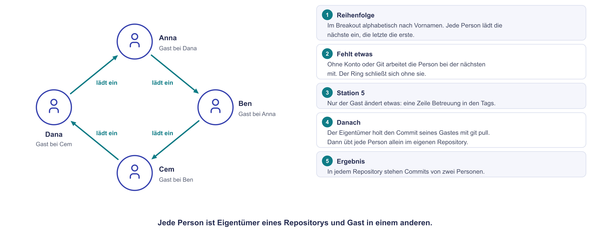{ .diagramm }

So sieht euer Repository auf GitHub nach Teil 2 aus: drei Dateien, keine
State-Datei, Commits von zwei Personen. Heute fehlt nur der letzte Commit
aus Station 6.

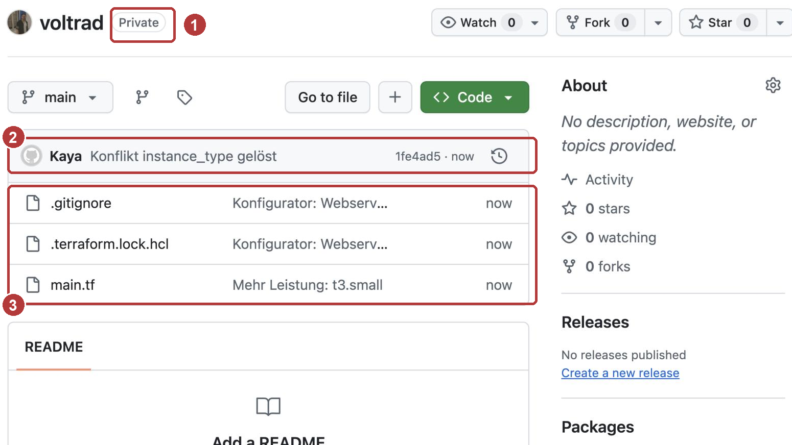{ width="560" }

---

## Station 1: Werkzeuge und Konto (15 Minuten, allein)

**Was ihr hier tut:** Ihr prüft, ob Git installiert ist, legt ein
GitHub-Konto an und sagt Git einmalig, wer ihr seid.

1. Öffnet VS Code mit eurem Ordner `voltrad` und darin ein Terminal. Prüft,
   ob Git da ist:

    ```bash
    git --version
    ```

    Kommt eine Versionsnummer wie `git version 2.56.0.windows.1`, ist Git
    installiert. Weiter mit Schritt 2. Sonst installiert ihr Git jetzt:

    === "Windows (PowerShell)"

        ```powershell
        winget install --id Git.Git -e --source winget
        ```

        Windows fragt dabei nach **Administratorrechten**. Danach VS Code
        ganz schließen und neu öffnen, erst dann findet das Terminal den
        Befehl `git`.

        Kennt Windows den Befehl `winget` nicht, ladet ihr Git von
        [git-scm.com/downloads/win](https://git-scm.com/downloads/win) und
        klickt euch mit den vorgeschlagenen Einstellungen durch.

        Habt ihr auf eurem Firmenlaptop keine Administratorrechte, arbeitet
        ihr heute mit der nächsten Person aus dem Ring an deren Bildschirm
        mit und sagt Jacob kurz Bescheid.

    === "macOS / Linux"

        Auf dem Mac öffnet `git --version` ein Fenster, das die
        **Entwicklerwerkzeuge** (Command Line Tools) installieren will.
        Bestätigt mit **Installieren**. Das dauert einige Minuten, danach
        `git --version` noch einmal.

        Unter Linux installiert ihr Git über die Paketverwaltung, zum
        Beispiel `sudo apt install git`.

2. Legt ein Konto auf [github.com/signup](https://github.com/signup) an.
   GitHub fragt nach E-Mail-Adresse, Passwort und Benutzername, dann kommt
   ein kurzes Rätsel und ein Code per E-Mail. Habt ihr schon ein Konto,
   nehmt ihr das.

    Der Benutzername ist frei wählbar und erscheint in den Adressen eurer
    Repositories. Euer Profil ist öffentlich, eure Repositories legt ihr
    heute **privat** an.

    Meldet ihr euch später auf einem neuen Gerät an, schickt GitHub
    ebenfalls einen Code per E-Mail. Haltet euer Postfach bereit.

3. Stellt ein, dass eure private E-Mail-Adresse nicht in euren Commits
   landet: Profilbild oben rechts → **Settings** → **Emails** → Haken bei
   **Keep my email addresses private**. Darunter zeigt GitHub eure
   Ersatzadresse in der Form `12345678+name@users.noreply.github.com`.
   Kopiert sie.

    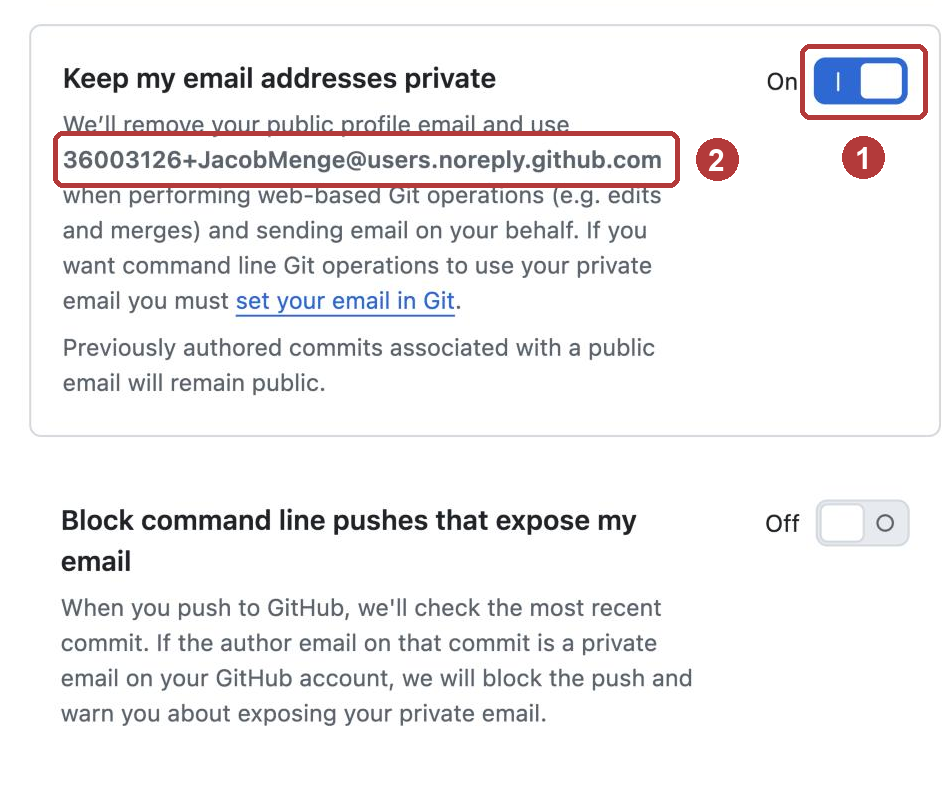{ width="560" }

    In jedem Commit steht die E-Mail-Adresse, die ihr Git gleich nennt.
    Mit der Ersatzadresse ordnet GitHub eure Commits trotzdem eurem Konto zu.

4. Sagt Git einmalig, wer ihr seid. Die fünf Zeilen sind auf allen Systemen
   gleich. Name und Ersatzadresse ersetzt ihr durch eure eigenen:

    ```bash
    git config --global user.name "Vorname Nachname"
    ```

    ```bash
    git config --global user.email "12345678+name@users.noreply.github.com"
    ```

    ```bash
    git config --global init.defaultBranch main
    ```

    ```bash
    git config --global core.editor "code --wait"
    ```

    ```bash
    git config --global pull.rebase false
    ```

    | Zeile | Warum |
    |---|---|
    | `user.name`, `user.email` | So steht ihr in jedem Commit als Autor. |
    | `init.defaultBranch main` | Der erste Zweig eines neuen Repositorys heißt `main`, wie bei GitHub. Git für Windows nennt ihn sonst `master`. |
    | `core.editor "code --wait"` | Braucht Git einmal einen Text von euch, öffnet es VS Code. Sonst öffnet es den Editor Vim, aus dem viele nicht mehr herausfinden. |
    | `pull.rebase false` | Gibt es bei euch und auf GitHub neue Commits, führt `git pull` sie zusammen. Ohne die Zeile bricht Git dann auf macOS und Linux mit einer Fehlermeldung ab. |

    Nutzt ihr nicht VS Code, schreibt ihr in die vierte Zeile `notepad`
    statt `"code --wait"`. Auf dem Mac kennt das Terminal den Befehl `code`
    erst, wenn ihr ihn einmal eingerichtet habt: in VS Code
    ++cmd+shift+p++, dann **Shell Command: Install 'code' command in PATH**.
    Prüfen könnt ihr alles mit:

    ```bash
    git config --global --list
    ```

5. Schreibt euren GitHub-Benutzernamen in den Chat eures Breakout-Raums. Die
   Namen braucht ihr in Station 5. Wer mag, öffnet die Profile der anderen
   (`github.com/benutzername`) und klickt auf **Follow**.

---

## Station 2: Euer Schloss bei GitHub (10 Minuten, allein)

**Was ihr hier tut:** Ihr hinterlegt euren öffentlichen Schlüssel vom Montag
bei GitHub. Er ist ein zweites Schloss für denselben Schlüssel: Am Montag lag
er auf dem Server, heute zusätzlich bei GitHub. Der private Schlüssel bleibt
auf eurem Rechner.

1. Kopiert euren **öffentlichen** Schlüssel in die Zwischenablage:

    === "Windows (PowerShell)"

        ```powershell
        Get-Content $HOME\.ssh\id_ed25519.pub | Set-Clipboard
        ```

    === "macOS / Linux"

        macOS:

        ```bash
        pbcopy < ~/.ssh/id_ed25519.pub
        ```

        Linux: Den Inhalt anzeigen und die ganze Zeile markieren und
        kopieren.

        ```bash
        cat ~/.ssh/id_ed25519.pub
        ```

2. Bei GitHub: Profilbild oben rechts → **Settings** → **SSH and GPG keys**
   → **New SSH key**. Als **Title** schreibt ihr zum Beispiel `Laptop`, in
   das Feld **Key** fügt ihr mit ++ctrl+v++ ein. Dann **Add SSH key**.
   GitHub kann dabei noch einmal nach eurem Passwort oder einem Code
   fragen.

    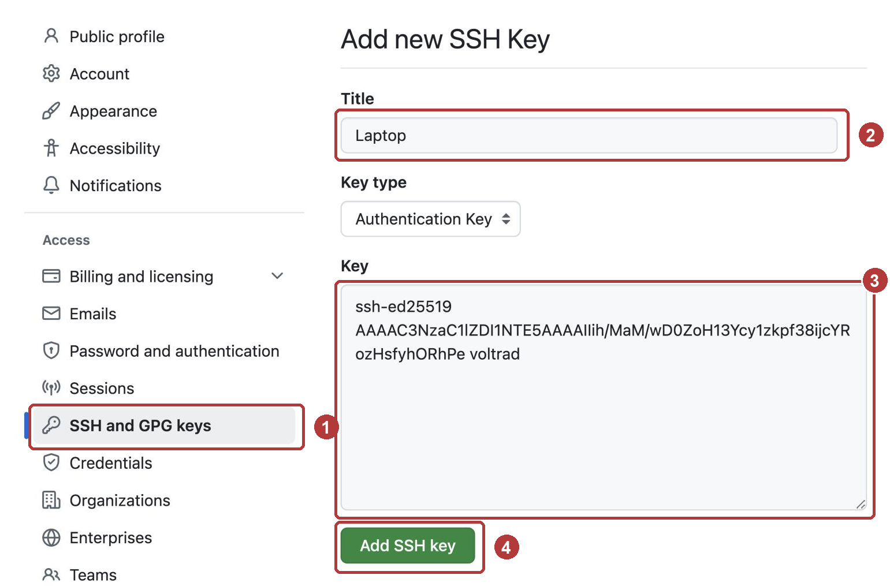{ width="560" }

3. **Vorhersage:** Gleich verbindet sich euer Rechner zum ersten Mal per
   SSH mit GitHub. Welche Frage stellt `ssh` dabei? Warum? Denkt an
   Montag. Dann testet die Verbindung:

    ```bash
    ssh -T git@github.com
    ```

    Vergleicht den Fingerabdruck in der Frage mit dem Wert, den GitHub auf
    der Seite [GitHub's SSH key fingerprints](https://docs.github.com/en/authentication/keeping-your-account-and-data-secure/githubs-ssh-key-fingerprints)
    veröffentlicht:

    ```text
    SHA256:+DiY3wvvV6TuJJhbpZisF/zLDA0zPMSvHdkr4UvCOqU
    ```

    Stimmt er überein, antwortet ihr mit `yes`. Erwartet wird:

    ```text
    Hi NAME! You've successfully authenticated, but GitHub does not provide shell access.
    ```

    Der zweite Teil ist kein Fehler: GitHub lässt euch nicht auf seine
    Server, es prüft nur, wer ihr seid.

---

## Station 3: Der Ordner wird ein Repository (15 Minuten, allein)

**Was ihr hier tut:** Ihr macht den Ordner `voltrad` zum Repository und
legt fest, was Git nie aufnehmen soll. Dann haltet ihr den ersten Stand
fest.

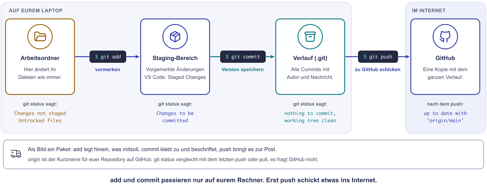{ .diagramm }

1. Im Terminal von VS Code, im Ordner `voltrad`:

    ```bash
    git init
    ```

    Git legt einen versteckten Ordner `.git` an. Darin steht ab jetzt die
    ganze Geschichte.

2. **Vorhersage 1:** Welche Dateien und Ordner wird `git status` gleich als
   neu anzeigen? Schaut in den Explorer von VS Code und notiert eure Liste.
   Dann prüft ihr:

    ```bash
    git status
    ```

3. Legt im Explorer von VS Code eine neue Datei mit dem Namen `.gitignore`
   an, mit dem Punkt am Anfang und ohne Endung. Kopiert diesen Inhalt hinein
   und speichert mit ++ctrl+s++:

    ```text
    # Terraform: Provider, State und persönliche Werte bleiben draußen
    .terraform/
    *.tfstate
    *.tfstate.*
    *.tfvars
    crash.log
    ```

    **Achtung bei Notepad:** Beim Speichern **Dateityp: Alle Dateien**
    wählen, sonst entsteht `.gitignore.txt` und Git beachtet die Datei
    nicht.

4. **Vorhersage 2:** Was zeigt `git status` jetzt? Notiert eure Liste.
   Dann prüft ihr, stellt alles bereit und haltet den ersten Stand fest:

    ```bash
    git status
    ```

    ```bash
    git add .
    ```

    ```bash
    git status
    ```

    ```bash
    git commit -m "Konfigurator: Webserver mit SSH-Zugang"
    ```

    ```bash
    git log
    ```

    Endet eine Ausgabe mit `:` oder `(END)`, zeigt Git sie seitenweise an.
    Mit ++q++ kommt ihr zurück.

5. Eine kleine Änderung: Ändert in `main.tf` die erste Zeile von

    ```hcl
    # Voltrad Konfigurator: Webserver, gebaut vom eigenen Laptop
    ```

    zu

    ```hcl
    # Voltrad Konfigurator: Webserver, verwaltet mit Git
    ```

    und speichert. Dann:

    ```bash
    git diff
    ```

    ```bash
    git add main.tf
    ```

    ```bash
    git commit -m "Kommentar: verwaltet mit Git"
    ```

    ```bash
    git log --oneline
    ```

**Frage 1:** Was zeigt `git diff` in den Zeilen mit `-` und mit `+`?

??? tip "Hinweis 1 zu Station 3"
    Git meldet nur Dateien, die es noch nicht kennt und die es nicht
    ignorieren soll. Direkt nach `git init` kennt Git noch keine einzige
    Datei.

??? tip "Hinweis 2 zu Station 3"
    Legt die `.gitignore` neben den Explorer und geht jede Zeile durch.
    Ein `*` steht für beliebige Zeichen, ein `/` am Ende für einen Ordner.
    Welche Dateien im Explorer passen zu welcher Zeile?

??? tip "Hinweis 3 zu Station 3"
    `git diff` vergleicht euren Ordner mit dem letzten festgehaltenen Stand.
    Eine geänderte Zeile erscheint deshalb zweimal.

Die Lösung besprechen wir gemeinsam nach der Praxiszeit.

---

## Station 4: Ab zu GitHub (10 Minuten, allein)

**Was ihr hier tut:** Ihr legt ein leeres, privates Repository auf GitHub an
und ladet euren Stand hoch.

1. Bei GitHub oben rechts auf **+** → **New repository**:

    - **Repository name:** `voltrad`
    - Sichtbarkeit: **Private**. Achtung, sie steht oft auf **Public**.
    - **Add README**, **.gitignore** und **License** bleiben aus. Das
      Repository muss leer sein, eure Dateien kommen gleich von eurem
      Rechner.
    - **Create repository**

    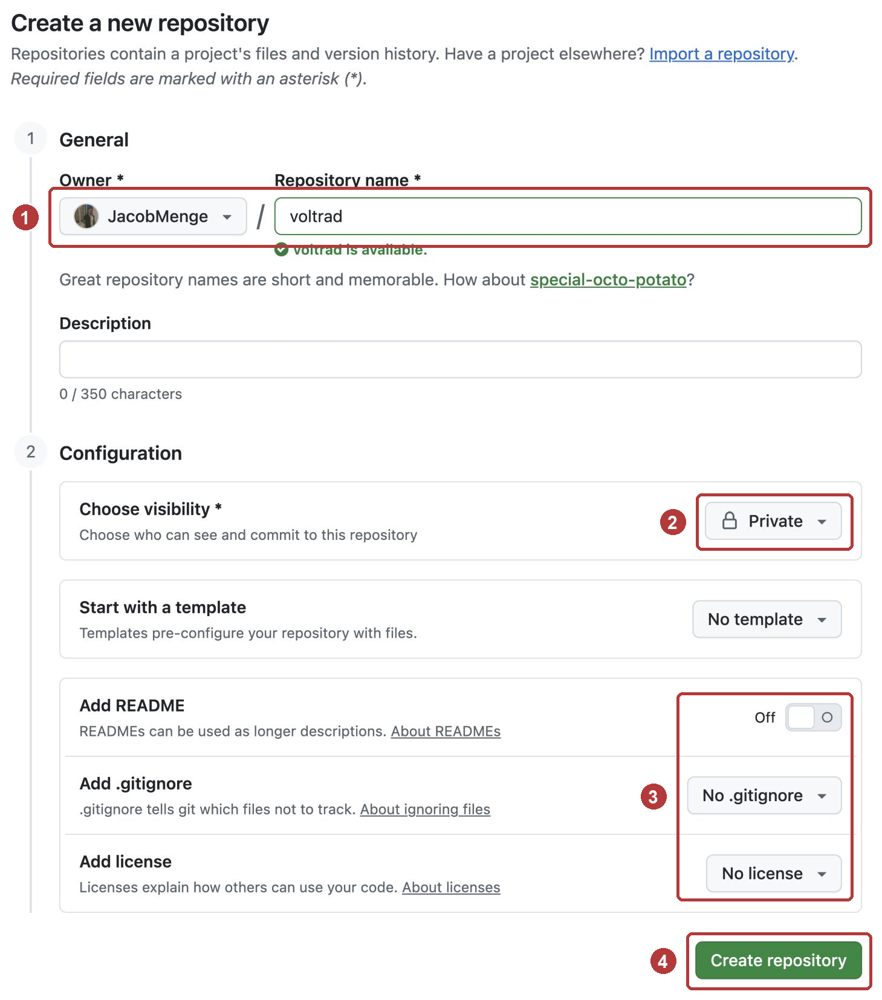{ width="560" }

2. GitHub zeigt eine fast leere Seite. Wählt oben im Kasten **Quick setup**
   den Reiter **SSH**. Darunter steht ein Block
   **…or push an existing repository from the command line** mit drei
   Zeilen, schon mit eurem Benutzernamen:

    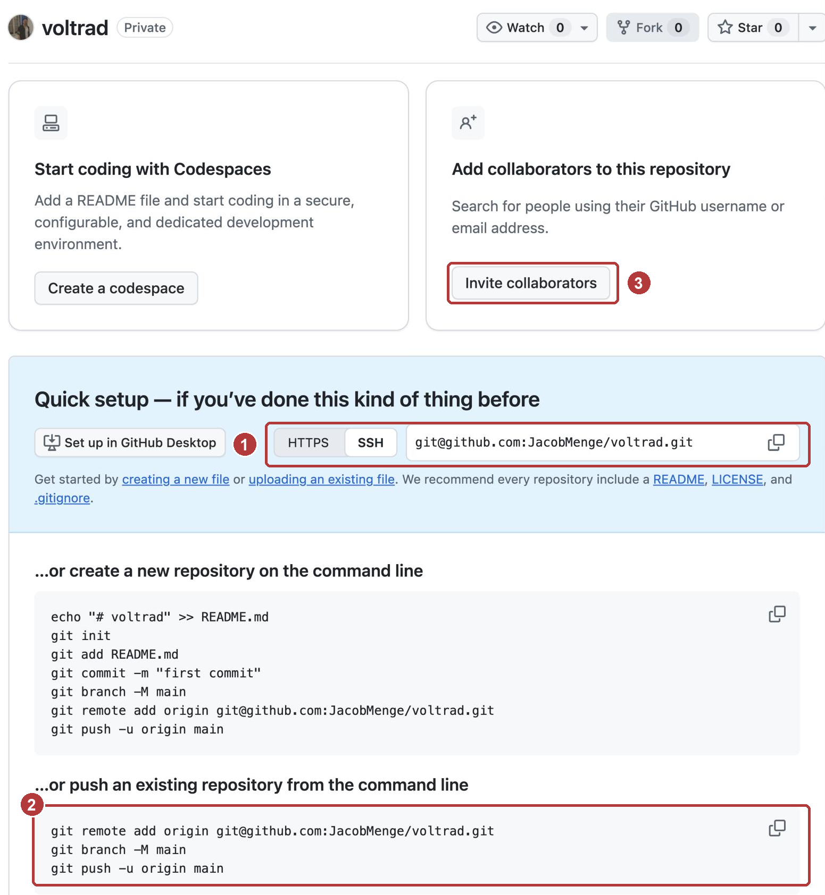{ width="560" }

    ```bash
    git remote add origin git@github.com:NAME/voltrad.git
    ```

    ```bash
    git branch -M main
    ```

    ```bash
    git push -u origin main
    ```

    Kopiert die Zeilen von eurer GitHub-Seite oder ersetzt `NAME` durch
    euren Benutzernamen. `origin` ist der übliche Name für die Kopie auf
    GitHub. `git branch -M main` stellt sicher, dass euer Zweig `main`
    heißt. `-u` merkt sich die Verbindung, danach reicht `git push`.

3. Ladet die Seite im Browser neu und seht nach:

    - Welche Dateien liegen dort? Es sollten genau drei sein. Wer am Montag
      gefehlt hat, sieht zwei, weil `.terraform.lock.hcl` fehlt.
    - Oben rechts über der Dateiliste steht, wie viele Commits es gibt.
      Klickt darauf und dann auf euren zweiten Commit: Ihr seht dieselbe
      Änderung wie bei `git diff`.

    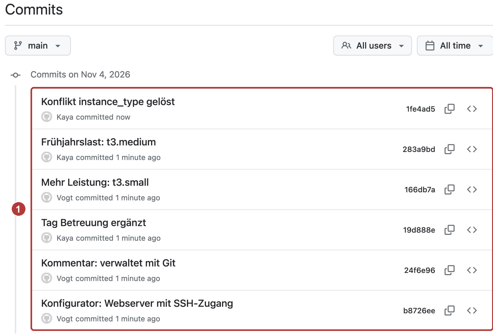{ width="560" }

    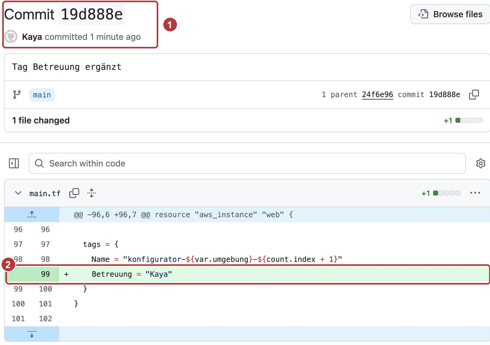{ width="560" }

**Frage 2:** Warum fehlen `terraform.tfstate` und `terraform.tfvars` auf
GitHub, obwohl sie in eurem Ordner liegen?

??? tip "Hinweis 1 zu Station 4"
    GitHub bekommt genau das, was in euren Commits steckt. Was nie
    committet wurde, kann auch nicht hochgeladen werden.

??? tip "Hinweis 2 zu Station 4"
    Schaut noch einmal in eure `.gitignore` und in eure Vorhersage 2 aus
    Station 3.

Die Lösung besprechen wir gemeinsam nach der Praxiszeit.

---

## Station 5: Gast im Nachbar-Repo (15 Minuten, im Ring)

**Was ihr hier tut:** Ihr ladet die nächste Person in euer Repository ein und
arbeitet selbst als Gast im Repository einer anderen Person mit.

**So bildet ihr den Ring:** Sortiert euch im Breakout-Raum alphabetisch nach
Vornamen. Jede Person lädt die nächste ein, die letzte lädt die erste ein.
Seid ihr nur zu zweit, ladet ihr euch gegenseitig ein. Fehlen jemandem Konto
oder Git, arbeitet diese Person am Bildschirm der nächsten mit. Der Ring
schließt sich dann ohne sie. Jede Person ist damit **Eigentümer** des eigenen
Repositorys und **Gast** in genau einem fremden.

1. **Als Eigentümer:** In eurem Repository auf GitHub **Settings** →
   **Collaborators** → **Add people**. Benutzernamen der nächsten Person
   eintippen, auswählen und mit **Add … to this repository** bestätigen.
   GitHub fragt dabei eventuell noch einmal nach eurem Passwort.

    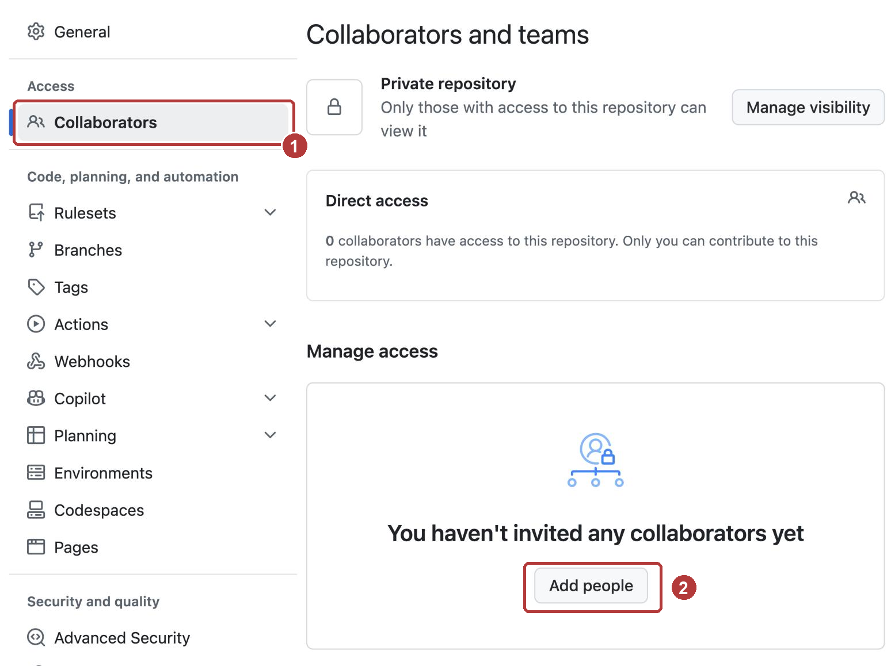{ width="560" }

    Mitarbeitende dürfen lesen und schreiben. Sie dürfen niemanden
    einladen und das Repository weder löschen noch öffentlich machen.

2. **Als Gast:** Nehmt die Einladung an. GitHub schickt sie per E-Mail
   (**View invitation**, dann **Accept invitation**). Alternativ öffnet ihr
   `github.com/NAME/voltrad/invitations` mit dem Namen des Eigentümers.

3. **Als Gast:** Klont das Repository **neben** euren eigenen Ordner, nicht
   hinein. Im Terminal geht ihr dafür eine Ebene nach oben. `NAME` ist der
   Benutzername des Eigentümers:

    ```bash
    cd ..
    ```

    ```bash
    git clone git@github.com:NAME/voltrad.git voltrad-NAME
    ```

    ```bash
    code voltrad-NAME
    ```

    Der letzte Befehl öffnet ein zweites VS-Code-Fenster mit dem fremden
    Repository. Findet das Terminal `code` nicht, öffnet ihr den Ordner
    über **Datei → Ordner öffnen**. Ab jetzt arbeitet ihr in zwei Fenstern:
    `voltrad` ist euer eigenes Repository, `voltrad-NAME` das fremde.

4. **Als Gast**, im Fenster `voltrad-NAME`: Ergänzt in `main.tf` im Block
   `tags` von `aws_instance` eine Zeile unter `Name`, mit eurem Vornamen:

    ```hcl
      tags = {
        Name = "konfigurator-${var.umgebung}-${count.index + 1}"
        Betreuung = "Vorname"
      }
    ```

    Speichern, dann:

    ```bash
    git add main.tf
    ```

    ```bash
    git commit -m "Tag Betreuung ergänzt"
    ```

    ```bash
    git push
    ```

5. **Als Eigentümer**, im Fenster `voltrad`: Holt die Änderung des Gastes
   und seht nach, wer sie gemacht hat:

    ```bash
    git pull
    ```

    ```bash
    git log --oneline
    ```

    Auf GitHub unter den Commits steht der Name des Gastes neben seinem
    Commit.

!!! warning "In Station 5 ändert nur der Gast etwas"
    Der Eigentümer ändert in dieser Station nichts an seiner `main.tf`. So
    bleibt das Holen einfach. Wie es aussieht, wenn beide gleichzeitig
    ändern, probiert ihr in Station 6 in Teil 2.

---

## Üben mit dem eigenen Verlauf (15 Minuten, allein)

**Was ihr hier tut:** Ihr macht ein paar eigene Commits in eurem Repository
`voltrad`, schickt sie zu GitHub und seht sie euch dort an. Ihr ändert nur
den angegebenen Wert. `terraform apply` braucht ihr dafür nicht.

1. Im Fenster `voltrad`: Holt zuerst den Commit eures Gastes, falls noch
   nicht geschehen:

    ```bash
    git pull
    ```

2. Ändert in `main.tf` in `variable "anzahl_server"` den Wert `default` von
   `1` auf `2` und speichert. **Vorhersage:** Was zeigen `git status` und
   `git diff`? Notiert es, dann prüft:

    ```bash
    git status
    ```

    ```bash
    git diff
    ```

3. Haltet die Änderung fest und schickt sie zu GitHub:

    ```bash
    git add main.tf
    ```

    ```bash
    git commit -m "Zwei Server zum Testen"
    ```

    ```bash
    git push
    ```

4. Auf GitHub: Öffnet euer Repository. Rechts über der Dateiliste steht die
   Zahl der Commits mit einem Uhr-Symbol. Klickt darauf und dann auf euren
   neuesten Commit. GitHub zeigt die Änderung Zeile für Zeile: rot die alte
   Fassung, grün die neue.

5. Setzt den Wert wieder auf `1`, speichert und haltet das fest. `-a` merkt
   alle geänderten Dateien vor, die Git schon kennt, und spart so
   `git add`:

    ```bash
    git commit -am "Wieder ein Server"
    ```

    ```bash
    git push
    ```

6. Seht euch den Verlauf an. Die sieben Zeichen vorne in jeder Zeile sind
   die Kennung des Commits:

    ```bash
    git log --oneline
    ```

    Zeigt dann einen einzelnen Commit, `KENNUNG` ersetzt ihr durch die
    Kennung von „Zwei Server zum Testen“:

    ```bash
    git show KENNUNG
    ```

!!! tip "Lehnt GitHub euren push ab?"
    Meldet `git push` **rejected** und **fetch first**, hat euer Gast in der
    Zwischenzeit etwas geschickt. Dann erst `git pull`, danach noch einmal
    `git push`. Öffnet sich beim `git pull` in VS Code ein Reiter
    `MERGE_MSG`, schließt ihn einfach. Git führt eure und seine Änderung
    selbst zusammen, weil ihr verschiedene Zeilen geändert habt.

**Frage:** Wer steht in eurem Verlauf alles als Autor? Wo seht ihr das auf
GitHub?

---

## Station 6: Beide ändern dieselbe Zeile (12 Minuten, im Ring)

!!! info "Teil 2 am Montag"
    Diese Station macht ihr in Teil 2. Heute hört ihr nach „Üben mit dem
    eigenen Verlauf“ und den Bonus-Aufgaben 1 und 2 auf.

**Was ihr hier tut:** Eigentümer und Gast ändern dieselbe Zeile, jeder
anders. Wer als Zweiter hochlädt, muss den Konflikt lösen.

1. **Zuerst alle als Eigentümer**, im eigenen Fenster `voltrad`: Ändert in
   `aws_instance` den Wert von `instance_type` von `"t3.micro"` auf
   `"t3.small"`. Nur der Wert in den Anführungszeichen ändert sich.
   Speichern, dann:

    ```bash
    git commit -am "Mehr Leistung: t3.small"
    ```

    ```bash
    git push
    ```

    `-a` stellt alle geänderten Dateien bereit, die Git schon kennt. Das
    spart `git add`. Schreibt danach „gepusht“ in den Chat eures
    Breakout-Raums.

2. **Danach alle als Gast**, sobald alle in eurem Raum „gepusht“
   geschrieben haben. Im Fenster `voltrad-NAME`, **ohne vorher zu holen**: Ändert dort `instance_type` auf `"t3.medium"`, speichert und
   haltet die Änderung fest:

    ```bash
    git commit -am "Frühjahrslast: t3.medium"
    ```

3. **Vorhersage:** Was passiert gleich beim `git push`? Notiert es, dann
   ladet ihr als Gast hoch:

    ```bash
    git push
    ```

    Lest die Meldung genau, sie sagt euch, was zu tun ist.

4. Als Gast holen:

    ```bash
    git pull
    ```

    Öffnet danach `main.tf`. VS Code markiert die umstrittene Stelle farbig.
    Darüber stehen die Knöpfe **Accept Current Change**, **Accept Incoming
    Change**, **Accept Both Changes** und **Compare Changes**.

    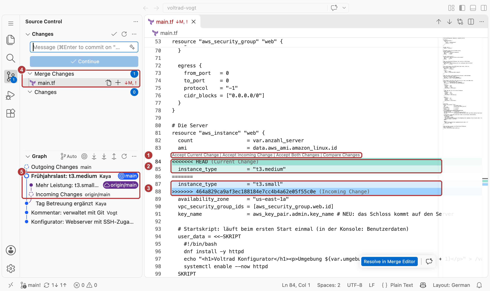{ width="560" }

5. Einigt euch mit dem Eigentümer im Breakout-Chat, welcher Wert gelten
   soll. Wählt dann eine Fassung per Knopf oder schreibt die Zeile von Hand
   richtig. Am Ende dürfen in der Datei keine Zeilen mit `<<<<<<<`,
   `=======` oder `>>>>>>>` übrig sein. Speichern, dann:

    ```bash
    git add main.tf
    ```

    ```bash
    git commit -m "Konflikt instance_type gelöst"
    ```

    ```bash
    git push
    ```

6. **Als Eigentümer**, im Fenster `voltrad`: Holt das Ergebnis und seht euch
   die Geschichte als Bild an:

    ```bash
    git pull
    ```

    ```bash
    git log --oneline --graph
    ```

**Frage 3:** Welche Meldung kam beim abgelehnten Push?

**Frage 4:** Was bedeuten die drei Markierungen `<<<<<<<`, `=======` und
`>>>>>>>`?

**Frage 5:** Warum musste der Eigentümer beim letzten `git pull` nichts
entscheiden?

??? tip "Hinweis 1 zu Station 6"
    Lest die Meldung beim abgelehnten Push bis zum Ende. Der wichtigste
    Teil steht in den Zeilen mit `hint:`.

??? tip "Hinweis 2 zu Station 6"
    VS Code beschriftet beide Teile des Konflikts: **Current Change** und
    **Incoming Change**. Überlegt, welcher Teil von euch kommt und welcher
    vom Eigentümer.

??? tip "Hinweis 3 zu Station 6"
    Nach dem Speichern müsst ihr Git sagen, dass der Konflikt gelöst ist.
    Das geht mit demselben Befehl, mit dem ihr sonst eine Datei
    bereitstellt.

Die Lösung besprechen wir gemeinsam nach der Praxiszeit.

---

## Bonus für die Schnellen

### Bonus 1: Rückgängig machen (5 Minuten)

Jemand trägt aus Versehen neun Server ein. Git kann einen Commit
zurücknehmen, ohne die Geschichte zu verändern.

1. Im eigenen Fenster `voltrad`: Setzt in `variable "anzahl_server"` den
   Wert `default` auf `9` und speichert.
2. Haltet den Fehler fest und nehmt ihn sofort zurück:

    ```bash
    git commit -am "Neun Server für den Frühling"
    ```

    ```bash
    git revert --no-edit HEAD
    ```

    ```bash
    git log --oneline
    ```

    ```bash
    git push
    ```

??? success "Musterlösung Bonus 1"
    `git revert` legt einen **neuen** Commit an, der die Änderung des
    letzten Commits umkehrt. In `main.tf` steht danach wieder `default = 1`.
    `HEAD` bezeichnet den Commit, auf dem ihr gerade steht. `--no-edit`
    übernimmt die vorgeschlagene Nachricht `Revert "Neun Server für den
    Frühling"`, ohne einen Editor zu öffnen.

    Im Verlauf stehen beide Commits: der Fehler und seine Rücknahme. Genau
    das will man im Team, denn jeder sieht, was passiert ist. Andere, die
    den Fehler schon geholt haben, bekommen die Rücknahme mit dem nächsten
    `git pull`.

### Bonus 2: Git vergisst nichts (8 Minuten)

Was passiert, wenn ein Passwort in einem Commit landet und im nächsten
wieder gelöscht wird? Probiert es in einem eigenen Spielordner aus,
**nicht** in `voltrad`.

1. Neben `voltrad` einen Ordner `zeitkapsel` anlegen und dort ein
   Repository starten:

    ```bash
    cd ..
    ```

    ```bash
    mkdir zeitkapsel
    ```

    ```bash
    cd zeitkapsel
    ```

    ```bash
    git init
    ```

2. Eine Datei mit einem **ausgedachten** Passwort anlegen:

    === "Windows (PowerShell)"

        ```powershell
        Set-Content geheim.txt "passwort=Sommer2026!"
        ```

    === "macOS / Linux"

        ```bash
        echo 'passwort=Sommer2026!' > geheim.txt
        ```

3. Festhalten, wieder löschen, wieder festhalten:

    ```bash
    git add geheim.txt
    ```

    ```bash
    git commit -m "Zugang notiert"
    ```

    ```bash
    git rm geheim.txt
    ```

    ```bash
    git commit -m "Zugang wieder entfernt"
    ```

    ```bash
    git log --oneline
    ```

4. Die Datei ist aus dem Ordner verschwunden. Holt sie aus der Geschichte:

    ```bash
    git show HEAD~1:geheim.txt
    ```

!!! warning "Diesen Ordner nie hochladen"
    `zeitkapsel` ist nur zum Ausprobieren da. Legt dafür kein Repository
    auf GitHub an.

??? success "Musterlösung Bonus 2"
    `git show HEAD~1:geheim.txt` zeigt den Inhalt der Datei, wie er einen
    Commit vor dem aktuellen aussah (`HEAD~1`). Das Löschen hat nur einen
    neuen Stand angelegt, der alte Stand bleibt vollständig erhalten.

    Läge dieses Repository auf GitHub, könnte jede Person mit Zugriff das
    Passwort aus der Geschichte holen, auch Jahre später. Bei einem echten
    Schlüssel hilft deshalb nur eins: **sofort sperren und einen neuen
    ausstellen**. Die Geschichte nachträglich umzuschreiben ist aufwendig
    und erreicht keine Kopien, die andere schon geklont haben.

### Bonus 3: Pull Request (15 Minuten)

!!! info "Teil 2 am Montag"
    Pull Requests und Branches erklären wir in Teil 2. Wer heute schon
    Lust hat, darf es ausprobieren.

In Teams schreibt meist niemand direkt auf `main`. Änderungen kommen über
einen eigenen Zweig (Branch) und einen **Pull Request**: eine Anfrage an den
Eigentümer, die Änderung zu prüfen und zu übernehmen.

1. **Als Gast**, im Fenster `voltrad-NAME`: einen neuen Zweig anlegen und
   dorthin wechseln:

    ```bash
    git switch -c groesse-produktion
    ```

2. In `main.tf` bei `variable "anzahl_server"` die Beschreibung ergänzen:

    ```hcl
      description = "Wie viele Server sollen laufen? Produktion im Frühjahr: 4"
    ```

    Speichern, festhalten und den Zweig hochladen:

    ```bash
    git commit -am "Beschreibung: vier Server in der Produktion im Frühjahr"
    ```

    ```bash
    git push -u origin groesse-produktion
    ```

3. Auf GitHub im Repository des Eigentümers erscheint oben der Knopf
   **Compare & pull request**. Klickt darauf, prüft den Titel und klickt
   **Create pull request**. Fehlt der Knopf: **Pull requests** → **New pull
   request**, bei **compare** den Zweig `groesse-produktion` wählen.

    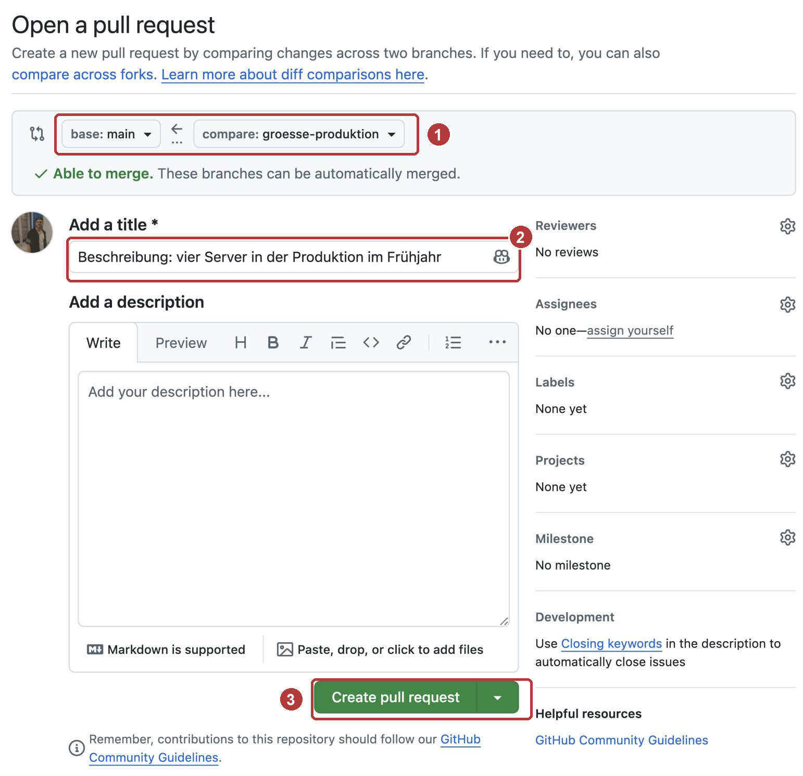{ width="560" }

4. **Als Eigentümer:** Öffnet den Pull Request, seht euch unter **Files
   changed** die Änderung an. Über **Review changes** schreibt ihr einen
   Kommentar und wählt **Approve**, dann **Submit review**. Anschließend
   **Merge pull request** und **Confirm merge**.

    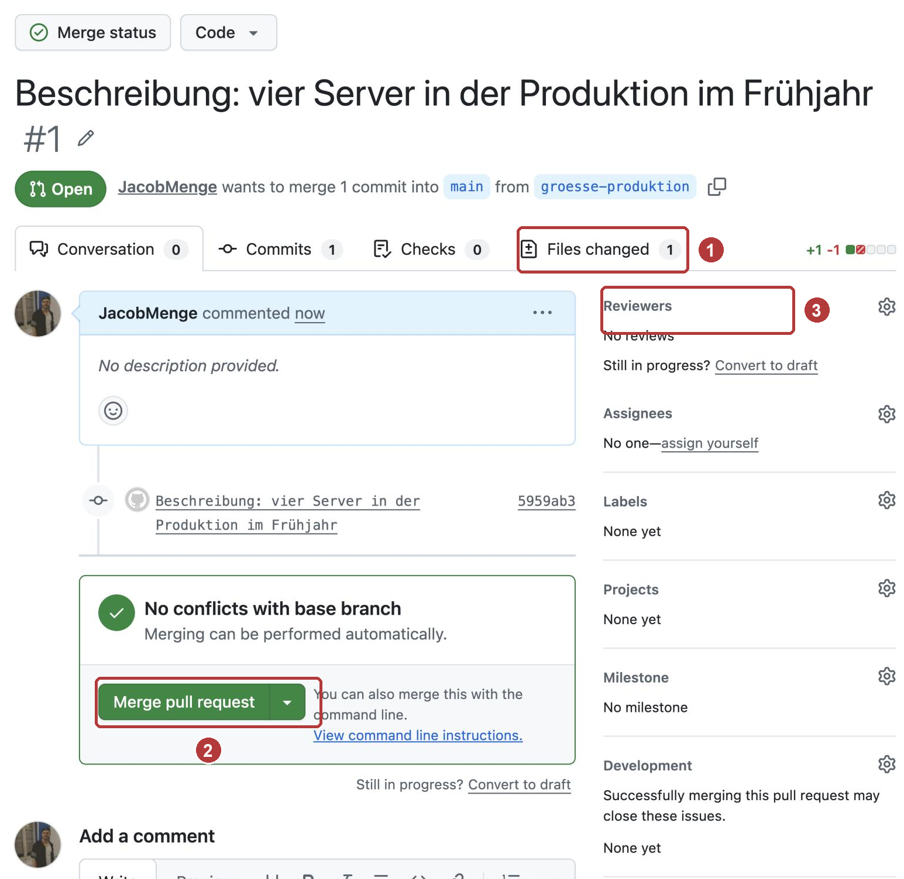{ width="560" }

5. Beide holen den neuen Stand:

    === "Gast"

        ```bash
        git switch main
        ```

        ```bash
        git pull
        ```

    === "Eigentümer"

        ```bash
        git pull
        ```

??? success "Musterlösung Bonus 3"
    Der Zweig `groesse-produktion` ist eine Abzweigung von `main`. Was dort
    passiert, berührt `main` erst, wenn der Pull Request zusammengeführt
    wird. Dazwischen liegt die Prüfung durch eine zweite Person.

    Nach dem Zusammenführen enthält `main` die neue Beschreibung. Der Gast
    wechselt mit `git switch main` zurück und holt den Stand. Den Zweig
    `groesse-produktion` braucht danach niemand mehr. GitHub bietet nach dem
    Zusammenführen an, ihn zu löschen (**Delete branch**).

    Später läuft in diesem Moment oft automatisch eine Prüfung mit, zum
    Beispiel `terraform validate`, bevor jemand zusammenführen darf.

### Denkaufgabe: Repo-Regeln für Voltrad (10 Minuten)

Bei Voltrad arbeiten bald drei an `main.tf`: Frau Vogt, ihr neuer Kollege
Herr Kaya und ein externer Dienstleister, der die Webserver betreut.

Überlegt:

1. Wer darf direkt auf `main` schreiben?
2. Was steht in der `.gitignore`?
3. Wo liegt der State, wenn ihn nicht ein einzelner Laptop haben soll?
4. Wie bekommt Terraform den Zugangsschlüssel, wenn er nicht im
   Repository stehen darf?
5. Was passiert, wenn der Vertrag mit dem Dienstleister endet?

??? success "Musterlösung Denkaufgabe"
    1. **Niemand schreibt direkt auf `main`.** Jede Änderung kommt über einen
       Zweig und einen Pull Request, eine zweite Person prüft. Bei GitHub
       lässt sich das mit einer Schutzregel für `main` erzwingen. Für
       private Repositories ist das in den kostenpflichtigen Tarifen
       enthalten, die eine Firma ohnehin nutzt.
    2. **In der `.gitignore`** stehen mindestens `.terraform/`,
       `*.tfstate`, `*.tfstate.*`, `*.tfvars` und `crash.log`. Schlüssel
       liegen gar nicht erst im Projektordner. Nutzt das Team eine Datei
       `.env`, gehört auch sie hinein.
    3. **Der State liegt an einem gemeinsamen Ort,** nicht im Repository
       und nicht auf einem Laptop. Terraform nennt das ein **Backend**, bei
       AWS zum Beispiel ein S3-Bucket. Terraform sperrt den State dort,
       solange jemand baut, damit nicht zwei gleichzeitig ändern.
    4. **Jede Person meldet sich selbst bei AWS an,** am besten per Single
       Sign-on mit Schlüsseln auf Zeit. Terraform liest sie aus der Umgebung
       wie am Montag. Im Repository steht kein einziger Schlüssel.
    5. **Der Dienstleister bekommt eigene Konten,** bei GitHub und bei AWS,
       mit Zugriff nur auf das, was er braucht. Endet der Vertrag, nimmt
       Voltrad ihm beides weg. Weil niemand Schlüssel geteilt hat, muss sonst
       niemand etwas ändern. In einem persönlichen Repository gibt es nur
       eine Rechtestufe (lesen und schreiben). Eine Firma legt deshalb eine
       **Organisation** an, dort lassen sich Rechte abstufen.

---

## Aufräumen

Heute wird nichts gelöscht. Eure Repositories bleiben privat auf GitHub,
die Ordner `voltrad` und `voltrad-NAME` bleiben auf eurem Rechner. Wer mag,
entfernt den Gast später wieder unter **Settings → Collaborators**.

---

## Wenn es klemmt

| Was ihr seht | Woran es liegt | Was hilft |
|---|---|---|
| `git` wird nicht gefunden | Das Terminal kennt die neue Installation noch nicht | VS Code ganz schließen und neu öffnen. |
| Ein schwarzes Fenster mit `~` am linken Rand | Git hat den Editor Vim geöffnet, weil `core.editor` fehlt | ++esc++ drücken, `:wq` tippen, ++enter++. Danach die Zeile `core.editor` aus Station 1 ausführen. |
| Eine Ausgabe endet mit `:` oder `(END)` | Git zeigt lange Ausgaben seitenweise an | ++q++ drücken. |
| `fatal: not a git repository` | Das Terminal steht im falschen Ordner | Im Explorer von VS Code prüfen, welcher Ordner offen ist. Mit `cd` in `voltrad` wechseln. |
| `Permission denied (publickey)` bei GitHub | Euer öffentlicher Schlüssel liegt nicht oder falsch bei GitHub | Station 2 noch einmal: die ganze Zeile aus `id_ed25519.pub` als **New SSH key** hinterlegen. |
| `ssh: connect to host github.com port 22: Connection timed out` | Euer Netz sperrt Port 22, das kommt in Firmennetzen vor | GitHub antwortet auch auf Port 443. Legt in `.ssh` eine Datei `config` ohne Endung an (Windows: `C:\Users\NAME\.ssh\config`), Inhalt siehe unten. Testen mit `ssh -T git@github.com`. |
| `error: src refspec main does not match any` | Euer Zweig heißt noch `master` oder es gibt noch keinen Commit | `git branch -M main`, dann `git push -u origin main`. Fehlt der Commit, erst Station 3. |
| `error: remote origin already exists` | Die Verbindung zu GitHub ist schon eingetragen | Adresse ersetzen: `git remote set-url origin git@github.com:NAME/voltrad.git` |
| Beim Push erscheint ein Anmeldefenster oder eine Frage nach dem Passwort | Ihr habt die HTTPS-Adresse statt der SSH-Adresse eingetragen | Abbrechen, dann `git remote set-url origin git@github.com:NAME/voltrad.git` |
| `ERROR: Repository not found` beim Klonen | Die Einladung ist noch nicht angenommen oder der Name ist falsch geschrieben | Station 5, Schritt 2 prüfen. Den Benutzernamen mit dem im Breakout-Chat vergleichen. |
| `GH007: Your push would publish a private email address` | Eure Commits tragen eure private E-Mail-Adresse | `user.email` auf die Ersatzadresse aus Station 1 setzen, dann `git commit --amend --reset-author --no-edit` und noch einmal pushen. |
| `Updates were rejected because the remote contains work that you do not have locally` | Auf GitHub liegt ein Stand, den ihr noch nicht habt | Erst `git pull`, dann `git push`. Öffnet sich dabei in VS Code ein Reiter `MERGE_MSG`, schließt ihn einfach. In Station 6 ist das gewollt. |
| `fatal: Need to specify how to reconcile divergent branches` | Die Zeile `pull.rebase false` aus Station 1 fehlt, das betrifft vor allem macOS und Linux | `git config --global pull.rebase false` ausführen, dann noch einmal `git pull`. |
| Das Terminal wartet nach `git commit`, in VS Code ist ein Reiter `COMMIT_EDITMSG` offen | Ihr habt `-m` weggelassen, Git wartet auf die Nachricht | Nachricht in die erste Zeile schreiben, speichern, Reiter schließen. Danach läuft das Terminal weiter. |
| Der Gast konnte in Station 6 ohne Ablehnung pushen, es gab keinen Konflikt | Der Gast hat vor seiner Änderung geholt oder der Eigentümer hatte noch nicht gepusht | Kein Problem. Mit dem Eigentümer noch einmal dieselbe Zeile anders ändern: erst pusht der Eigentümer, dann der Gast ohne zu holen. |
| Keine Einladung in der E-Mail | Die E-Mail kommt verspätet oder im Spam an | `github.com/NAME/voltrad/invitations` öffnen. Der Eigentümer prüft unter **Collaborators**, ob er den richtigen Benutzernamen eingeladen hat. |
| `LF will be replaced by CRLF` | Windows und Linux beenden Zeilen unterschiedlich, Git gleicht das an | Nur ein Hinweis, weiterarbeiten. |
| Meldungen auf Deutsch, zum Beispiel `KONFLIKT (Inhalt): Merge-Konflikt in main.tf` | Git für Windows übersetzt teilweise, je nach Spracheinstellung | Gleiche Bedeutung wie die englische Meldung, weiterarbeiten. |

Inhalt der Datei `config` für SSH über Port 443:

```text
Host github.com
    Hostname ssh.github.com
    Port 443
    User git
```

Beim ersten Verbinden fragt `ssh` dann noch einmal nach dem Fingerabdruck,
diesmal für `[ssh.github.com]:443`. Es ist derselbe Wert wie in Station 2.

---

## Was ihr zur Auswertung mitbringt

1. Welche Dateien liegen in eurem Repository auf GitHub, welche nicht?
   Warum?
2. Was hat `git status` vor und nach der `.gitignore` gezeigt?
3. Woher wusste GitHub, dass ihr es seid? Woher wusstet ihr, dass es GitHub
   ist?
4. Wo seht ihr auf GitHub, was ein Commit geändert hat? Was zeigt
   `git log` dazu?
5. Denkfrage: Ihr committet eine Änderung, pusht aber nicht. Was sieht eine
   Kollegin auf GitHub?

---

## Weiterlesen

Die folgenden Seiten erklären Git ausführlicher. Sie zeigen die Anmeldung
bei GitHub über HTTPS mit einem Token, wir nutzen SSH mit eurem Schlüssel.

- [Grundbegriffe](grundbegriffe.md): Repository, Bereitstellung, Commit, HEAD
- [Branches und Merge](branches-und-merge.md): Zweige und Zusammenführen
- [Remote und GitHub](remote-und-github.md): GitHub, GitLab und andere Anbieter
- [Stolpersteine](stolpersteine.md): weitere typische Fehler und ihre Lösung
