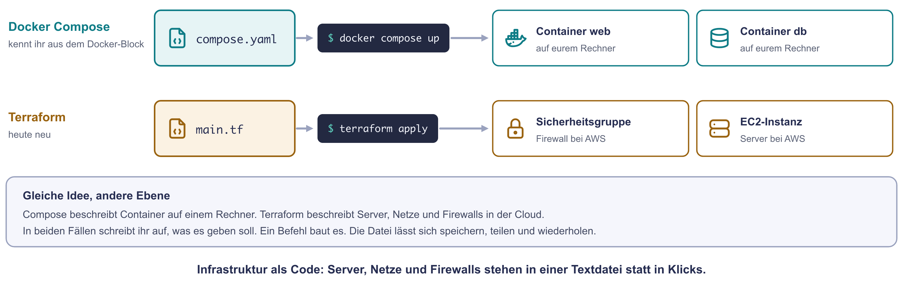
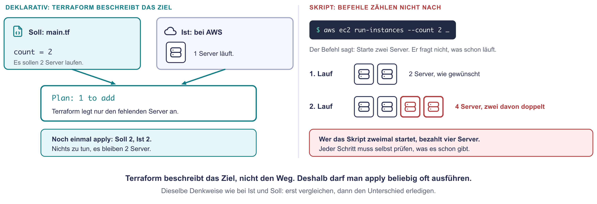
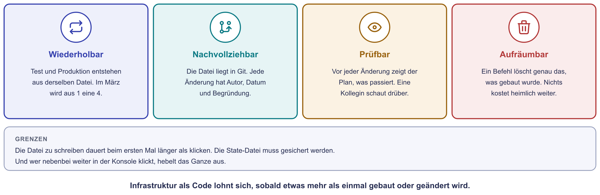
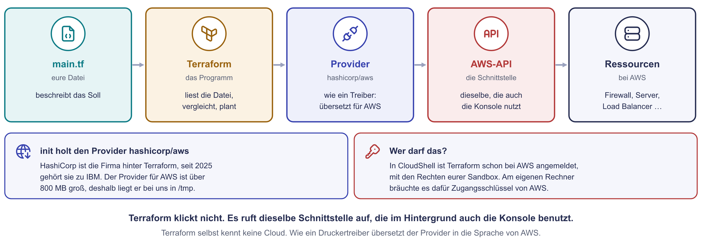
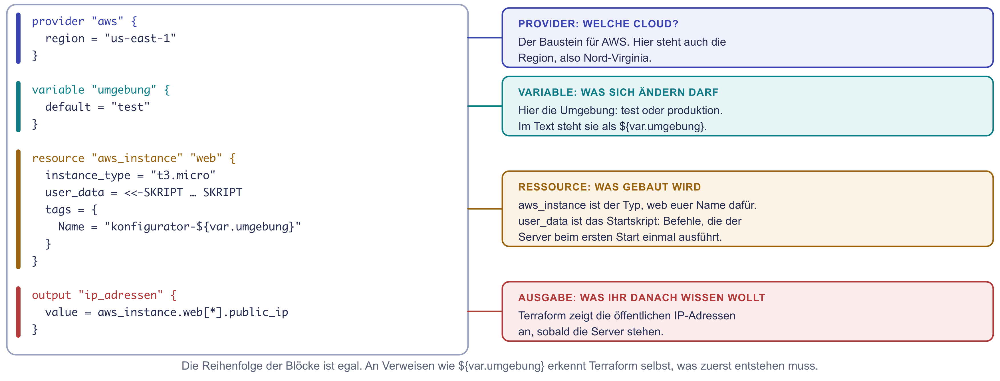
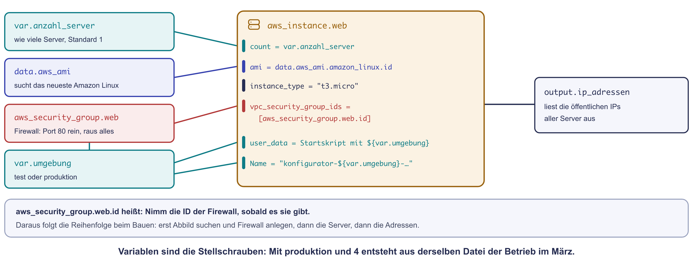
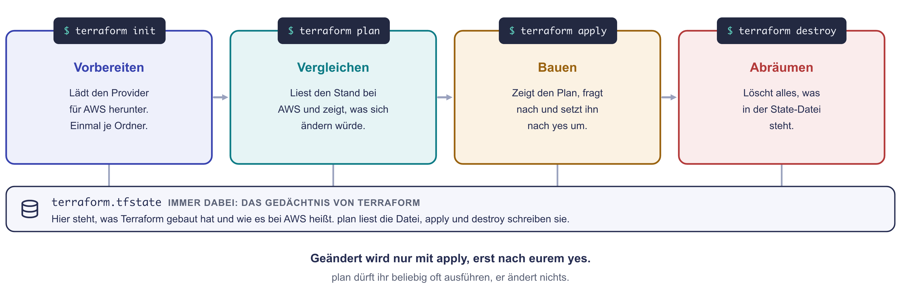
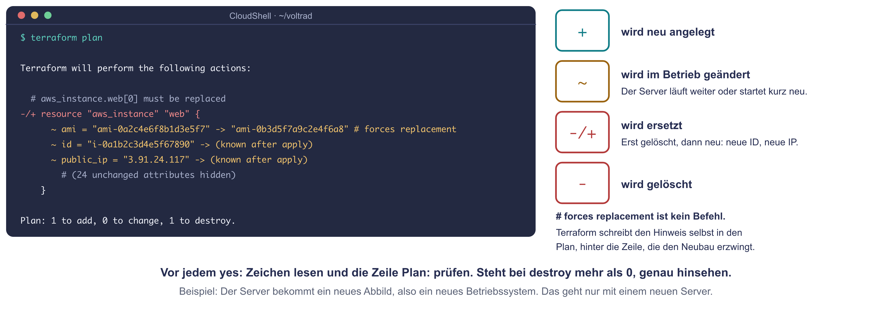

# Infrastruktur als Code

Wer einen Server in der Cloud einmal anlegt, ist mit der Konsole schnell. Wer
ihn jedes Frühjahr dreimal zusätzlich braucht, ihn in einer Testumgebung
genauso noch einmal aufbauen will oder nach einem halben Jahr nachvollziehen
muss, was damals eingestellt wurde, kommt mit Klicken nicht weit. Was nur
geklickt wurde, steht nirgends: Es gibt keine Vorlage, kein Protokoll und
keinen Vergleich mit dem letzten Mal.

**Infrastruktur als Code** (englisch Infrastructure as Code, kurz IaC)
beschreibt Server, Netze und Firewalls deshalb in Textdateien. Ein Werkzeug
liest die Datei und baut daraus die echte Umgebung. Die Datei lässt sich
speichern, in Git versionieren, prüfen und beliebig oft wieder ausführen.

## Die Idee kennt ihr schon

Docker Compose arbeitet genauso: In `compose.yaml` steht, welche Container es
geben soll. `docker compose up` startet sie. Infrastruktur als Code hebt
dieselbe Idee eine Ebene höher, von Containern auf einem Rechner zu Servern,
Netzen und Firewalls in der Cloud.

{ .diagramm }

## Ziel statt Weg

Terraform arbeitet **deklarativ**: Die Datei beschreibt das Ziel, also den
Soll-Zustand. Vor jeder Änderung liest Terraform den Ist-Zustand bei der
Cloud, vergleicht beide und erledigt nur den Unterschied. Deshalb darf man
denselben Befehl beliebig oft ausführen. Ein Skript, das Befehl für Befehl
abarbeitet, zählt dagegen nicht nach: Zweimal gestartet, legt es alles
doppelt an.

{ .diagramm }

## Nutzen und Grenzen

{ .diagramm }

| Nutzen | Was das im Betrieb heißt |
|---|---|
| **wiederholbar** | Test und Produktion entstehen aus derselben Datei und sind deshalb gleich gebaut. |
| **nachvollziehbar** | Die Datei liegt in Git. Jede Änderung hat einen Autor, ein Datum und eine Begründung. |
| **prüfbar** | Vor jeder Änderung zeigt ein Plan, was passieren wird. Eine zweite Person kann ihn lesen, bevor gebaut wird. |
| **aufräumbar** | Ein Befehl löscht genau das, was gebaut wurde. Vergessene Server, die weiter Geld kosten, gibt es nicht. |

Die Grenzen gehören dazu: Die Datei zu schreiben dauert beim ersten Mal
länger als klicken. Die State-Datei (siehe unten) muss gesichert werden. Und
wer nebenbei weiter in der Konsole ändert, hebelt das Ganze aus.

## Terraform

**Terraform** ist das verbreitetste Werkzeug für Infrastruktur als Code. Entwickelt wird es von der Firma HashiCorp, die seit 2025 zu IBM gehört. Über
**Provider** steuert es AWS, Azure, Google Cloud, VMware, Proxmox und viele
weitere Plattformen an. Seit 2023 steht Terraform unter der Business Source
License: Die normale Nutzung bleibt kostenlos, nur Konkurrenzprodukte darf
man damit nicht bauen. Die Gemeinschaft hat daraufhin die freie Kopie
**OpenTofu** gestartet, die dieselben Dateien und Befehle versteht. Mehr dazu
auf der Seite [Lizenzmodelle](lizenzmodelle.md).

Terraform selbst kennt keine Cloud. Der Provider funktioniert wie ein
Druckertreiber: Er übersetzt die Blöcke der Datei in die Sprache der
jeweiligen Plattform. Terraform klickt also nicht. Es ruft über den Provider dieselbe Schnittstelle auf,
die im Hintergrund auch die Konsole benutzt. `terraform init` lädt den
Provider aus der Terraform Registry. In CloudShell ist Terraform schon bei AWS
angemeldet, auf dem eigenen Rechner bräuchte es dafür Zugangsschlüssel.

{ .diagramm }

### Eine Terraform-Datei

Terraform-Dateien enden auf `.tf`. Sie bestehen aus Blöcken:

| Block | Wofür er steht |
|---|---|
| `provider` | Mit welcher Plattform Terraform spricht, bei AWS samt Region. |
| `variable` | Ein Wert mit Namen, der sich ändern darf, etwa die Umgebung (`test` oder `produktion`) oder die Anzahl der Server. Im Text steht er als `${var.umgebung}`. |
| `resource` | Etwas, das gebaut wird. Erst kommt der Typ aus dem Provider, etwa `aws_instance`, dann ein eigener Name. |
| `data` | Etwas, das nur nachgeschlagen wird, etwa das neueste Betriebssystem-Abbild. Gebaut wird dabei nichts. |
| `output` | Ein Wert, den Terraform nach dem Bauen anzeigt, etwa die IP-Adresse. |

Welche Einträge eine Ressource kennt, steht in der [Terraform Registry](https://registry.terraform.io/providers/hashicorp/aws/latest/docs) unter **Argument Reference** (was man eintragen kann) und **Attribute Reference** (was Terraform danach weiß). Jeder Provider hat dort seine eigenen Ressourcen und Einträge.

{ .diagramm }

Die Blöcke verweisen aufeinander. `aws_security_group.web.id` heißt: Nimm die
ID der Firewall, sobald es sie gibt. Aus diesen Verweisen leitet Terraform
die Reihenfolge ab, in der es baut.

{ .diagramm }

### Vier Befehle

{ .diagramm }

| Befehl | Was er tut |
|---|---|
| `terraform init` | Lädt die Provider herunter. Einmal je Ordner. |
| `terraform plan` | Liest den Ist-Zustand und zeigt, was sich ändern würde. Ändert nichts. |
| `terraform apply` | Zeigt den Plan, fragt nach und setzt ihn nach `yes` um. |
| `terraform destroy` | Löscht alles, was Terraform gebaut hat. |

### Den Plan lesen

Vor jeder Ressource steht im Plan ein Zeichen. `+` heißt neu anlegen, `~`
heißt im laufenden Betrieb ändern, `-/+` heißt ersetzen, also löschen und
neu anlegen. `-` heißt löschen. Bei einem Ersatz schreibt Terraform
hinter die auslösende Zeile den Hinweis `# forces replacement`. Das ist kein
Befehl, sondern die Begründung für den Neubau. Die letzte Zeile zählt alles
zusammen, zum Beispiel `Plan: 1 to add, 0 to change, 1 to destroy.`

{ .diagramm }

Ein Ersatz kann teuer werden: Der neue Server bekommt eine neue ID und eine
neue IP-Adresse. Bis er läuft, ist der Dienst weg. Deshalb wird vor
jedem `yes` der Plan gelesen.

### Die State-Datei

In `terraform.tfstate` merkt sich Terraform, was es gebaut hat und wie die
Ressourcen bei der Cloud heißen, zum Beispiel dass `aws_instance.web` die
Instanz `i-0a1b2c3d4e5f67890` ist. Warum schaut Terraform nicht einfach bei AWS nach? Im Konto laufen oft viele Server, auch von Hand angelegte oder die anderer Teams. Erst der State sagt, welcher Server zu welchem Block der Datei gehört. Und löscht man einen Block aus der Datei, weiß Terraform nur über den State, welchen Server es abbauen muss. Ohne diese Datei weiß Terraform nicht mehr,
was zu ihm gehört. Es würde alles noch einmal anlegen. Arbeiten mehrere
Personen mit derselben Datei, liegt die State-Datei deshalb an einem
gemeinsamen, gesicherten Ort, bei AWS meist in einem S3-Bucket, mit einer
Sperre gegen gleichzeitige Änderungen. In ein Git-Repository gehört sie
nicht, denn sie kann Passwörter im Klartext enthalten.

Ändert jemand von Hand in der Konsole etwas, weicht die Wirklichkeit von der
Datei ab. Diese Abweichung heißt **Drift**. Der nächste Plan zeigt sie an,
und das nächste `apply` stellt den Stand aus der Datei wieder her. Deshalb
gilt im Betrieb: Geändert wird nur über die Datei.

## Zum Ausprobieren

In der Übung [Praxis: Der Konfigurator als Code](praxis-terraform.md) baut
ihr einen Webserver in der AWS-Sandbox mit Terraform, ändert ihn, deckt eine
Änderung von Hand auf und räumt am Ende mit einem Befehl auf.
