# Praxis: Bestandsaufnahme bei Voltrad

Der Serverraum der Voltrad GmbH ist sechs Jahre alt. Die Geschäftsführerin
möchte „einfach acht neue Server kaufen". Bevor irgendjemand etwas bestellt,
klärt ihr als IT-Team drei Fragen: Was steht dort wirklich? Was braucht das
Unternehmen? Und wie soll die neue Umgebung aussehen?

Ihr bekommt dafür vier Fundstücke, so wie sie in einem echten Betrieb
herumliegen: eine alte Inventarliste, Notizen von einem Rundgang, Messwerte
und Aussagen aus den Abteilungen. Die Fundstücke widersprechen sich. Genau
das ist die Aufgabe.

!!! abstract "Ziel"
    Am Ende könnt ihr:

    - eine Ist-Aufnahme aus mehreren Quellen prüfen und Widersprüche belegen
    - aus vagen Wünschen messbare Anforderungen machen und eine Verfügbarkeit
      in Stunden umrechnen
    - für jedes System begründet entscheiden, ob es im Werk bleibt, in die
      Cloud geht, als fertiger Dienst gemietet oder abgeschaltet wird
    - Abhängigkeiten als Graph festhalten und daran ablesen, was bei einem
      Ausfall alles steht

    Für die Schnellen gibt es drei kurze Bonus-Aufgaben und eine längere
    Denkaufgabe.

!!! info "Es läuft alles im Browser"
    Ihr müsst nichts installieren und braucht kein Konto. In Station 4
    zeichnet ihr im Mermaid Live Editor, einer kostenlosen Webseite. Wer
    lieber anders zeichnet, nimmt ein Werkzeug, das er kennt. Nur eine
    Bonus-Aufgabe nutzt das Terminal eures eigenen Rechners.

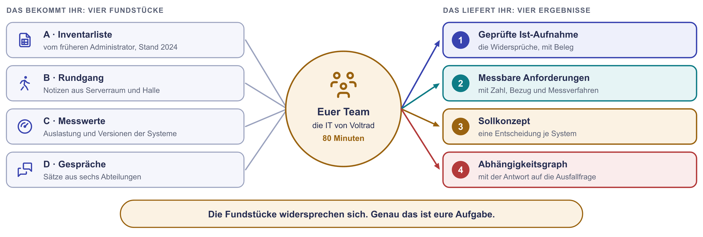{ .diagramm }

## Womit ihr hier arbeitet

| Baustein | Was er tut |
|---|---|
| **Fundstücke A bis D** | Die vier Quellen eurer Ist-Analyse. Sie stehen weiter unten auf dieser Seite. |
| **Ergebniszettel** | Eine Vorlage am Ende der Seite. Eine Person im Team füllt sie aus und bringt sie in die Auswertung mit. |
| **Mermaid Live Editor** | Eine Webseite, die aus wenigen Zeilen Text ein Schaubild zeichnet. Ihr haltet damit fest, welches System von welchem abhängt. Ein anderes Zeichenwerkzeug oder Papier geht genauso. |

Für die Prüfung zählt die Kette dahinter: Ist-Analyse, Anforderungen,
Sollkonzept, Lastenheft und Pflichtenheft, CMDB. Im Beruf beginnt fast jedes
Infrastrukturprojekt genau so, mit einer Liste, der niemand mehr traut.

## So arbeitet ihr im Team

Jede Person öffnet diese Seite selbst, denn die Fundstücke stehen in Reitern
nebeneinander. Im Breakout teilt eine Person ihren Bildschirm, eine zweite
führt den Ergebniszettel. Die Stationen bauen aufeinander auf, haltet
deshalb die Reihenfolge ein. Die Zeiten in den Überschriften sind Richtwerte.
Zu jeder Station gibt es eine Musterlösung zum Aufklappen. Seht erst hinein,
wenn ihr euch auf ein eigenes Ergebnis geeinigt habt.

!!! tip "Ihr arbeitet in einer zweiten Runde weiter?"
    So steigt ihr in fünf Minuten wieder ein:

    1. Wer hat den Ergebniszettel? Diese Person teilt ihn im Breakout.
    2. Lest eure Befunde aus Station 1 einmal laut vor. Fehlen noch welche,
       nehmt euch den Lageplan im Fundstück B und vergleicht ihn mit der
       Liste A.
    3. Macht dort weiter, wo ihr aufgehört habt. Die Stationen 2, 3 und 4
       bauen auf Station 1 auf, brauchen aber keine neuen Fundstücke.

## Die Lage

Es ist Oktober 2026. Die Voltrad GmbH baut mit 280 Mitarbeitenden in einem
Werk 120 E-Bikes am Tag. Die Montagelinie läuft in zwei Schichten, montags bis
freitags von 6 bis 22 Uhr. E-Mail und Office kommen schon als Microsoft 365
aus der Cloud. Alles andere läuft im eigenen Serverraum.

Herr Brandt hat diesen Serverraum aufgebaut und sechs Jahre lang allein
betreut. Seit dem Sommer ist er im Ruhestand. Geblieben sind seine
Inventarliste und zwei Kolleginnen in der IT.

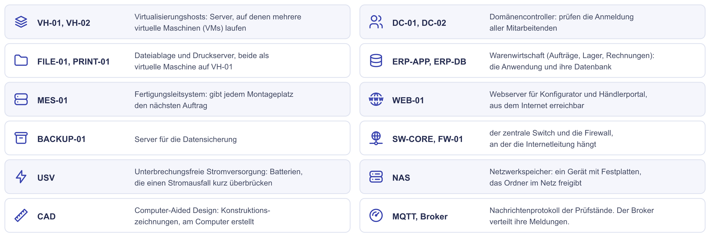{ .diagramm }

??? note "Die Abkürzungen als Tabelle"
    | Kürzel | Bedeutung |
    |---|---|
    | **VH** | Virtualisierungshost: ein Server, auf dem mehrere virtuelle Maschinen laufen |
    | **DC** | Domänencontroller: prüft die Anmeldung aller Mitarbeitenden am Netzwerk |
    | **FILE**, **PRINT** | Dateiablage und Druckserver |
    | **ERP** | Warenwirtschaft (Enterprise Resource Planning): Aufträge, Lager, Rechnungen. ERP-APP ist die Anwendung, ERP-DB ihre Datenbank. |
    | **MES** | Fertigungsleitsystem (Manufacturing Execution System): gibt jedem Montageplatz den nächsten Auftrag |
    | **MQTT** | Message Queuing Telemetry Transport: das Nachrichtenprotokoll, über das die Prüfstände ihre Messwerte melden. Der Broker ist die Verteilstelle. |
    | **MON** | Monitoring: zeichnet Auslastung und Störungen auf |
    | **NAS** | Netzwerkspeicher (Network Attached Storage): ein Gerät mit Festplatten, das Ordner im Netz freigibt |
    | **USV** | Unterbrechungsfreie Stromversorgung: Batterien, die einen Stromausfall für einige Minuten überbrücken |
    | **DMZ** | Abgetrennte Netzzone für Server, die aus dem Internet erreichbar sind |
    | **CAD** | Konstruktionszeichnungen am Computer (Computer-Aided Design) |
    | **SQL Server** | Das Datenbanksystem von Microsoft, auf dem die Warenwirtschaft ihre Daten speichert |
    | **LTS** | Long Term Support: eine Ausgabe von Ubuntu mit besonders langem Supportzeitraum |

## Die Fundstücke

Ihr müsst nicht alles lesen, bevor ihr anfangt. Jede Person öffnet
die Liste in Fundstück A und dazu genau ein weiteres Fundstück: eine Person B,
eine C, eine D. Seid ihr zu zweit, übernimmt eine Person B und D. Den Rest
erledigt Station 1.

=== "A · Inventarliste"

    Die Liste von Herrn Brandt, Stand März 2024.

    | Name | Aufgabe | Betriebssystem | Verantwortlich | Bemerkung |
    |---|---|---|---|---|
    | VH-01 | Virtualisierungshost für DC-01, FILE-01, PRINT-01 | Windows Server 2019 | Hr. Brandt | |
    | VH-02 | Virtualisierungshost für DC-02, MQTT-01, MON-01 | Windows Server 2019 | Hr. Brandt | |
    | ERP-DB | Datenbank der Warenwirtschaft | Windows Server 2019 | Hr. Brandt | |
    | ERP-APP | Warenwirtschaft, Anwendung | Windows Server 2019 | Hr. Brandt | |
    | MES-01 | Fertigungsleitsystem | Windows Server 2019 | Fertigung | Wartung durch den Hersteller |
    | WEB-01 | Konfigurator und Händlerportal | Ubuntu 20.04 LTS | Webagentur | steht in der DMZ |
    | BACKUP-01 | Datensicherung | Windows Server 2019 | Hr. Brandt | Rücksicherung getestet: ja |
    | TEST-01 | Testsystem der Warenwirtschaft | Windows Server 2016 | Hr. Brandt | |

    Zwei Notizen unter der Tabelle: „Alle acht Server 2020 gekauft." und
    „FILE-01 hat 2 TB, davon 55 % belegt."

=== "B · Rundgang"

    Was ihr beim Rundgang durch Serverraum und Halle seht, diese Woche. Legt
    das Bild neben die Liste aus Fundstück A.

    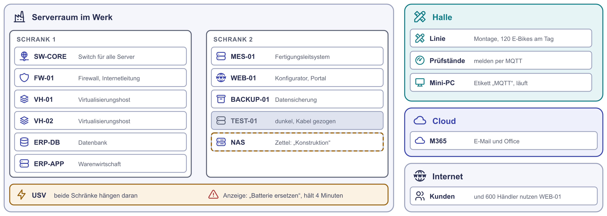{ .diagramm }

    ??? note "Die Notizen vom Rundgang als Text"
        - **Schrank 1:** VH-01, VH-02, ERP-DB und ERP-APP. Alle vier laufen.
        - **Schrank 1, oben:** ein Switch mit dem Etikett SW-CORE, an dem alle
          Server hängen. Daneben die Firewall FW-01. An ihr steckt die eine
          Internetleitung des Werks.
        - **Schrank 2:** MES-01, WEB-01 und BACKUP-01 laufen. TEST-01 ist dunkel.
          Das Netzkabel ist gezogen, auf dem Gehäuse liegt Staub.
        - **Schrank 2, ganz unten:** ein NAS mit vier Festplatten, ohne Etikett.
          Darauf klebt ein Zettel: „Konstruktion. NICHT ausschalten!"
        - **Zwischen den Schränken:** eine USV, an der beide Schränke hängen. Die
          Anzeige meldet „Batterie ersetzen".
        - **In der Halle neben Prüfstand 3:** ein Mini-PC mit dem Etikett „MQTT".
          Er läuft und hängt an einer normalen Steckdose.
        - **Typenschilder:** Alle acht Server sind Baujahr 2020.

=== "C · Messwerte"

    Auszug aus dem Monitoring und aus Abfragen direkt an den Systemen.

    | System | Gemessen |
    |---|---|
    | VH-01 | Arbeitsspeicher zu 91 % belegt. Beide Hosts sind gleich ausgestattet. |
    | VH-02 | Arbeitsspeicher zu 44 % belegt. Die virtuelle Maschine MQTT-01 ist seit Februar 2025 ausgeschaltet. |
    | ERP-DB | Abfrage am System: Windows Server 2016 Standard mit SQL Server 2016 |
    | FILE-01 | Laufwerk mit 2 TB, zu 92 % belegt. Zuwachs etwa 25 GB im Monat. |
    | WEB-01 | Ubuntu 20.04 LTS, letzte Updates im Dezember 2024. Auslastung im Jahresmittel 12 %. Von März bis Mai an neun Tagen über Stunden 100 %. |
    | BACKUP-01 | Letzter Lauf: gestern, erfolgreich. Letzte Probe-Rücksicherung: kein Eintrag im Protokoll. |
    | TEST-01 | Antwortet nicht. Die letzten Messwerte stammen von 2024. |
    | USV | Meldet seit 14 Wochen „Batterie ersetzen". Überbrückungszeit laut Anzeige: 4 Minuten. |

    Dazu vier Termine der Hersteller, die ihr nicht nachschlagen müsst:

    | Produkt | Ende der regulären Sicherheitsupdates |
    |---|---|
    | SQL Server 2016 | 14. Juli 2026 |
    | Windows Server 2016 | 12. Januar 2027 |
    | Windows Server 2019 | 9. Januar 2029 |
    | Ubuntu 20.04 LTS, ohne Zusatzvertrag | 31. Mai 2025 |

=== "D · Gespräche"

    Sätze aus den Gesprächen mit den Abteilungen.

    **Frau Dr. Albers, Geschäftsführerin**

    - „Der Konfigurator darf im Frühjahr nie wieder ausfallen."
    - „Ich will keine Hardware bezahlen, die drei Viertel des Jahres
      herumsteht. Wir kaufen einfach acht neue Server, dann ist Ruhe."

    **Herr Yilmaz, Fertigungsleiter**

    - „Wenn das Fertigungsleitsystem steht, stehen nach zehn Minuten die
      Bänder."
    - „Die Fertigung muss auch laufen, wenn das Internet weg ist."
    - „Der MQTT-Broker steht bei uns in der Halle. Der Server im Keller war
      uns zu oft weg, da haben wir uns selbst geholfen."

    **Frau Sommer, Vertriebsleiterin**

    - „Das Händlerportal muss schnell sein. Die 600 Händler bestellen meist
      montags früh."
    - „Im Frühjahr hatten wir viermal so viele Besucher im Konfigurator. An
      zwei Samstagen war er stundenlang nicht erreichbar."
    - „Die Webagentur betreut uns seit Ende 2024 nicht mehr. Texte ändert
      jetzt ein Freiberufler."

    **Herr Okafor, Leiter Finanzen**

    - „Wenn in der Warenwirtschaft Daten von einem ganzen Tag verloren gehen,
      ist das eine Katastrophe."

    **Herr Lindner, Konstruktion**

    - „Das NAS haben wir selbst gekauft, weil auf der Dateiablage kein Platz mehr für uns war. Darauf
      liegen alle CAD-Daten der neuen Modelle. Gesichert wird das, glaube
      ich, nicht."

    **Frau Vogt, IT**

    - „Wir sind zu zweit. Nachts und am Wochenende ist niemand da."
    - „Eine Rücksicherung haben wir zuletzt 2023 ausprobiert, glaube ich."

---

## Station 1: Was steht da wirklich? (20 Minuten)

**Was ihr hier tut:** Ihr prüft die Inventarliste gegen die drei anderen
Fundstücke. Eine Ist-Analyse hat drei Quellen: lesen, messen und fragen. Jede
allein führt in die Irre. Listen veralten, Messwerte sagen nichts über die
Bedeutung eines Systems, Menschen erinnern sich ungenau.

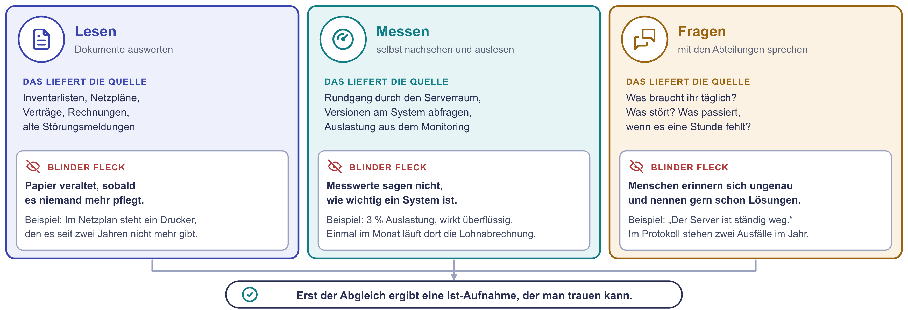{ .diagramm }

Ihr arbeitet gleichzeitig, jede Person mit ihrem Fundstück:

| Wer | Vergleicht die Liste A mit | Und fragt |
|---|---|---|
| Person 1 | **B**, dem Rundgang als Lageplan | Gibt es jedes Gerät? Läuft es? Steht etwas da, das in der Liste fehlt? |
| Person 2 | **C**, den Messwerten | Stimmen Betriebssystem und Zahlen? Welche Termine der Hersteller sind schon vorbei? |
| Person 3 | **D**, den Gesprächen sowie der Lage | Gibt es die Zuständigen noch? Stimmt, was die Liste über Standort und Sicherung sagt? |

1. Jede Person notiert ihre Funde in einer Zeile: „Die Liste sagt X.
   Tatsächlich Y. Beleg: B." Nach zehn Minuten legt ihr alles zusammen.
2. Die Musterlösung fasst neun Befunde zusammen. Findet mindestens sechs.
3. Wählt die drei Befunde aus, die ihr zuerst angehen würdet. Begründet jede
   Wahl in einem Satz.

!!! tip "Wenn ihr nicht weiterkommt"
    Geht die Spalten der Liste einzeln durch: Stimmt die Zahl der Geräte?
    Stimmen Aufgabe und Standort? Stimmt das Betriebssystem? Gibt es die
    verantwortliche Person noch? Und was steht im Raum, das in der Liste gar
    nicht vorkommt?

??? tip "Musterlösung Station 1"
    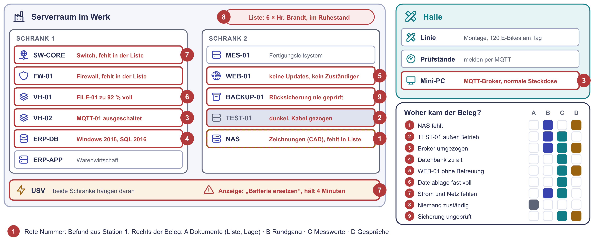{ .diagramm }

    | Nr. | Die Liste sagt | Tatsächlich | Beleg |
    |---|---|---|---|
    | 1 | Es gibt acht Server. | Im Schrank steht ein neuntes Gerät, das NAS der Konstruktion. Es wird nicht gesichert. | B, D |
    | 2 | TEST-01 ist ein Testsystem. | TEST-01 ist seit 2024 außer Betrieb, das Netzkabel ist gezogen. | B, C |
    | 3 | Der MQTT-Broker läuft als MQTT-01 auf VH-02. | MQTT-01 ist ausgeschaltet. Der Broker läuft auf einem Mini-PC in der Halle, an einer normalen Steckdose. | B, C, D |
    | 4 | ERP-DB läuft unter Windows Server 2019. | Es ist Windows Server 2016 mit SQL Server 2016. Die Datenbank bekommt seit Juli 2026 keine Sicherheitsupdates mehr, das Betriebssystem nur noch bis Januar 2027. | C |
    | 5 | Für WEB-01 ist die Webagentur verantwortlich. | Die Agentur ist seit Ende 2024 weg, seitdem hat niemand Updates eingespielt. Ubuntu 20.04 bekommt seit Ende Mai 2025 ohne Zusatzvertrag keine mehr. Der Server ist aus dem Internet erreichbar. | C, D |
    | 6 | FILE-01 ist zu 55 % belegt. | Es sind 92 %. | C |
    | 7 | Die Liste nennt nur Server. | USV, Switch, Firewall und Internetleitung fehlen ganz. Die USV meldet seit 14 Wochen einen Batteriefehler und überbrückt nur 4 Minuten. | B, C |
    | 8 | Verantwortlich ist bei sechs Einträgen Herr Brandt. | Herr Brandt ist im Ruhestand. Diese Systeme haben keinen benannten Verantwortlichen. | Lage |
    | 9 | Die Rücksicherung ist getestet. | Im Protokoll steht keine Probe. Die letzte liegt nach Erinnerung drei Jahre zurück. | C, D |

    **Die drei dringendsten Befunde** (eine gute Auswahl, es gibt andere):

    - **Befund 5, WEB-01:** Ein Server ohne Updates, den jeder aus dem
      Internet erreicht, ist das größte Sicherheitsrisiko im Haus.
    - **Befund 7, USV:** An der einen USV hängen beide Schränke. Fällt der
      Strom länger als vier Minuten aus, steht alles zugleich, auch die
      Fertigung.
    - **Befund 1 und 9, Datensicherung:** Die CAD-Daten der neuen Modelle
      liegen ungesichert auf einem einzigen Gerät. Und ob sich der Rest
      zurückspielen lässt, weiß niemand.

    Befund 4 ist ebenfalls dringend, weil das Datum feststeht. Wer ihn unter
    die ersten drei wählt, liegt genauso richtig.

    **Anders gezählt?** Wer bei WEB-01 Zuständigkeit und Updates getrennt
    zählt oder die 91 % Arbeitsspeicher auf VH-01 notiert hat, hat genau
    hingesehen. Auf die Zählung kommt es nicht an.

    **Was ihr daran seht:** Kein einziger Befund stand in der Liste. Die
    meisten zeigen sich erst, wenn zwei Quellen zusammenkommen: der Rundgang
    und die Messung oder die Messung und das Gespräch. Erst der Abgleich
    ergibt eine Ist-Aufnahme, der man trauen kann.

---

## Station 2: Was wird gebraucht? (15 Minuten)

**Was ihr hier tut:** Ihr macht aus Aussagen der Abteilungen Anforderungen,
die sich prüfen lassen. Funktionale Anforderungen sagen, **was** ein System
tun soll. Nicht-funktionale sagen, **wie gut** es das tun soll: wie
verfügbar, wie schnell, wie sicher. Rahmenbedingungen sind Grenzen, die schon
feststehen.

### Teil a: Sortieren

Ordnet jede Aussage ein: funktionale Anforderung, nicht-funktionale
Anforderung, Rahmenbedingung oder gar keine Anforderung. Eine Aussage kann
zwei Arten zugleich enthalten. Nennt dann beide.

1. „Händler können im Portal rund um die Uhr Bestellungen aufgeben."
2. „Der Konfigurator darf im Frühjahr nie wieder ausfallen."
3. „Die Fertigung muss auch laufen, wenn das Internet weg ist."
4. „Wir kaufen einfach acht neue Server."
5. „Die IT besteht aus zwei Personen. Nachts und am Wochenende ist niemand
   da."
6. „Das Fertigungsleitsystem zeigt jedem Montageplatz den nächsten Auftrag."

### Teil b: Messbar machen

Schreibt die Aussage zum Konfigurator so um, dass man sie am Ende abhaken
kann. Die beiden anderen sind für Schnelle. Jede
Anforderung braucht eine **Zahl mit Einheit**, einen **Bezug** (wann, unter
welcher Last) und ein **Messverfahren**.

So sieht das an einem Beispiel aus, das nicht zur Aufgabe gehört:

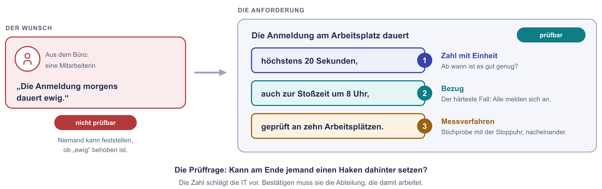{ .diagramm }

Jetzt ihr:

- „Der Konfigurator darf im Frühjahr nie wieder ausfallen."
- „Das Händlerportal muss schnell sein."
- „Wenn Daten von einem ganzen Tag verloren gehen, ist das eine Katastrophe."

### Teil c: Verfügbarkeit rechnen

Eine Verfügbarkeit gilt immer für eine **Bezugszeit**: die Stunden, in denen
das System laufen muss. Das Bild zeigt zwei Fälle und die Rechnung dazu.

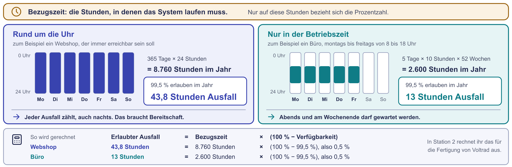{ .diagramm }

Für das Fertigungsleitsystem steht der Vorschlag „99,5 % Verfügbarkeit" im
Raum. Die Fertigung ist ein dritter Fall: zwei Schichten an fünf Tagen.

1. Wie viele Stunden im Jahr läuft die Fertigung? Rechnet mit 52 Wochen.
2. Wie viele Stunden Ausfall erlaubt 99,5 %, bezogen auf diese
   Betriebszeit? Vergleicht mit dem Wert für rund um die Uhr aus dem Bild.
3. Wie viele E-Bikes werden in den erlaubten Ausfallstunden der Betriebszeit
   nicht gebaut?
4. Herr Yilmaz sagt, nach zehn Minuten stehen die Bänder. Reicht die Zahl
   99,5 % als Anforderung aus? Was fehlt?

??? tip "Musterlösung Station 2"
    **Teil a**

    | Nr. | Einordnung | Begründung |
    |---|---|---|
    | 1 | funktional, dazu nicht-funktional | Beschreibt, was das Portal können muss. „Rund um die Uhr" ist zusätzlich eine Aussage zur Verfügbarkeit. |
    | 2 | nicht-funktional | Es geht um Verfügbarkeit, also um das Wie-gut. So ist der Satz aber noch nicht messbar. |
    | 3 | nicht-funktional | Die Fertigung soll unabhängig von der Internetleitung verfügbar sein. Das entscheidet später über den Standort der Systeme. Eine Rahmenbedingung ist es nicht: Sie steht nicht von außen fest, die Fertigung fordert sie vom Ergebnis. |
    | 4 | keine Anforderung | Das ist ein Lösungsvorschlag. Die Frage dahinter lautet: Wozu? Erst die Antwort darauf ist eine Anforderung. |
    | 5 | Rahmenbedingung | Die Größe des Teams steht fest. Jede Lösung muss damit auskommen. |
    | 6 | funktional | Beschreibt eine Funktion des Systems. |

    **Teil b** (Beispiele, eure Zahlen dürfen abweichen)

    - „Der Konfigurator ist von März bis Mai in jedem Monat zu mindestens
      99,9 % erreichbar. Gemessen wird von außen mit einem Abruf der
      Startseite alle 60 Sekunden." In einem Monat mit 30 Tagen erlaubt das
      etwa 43 Minuten Ausfall.
    - „Die Startseite des Händlerportals ist bei 200 gleichzeitig angemeldeten
      Händlern in höchstens 2 Sekunden geladen. Gemessen wird mit einem
      Lasttest vor der Inbetriebnahme und danach montags zwischen 7 und 9 Uhr
      über die aufgezeichneten Ladezeiten."
    - „Bei einem Ausfall der Warenwirtschaft gehen höchstens die Buchungen der
      letzten 60 Minuten verloren. Geprüft wird das zweimal im Jahr mit einer
      Probe-Rücksicherung." Der Fachbegriff für diesen höchsten Datenverlust
      ist RPO (Recovery Point Objective).

    Die Zahlen selbst legt ihr nie allein fest. Ihr schlagt sie vor, die
    Fachabteilung bestätigt sie. Eine strengere Zahl kostet mehr, deshalb gehört
    die Entscheidung dorthin, wo der Nutzen entsteht.

    **Teil c**

    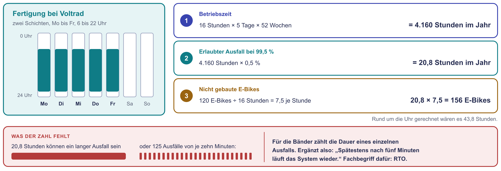{ .diagramm }

    1. 16 Stunden × 5 Tage × 52 Wochen = **4.160 Stunden** im Jahr.
    2. 0,5 % von 4.160 Stunden = **20,8 Stunden**. Auf das ganze Jahr
       gerechnet wären es 0,5 % von 8.760 Stunden = 43,8 Stunden. Dieselbe
       Prozentzahl erlaubt also mehr als doppelt so viel Ausfall, wenn der
       Bezug nicht festgelegt ist.
    3. 120 E-Bikes in 16 Stunden sind 7,5 je Stunde. 20,8 Stunden × 7,5 =
       **156 E-Bikes**.
    4. Nein. 20,8 Stunden können ein einziger langer Ausfall sein oder rund 125
       Ausfälle von je zehn Minuten. Für die Fertigung ist das ein großer
       Unterschied. Es fehlt eine zweite Zahl: wie lange ein einzelner
       Ausfall höchstens dauern darf, zum Beispiel „spätestens nach fünf
       Minuten läuft das System wieder". Der Fachbegriff dafür ist RTO
       (Recovery Time Objective). Dazu gehört der Bezug: „gemessen in
       der Betriebszeit montags bis freitags von 6 bis 22 Uhr".

---

## Station 3: Wie soll es aussehen? (10 Minuten)

**Was ihr hier tut:** Ihr entwerft das Sollkonzept in seiner einfachsten
Form: eine Entscheidung je System, begründet mit einer Anforderung. Die
Geschäftsführerin wollte acht neue Server. Ihr zeigt ihr, was sie wirklich
braucht.

### Teil a: Wohin mit jedem System?

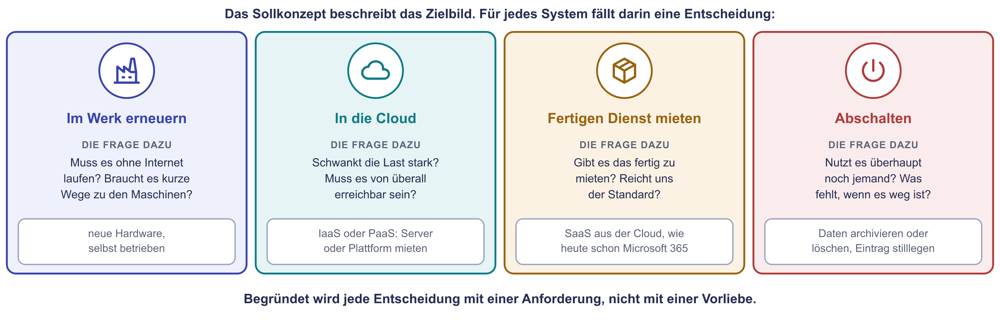{ .diagramm }

Entscheidet für jede Zeile und begründet in einem Satz. Ein Beispiel für
die Form: „In die Cloud, weil die Last stark schwankt." Zur Wahl stehen:

- **im Werk erneuern**, auf neuer Hardware
- **in die Cloud**, als gemieteter Server (IaaS) oder gemietete Plattform
  (PaaS)
- **als fertigen Dienst aus der Cloud mieten** (SaaS, Software as a
  Service), wie heute schon Microsoft 365
- **abschalten**

| System | Eure Entscheidung | Begründung |
|---|---|---|
| Fertigungsleitsystem (MES-01) | | |
| MQTT-Broker der Prüfstände | | |
| Warenwirtschaft (ERP-APP und ERP-DB) | | |
| Dateien (FILE-01 und das NAS der Konstruktion) | | |
| Konfigurator und Händlerportal (WEB-01) | | |
| Anmeldung und Druck (DC-01, DC-02, PRINT-01) | | |
| Datensicherung (BACKUP-01) | | |
| Testsystem (TEST-01) | | |

Zählt am Ende: Wie viele Server muss Voltrad nach eurem Konzept noch selbst
kaufen?

### Teil b: Lastenheft oder Pflichtenheft? (wenn Zeit bleibt)

Das **Lastenheft** schreibt der Auftraggeber: Was wird gebraucht und wofür?
Das **Pflichtenheft** schreibt der Auftragnehmer als Antwort: Wie und womit
wird das umgesetzt?

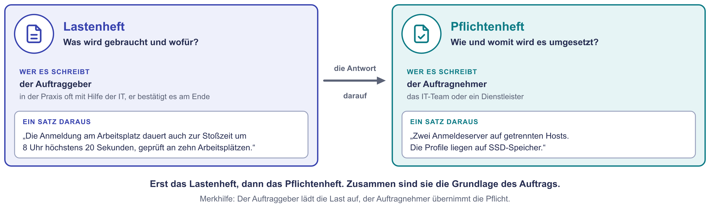{ .diagramm }

In welches Dokument gehört jeder Satz?

1. „Der Konfigurator muss im Frühjahr viermal so viele Besucher bedienen wie
   im übrigen Jahr."
2. „Der Konfigurator läuft auf mindestens zwei Servern an zwei getrennten
   Standorten des Cloud-Anbieters. Ein Lastverteiler (Load Balancer)
   verteilt die Anfragen."
3. „Bei einem Ausfall der Warenwirtschaft gehen höchstens die Buchungen der
   letzten 60 Minuten verloren."
4. „Die Datenbank der Warenwirtschaft wird stündlich gesichert. Eine Kopie
   liegt außerhalb des Werks."

Wenn Zeit bleibt: Schreibt selbst ein Paar zum Fertigungsleitsystem, einen
Satz für das Lastenheft und den passenden Satz für das Pflichtenheft.

??? tip "Musterlösung Station 3"
    **Teil a** (eine gut begründete Lösung, andere sind möglich)

    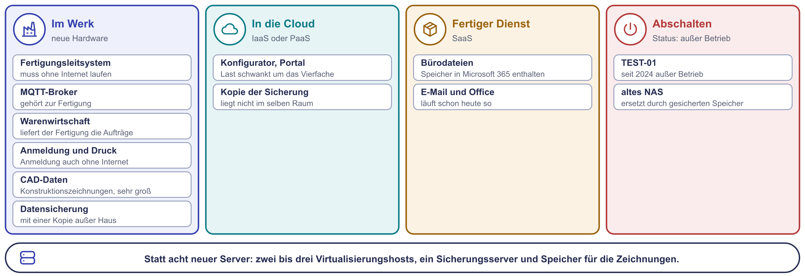{ .diagramm }

    | System | Entscheidung | Begründung |
    |---|---|---|
    | Fertigungsleitsystem | im Werk erneuern | Die Fertigung muss ohne Internet laufen. Nach zehn Minuten Stillstand stehen die Bänder. |
    | MQTT-Broker | im Werk erneuern | Er gehört zur Fertigung und muss ohne Internet arbeiten. Er zieht zurück in den Serverraum, an die USV und in die Datensicherung. |
    | Warenwirtschaft | im Werk erneuern, mit aktuellem Betriebssystem und aktueller Datenbank | Das Fertigungsleitsystem holt seine Aufträge dort ab. Läge sie in der Cloud, hinge die Fertigung doch wieder an der Internetleitung. |
    | Dateien | Bürodateien als fertigen Dienst mieten, CAD-Daten im Werk | Für Bürodateien ist in Microsoft 365 schon Speicher enthalten. CAD-Dateien sind groß und werden lokal bearbeitet, sie bekommen einen gesicherten Platz im Werk. Das NAS ohne Sicherung verschwindet. |
    | Konfigurator und Händlerportal | in die Cloud | Die Last schwankt um das Vierfache. In der Cloud wächst die Umgebung im Frühjahr mit und schrumpft danach. Ein Ausfall der Internetleitung im Werk trifft den Konfigurator dann nicht mehr. Bestellungen aus dem Portal werden in der Cloud zwischengespeichert, bis die Warenwirtschaft im Werk wieder erreichbar ist. |
    | Anmeldung und Druck | im Werk erneuern | Die Anmeldung muss auch ohne Internet funktionieren. Beide Domänencontroller bleiben auf zwei getrennten Hosts. |
    | Datensicherung | im Werk erneuern, mit einer Kopie in der Cloud | Eine Sicherung, die im selben Raum steht wie die Server, hilft bei Brand oder Wasserschaden nicht. |
    | Testsystem | abschalten | Es ist seit 2024 außer Betrieb. Die Platten werden gelöscht, der Eintrag bekommt den Status „außer Betrieb". |

    **Wie viele Server kauft Voltrad?** Nach diesem Konzept drei bis vier
    statt acht: zwei bis drei Virtualisierungshosts und ein Server für die
    Datensicherung. Die Hosts müssen sich gegenseitig vertreten können. Dazu
    kommt ein eigener Speicher für die CAD-Daten. Ob das Fertigungsleitsystem als
    virtuelle Maschine laufen darf, klärt ihr vorher mit dem Hersteller.

    **Teil b**

    | Satz | Dokument | Warum |
    |---|---|---|
    | 1 | Lastenheft | Beschreibt den Bedarf, ohne eine Lösung zu nennen. |
    | 2 | Pflichtenheft | Beschreibt, wie der Bedarf technisch gedeckt wird. |
    | 3 | Lastenheft | Legt fest, was erreicht werden muss. |
    | 4 | Pflichtenheft | Nennt die technische Umsetzung dazu. |

    Ein Paar zum Fertigungsleitsystem könnte so aussehen. Lastenheft: „Das
    Fertigungsleitsystem ist in der Betriebszeit zu 99,5 % verfügbar, kein
    Ausfall dauert länger als fünf Minuten." Pflichtenheft: „Das System läuft
    als virtuelle Maschine in einem Verbund aus zwei Hosts mit gemeinsamem
    Speicher im Werk. Fällt ein Host aus, startet die Maschine automatisch
    auf dem anderen."

---

## Station 4: Was hängt woran? (20 Minuten)

**Was ihr hier tut:** Ihr haltet fest, welches System welches andere braucht.
Diese Beziehungen sind der Kern einer **CMDB** (Configuration Management
Database), also einer Datenbank über alle Bestandteile der IT. Jeder
Bestandteil heißt dort **Configuration Item**, kurz CI. Anders als eine
Inventarliste kennt die CMDB auch die Verbindungen zwischen den Einträgen.
Erst damit lässt sich beantworten, was bei einem Ausfall alles steht.

Eine echte CMDB ist eine Datenbank mit Weboberfläche. Eine solche baut ihr
heute nicht auf. Ihr zeichnet nur ihren Kern: die Bestandteile und ihre
Beziehungen.

Dafür nehmt ihr den **Mermaid Live Editor**. Mermaid, gesprochen „Mör-mäid",
macht aus Textzeilen ein Schaubild. Aus einer Zeile werden zwei Kästen und
ein Pfeil:

```text
MES -->|holt Aufträge von| ERPAPP
```

{ .diagramm style="max-width: 24rem" }

Der Pfeil bedeutet immer: Das System vor dem Pfeil **braucht** das System
dahinter.

!!! tip "Lieber ein anderes Werkzeug?"
    Mermaid ist nur der Stift. Wenn euch Text nicht liegt, zeichnet ihr
    dieselben Kästen und Pfeile mit einem Werkzeug, das ihr kennt:
    [draw.io](https://app.diagrams.net/){ target=_blank } und
    [Excalidraw](https://excalidraw.com/){ target=_blank } laufen kostenlos
    und ohne Konto im Browser. PowerPoint oder ein Blatt Papier gehen
    genauso. Wichtig ist nur die Regel für die Pfeile. Die Schritte in Teil b
    sagen euch auch dann, was in das Bild gehört. In die Auswertung bringt
    ihr ein Bildschirmfoto statt eines Links mit.

### Teil a: Den Startgraphen öffnen

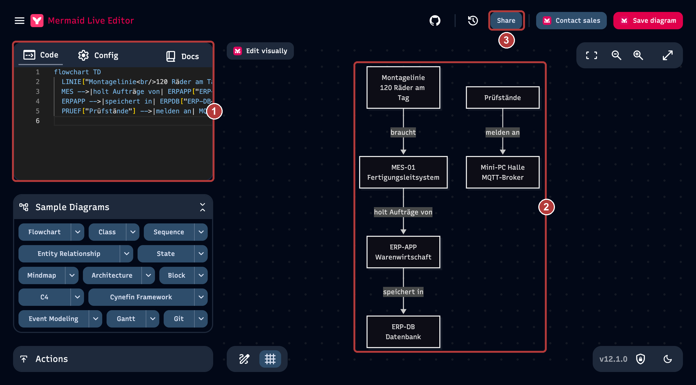{ .diagramm }

1. Öffnet den Startgraphen:
   [Startgraph im Mermaid Live Editor](https://mermaid.live/edit#pako:eNo1kM1Ow0AMhF_F2jMRAXGqUKWWpKISRaEN4kA4uImTrLrZVBsvVdX23XF-uFn2zOexLypvC1IzUKVpT3mNjiGNMgvwtn5fx9-Z2rSWsSKjrabnvbufPzyGsM18GNJTQQ6wgRSrTP1AEMyve4c-r_kKm3jXm-NdED4MthU51pW3VWdIc3fumBpx9atENZjr1jAsfMluxFcEv629QrxNFkkiOCkCqQbeFzqyJ-24k9QlT6hROtC6I-m8lq2gR0a0nBDRciBEyGT3aA-TN9l-xiuRJMP6Mi87HnPYgv7va8gUZAGFuPlI0_5EeUyQvMArGjM-qB8ES9ceyA1kdQeqIdegLvpHXzLFNTWCnEGmCirRG4l_62Xoud2dbS4jdp6k44-FxIw0Vg6bqX37A8VPj20=){ target=_blank }
2. Links steht der Text unter **Code** (im Bild die 1), rechts das Schaubild
   (2). Ändert links probeweise ein Wort. Das Schaubild folgt sofort.
3. Ein Werbebanner am oberen Rand schließt ihr mit dem Kreuz. Den Knopf
   **Save diagram** braucht ihr nicht, er verlangt ein Konto.

??? note "Falls der Link nicht lädt: den Startgraphen von Hand einfügen"
    Öffnet [mermaid.live](https://mermaid.live){ target=_blank }, löscht den
    Text unter **Code** und fügt diesen ein:

    ```text
    flowchart TD
      LINIE["Montagelinie<br/>120 Räder am Tag"] -->|braucht| MES["MES-01<br/>Fertigungsleitsystem"]
      MES -->|holt Aufträge von| ERPAPP["ERP-APP<br/>Warenwirtschaft"]
      ERPAPP -->|speichert in| ERPDB["ERP-DB<br/>Datenbank"]
      PRUEF["Prüfstände"] -->|melden an| MQTT["Mini-PC Halle<br/>MQTT-Broker"]
    ```

### Teil b: Den Graphen erweitern

Der Startgraph kennt vier Beziehungen. Ergänzt ihn in vier Schritten aus eurer
Ist-Aufnahme. Jede neue Zeile kommt an das Ende des Textes. Zu jedem Schritt
gibt es eine Zeile als Muster, den Rest schreibt ihr selbst.

**Schritt 1: der Strom.** An der USV hängen alle Geräte im Serverraum. Kopiert
diese Zeile unter den Startgraphen:

```text
  MES & ERPAPP & ERPDB -->|Strom von| USV["USV-01"]
```

Das Zeichen `&` fasst mehrere Systeme zusammen, die dieselbe Beziehung haben.
`USV["USV-01"]` legt einen neuen Kasten an: Vor der eckigen Klammer steht ein
kurzer Name ohne Leerzeichen und ohne Bindestrich, in der Klammer der Text,
der im Kasten erscheint. Ab dem zweiten Auftreten genügt der kurze Name.

??? example "Zur Kontrolle: So sieht der Graph nach Schritt 1 aus"
    ```mermaid
    flowchart TD
      LINIE["Montagelinie<br/>120 Räder am Tag"] -->|braucht| MES["MES-01<br/>Fertigungsleitsystem"]
      MES -->|holt Aufträge von| ERPAPP["ERP-APP<br/>Warenwirtschaft"]
      ERPAPP -->|speichert in| ERPDB["ERP-DB<br/>Datenbank"]
      PRUEF["Prüfstände"] -->|melden an| MQTT["Mini-PC Halle<br/>MQTT-Broker"]
      MES & ERPAPP & ERPDB -->|Strom von| USV["USV-01"]
    ```

**Schritt 2: die Hosts.** DC-01 und FILE-01 laufen auf VH-01, DC-02 läuft auf
VH-02. Beide Hosts bekommen ihren Strom von der USV. Das Muster:

```text
  DC1["DC-01"] -->|läuft auf| VH1["VH-01"]
```

**Schritt 3: das Büro.** Die Büro-Arbeitsplätze melden sich an DC-01 und DC-02
an und speichern ihre Dateien auf FILE-01. Das Muster:

```text
  BUERO["Büro-Arbeitsplätze"] -->|melden sich an bei| DC1
```

**Schritt 4: das Internet.** Kunden und Händler nutzen WEB-01. WEB-01 ist über
die Firewall FW-01 erreichbar, die Firewall hängt an der Internetleitung.
WEB-01 und die Firewall bekommen ihren Strom ebenfalls von der USV. Das
Muster:

```text
  KUNDEN["Kunden und Händler"] -->|nutzen| WEB["WEB-01"]
```

Wer noch Zeit hat, ergänzt das NAS der Konstruktion. Wenn ihr festhängt,
steht die fertige Fassung in der Musterlösung am Ende der Station.

??? note "Spickzettel: fünf Schreibweisen genügen"
    - Neuer Kasten: `USV["USV-01"]`
    - Beziehung zwischen zwei Kästen: `DC1 -->|läuft auf| VH1`
    - Mehrere Systeme auf einmal: `VH1 & VH2 -->|Strom von| USV`
    - Zweite Zeile im Kasten: `MES["MES-01<br/>Fertigungsleitsystem"]`
    - Von links nach rechts statt von oben nach unten: in der ersten Zeile
      `flowchart LR` statt `flowchart TD`

!!! warning "Wenn unter dem Code „Syntax error" erscheint"
    Bei einem Tippfehler wird das Schaubild rechts grau und zeigt den letzten
    gültigen Stand. Links unter dem Code nennt die Meldung die Zeile, zum
    Beispiel „Parse error on line 7". Meist fehlt dort ein Anführungszeichen
    oder eine Klammer: Jeder Kastentext steht in `["..."]`, jede Beschriftung
    eines Pfeils zwischen zwei senkrechten Strichen. Den Knopf **AI Repair**
    braucht ihr nicht, er verlangt ein Konto.

### Teil c: Die Ausfallfrage

Lest die Antworten an eurem Graphen ab und nehmt die Fundstücke dazu.
Betroffen ist alles, von dem aus ein Weg entlang der Pfeile zum ausgefallenen
Bestandteil führt. Eine Ausnahme: Führen zwei Pfeile zu gleichwertigen
Systemen, etwa zu zwei Domänencontrollern, genügt eines davon.

So liest man das an einem Fall, der unten nicht gefragt ist:

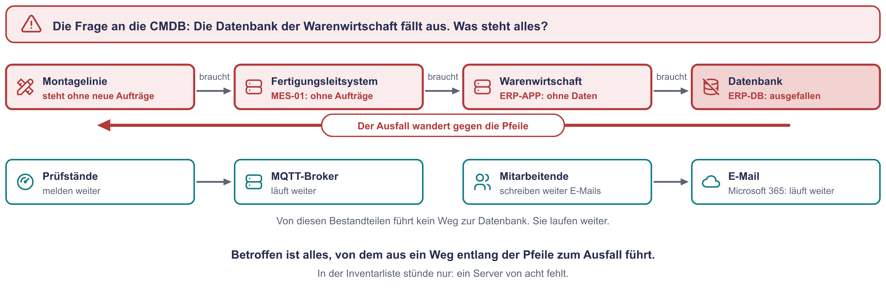{ .diagramm }

1. Im Serverraum löst ein Sicherungsautomat aus. Der Strom ist dort für 20 Minuten
   weg, die USV hält 4 Minuten. Die Halle hat weiter Strom. Was steht? Was
   läuft weiter?
2. VH-01 fällt aus. Was steht? Können sich die Mitarbeitenden noch anmelden?
3. Die Internetleitung des Werks fällt aus. Läuft die Fertigung weiter? Was
   merken Kunden und Händler?

### Teil d: Die schwachen Stellen markieren

Ein Bestandteil, an dem vieles hängt und für den es keinen Ersatz gibt, heißt
**Single Point of Failure**. Gebt euren Kandidaten einen roten Rahmen. Dazu
hängt ihr zwei Zeilen an das Ende des Textes und tragt die kurzen Namen ein:

```text
  classDef kritisch stroke:#E05252,stroke-width:4px
  class USV,ERPDB kritisch
```

In der zweiten Zeile stehen eure Kandidaten, durch Kommas getrennt und ohne
Leerzeichen. Wer mit einem anderen Werkzeug zeichnet, färbt die Rahmen dort
rot.

### Teil e: Teilen

Klickt oben auf **Share** und in der Zeile **Mermaid Live Editor** auf
**Copy**. Der kopierte Link enthält den ganzen Graphen. Tragt ihn in den
Ergebniszettel ein. Mit einem anderen Werkzeug macht ihr ein Bildschirmfoto.

??? tip "Musterlösung Station 4"
    Ein möglicher Graph. Rot umrandet ist eine Auswahl: vier Bestandteile ohne
    Ersatz, an denen besonders viel hängt.

    ```mermaid
    flowchart TD
      LINIE["Montagelinie<br/>120 Räder am Tag"] -->|braucht| MES["MES-01<br/>Fertigungsleitsystem"]
      MES -->|holt Aufträge von| ERPAPP["ERP-APP<br/>Warenwirtschaft"]
      ERPAPP -->|speichert in| ERPDB["ERP-DB<br/>Datenbank"]
      PRUEF["Prüfstände"] -->|melden an| MQTT["Mini-PC Halle<br/>MQTT-Broker"]

      MES & ERPAPP & ERPDB -->|Strom von| USV["USV-01"]

      DC1["DC-01"] -->|läuft auf| VH1["VH-01"]
      FILE["FILE-01<br/>Dateiablage"] -->|läuft auf| VH1
      DC2["DC-02"] -->|läuft auf| VH2["VH-02"]
      VH1 & VH2 -->|Strom von| USV

      BUERO["Büro-Arbeitsplätze"] -->|melden sich an bei| DC1 & DC2
      BUERO -->|speichern auf| FILE

      KUNDEN["Kunden und Händler"] -->|nutzen| WEB["WEB-01<br/>Konfigurator, Händlerportal"]
      WEB -->|erreichbar über| FW["FW-01<br/>Firewall"]
      FW -->|hängt an| NETZ["Internetleitung"]
      WEB & FW -->|Strom von| USV

      KONSTR["Konstruktion"] -->|speichert auf| NAS["NAS Konstruktion<br/>CAD-Daten"]
      NAS -->|Strom von| USV

      classDef kritisch stroke:#E05252,stroke-width:4px
      class USV,ERPDB,NETZ,NAS kritisch
    ```

    Dasselbe als aufgeräumtes Schaubild. Der Blitz heißt: bekommt Strom von
    der USV.

    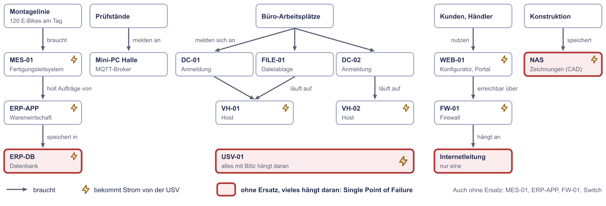{ .diagramm }

    Zum Vergleichen und Weiterbauen:
    [Musterlösung im Mermaid Live Editor öffnen](https://mermaid.live/edit#pako:eNp9VF1v2jAU_StXmcQT0SBqX9BUCUgQiJYyPqUte3ASJ1g4NnKcsa70v-_aTlg7tXsxwbnnnHvuR569VGbUG4CXc3lOD0Rp2ISxALifLWbR99h7kEKTgnImGP2SqM93_aAHq7ju9ehNRhWQEjakiL0f4Pt3l0SROj3oCzxEawOO1n6vb2ETqjQralFUnDJdPVWalogyUhhlwQfJNQzrXCtHX1D4KcUFotVyuFwiHT74-GT59kRRcWZKV5h1rhsqF2rZqhNl6QFVgTmOcNRQhCPLEBJNRULEscEuV9togiFLK5-neaVdHiKjrb-S8owKIMj48HWzMRaxMP5yDFPCuSuQeeGPlDxSZZlbi502u47LxhKutZKls7ld75APTyzZFRiO-3gZjt2dhXCXFdYJSJ1fYDc1IbtpCwOYzO5N68xPW35jlpGEYyv_w-MUg0Yx-DgyaBSDRhGxaAvv3zHljIy20eoRUSNXXCX9oUrMJJwadv373ypX2D8sNWDYxRQCFTC5K9mbLguXmbHs9ObbRRgtUHBeC0OGJ0zbfnLbGksgahTGRPeRGQ8824rNpchxYBXRUnXfQE9SacIb54iwPFQpk0lCFDiHCVWYz970YX9dAqboGQel7dPezX3DXWg7WIto8w1RM6HRFtVmXXBtXsl1WuB7dZ4_LtablfEtRaVVfdRMitbs352w1VoMzZLiCa-DbabjYejbBWl0TdBHkiknVRXSHI6KaYb7CMiF4z_4FPVug9ug6_76Z5bpw-Dm9OsKMhxduwxd47prVFqSWHhd8EqqSsIy84V6jj19oCVOyQBiL6M5qTnu_YsJI7WW6yeR4iu0QfGmPmWYfshIoUjZXL_8AUKTlTc=){ target=_blank }

    **Teil c**

    1. **Stromausfall im Serverraum:** Nach vier Minuten steht dort alles
       zugleich: Fertigungsleitsystem, Warenwirtschaft, beide Hosts mit
       Anmeldung und Dateiablage, Konfigurator, Händlerportal, das NAS, die
       Datensicherung, der Switch und die Firewall. Zehn Minuten später
       steht auch die Montagelinie, obwohl die Halle Strom hat: Ohne
       Fertigungsleitsystem kommen dort keine Aufträge an. Weiter läuft der
       Mini-PC mit dem Broker in der Halle. Microsoft 365 läuft in der Cloud
       zwar weiter, ist aus dem Werk aber nicht erreichbar, weil Firewall und
       Switch ohne Strom sind. Die Server werden nicht sauber
       heruntergefahren, weil vier Minuten dafür kaum reichen.
    2. **VH-01:** Es stehen DC-01, FILE-01 und PRINT-01. Die Anmeldung
       funktioniert weiter, weil DC-02 auf VH-02 läuft. Der Graph zeigt das
       nicht von selbst, er kennt kein Entweder-oder. Die Dateiablage und
       das Drucken fallen aus. Selbst wenn die Hosts dafür eingerichtet
       wären, könnte VH-02 nicht alle Maschinen übernehmen: Dort sind nur
       56 % des Arbeitsspeichers frei, VH-01 belegt 91 %.
    3. **Internetleitung:** Die Fertigung läuft weiter, weil
       Fertigungsleitsystem, Warenwirtschaft und Broker im Werk stehen.
       Kunden und Händler erreichen Konfigurator und Portal nicht mehr, denn
       WEB-01 hängt an derselben Leitung. Im Büro fallen E-Mail und die
       Online-Dienste von Microsoft 365 aus.

    **Teil d:** Einen roten Rahmen bekommen mindestens die USV (alles hängt an ihr), die
    Datenbank der Warenwirtschaft (über sie steht die Fertigung), die eine
    Internetleitung und das NAS (einziger Ort der CAD-Daten). Ebenso ohne
    Ersatz sind das Fertigungsleitsystem, die Anwendung der Warenwirtschaft,
    die Firewall und der Switch SW-CORE. Wer sie markiert, liegt auch richtig.

---

## Bonus für die Schnellen

Die Reihenfolge ist frei. Die ersten drei Aufgaben dauern je etwa fünf
Minuten, die Denkaufgabe etwa zwanzig.

### Bonus 1: Euer Rechner als Configuration Item

Eine Ist-Aufnahme beginnt mit einem einzelnen Gerät. Nehmt euren eigenen
Rechner so auf, als stünde er bei Voltrad. Schreibt vorher aus dem Kopf auf:
Welche Version hat euer Betriebssystem? Wann wurde der Rechner zuletzt
neu gestartet? Dann messt nach.

=== "Windows PowerShell"

    ```powershell
    systeminfo
    ```

    Die Ausgabe braucht einige Sekunden. Sucht darin die Zeilen
    **Hostname**, **Betriebssystemname**, **Betriebssystemversion**,
    **Systemstartzeit** und **Gesamter physischer Speicher**. Auf einem
    englischen Windows heißen sie Host Name, OS Name, OS Version, System Boot
    Time und Total Physical Memory. Mit eingeschaltetem Schnellstart zeigt
    Windows den letzten echten Neustart, nicht das letzte Einschalten.

=== "macOS"

    ```bash
    hostname
    sw_vers
    uptime
    sysctl -n hw.memsize
    ```

    `uptime` zeigt hinter `up`, wie lange der Rechner schon läuft. Die letzte
    Zeile nennt den Arbeitsspeicher in Byte. Geteilt durch 1.073.741.824
    ergibt das Gigabyte.

=== "Linux"

    ```bash
    hostname
    cat /etc/os-release
    uptime
    free -h
    ```

    `uptime` zeigt hinter `up`, wie lange der Rechner schon läuft. `free -h`
    nennt in der Spalte `total` den Arbeitsspeicher.

Tragt die Werte in eine Zeile ein: Name, Betriebssystem mit Version,
Arbeitsspeicher, letzter Neustart, verantwortliche Person, Ende der
Sicherheitsupdates. Das letzte Datum findet ihr auf
[endoflife.date](https://endoflife.date){ target=_blank }, einer freien
Übersicht über die Supportzeiträume vieler Produkte.

??? tip "Worauf es ankommt"
    Die meisten liegen bei der Version oder beim letzten Neustart daneben,
    obwohl es der eigene Rechner ist. Genau so entsteht eine Liste wie die
    von Herrn Brandt: Niemand trägt absichtlich etwas Falsches ein, die
    Wirklichkeit ändert sich nur schneller als die Liste. Deshalb liest eine
    gute CMDB solche Werte automatisch aus den Systemen und vermerkt, von
    wann die Angabe stammt.

    Windows 10 bekommt seit dem 14. Oktober 2025 keine regulären
    Sicherheitsupdates mehr. Falls jemand im Team es noch nutzt, habt ihr
    euren eigenen Befund.

### Bonus 2: Verfügbarkeit in der Kette

Die Montagelinie braucht das Fertigungsleitsystem, dieses die Anwendung der
Warenwirtschaft und diese ihre Datenbank. Angenommen, jedes der drei Systeme
erreicht für sich 99,5 %. Wie verfügbar ist die Kette? Wie viele Stunden
Ausfall sind das in der Betriebszeit von 4.160 Stunden?

??? tip "Musterlösung"
    Die Kette läuft nur, wenn alle drei Glieder laufen. Die Werte werden
    deshalb multipliziert: 0,995 × 0,995 × 0,995 = 0,9851, also rund
    **98,5 %**. Das sind 1,49 % von 4.160 Stunden, also rund **62 Stunden**
    Ausfall statt 20,8. Jedes zusätzliche Glied in einer Kette senkt die
    Verfügbarkeit des Ganzen. Wer 99,5 % für die Fertigung zusagen will, muss
    jedes einzelne Glied deutlich besser bauen.

### Bonus 3: Wann ist die Dateiablage voll?

FILE-01 hat 2 TB, ist zu 92 % belegt und wächst um 25 GB im Monat. Rechnet
mit 1 TB = 1.000 GB.

1. Wie viele Monate reicht der Platz noch?
2. Auf dem NAS der Konstruktion liegen 600 GB CAD-Daten. Was passiert, wenn
   ihr sie einfach auf FILE-01 verschiebt?

??? tip "Musterlösung"
    1. Belegt sind 1.840 GB, frei sind 160 GB. 160 ÷ 25 = 6,4. Der Platz
       reicht noch gut **sechs Monate**, also bis zum Frühjahr.
    2. Die 600 GB passen nicht auf 160 GB freien Platz. Wer zwei Ablagen
       zusammenführt, muss den Speicher vorher neu planen: heutiger Bestand,
       Zuwachs je Monat und eine Reserve. Wie das geht, ist Thema der Seite
       [Speicherlösungen](speicherloesungen.md).

### Denkaufgabe: In welcher Reihenfolge?

Ihr habt die Befunde, die Anforderungen und das Zielbild. Jetzt fehlt der
Fahrplan. Bringt diese sechs Vorhaben in eine Reihenfolge und begründet sie.
Was kann gleichzeitig laufen? Was muss vor dem Frühjahr fertig sein?

- A: Konfigurator und Händlerportal in die Cloud umziehen
- B: Neue Virtualisierungshosts für das Werk beschaffen und aufbauen
- C: Die Datenbank der Warenwirtschaft auf aktuelle Versionen bringen
- D: Batterie der USV tauschen, NAS in die Datensicherung aufnehmen,
  Zusatzvertrag für WEB-01 abschließen und Updates einspielen
- E: Dateien neu ordnen: Bürodateien nach Microsoft 365, CAD-Daten vom NAS
  auf gesicherten Speicher im Werk
- F: Das Fertigungsleitsystem auf die neue Plattform umziehen

Bedenkt dabei: Das Team besteht aus zwei Personen. Die Fertigung läuft
montags bis freitags in zwei Schichten. Die Termine der Hersteller aus
Fundstück C stehen fest.

??? tip "Musterlösung"
    Eine gut begründete Reihenfolge:

    1. **D, sofort.** Drei überschaubare Schritte, die von nichts anderem
       abhängen und die größten Risiken entschärfen. Bei WEB-01 genügt das
       Einspielen allein nicht: Ohne Zusatzvertrag enden die Updates beim
       Stand von Mai 2025. Vorher sichert ihr den Server.
    2. **B, gleich danach.** Die neuen Hosts haben Lieferzeit. C und F
       bauen auf ihnen auf. Deshalb wird zuerst bestellt.
    3. **C, vor dem 12. Januar 2027.** Die Datenbank bekommt schon heute
       keine Sicherheitsupdates mehr, das Betriebssystem nur noch bis zu
       diesem Datum. Vorher klärt ihr mit dem Hersteller der
       Warenwirtschaft, welche Versionen er freigibt. Der Umzug läuft an
       einem eigens geplanten Wochenende, nach einer geglückten
       Probe-Rücksicherung.
    4. **A, von November bis Februar.** Der Umzug braucht die Hosts im Werk
       nicht und läuft parallel zu B und C, wenn ein Dienstleister hilft.
       Fertig sein muss er vor März, mit einem Lasttest vor der Saison.
    5. **E, bis zum Frühjahr.** Die Dateiablage ist in gut sechs Monaten
       voll. Vorher muss der neue Speicher stehen.
    6. **F, zum Schluss.** Das Fertigungsleitsystem läuft laut Liste unter
       Windows Server 2019 und hat noch Zeit. Nachgemessen hat das noch
       niemand, das holt ihr vorher nach. Sein Umzug ist der heikelste und
       gelingt nur an einem Wochenende gemeinsam mit dem Hersteller. Bis
       dahin hat das Team an C Erfahrung mit der neuen Plattform gesammelt.

    Zwei Personen schaffen das nicht nebenbei. Zum Fahrplan gehört deshalb
    die Frage, welche Schritte ein Dienstleister übernimmt. Das ist
    Ressourcenplanung, siehe [Ressourcen planen](ressourcen-planen.md).

---

## Ergebniszettel

Kopiert die Vorlage in ein Dokument oder einen Editor. Eine Person im Team
füllt sie aus.

```text
Team:

Station 1
Gefundene Befunde (Anzahl):
Unsere drei dringendsten, je mit einem Satz Begründung:
1.
2.
3.

Station 2
Unsere messbare Anforderung an den Konfigurator:
Fertigungsleitsystem bei 99,5 %: ... Stunden Ausfall, ... E-Bikes
Was der Zahl 99,5 % noch fehlt:

Station 3
Im Werk bleibt:
In die Cloud geht:
Als fertiger Dienst:
Abgeschaltet wird:
So viele Server kauft Voltrad noch selbst:

Station 4
Link zu unserem Graphen (oder ein Bildschirmfoto):
Stromausfall im Serverraum: Das steht alles:
Unsere rot umrandeten Bestandteile:
```

## Wenn etwas nicht klappt

| Was ihr seht | Was hilft |
|---|---|
| Unter dem Code steht „Syntax error", das Schaubild ist grau | Die Meldung nennt die Zeile. Dort prüfen: Kastentext in `["..."]`, Pfeiltext zwischen zwei senkrechten Strichen, kurze Namen ohne Leerzeichen und ohne Bindestrich |
| Das Schaubild ist zu klein | Rechts oben mit den Lupen vergrößern oder mit dem Mausrad hineinzoomen |
| Mermaid liegt uns nicht | Ein anderes Werkzeug nehmen: draw.io, Excalidraw, PowerPoint oder Papier. Die Schritte in Teil b gelten genauso. |
| Der Graph wird unübersichtlich | Die erste Zeile von `flowchart TD` auf `flowchart LR` ändern. Dann läuft er von links nach rechts. |
| Der kopierte Link ist sehr lang | Das ist richtig so. Der ganze Graph steckt im Link, gespeichert wird nirgends etwas. |
| `systeminfo` zeigt englische Zeilen | Die englischen Namen stehen bei Bonus 1 direkt unter dem Befehl |

## Was ihr jetzt könnt

- Ihr prüft eine Bestandsliste gegen Rundgang, Messwerte und Gespräche und
  belegt jeden Widerspruch mit seiner Quelle.
- Ihr macht aus einem Wunsch eine Anforderung mit Zahl, Bezug und
  Messverfahren.
- Ihr rechnet eine Verfügbarkeit in Stunden um und wisst, dass die
  Prozentzahl ohne Bezugszeit nichts sagt.
- Ihr entscheidet je System zwischen Werk, Cloud, fertigem Dienst und
  Abschalten und trennt Lastenheft von Pflichtenheft.
- Ihr lest an einem Abhängigkeitsgraphen ab, was bei einem Ausfall steht.

Die Theorie dazu steht auf der Seite
[Anforderungen & Sollkonzept](anforderungen-und-sollkonzept.md). Acht weitere
Einzelaufgaben mit Musterlösung findet ihr unter
[Übungen: Anforderungen & Sollkonzept](uebungen-anforderungen.md).
