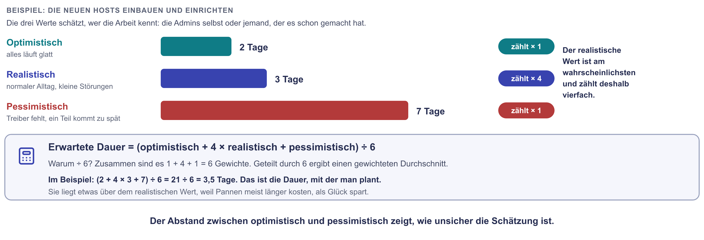
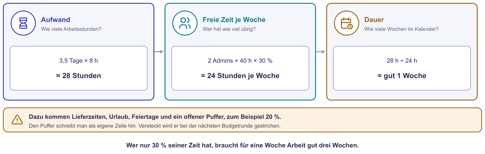
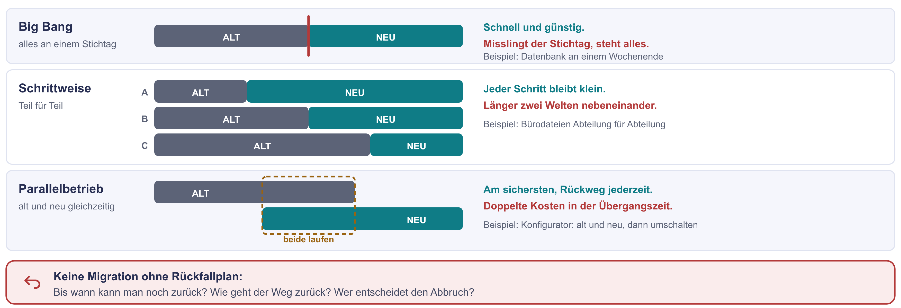
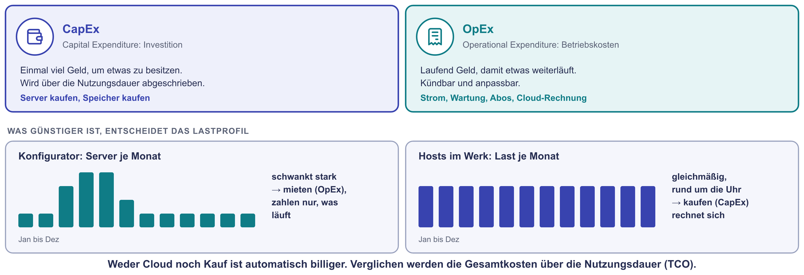
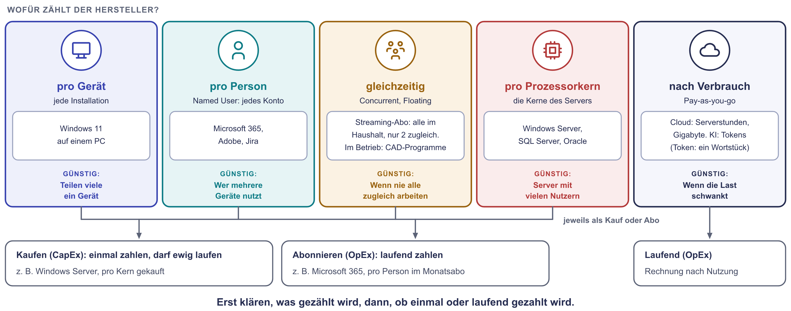
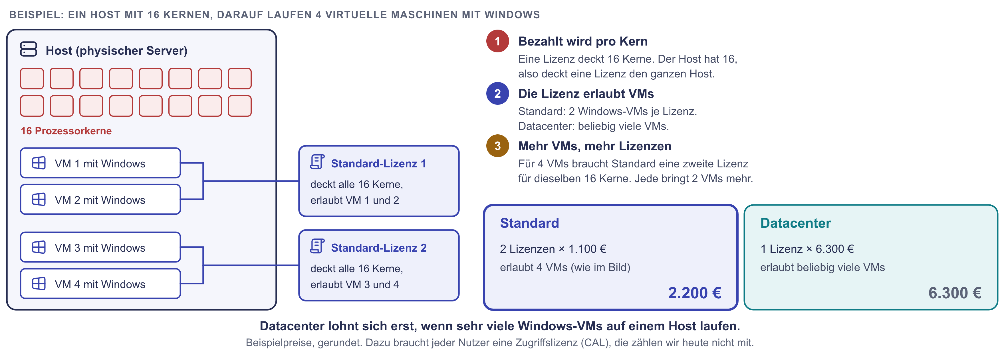

# Praxis: Schafft Voltrad das?

Das Sollkonzept der Voltrad GmbH steht, der Speicher ist geplant. Jetzt will
die Geschäftsführerin wissen, ob das Vorhaben machbar ist: Schafft das Team den
Termin? Was kostet es? Welche Lizenzen braucht Voltrad? Und reicht das Budget
von 60.000 € im ersten Jahr?

Ihr rechnet es in fünf Stationen durch. Sie bauen aufeinander auf: Am Ende
fließen alle Zahlen in eine Empfehlung an die Geschäftsführung.

!!! abstract "Ziel"
    Am Ende könnt ihr:

    - eine Dauer mit der Dreipunktschätzung schätzen und Aufwand in
      Kalenderwochen umrechnen
    - je System eine Migrationsstrategie mit Rückfallplan begründen
    - Cloud und eigene Server über die gesamte Nutzungsdauer vergleichen
    - Lizenzen nach ihrer Zählweise durchrechnen
    - aus allen Zahlen eine kurze Entscheidungsvorlage schreiben

    Für die Schnellen gibt es drei kurze Bonus-Aufgaben und eine längere
    Denkaufgabe.

!!! info "Alles im Browser, alles auf einer Karte"
    Ihr braucht nur diese Seite und einen Taschenrechner. Alle Zahlen stehen
    auf der Karte unten. Die Preise sind gerundete Beispielpreise.

## So arbeitet ihr im Team

Eine Person teilt den Bildschirm mit dieser Seite, eine zweite schreibt die
Ergebnisse auf. Teilt euch die Rechnungen ruhig auf: Station 3 und 4 lassen
sich gleichzeitig rechnen. Zu jeder Station gibt es Hinweise zum Aufklappen,
falls ihr nicht weiterkommt. Die Lösung besprechen wir gemeinsam nach der
Praxiszeit. Dort stellt jede Gruppe ihre Ergebnisse in fünf Minuten vor.

## Die Karte mit allen Zahlen

| Bereich | Angaben |
|---|---|
| **Das Vorhaben** | Zwei Hosts je 9.000 €, je 16 Kerne. Bestellung am Montag, 26.10., Lieferzeit 6 Wochen. Speicher mit fünf Platten: 6.000 €. Sechs Windows-VMs, jede muss auf jedem Host laufen dürfen. |
| **Konfigurator** | Kommt in die Cloud. Bedarf 21 Servermonate im Jahr: im Frühjahr bis zu 4 Server gleichzeitig, außerhalb der Saison reicht einer. |
| **Team und Termine** | Zwei Admins, je 40 Stunden pro Woche, davon 30 % frei für das Projekt. Dienstleister: 120 € pro Stunde. Hosts aufbauen: 1 Kalenderwoche nach der Lieferung. Der Umzug der Datenbank muss **vor dem 12.01.2027** fertig sein. Betriebsurlaub 21.12. bis 3.1. Schätzung für den Umzug: optimistisch 3, realistisch 5, pessimistisch 13 Arbeitstage zu je 8 Stunden. |
| **Preise** | Cloud-Server: 120 € pro Monat. Eigener Server für den Konfigurator: 5.000 €, Strom und Wartung 60 € pro Monat je Server, auch wenn er gerade nicht gebraucht wird. Budget der Geschäftsführung: 60.000 € im ersten Jahr. |
| **Lizenzen** | CAD: 12 Personen, höchstens 8 arbeiten gleichzeitig. Named User 2.200 € oder Floating 3.000 € je Lizenz und Jahr. Windows Server je 16 Kerne: Standard 1.100 €, deckt 2 VMs. Datacenter 6.300 €, deckt beliebig viele VMs. |
| **Nicht rechnen** | Zugriffslizenzen (CALs), SQL Server und den Sicherungsserver. Sie laufen über ein anderes Budget. |

Alle Preise sind gerundete Beispielpreise.

---

## Station 1: Schafft das Team den Termin? (15 Minuten)

{ .diagramm }

{ .diagramm }

1. Rechnet mit der Dreipunktschätzung aus, wie viele Arbeitstage der Umzug
   der Datenbank erwartungsgemäß dauert. Wie viele Stunden sind das?
2. Wie viele Stunden haben die beiden Admins zusammen pro Woche für das
   Projekt frei? Wie viele Kalenderwochen dauert der Umzug also?
3. Legt alles auf den Kalender: Bestellung am 26.10., 6 Wochen Lieferzeit,
   1 Woche Aufbau, dann der Umzug. Vergesst den Betriebsurlaub nicht.
   Rechnet 20 % Puffer auf den Umzug. Schafft das Team den 12.01.?
4. Wenn es knapp wird: Was könnte Voltrad tun? Nennt zwei Möglichkeiten.
5. Rechnet eine davon durch: Wie viele Stunden muss ein Dienstleister
   übernehmen, damit der Umzug ohne Puffer vor dem Betriebsurlaub fertig
   ist? Der Puffer bleibt in der Woche ab 4.1. Was kostet der Dienstleister?

??? tip "Hinweise zu Station 1"
    1. Die Formel steht im Bild: (optimistisch + 4 × realistisch +
       pessimistisch) ÷ 6.
    2. 30 % von 40 Stunden. Das gilt für jede der zwei Personen.
    3. Zeichnet euch die Wochen ab dem 26.10. als Liste auf. Welche Wochen
       fallen in den Urlaub?
    4. Denkt an die vier Dimensionen: Was lässt sich an Zeit, Personal oder
       Geld verändern?
    5. Wie viele Stunden schafft das Team in der einen Woche vor dem
       Urlaub? Den Rest übernimmt der Dienstleister.

---

## Station 2: Wie zieht Voltrad um? (10 Minuten)

{ .diagramm }

1. Wählt für jedes System eine Strategie und begründet sie in einem Satz:
   - die Datenbank der Warenwirtschaft
   - der Konfigurator, der in die Cloud zieht
   - die Bürodateien, die zu Microsoft 365 wandern
2. Schreibt für die Datenbank einen Rückfallplan in drei Sätzen: Bis wann
   kann man zurück? Wie geht der Weg zurück? Wer entscheidet?

??? tip "Hinweise zu Station 2"
    1. Kann man zwei Datenbanken gleichzeitig mit Buchungen füttern, ohne
       dass sie auseinanderlaufen?
    2. Beim Konfigurator gibt es einen einfachen Schalter: den Namen, unter
       dem Kunden ihn aufrufen.
    3. Bei den Bürodateien: Muss die ganze Firma am selben Tag umziehen?

---

## Station 3: Konfigurator mieten oder kaufen? (10 Minuten)

{ .diagramm }

Vergleicht die Kosten des Konfigurators über fünf Jahre.

1. **Cloud:** 21 Servermonate im Jahr zu je 120 €. Was kostet das in fünf
   Jahren?
2. **Eigene Server:** Im Frühjahr laufen bis zu 4 Server gleichzeitig. Wer
   kauft, muss für diese Spitze kaufen. Was kosten Kauf und Betrieb über
   fünf Jahre?
3. Was ist günstiger? Um wie viel? Woran liegt das?

??? tip "Hinweise zu Station 3"
    1. Fünf Jahre sind 60 Monate.
    2. Für wie viele Server müsst ihr kaufen, wenn die Spitze 4 Server
       braucht?
    3. Schaut auf das Lastprofil im Bild.

---

## Station 4: Welche Lizenzen? (15 Minuten)

{ .diagramm }

{ .diagramm }

1. **Windows Server:** Auf jedem der zwei Hosts müssen alle sechs
   Windows-VMs laufen dürfen. Was kostet das mit Standard, was mit
   Datacenter? Was nehmt ihr?
2. **CAD:** Was kosten Named User und Floating im Jahr? Was nehmt ihr? Welches
   Risiko hat eure Wahl?
3. Ab wie vielen Windows-VMs je Host wäre Datacenter günstiger?

??? tip "Hinweise zu Station 4"
    1. Wie viele VMs deckt eine Standard-Lizenz? Und für welche Hosts
       braucht ihr Lizenzen?
    2. Named User zählt Personen, Floating zählt, wer gleichzeitig arbeitet.
    3. Wie viele Standard-Lizenzen brauchen 10 VMs, wie viele 11? Vergleicht
       mit dem Preis einer Datacenter-Lizenz.

---

## Station 5: Reicht das Budget? (8 Minuten)

Zählt alles zusammen, was Voltrad im ersten Jahr ausgibt: die Hosts, den
Speicher, eure Lizenzen aus Station 4, ein Jahr Konfigurator in der Cloud und
den Dienstleister aus Station 1, Frage 5.

1. Reicht das Budget von 60.000 €?
2. Schreibt eure Empfehlung an die Geschäftsführerin in drei Sätzen: das
   Problem, die Möglichkeiten mit Kosten, eure Empfehlung.

??? tip "Hinweise zu Station 5"
    Ein guter Satz für die Empfehlung beginnt mit einer Zahl, zum Beispiel:
    „Das Vorhaben kostet im ersten Jahr … € und liegt damit …"

---

## Bonus für die Schnellen

Die ersten drei Aufgaben dauern je etwa fünf Minuten, die Denkaufgabe etwa
fünfzehn.

### Bonus 1: CapEx oder OpEx?

Ordnet zu: der Kauf der Hosts, der Wartungsvertrag, die Cloud-Rechnung, die
CAD-Lizenzen im Jahresabo, eine einmal gekaufte Lizenz für Windows Server,
der Dienstleister.

??? tip "Musterlösung"
    **CapEx:** Kauf der Hosts, die einmal gekaufte Windows-Server-Lizenz.
    **OpEx:** Wartungsvertrag, Cloud-Rechnung, CAD im Abo, Dienstleister.
    Der Dienstleister ist ein Sonderfall: Er wird einmal bezahlt, kauft aber
    keinen Besitz. In der Buchhaltung zählt er meist zu den laufenden Kosten
    des Projekts.

### Bonus 2: Was kostet der Strom?

Ein Host braucht im Mittel 400 Watt, rund um die Uhr. Strom kostet 0,30 € je
Kilowattstunde. Was kosten zwei Hosts im Jahr?

??? tip "Musterlösung"
    0,4 kW × 24 h × 365 Tage = 3.504 kWh je Host. Mal zwei Hosts = 7.008 kWh.
    Mal 0,30 € = **rund 2.100 € im Jahr**, in fünf Jahren gut 10.500 €. Je
    Host sind das gut 5.000 €, mehr als die Hälfte des Kaufpreises. Das
    gehört in die Gesamtkosten über die Nutzungsdauer (TCO).

### Bonus 3: Open Source statt Microsoft 365?

Ein Kollege schlägt vor, statt Microsoft 365 die Dateien mit Nextcloud im
eigenen Werk abzulegen: „Kostet nichts." Was stimmt daran, was nicht?

??? tip "Musterlösung"
    Richtig: Nextcloud kostet keine Lizenzgebühr. Unverändert betrieben
    entstehen aus der AGPL keine Pflichten. Aber: Voltrad braucht dann einen Server,
    Speicher, Sicherung, Updates und Arbeitszeit der zwei Admins, die schon
    knapp ist. Kostenlos ist nur die Lizenz, nicht der Betrieb. Genau das zeigen die
    Gesamtkosten über die Nutzungsdauer (TCO).

### Denkaufgabe: Die Qualifikationsmatrix

Für das Vorhaben braucht das Team fünf Fähigkeiten: Hosts im Cluster
einrichten, SQL Server umziehen, Cloud-Server bei AWS betreiben, Microsoft 365
verwalten, Lizenzen verwalten. Frau Vogt kennt sich mit Microsoft 365 und
SQL Server aus, ihre Kollegin mit Windows Server und ein wenig mit AWS. Einen
Cluster hat noch niemand gebaut.

Erstellt eine Tabelle: Fähigkeiten in den Zeilen, Personen in den Spalten,
in den Zellen „kann es", „mit Anleitung" oder „kann es nicht". Was folgt aus
den Lücken? Für jede Lücke: schulen, einkaufen oder einstellen?

??? tip "Musterlösung"
    | Fähigkeit | Frau Vogt | Kollegin |
    |---|---|---|
    | Cluster einrichten | kann es nicht | mit Anleitung |
    | SQL Server umziehen | kann es | kann es nicht |
    | Cloud-Server bei AWS | kann es nicht | mit Anleitung |
    | Microsoft 365 | kann es | mit Anleitung |
    | Lizenzen verwalten | mit Anleitung | mit Anleitung |

    - **Cluster:** einkaufen. Der Dienstleister baut ihn mit der Kollegin auf,
      so lernt sie dabei. Einmaliges Wissen lohnt keine Einstellung.
    - **SQL Server:** Hier gibt es nur eine Person. Fällt Frau Vogt aus, steht
      der Umzug. Die Kollegin sollte beim Umzug dabei sein.
    - **AWS:** schulen. Der Konfigurator läuft dauerhaft in der Cloud, das
      Wissen wird jeden Tag gebraucht.
    - **Lizenzen:** schulen oder einen Dienstleister für die jährliche Prüfung
      beauftragen.

    Zusammen: Das Team ist nicht nur zeitlich, sondern auch beim Wissen knapp.
    Genau das zeigt die personelle Dimension.

---

## Was ihr jetzt könnt

- Ihr schätzt eine Dauer mit drei Werten und rechnet Aufwand in
  Kalenderwochen um.
- Ihr wählt je System eine Migrationsstrategie und plant den Rückweg.
- Ihr vergleicht Mieten und Kaufen über die ganze Nutzungsdauer.
- Ihr rechnet Lizenzen nach Kernen, Personen und gleichzeitiger Nutzung.
- Ihr fasst Zahlen zu einer Empfehlung zusammen.

Die Theorie dazu steht auf den Seiten [Ressourcen planen](ressourcen-planen.md)
und [Lizenzmodelle](lizenzmodelle.md). Weitere Aufgaben mit Musterlösung
findet ihr unter [Übungen: Ressourcen planen](uebungen-ressourcen.md) und
[Übungen: Lizenzmodelle](uebungen-lizenzmodelle.md).
