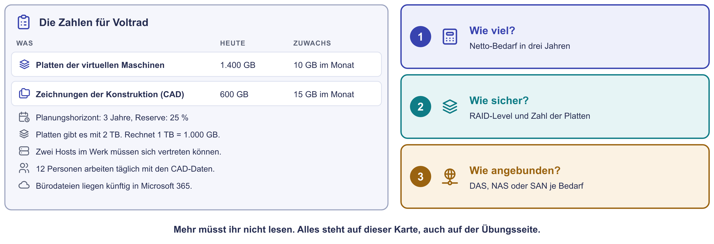
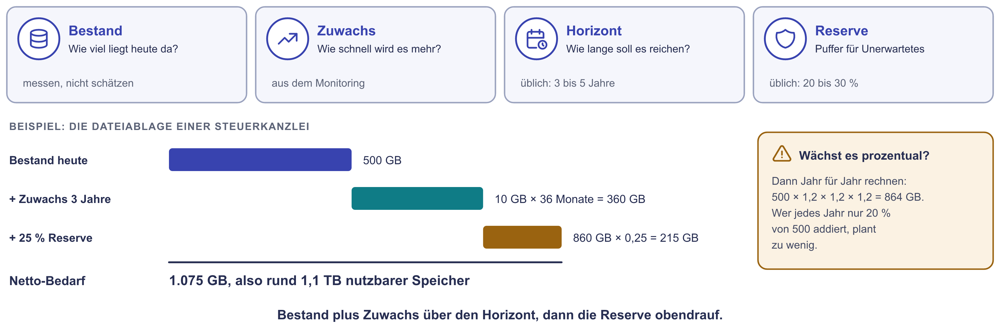
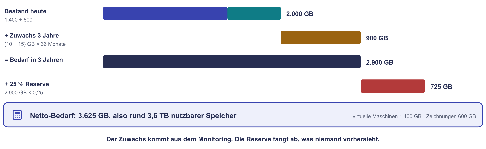
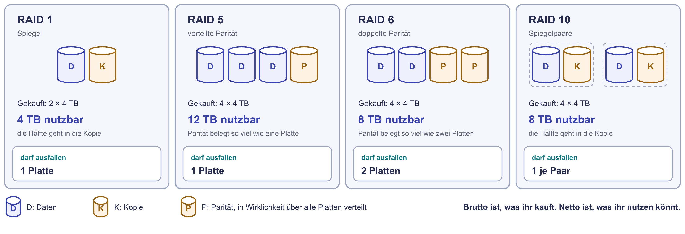
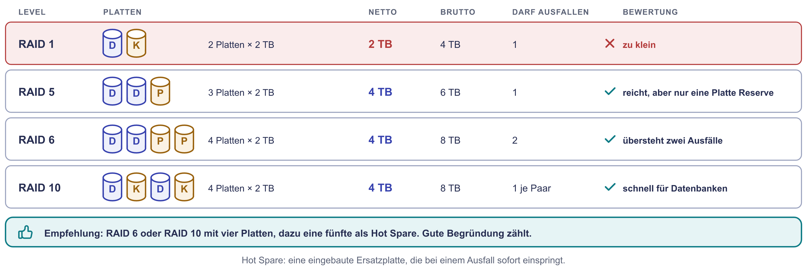
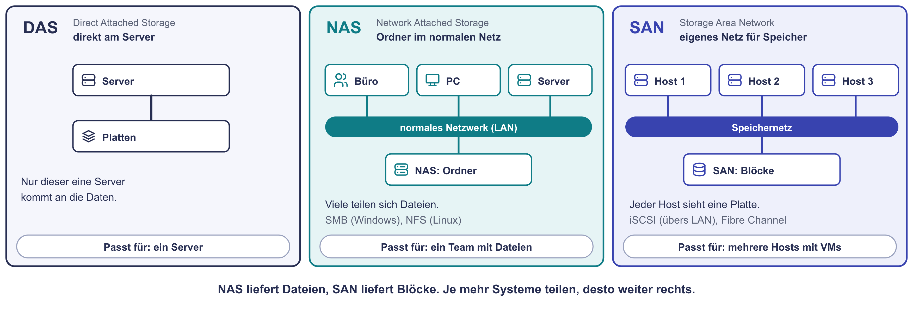
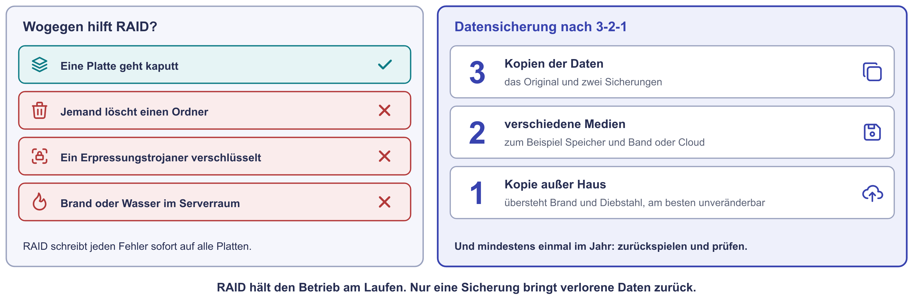
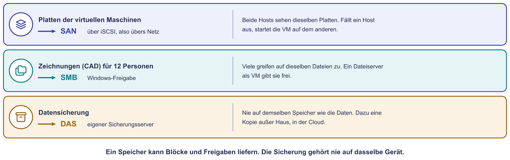

# Praxis: Speicher für Voltrad

In der Bestandsaufnahme habt ihr das Sollkonzept für die Voltrad GmbH
entworfen. Die
Bürodateien wandern zu Microsoft 365, Konfigurator und Händlerportal in die
Cloud. Fertigung, Warenwirtschaft, Anmeldung, CAD-Daten und Datensicherung
bleiben im Werk. Die Server laufen dort künftig als virtuelle Maschinen auf
zwei bis drei Virtualisierungshosts. Dafür braucht das Werk neuen Speicher. Heute plant ihr ihn in drei Schritten: wie viel, wie sicher, wie
angebunden.

!!! abstract "Ziel"
    Am Ende könnt ihr:

    - einen Speicherbedarf aus Bestand, Zuwachs, Horizont und Reserve
      ausrechnen
    - zwischen Netto und Brutto unterscheiden und ein RAID-Level begründet
      wählen
    - für einen Bedarf zwischen DAS, NAS und SAN entscheiden

    Für die Schnellen gibt es drei kurze Bonus-Aufgaben und eine längere
    Denkaufgabe.

!!! info "Wenig Lesestoff"
    Alle Zahlen stehen auf der Karte unten. Mehr müsst ihr nicht lesen. Ihr
    braucht nur einen Taschenrechner, zum Beispiel den eures Rechners.

## So arbeitet ihr im Team

Im Breakout teilt eine Person den Bildschirm mit dieser Seite. Eine zweite
schreibt die drei Antworten auf: den Netto-Bedarf, das RAID-Level mit der
Zahl der Platten und die Anbindung je Bedarf. Zu jeder Station gibt es eine
Musterlösung zum Aufklappen. Seht erst hinein, wenn ihr ein eigenes Ergebnis
habt.

## Die Karte mit allen Zahlen

{ .diagramm }

| Was | Heute | Zuwachs |
|---|---|---|
| Platten der virtuellen Maschinen (Fertigungsleitsystem, Warenwirtschaft, Domänencontroller, Druck, Broker) | 1.400 GB | 10 GB im Monat |
| CAD-Daten der Konstruktion | 600 GB | 15 GB im Monat |

- Planungshorizont: 3 Jahre. Reserve: 25 %.
- Platten gibt es mit 2 TB. Rechnet mit 1 TB = 1.000 GB.
- Zwei Hosts im Werk müssen sich gegenseitig vertreten können.
- 12 Personen in der Konstruktion arbeiten täglich mit den CAD-Daten.

Ob das Fertigungsleitsystem als virtuelle Maschine laufen darf, hat Voltrad
mit dem Hersteller geklärt: Es darf.

---

## Station 1: Wie viel? (15 Minuten)

**Was ihr hier tut:** Ihr rechnet aus, wie viel nutzbaren Speicher Voltrad in
drei Jahren braucht. Das ist der **Netto-Bedarf**.

{ .diagramm }

1. Wie viel liegt heute im Werk? Zählt beide Zeilen der Karte zusammen.
2. Um wie viel wächst der Bestand in drei Jahren? Rechnet mit 36 Monaten.
3. Wie viel ist das in drei Jahren zusammen?
4. Schlagt 25 % Reserve auf. Das Ergebnis ist der Netto-Bedarf.

??? tip "Musterlösung Station 1"
    { .diagramm }

    1. Bestand: 1.400 GB + 600 GB = **2.000 GB**.
    2. Zuwachs: (10 GB + 15 GB) × 36 Monate = **900 GB**.
    3. In drei Jahren: 2.000 GB + 900 GB = **2.900 GB**.
    4. Mit Reserve: 2.900 GB × 1,25 = **3.625 GB**, also rund **3,6 TB netto**.

    Wer VMs und CAD-Daten getrennt rechnet, kommt auf dasselbe: 1.760 GB plus
    1.140 GB sind 2.900 GB.

---

## Station 2: Wie sicher? (15 Minuten)

**Was ihr hier tut:** Ihr wählt ein RAID-Level und zählt, wie viele Platten
mit je 2 TB Voltrad kaufen muss. Gekauft wird **brutto**, nutzbar ist
**netto**. Der Unterschied steckt in der Redundanz.

Das Bild rechnet mit 4-TB-Platten, ihr rechnet mit 2 TB.

{ .diagramm }

1. Rechnet für RAID 1, RAID 5, RAID 6 und RAID 10 aus: Wie viele Platten mit
   2 TB braucht ihr mindestens, damit netto 3,6 TB herauskommen?
2. Wie viel kauft Voltrad dann brutto? Wie viele Platten dürfen
   ausfallen?
3. Entscheidet euch für ein Level. Bedenkt: Auf dem Speicher läuft auch die
   Datenbank der Warenwirtschaft. In der IT arbeiten nur zwei Personen.

!!! tip "So rechnet ihr die Plattenzahl"
    Bei RAID 5 geht die Kapazität einer Platte für die Parität weg, verteilt
    über alle Platten. Nutzbar sind also alle außer einer. Bei RAID 6 alle
    außer zwei. RAID 1 spiegelt genau zwei Platten, nutzbar ist eine davon.
    RAID 10 verbindet mehrere Spiegelpaare, nutzbar ist die Hälfte. Beispiel
    RAID 5 mit drei Platten: (3 − 1) × 2 TB = 4 TB netto.

??? tip "Musterlösung Station 2"
    { .diagramm }

    | Level | Platten | Netto | Brutto | Darf ausfallen |
    |---|---|---|---|---|
    | RAID 1 | 2 | 2 TB, zu klein | 4 TB | 1 Platte |
    | RAID 5 | 3 | 4 TB | 6 TB | 1 Platte |
    | RAID 6 | 4 | 4 TB | 8 TB | 2 Platten |
    | RAID 10 | 4 | 4 TB | 8 TB | 1 je Spiegelpaar |

    **Empfehlung:** RAID 6 oder RAID 10 mit vier Platten. RAID 6 übersteht
    zwei Ausfälle, das ist gut, wenn nachts und am Wochenende niemand da ist.
    RAID 10 ist schneller beim Schreiben, das hilft der Datenbank. RAID 5
    reicht von der Größe her, hat aber nur eine Platte Reserve. Fällt
    während des Wiederaufbaus eine zweite aus, sind die Daten weg.

    Dazu kommt eine fünfte Platte als **Hot Spare**: Sie steckt eingebaut im
    Gerät und springt bei einem Ausfall sofort ein.

---

## Station 3: Wie angebunden? (10 Minuten)

**Was ihr hier tut:** Ihr entscheidet für drei Bedarfe, wie der Speicher an
die Rechner kommt.

{ .diagramm }

Welche Anbindung passt? Begründet jede Wahl in einem Satz.

1. Die Platten der virtuellen Maschinen. Fällt ein Host aus, sollen seine
   Maschinen auf dem anderen weiterlaufen.
2. Die CAD-Daten, mit denen 12 Personen täglich arbeiten.
3. Die Datensicherung. Denkt an die Regel 3-2-1 im Bild darunter.

{ .diagramm }

??? tip "Musterlösung Station 3"
    { .diagramm }

    1. **SAN, zum Beispiel über iSCSI.** Beide Hosts sehen dieselben
       Platten. Fällt ein Host aus, startet die VM auf dem anderen, weil ihre
       Daten nie auf dem toten Gerät lagen.
    2. **Eine Freigabe per SMB aus demselben Speicher.** Viele Personen
       arbeiten mit denselben Dateien, sie brauchen also eine Freigabe wie
       bei einem NAS. Am einfachsten gibt ein Dateiserver als VM die Ordner
       frei, seine Platte liegt im SAN. Viele Speichergeräte können auch
       beides zugleich: Blöcke für die Hosts und Freigaben für die Büros.
       Deshalb reicht ein Verbund mit 3,6 TB für VMs und CAD-Daten.
    3. **Ein eigener Sicherungsserver mit eigenen Platten (DAS), dazu eine
       Kopie außer Haus**, zum Beispiel als Objektspeicher in der Cloud. Die
       Sicherung darf nie auf demselben Speicher liegen wie die Daten. Und
       sie zählt erst, wenn eine Probe-Rücksicherung geklappt hat.

---

## Bonus für die Schnellen

Die Reihenfolge ist frei. Die ersten drei Aufgaben dauern je etwa fünf
Minuten, die Denkaufgabe etwa zehn.

### Bonus 1: Prozentuales Wachstum

Angenommen, der Bestand von 2.000 GB wächst nicht um feste 25 GB im Monat,
sondern um 15 % im Jahr. Wie viel liegt nach drei Jahren da? Mehr oder
weniger als bei eurer Rechnung?

??? tip "Musterlösung"
    2.000 × 1,15 = 2.300 GB. 2.300 × 1,15 = 2.645 GB. 2.645 × 1,15 =
    **rund 3.042 GB**. Das sind 142 GB mehr als die 2.900 GB aus Station 1.
    Prozentuales Wachstum rechnet jedes Jahr auf den neuen Stand, deshalb
    wird es von Jahr zu Jahr mehr.

### Bonus 2: Was kostet der Hot Spare?

Ihr nehmt RAID 6 mit vier Platten und einer fünften als Hot Spare. Wie viel
kauft Voltrad brutto? Welcher Anteil davon ist nutzbar?

??? tip "Musterlösung"
    Fünf Platten × 2 TB = **10 TB brutto**, davon **4 TB netto**. Nutzbar
    sind also 40 %. Der Rest ist Sicherheit: zwei Platten Parität und eine
    Ersatzplatte.

### Bonus 3: 3-2-1 für Voltrad

Benennt für Voltrad die drei Kopien, die zwei Medien und die eine Kopie außer
Haus.

??? tip "Musterlösung"
    - **Drei Kopien:** die Daten im SAN, eine Sicherung auf dem eigenen
      Sicherungsserver im Werk, eine zweite Sicherung außer Haus.
    - **Zwei Medien:** zum Beispiel Festplatten im Werk und Objektspeicher
      in der Cloud. Auch ein Band ist ein eigenes Medium.
    - **Eine außer Haus:** die Kopie in der Cloud. Sie übersteht Brand und
      Wasser. Einen Trojaner im Werksnetz übersteht sie nur, wenn sie sich
      für eine Zeit nicht ändern oder löschen lässt. Viele Cloud-Speicher
      bieten dafür eine Sperre an.

    Der Sicherungsserver im Werk steht am besten in einem anderen Raum als
    der Serverraum.

### Denkaufgabe: Die Frage der Chefin

Die Geschäftsführerin sagt: „Warum kaufen wir nicht gleich 20 TB? Dann
müssen wir nie wieder darüber reden." Was antwortet ihr? Nennt zwei
Argumente dagegen und schlagt einen Mittelweg vor.

??? tip "Musterlösung"
    Argumente gegen 20 TB:

    - **Geld liegt brach:** Fünfmal so viel Speicher kostet sofort, wird aber
      jahrelang nicht gebraucht. Speicher wird mit der Zeit billiger, später
      gekauft ist er günstiger.
    - **Platten altern:** Nach fünf bis sechs Jahren wird die Hardware ohnehin
      ersetzt, so wie jetzt. Platz, der bis dahin nie genutzt wurde, ist
      verschenkt.
    - **„Nie wieder" stimmt nicht:** Ohne Überwachung läuft auch ein großer
      Speicher irgendwann unbemerkt voll.

    Mittelweg: ein Gerät mit freien Einschüben kaufen, das sich später um
    Platten erweitern lässt. Den Füllstand ins Monitoring aufnehmen, mit
    einem Alarm bei 80 %. So kauft Voltrad heute, was es braucht. Erweitert
    wird rechtzeitig, bevor es eng wird.

---

## Was ihr jetzt könnt

- Ihr rechnet einen Speicherbedarf aus Bestand, Zuwachs, Horizont und
  Reserve aus.
- Ihr unterscheidet Netto und Brutto und wählt ein RAID-Level mit
  Begründung.
- Ihr wisst, dass RAID keine Datensicherung ist. Ihr kennt die Regel 3-2-1.
- Ihr entscheidet je Bedarf zwischen DAS, NAS und SAN.

Die Theorie dazu steht auf der Seite [Speicherlösungen](speicherloesungen.md).
Acht weitere Rechenaufgaben findet ihr unter
[Übungen: Speicherlösungen](uebungen-speicherloesungen.md).
