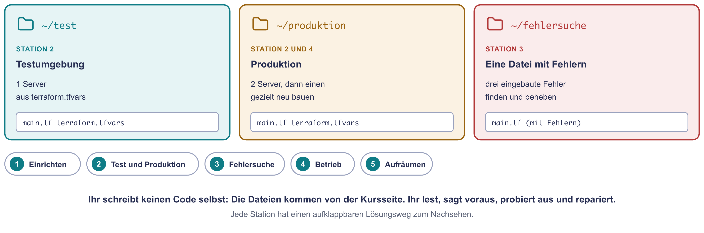
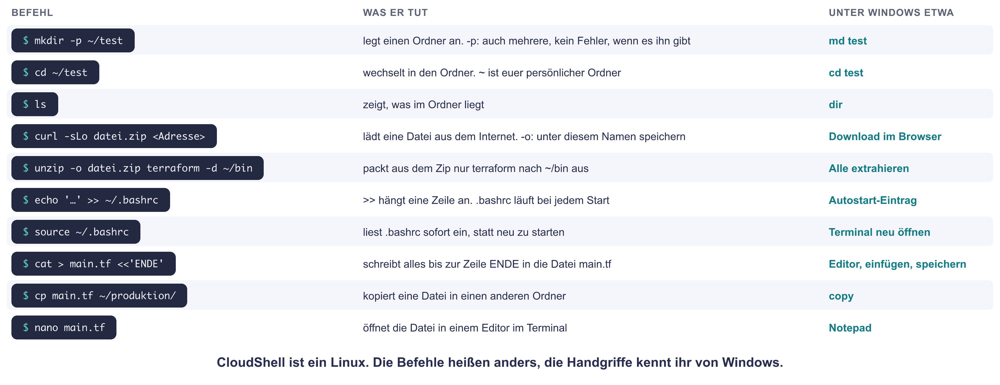
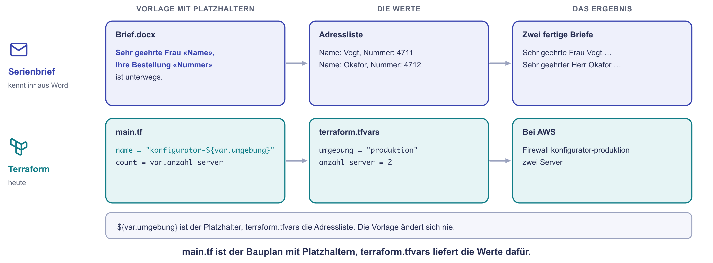
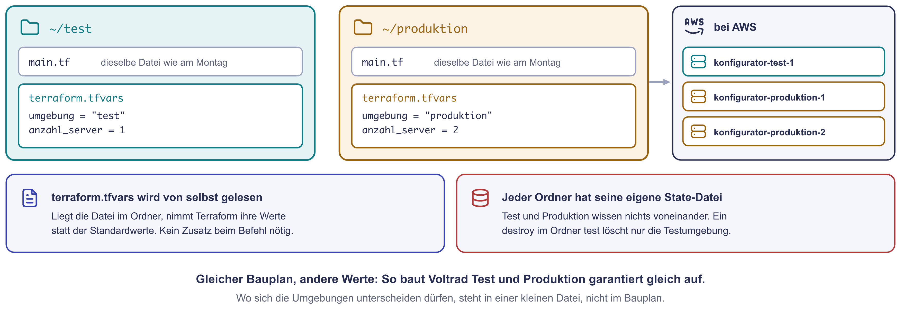
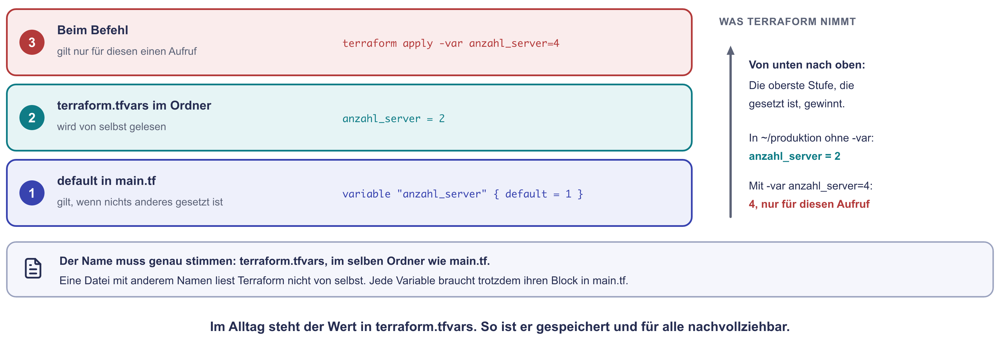
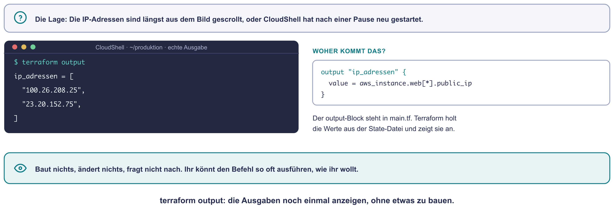
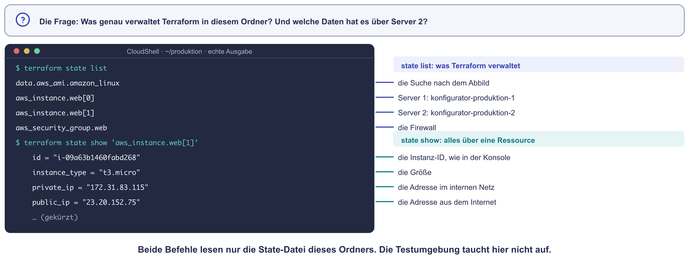
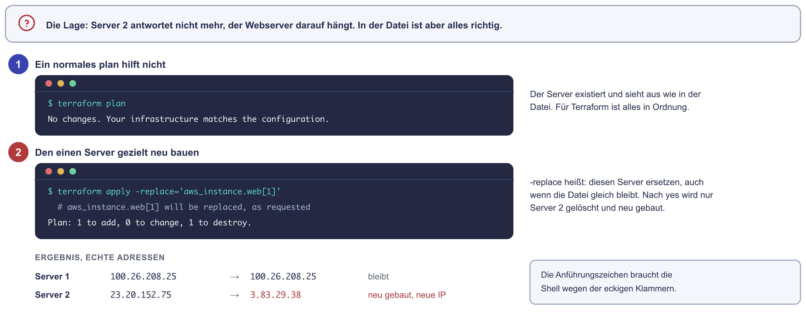

# Praxis: Terraform verstehen und ausprobieren

Am Montag habt ihr den Konfigurator der Voltrad GmbH zum ersten Mal mit
Terraform gebaut. Heute geht es nicht um Neues, sondern ums Üben: Ihr baut
eine Test- und eine Produktionsumgebung aus derselben Datei, sucht drei Fehler
in einer fertigen Datei und probiert die Befehle aus, die man im Betrieb
jeden Tag braucht.

Ihr schreibt dabei keinen Code selbst. Die Dateien kopiert ihr von dieser
Seite. Eure Aufgabe ist lesen, vorhersagen, ausprobieren und reparieren.

!!! abstract "Ziel"
    Am Ende könnt ihr:

    - mit `terraform.tfvars` aus einer Datei verschiedene Umgebungen bauen
    - erklären, warum jeder Ordner seine eigene State-Datei hat
    - Fehler mit `terraform validate`, dem Plan und der Konsole eingrenzen
    - mit `terraform output`, `terraform state list` und `terraform apply -replace` arbeiten

    Für die Schnellen gibt es drei Bonus-Aufgaben und eine Denkaufgabe.

!!! info "Montag nicht fertig geworden?"
    Dann macht zuerst dort weiter: [Praxis: Der Konfigurator als Code](praxis-terraform.md).
    Die Lösungen vom Montag haben wir am Anfang gemeinsam besprochen. Diese
    Seite hier läuft nicht weg.

!!! tip "So arbeitet ihr heute"
    Jede Person arbeitet für sich in der eigenen Sandbox. Unter jeder Station
    steht ein **Lösungsweg** zum Aufklappen, Schritt für Schritt erklärt.
    Probiert erst selbst und schaut dann nach. Bei jedem `apply` gilt wie am
    Montag: erst vorhersagen, dann den Plan lesen, dann `yes`.

## Was ihr heute baut

{ .diagramm }

| Ordner | Was darin passiert |
|---|---|
| `~/test` | Die Testumgebung: ein Server, Werte aus `terraform.tfvars` |
| `~/produktion` | Die Produktion: zwei Server aus derselben `main.tf`, andere Werte |
| `~/fehlersuche` | Eine fertige Datei mit drei eingebauten Fehlern |

---

## Station 1: Wieder einrichten (10 Minuten)

**Was ihr hier tut:** Eure Sandbox von Montag ist gelöscht, die heutige ist
ein neues, leeres AWS-Konto. Deshalb richtet ihr Terraform noch einmal ein und
legt die drei Ordner und die Datei vom Montag an.

1. Sandbox starten, mit `cloud_user` anmelden, oben rechts **USA
   (Nord-Virginia)** prüfen, **CloudShell** öffnen. Genau wie am Montag.
2. Diesen Block kopieren und in CloudShell einfügen. Er installiert
   Terraform und legt die drei Ordner an:

    ```bash
    mkdir -p ~/bin ~/test ~/produktion ~/fehlersuche
    curl -sLo /tmp/terraform.zip https://releases.hashicorp.com/terraform/1.16.7/terraform_1.16.7_linux_amd64.zip
    unzip -o /tmp/terraform.zip terraform -d ~/bin
    echo 'export PATH=$HOME/bin:$PATH' >> ~/.bashrc
    echo 'export TF_DATA_DIR=/tmp/terraform-daten' >> ~/.bashrc
    source ~/.bashrc
    terraform -version
    ```

3. Diesen Block einfügen. Er schreibt die Datei vom Montag nach `~/test`:

    ```bash
    cat > ~/test/main.tf <<'ENDE'
    # Voltrad Konfigurator: Webserver in der AWS-Sandbox

    terraform {
      required_providers {
        aws = {
          source  = "hashicorp/aws"
          version = "~> 6.0"
        }
      }
    }

    provider "aws" {
      region = "us-east-1"
    }

    # Variablen: Werte, die sich ändern dürfen
    variable "umgebung" {
      description = "test oder produktion"
      type        = string
      default     = "test"
    }

    variable "anzahl_server" {
      description = "Wie viele Server sollen laufen?"
      type        = number
      default     = 1
    }

    # Das neueste Amazon Linux 2023 suchen (baut nichts, sucht nur)
    data "aws_ami" "amazon_linux" {
      most_recent = true
      owners      = ["amazon"]

      filter {
        name   = "name"
        values = ["al2023-ami-2023.*-x86_64"]
      }
    }

    # Die Firewall: Port 80 aus dem Internet erlaubt, nach außen alles
    resource "aws_security_group" "web" {
      name        = "konfigurator-${var.umgebung}"
      description = "HTTP fuer den Konfigurator"

      ingress {
        from_port   = 80
        to_port     = 80
        protocol    = "tcp"
        cidr_blocks = ["0.0.0.0/0"]
      }

      egress {
        from_port   = 0
        to_port     = 0
        protocol    = "-1"
        cidr_blocks = ["0.0.0.0/0"]
      }
    }

    # Die Server
    resource "aws_instance" "web" {
      count                  = var.anzahl_server
      ami                    = data.aws_ami.amazon_linux.id
      instance_type          = "t3.micro"
      availability_zone      = "us-east-1a"
      vpc_security_group_ids = [aws_security_group.web.id]

      # Startskript: läuft beim ersten Start einmal (in der Konsole: Benutzerdaten)
      user_data = <<-SKRIPT
        #!/bin/bash
        dnf install -y httpd
        echo "<h1>Voltrad Konfigurator</h1><p>Umgebung ${var.umgebung}, Server ${count.index + 1}</p>" > /var/www/html/index.html
        systemctl enable --now httpd
      SKRIPT

      tags = {
        Name = "konfigurator-${var.umgebung}-${count.index + 1}"
      }
    }

    # Nach dem Bauen anzeigen: die öffentlichen IP-Adressen
    output "ip_adressen" {
      value = aws_instance.web[*].public_ip
    }
    ENDE
    ```

4. Dieselbe Datei auch in den Ordner der Produktion kopieren:

    ```bash
    cp ~/test/main.tf ~/produktion/
    ```

!!! info "Was die Linux-Befehle tun"
    CloudShell ist ein Linux. Die Befehle heißen anders als unter Windows,
    die Handgriffe kennt ihr:

    { .diagramm }

**Geschafft, wenn** `terraform -version` die Version 1.16.7 zeigt und
`ls ~/test ~/produktion` in beiden Ordnern eine `main.tf` anzeigt. Der Hinweis
auf eine neuere Version ist kein Fehler.

??? success "Lösungsweg Station 1"
    So sieht die Kontrolle aus:

    ```text
    $ ls ~/test ~/produktion
    /home/cloudshell-user/produktion:
    main.tf

    /home/cloudshell-user/test:
    main.tf
    ```

    `~` steht für euer Home-Verzeichnis, `/home/cloudshell-user`. Nur was dort
    liegt, bleibt erhalten, wenn CloudShell neu startet. Die großen Dateien
    des Providers liegen wie am Montag in `/tmp`.

---

## Station 2: Test und Produktion aus einer Datei (20 Minuten)

**Was ihr hier tut:** In beiden Ordnern liegt dieselbe `main.tf`. Was die
Umgebungen unterscheidet, steht in einer kleinen zweiten Datei:
`terraform.tfvars`. Terraform liest sie von selbst, sobald sie im Ordner
liegt. Sie nimmt ihre Werte statt der Standardwerte aus den
`variable`-Blöcken.

Am einfachsten versteht man es wie einen Serienbrief: `main.tf` ist die
Vorlage mit Platzhaltern, `terraform.tfvars` die Liste mit den Werten.

{ .diagramm }

{ .diagramm }

Woher Terraform einen Wert nimmt, folgt einer festen Reihenfolge:

{ .diagramm }

**Warum man das so macht:** Test und Produktion sollen gleich gebaut sein,
sonst testet man etwas anderes, als später läuft. Der Bauplan steht deshalb
nur einmal da. Unterschiede wie Name und Anzahl der Server stehen getrennt
davon und sind auf einen Blick sichtbar.

1. Die Werte für beide Umgebungen anlegen:

    ```bash
    cat > ~/test/terraform.tfvars <<'ENDE'
    umgebung      = "test"
    anzahl_server = 1
    ENDE
    cat > ~/produktion/terraform.tfvars <<'ENDE'
    umgebung      = "produktion"
    anzahl_server = 2
    ENDE
    ```

2. Die Testumgebung bauen. Schreibt vorher auf, was in der Zeile `Plan:`
   stehen wird:

    ```bash
    cd ~/test
    terraform init
    terraform apply
    ```

3. Die Produktion bauen, wieder erst vorhersagen:

    ```bash
    cd ~/produktion
    terraform init
    terraform apply
    ```

4. Öffnet die Adressen im Browser (`http://` davor). Jede Seite zeigt, zu
   welcher Umgebung sie gehört und welcher Server antwortet.

**Frage 1:** Was stand in den beiden Zeilen `Plan:`? Warum unterscheiden sie
sich, obwohl `main.tf` gleich ist?

**Frage 2:** Schaut in der Konsole unter **EC2** in die Liste **Instances**
und unter **Sicherheitsgruppen** (Security Groups). Achtung: In der Liste der
Sicherheitsgruppen ist die erste Spalte **Name** leer, dort steht nur ein Strich. Den Namen findet
ihr in der Spalte **Name der Sicherheitsgruppe**. Wie viele Server und wie
viele Sicherheitsgruppen findet ihr? Wie heißen sie?

**Frage 3:** Was würde ein `terraform destroy` im Ordner `~/test` löschen?
Führt es noch nicht aus, beantwortet es mit dem, was ihr über die State-Datei
wisst.

??? tip "Hinweise zu Station 2"
    1. Zählt für jeden Ordner: Wie viele Server sagt `anzahl_server`? Wie
       viele Firewalls gibt es je Ordner?
    2. Der Name der Sicherheitsgruppe enthält `${var.umgebung}`.
    3. In welchem Ordner liegt welche `terraform.tfstate`?

??? success "Lösungsweg Station 2"
    **Frage 1:** Im Ordner `~/test` steht `Plan: 2 to add, 0 to change, 0 to
    destroy.`, im Ordner `~/produktion` steht `Plan: 3 to add, 0 to change, 0
    to destroy.`

    ```text
    ~/test:        Plan: 2 to add, 0 to change, 0 to destroy.
                   (eine Sicherheitsgruppe, ein Server)
    ~/produktion:  Plan: 3 to add, 0 to change, 0 to destroy.
                   (eine Sicherheitsgruppe, zwei Server)
    ```

    `main.tf` ist gleich, aber `terraform.tfvars` setzt `anzahl_server`
    einmal auf 1 und einmal auf 2. Weil im Server-Block
    `count = var.anzahl_server` steht, entstehen verschieden viele Server.

    **Frage 2:** Drei Server: `konfigurator-test-1`,
    `konfigurator-produktion-1` und `konfigurator-produktion-2`. Dazu zwei
    Sicherheitsgruppen: `konfigurator-test` und `konfigurator-produktion`.
    Die Namen kommen aus `${var.umgebung}`. Deshalb kommen sich die beiden
    Umgebungen nicht in die Quere, obwohl sie im selben AWS-Konto liegen.

    **Frage 3:** Nur die Testumgebung, also `konfigurator-test-1` und die
    Sicherheitsgruppe `konfigurator-test`. Jeder Ordner hat seine eigene
    `terraform.tfstate`. `destroy` löscht genau das, was in der
    State-Datei des aktuellen Ordners steht. Die Produktion steht in einer
    anderen State-Datei, sie bleibt unberührt.

    Im Betrieb ist das der Grund, warum man vor jedem Befehl prüft, in
    welchem Ordner man steht. Die Eingabezeile von CloudShell zeigt ihn an.

---

## Station 3: Fehlersuche (25 Minuten)

**Was ihr hier tut:** Eine Kollegin hat eine Datei für den Konfigurator
geschrieben, aber sie funktioniert nicht. Darin stecken drei Fehler. Ihr
findet sie nacheinander mit den Werkzeugen, die ihr kennt: `terraform
validate`, den Plan, die Konsole und die Nachschlage-Tabelle vom Montag.

**Warum ihr das übt:** Im Betrieb schreibt man selten alles neu. Viel öfter
übernimmt man fremde Dateien und muss herausfinden, warum etwas nicht läuft.

1. Die Datei anlegen und in den Ordner wechseln:

    ```bash
    cat > ~/fehlersuche/main.tf <<'ENDE'
    # Voltrad Konfigurator: eine Datei mit drei Fehlern

    terraform {
      required_providers {
        aws = {
          source  = "hashicorp/aws"
          version = "~> 6.0"
        }
      }
    }

    provider "aws" {
      region = "us-east-1"
    }

    variable "umgebung" {
      description = "test oder produktion"
      type        = string
      default     = "fehlersuche"
    }

    variable "anzahl_server" {
      description = "Wie viele Server sollen laufen?"
      type        = number
      default     = 1
    }

    data "aws_ami" "amazon_linux" {
      most_recent = true
      owners      = ["amazon"]

      filter {
        name   = "name"
        values = ["al2023-ami-2023.*-x86_64"]
      }
    }

    resource "aws_security_group" "web" {
      name        = "konfigurator-${var.umgebung}"
      description = "HTTP fuer den Konfigurator"

      ingress {
        from_port   = 8080
        to_port     = 8080
        protocol    = "tcp"
        cidr_blocks = ["0.0.0.0/0"]
      }
    }

    resource "aws_instance" "web" {
      count                  = var.anzahl_server
      ami                    = data.aws_ami.amazon_linux.id
      instance_typ           = "t3.micro"
      availability_zone      = "us-east-1a"
      vpc_security_group_ids = [aws_security_group.web.id]

      user_data = <<-SKRIPT
        #!/bin/bash
        dnf install -y httpd
        echo "<h1>Voltrad Konfigurator</h1><p>Umgebung ${var.umgebung}, Server ${count.index + 1}</p>" > /var/www/html/index.html
        systemctl enable --now httpd
      SKRIPT

      tags = {
        Name = "konfigurator-${var.umgebung}-${count.index + 1}"
      }
    }

    output "ip_adressen" {
      value = aws_instance.web[*].public_ip
    }
    ENDE
    cd ~/fehlersuche
    terraform init
    ```

2. Lasst die Datei prüfen, bevor ihr baut:

    ```bash
    terraform validate
    ```

    Lest die Meldung und repariert den ersten Fehler mit `nano main.tf`.
    `validate` muss danach `Success!` melden.

3. Baut den Server und öffnet die Adresse im Browser. Wartet zwei Minuten:

    ```bash
    terraform apply
    ```

    Die Seite lädt nicht. Findet den zweiten Fehler. Schaut dafür in der
    Konsole bei eurer Sicherheitsgruppe nach, welche Regel für eingehenden
    Verkehr sie hat. Vergleicht das mit der Datei. Repariert ihn und führt
    `terraform apply` aus.

4. Die Seite lädt immer noch nicht, auch nach zwei Minuten. Der dritte Fehler
   ist kein Tippfehler, sondern etwas, das fehlt. Vergleicht die
   Firewall mit der Datei vom Montag in `~/test/main.tf`.

5. Ist der dritte Fehler behoben, lädt die Seite trotzdem noch nicht. Warum?
   Und wie bekommt ihr den Server dazu, sein Startskript noch einmal
   auszuführen?

**Frage 4:** Welche drei Fehler waren es? Mit welchem Werkzeug habt ihr
sie jeweils gefunden?

**Frage 5:** Warum musste der Server am Ende neu gebaut werden?

??? tip "Hinweise zu Station 3"
    1. Der erste Fehler steht in der Meldung von `validate`, mit Zeilennummer.
       Terraform schlägt sogar den richtigen Namen vor.
    2. Der zweite Fehler: Konsole, **EC2**, links unter **Netzwerk &
       Sicherheit** auf **Sicherheitsgruppen**. Eure Gruppe erkennt ihr in
       der Spalte **Name der Sicherheitsgruppe** (`konfigurator-fehlersuche`),
       die Spalte **Name** davor ist leer. Klickt auf ihre ID (`sg-…`), dann
       stehen unten die **Regeln für eingehenden Datenverkehr** (Inbound
       rules). Welcher Port steht dort? Welchen braucht ein Webserver?
    3. Der dritte Fehler: Lest auf der Seite vom Montag unter „Nachschlagen“
       den Kasten **Achtung bei egress**. Der fehlende Block gehört in die
       geschweiften Klammern der Sicherheitsgruppe, direkt unter `ingress`.
       Prüft nach dem Einfügen mit `terraform validate`.
    4. Das Startskript läuft nur beim ersten Start. Erinnert euch an die
       Folie „Terraform im Betrieb“.

??? success "Lösungsweg Station 3"
    **Fehler 1: ein Tippfehler im Namen eines Eintrags.** `terraform
    validate` meldet:

    ```text
    Error: Unsupported argument

      on main.tf line 53, in resource "aws_instance" "web":
      53:   instance_typ           = "t3.micro"

    An argument named "instance_typ" is not expected here. Did you mean
    "instance_type"?
    ```

    In `nano main.tf` aus `instance_typ` wieder `instance_type` machen.
    `validate` prüft die Datei, ohne AWS zu fragen. Deshalb findet es solche
    Fehler in Sekunden.

    **Fehler 2: der falsche Port.** Der Server läuft, aber die Firewall lässt
    nur Port 8080 herein. Der Webserver antwortet auf Port 80, der Browser
    fragt bei `http://` ebenfalls auf Port 80. Die Konsole zeigt bei der
    Sicherheitsgruppe eine Regel für Port 8080. In der Datei im Block
    `ingress` beide Zeilen ändern:

    ```hcl
        from_port   = 80
        to_port     = 80
    ```

    `terraform apply` zeigt dann:

    ```text
      # aws_security_group.web will be updated in-place
    Plan: 0 to add, 1 to change, 0 to destroy.
    ```

    Die Firewall wird im laufenden Betrieb geändert, der Server bleibt.

    **Fehler 3: der fehlende `egress`-Block.** Ohne ihn darf der Server
    nichts ins Internet senden. Terraform entfernt bei Sicherheitsgruppen die
    Regel, die ausgehenden Verkehr erlaubt, wenn kein `egress`-Block in der
    Datei steht. Das Startskript konnte deshalb beim ersten Start den
    Webserver nicht herunterladen. Den Block aus der Datei vom Montag
    **innerhalb der Sicherheitsgruppe** einfügen: nach der schließenden
    Klammer von `ingress`, aber vor der letzten Klammer `}` der
    Sicherheitsgruppe. So sieht der ganze Block danach aus:

    ```hcl
    resource "aws_security_group" "web" {
      name        = "konfigurator-${var.umgebung}"
      description = "HTTP fuer den Konfigurator"

      ingress {
        from_port   = 80
        to_port     = 80
        protocol    = "tcp"
        cidr_blocks = ["0.0.0.0/0"]
      }

      egress {
        from_port   = 0
        to_port     = 0
        protocol    = "-1"
        cidr_blocks = ["0.0.0.0/0"]
      }
    }
    ```

    Steht `egress` an einer anderen Stelle, zum Beispiel ganz unten in der
    Datei, meldet `terraform validate`
    `Blocks of type "egress" are not expected here`. Terraform weiß dann
    nicht, zu welcher Firewall die Regel gehört.

    `terraform apply` ändert die Firewall wieder im Betrieb
    (`0 to add, 1 to change`).

    **Warum die Seite trotzdem noch nicht lädt (Frage 5):** Das Startskript
    läuft nur beim allerersten Start eines Servers. Damals fehlte der
    Internetzugang, die Installation ist gescheitert. Von selbst
    versucht der Server es nicht noch einmal. Die Lösung ist ein neuer Server:

    ```bash
    terraform apply -replace='aws_instance.web[0]'
    ```

    ```text
      # aws_instance.web[0] will be replaced, as requested
    Plan: 1 to add, 0 to change, 1 to destroy.
    ```

    Nach `yes` und gut einer Minute steht unter `ip_adressen` eine neue
    Adresse. Diesmal hat der Server Internet und das Skript läuft durch. Die
    Seite zeigt „Umgebung fehlersuche, Server 1“.

    **Frage 4 zusammengefasst:**

    | Fehler | Gefunden mit |
    |---|---|
    | `instance_typ` statt `instance_type` | `terraform validate` |
    | Port 8080 statt 80 | Konsole (Regeln der Sicherheitsgruppe) und Datei |
    | `egress`-Block fehlt | Vergleich mit der Datei vom Montag und der Nachschlage-Tabelle |

    Wer neugierig ist: In der Konsole unter **Instances**, Haken vor dem
    alten Server, **Aktionen** (Actions), **Überwachen und Fehler beheben**
    (Monitor and troubleshoot), **Systemprotokoll abrufen** (Get system log)
    standen die Fehlermeldungen von `dnf`. So findet man solche Fehler im
    echten Betrieb.

---

## Station 4: Terraform im Betrieb (10 Minuten)

**Was ihr hier tut:** Ihr arbeitet in der Produktion und probiert die
Befehle aus, mit denen man im Betrieb nachsieht und eingreift, ohne die Datei
zu ändern.

{ .diagramm }

{ .diagramm }

{ .diagramm }

1. In die Produktion wechseln und nachsehen:

    ```bash
    cd ~/produktion
    terraform output
    terraform state list
    ```

2. Alle Werte eines Servers ansehen:

    ```bash
    terraform state show 'aws_instance.web[1]'
    ```

    Sucht darin die Instanz-ID, die private IP-Adresse und die Zone.

3. Stellt euch vor, Server 2 reagiert nicht mehr. Baut genau diesen einen
   neu. Sagt vorher voraus, was der Plan zeigt und welche Adresse sich
   ändert:

    ```bash
    terraform apply -replace='aws_instance.web[1]'
    ```

4. Prüft mit `terraform output`, welche Adresse neu ist.

**Frage 6:** Was zeigt `terraform state list` in der Produktion? Warum
taucht dort nichts aus `~/test` auf?

**Frage 7:** Was zeigte der Plan bei `-replace`? Welche Adresse hat sich
geändert?

??? tip "Hinweise zu Station 4"
    1. `state list` liest nur die State-Datei des aktuellen Ordners.
    2. `-replace` wirkt nur auf die eine Ressource, die ihr nennt.
    3. Die einfachen Anführungszeichen um `'aws_instance.web[1]'` braucht die
       Shell wegen der eckigen Klammern.

??? success "Lösungsweg Station 4"
    **Frage 6:** `terraform state list` zeigt vier Einträge:

    ```text
    data.aws_ami.amazon_linux
    aws_instance.web[0]
    aws_instance.web[1]
    aws_security_group.web
    ```

    Aus der Testumgebung steht dort nichts, weil jeder Ordner seine eigene
    State-Datei hat. `state show` zeigt alle Werte, die Terraform über einen
    Server weiß, darunter `id` (beginnt mit `i-`), `private_ip` und
    `availability_zone = "us-east-1a"`.

    **Frage 7:**

    ```text
      # aws_instance.web[1] will be replaced, as requested
    Plan: 1 to add, 0 to change, 1 to destroy.
    ```

    Nur Server 2 wird gelöscht und neu gebaut. Bei `terraform output` hat
    sich deshalb nur die zweite Adresse geändert, die erste ist gleich
    geblieben. Die Datei habt ihr dabei nicht angefasst: `-replace` ist ein
    gezielter Eingriff für einen Server, der sich verklemmt hat, ohne den
    Bauplan zu ändern.

---

## Bonus für die Schnellen

Erledigt die Bonus-Aufgaben **vor** Station 5, denn danach ist alles weg.

### Bonus 1: Eine Ausgabe ergänzen (5 Minuten)

Im Betrieb braucht man oft den DNS-Namen eines Servers statt der IP-Adresse.
Hängt diesen Block in `~/produktion/main.tf` ans Ende an und ersetzt die
Unterstriche durch den richtigen Namen. Ihr findet ihn auf der Seite vom
Montag in der Tabelle „Server: was Terraform danach weiß“:

```hcl
output "dns_namen" {
  value = aws_instance.web[*].__________
}
```

Sagt vorher voraus: Was wird `terraform apply` an euren Servern ändern?

??? success "Lösungsweg Bonus 1"
    Der richtige Name ist `public_dns`:

    ```hcl
    output "dns_namen" {
      value = aws_instance.web[*].public_dns
    }
    ```

    `terraform apply` ändert an den Servern nichts. Der Plan zeigt nur
    `Changes to Outputs` und `0 to add, 0 to change, 0 to destroy`. Nach
    `yes` stehen die Namen unter `Outputs`, etwa
    `ec2-54-158-45-198.compute-1.amazonaws.com`. Ausgaben lesen nur Werte
    aus, sie bauen nichts.

### Bonus 2: Terraform fragen (5 Minuten)

Mit `terraform console` könnt ihr Terraform direkt fragen, was in einem
Ausdruck steckt. Im Ordner `~/produktion`:

```bash
terraform console
```

Tippt nacheinander ein und drückt jeweils ++enter++:

```text
var.umgebung
var.anzahl_server * 2
aws_instance.web[0].public_ip
length(aws_instance.web)
```

Mit `exit` geht es zurück in die normale Eingabe.

??? success "Lösungsweg Bonus 2"
    ```text
    > var.umgebung
    "produktion"
    > var.anzahl_server * 2
    4
    > aws_instance.web[0].public_ip
    "54.158.45.198"
    > length(aws_instance.web)
    2
    ```

    Die Werte kommen aus `terraform.tfvars` und aus der State-Datei. Eure
    IP-Adresse sieht anders aus. `terraform console` ist praktisch, um einen
    Verweis auszuprobieren, bevor man ihn in eine Datei schreibt.

### Bonus 3: Löschen nur planen (5 Minuten)

Was würde `destroy` in der Produktion löschen? Lasst es Terraform zeigen,
ohne etwas zu löschen:

```bash
terraform plan -destroy
```

??? success "Lösungsweg Bonus 3"
    `Plan: 0 to add, 0 to change, 3 to destroy.` Zwei Server und die
    Sicherheitsgruppe. `plan -destroy` ist der sichere Blick vorab: Er zeigt
    dasselbe wie `destroy`, fragt aber nicht nach und löscht nichts.

### Denkaufgabe: Die Produktion schützen (10 Minuten)

Bei Voltrad liegen Test und Produktion künftig wie bei euch in zwei Ordnern.
Was kann dabei schiefgehen? Überlegt euch drei Schutzmaßnahmen, damit
niemand aus Versehen die Produktion löscht.

??? success "Musterlösung"
    Was schiefgehen kann: Jemand steht im falschen Ordner und tippt
    `terraform destroy` oder ändert dort `terraform.tfvars`. Terraform
    fragt zwar nach, aber wer den Plan nicht liest, tippt `yes`.

    Mögliche Schutzmaßnahmen:

    1. **Den Plan lesen.** Steht bei `destroy` eine Zahl größer null und der
       Name `produktion`, stopp.
    2. **Vier Augen für die Produktion.** Änderungen an der Produktion laufen
       über Git, eine zweite Person prüft Änderung und Plan.
    3. **Getrennte Konten.** Viele Firmen haben für Test und Produktion
       getrennte AWS-Konten mit unterschiedlichen Rechten. Wer im Test
       arbeitet, kann die Produktion gar nicht erreichen.
    4. **Löschschutz in der Datei.** Terraform kennt in einem Block die
       Einstellung `lifecycle { prevent_destroy = true }`. Dann bricht
       `destroy` für diese Ressource mit einer Fehlermeldung ab.

---

## Station 5: Alles aufräumen (5 Minuten)

**Was ihr hier tut:** In jedem der drei Ordner steht eine eigene State-Datei.
Deshalb räumt ihr in jedem Ordner einzeln ab. Spätestens um 20:40 Uhr.

```bash
cd ~/test && terraform destroy
```

```bash
cd ~/produktion && terraform destroy
```

```bash
cd ~/fehlersuche && terraform destroy
```

Prüft danach in der Konsole unter **Instances** und **Sicherheitsgruppen**,
dass nichts mehr von euch übrig ist. Die Gruppe `default` gehört AWS und
bleibt stehen.

??? success "Lösungsweg Station 5"
    ```text
    ~/test:         Destroy complete! Resources: 2 destroyed.
    ~/produktion:   Destroy complete! Resources: 3 destroyed.
    ~/fehlersuche:  Destroy complete! Resources: 2 destroyed.
    ```

    Hättet ihr nur in einem Ordner aufgeräumt, liefen die anderen Server
    weiter. Jeder Ordner kennt nur seine eigene State-Datei.

---

## Wenn es klemmt

| Was ihr seht | Woran es liegt | Was hilft |
|---|---|---|
| `Your version of Terraform is out of date!` | Es gibt eine neuere Version als 1.16.7 | Kein Fehler, einfach weitermachen. |
| `terraform: command not found` | Die Einstellungen aus Station 1 sind in diesem Terminal noch nicht geladen | `source ~/.bashrc` eingeben. |
| `Required plugins are not installed` | CloudShell hat neu gestartet und `/tmp` geleert, oder `init` fehlt in diesem Ordner | Im jeweiligen Ordner `terraform init`. |
| `No configuration files` | Ihr steht im falschen Ordner | Mit `cd ~/test`, `cd ~/produktion` oder `cd ~/fehlersuche` wechseln. |
| `InvalidGroup.Duplicate` | Eine Sicherheitsgruppe mit diesem Namen gibt es schon | In `terraform.tfvars` stimmt `umgebung` nicht, oder ein alter Versuch hängt noch. Die alte Gruppe in der Konsole löschen. |
| `No valid credential sources found` oder `expired` | Die Anmeldung von CloudShell ist abgelaufen | Konsole neu laden, CloudShell neu öffnen. |
| `Blocks of type "egress" are not expected here` | Der `egress`-Block steht außerhalb der Sicherheitsgruppe, oft ganz unten in der Datei oder eine Zeile zu tief, also hinter der letzten `}` der Sicherheitsgruppe | Mit `nano main.tf` ausschneiden (++ctrl+k++) und direkt unter dem `ingress`-Block wieder einfügen (++ctrl+u++), noch vor der letzten `}` der Sicherheitsgruppe. Vergleicht mit dem ganzen Block im Lösungsweg von Station 3. |
| `Argument or block definition required` bei einer Zeile `ENDE` | Beim Kopieren ist die Endmarke `ENDE` in die Datei gerutscht. Sie gehört nur zum Kopierbefehl, nicht in `main.tf` | Mit `nano main.tf` zur genannten Zeile gehen und sie mit ++ctrl+k++ löschen. |
| Die Seite lädt nicht | Bei Station 3 ist das Absicht. Sonst installiert sich der Webserver noch | Zwei Minuten warten, `http://` statt `https://`. |

## Was ihr zur Auswertung mitbringt

- was eure Test- und eure Produktionsumgebung unterscheidet und wo das steht
- welcher der drei Fehler am schwersten zu finden war
- warum die Seite in Station 3 auch nach dem Reparieren der Firewall nicht lud
- wann ihr im Betrieb `apply -replace` benutzen würdet

## Wie es weitergeht

Die Theorie steht auf der Seite [Infrastruktur als Code](infrastruktur-als-code.md),
die erste Übung unter [Praxis: Der Konfigurator als Code](praxis-terraform.md).
