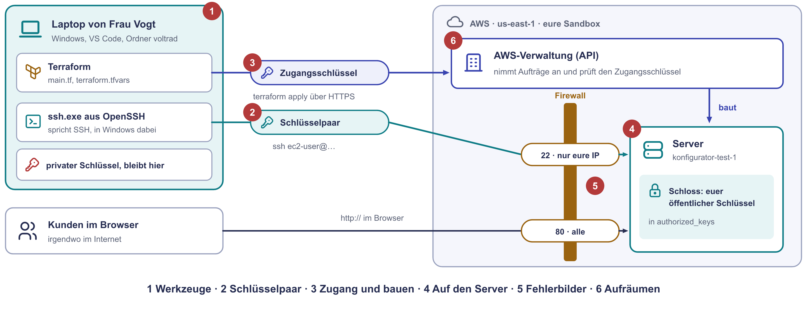
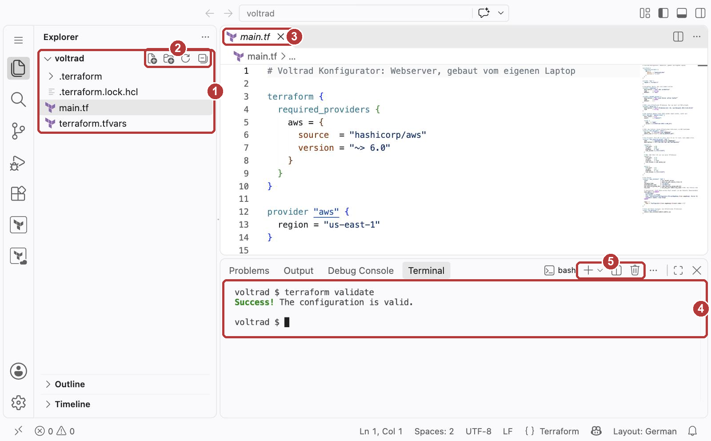
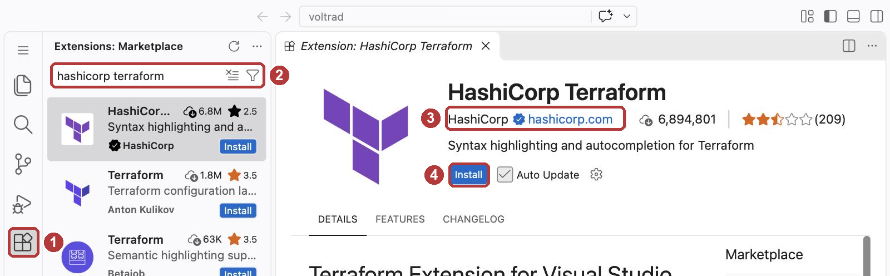
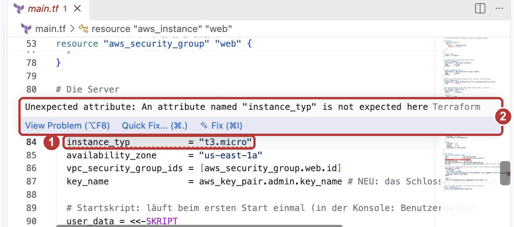
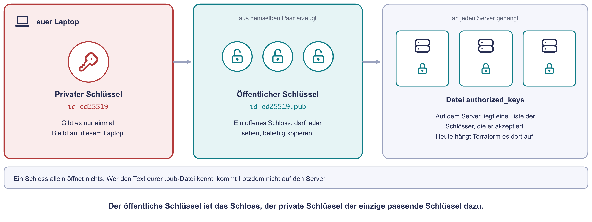
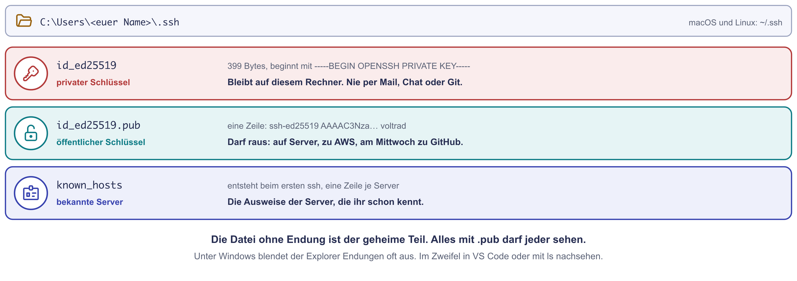
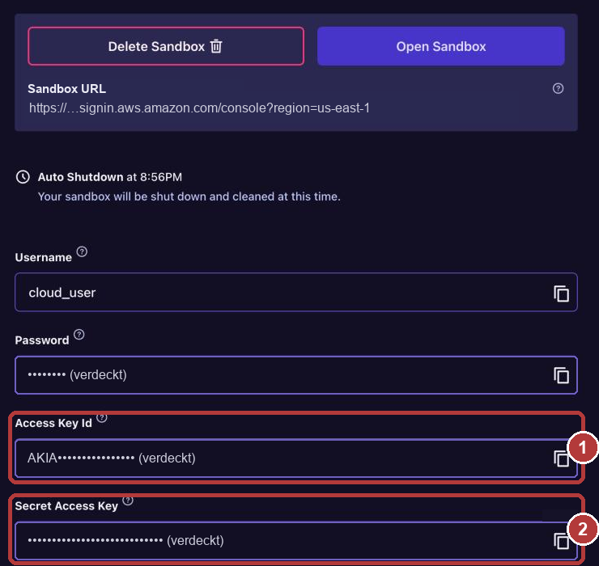
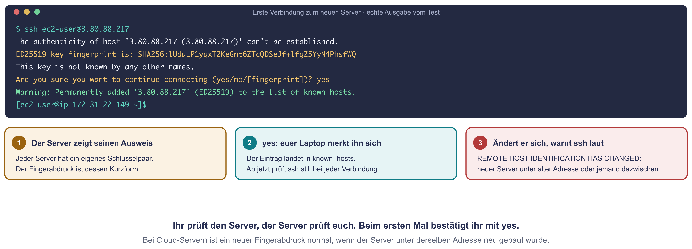

# Praxis: Terraform vom eigenen Laptop

Bisher lag eure `main.tf` in CloudShell. Mit der Sandbox war sie weg,
ebenso die State-Datei. Im Betrieb liegt der Code deshalb auf dem eigenen
Rechner, wird in VS Code bearbeitet und von dort aus an AWS geschickt. Genau
so arbeitet ihr heute.

Neu ist dabei nicht Terraform, sondern der Weg dorthin: Terraform braucht
einen **Zugangsschlüssel**, um bei AWS bauen zu dürfen. Und ihr meldet euch
zum ersten Mal per **SSH mit einem Schlüsselpaar** auf eurem Server an.

!!! abstract "Ziel"
    Am Ende könnt ihr:

    - Terraform und VS Code auf dem eigenen Rechner einrichten
    - erklären, wofür der Zugangsschlüssel und wofür das Schlüsselpaar da ist
    - ein SSH-Schlüsselpaar erzeugen und sagen, welche Datei weitergegeben werden darf
    - euch per SSH auf einem Server anmelden und dort nachsehen, was das Startskript getan hat
    - an der Fehlermeldung erkennen, ob die Firewall oder der Server abgelehnt hat

    Für die Schnellen gibt es drei Bonus-Aufgaben und eine Denkaufgabe.

!!! note "Windows-Hinweis"
    Unter Windows nutzt ihr die **PowerShell**. Erst im Windows-Terminal für
    die Installation, danach im Terminal unten in VS Code (**Terminal → Neues
    Terminal**, englisch **Terminal → New Terminal**). Wo sich Windows und
    macOS unterscheiden, gibt es Tabs mit der passenden Variante. Befehle
    **auf dem Server** sind überall gleich, denn auf dem Server läuft Linux.

!!! danger "Schlüssel gehören niemandem außer euch"
    Euren **Zugangsschlüssel** und euren **privaten SSH-Schlüssel** schreibt
    ihr nie in den Meet-Chat, in eine Datei für andere oder auf ein
    Bildschirmfoto. Wenn ihr Hilfe braucht, zeigt die Fehlermeldung, nicht
    die Schlüssel.

!!! tip "So arbeitet ihr heute"
    Jede Person arbeitet für sich, mit der eigenen Sandbox und auf dem
    eigenen Rechner. Ihr schreibt keinen Code selbst, die Dateien kopiert ihr
    von dieser Seite. Unter den Stationen stehen Hinweise zum Aufklappen. Bei
    jedem `apply` gilt wie immer: erst vorhersagen, dann den Plan lesen, dann
    `yes`.

## Was ihr heute baut

| Station | Was passiert | Zeit |
|---|---|---|
| 1 | Terraform und VS Code einrichten, Ordner `voltrad` anlegen | 15 Min. |
| 2 | Ein SSH-Schlüsselpaar erzeugen und ansehen | 10 Min. |
| 3 | Zugangsschlüssel setzen, Dateien anlegen, den Konfigurator bauen | 15 Min. |
| 4 | Per SSH auf den Server und nachsehen | 15 Min. |
| 5 | Drei Fehlermeldungen erzeugen und deuten | 10 Min. |
| 6 | Aufräumen, Ordner und Schlüssel behalten | 5 Min. |

{ .diagramm }

---

## Station 1: Werkzeuge einrichten (15 Minuten)

**Was ihr hier tut:** Ihr installiert Terraform auf eurem Rechner, richtet VS
Code ein und legt den Ordner an, in dem heute alles liegt.

!!! info "VS Code ist unsere Empfehlung, kein Muss"
    Terraform liest nur Textdateien. Ihr könnt jeden Texteditor nehmen, den
    ihr kennt: Notepad++, Notepad, Sublime Text oder einen anderen. Die
    Befehle tippt ihr dann in ein eigenes PowerShell-Fenster, das im Ordner
    `voltrad` steht. Wir empfehlen VS Code, weil Editor, Ordneransicht und
    Terminal in einem Fenster liegen und die Terraform-Erweiterung Fehler
    schon beim Tippen markiert. Die Anleitung unten beschreibt VS Code, mit
    einem anderen Editor macht ihr dieselben Schritte an eurer Stelle.

    **Achtung bei Notepad:** Beim Speichern **Dateityp: Alle Dateien**
    wählen, sonst entsteht `main.tf.txt` und Terraform findet die Datei nicht.

1. Terraform installieren. Unter Windows öffnet ihr dafür das
   **Windows-Terminal** (PowerShell):

    === "Windows (PowerShell)"

        ```powershell
        winget install --id Hashicorp.Terraform -e --source winget
        ```

        Das braucht keine Administratorrechte. Fragt `winget` beim ersten Mal,
        ob ihr den Bedingungen der Quelle zustimmt, bestätigt ihr mit ++y++.
        Danach das Fenster **schließen** und ein neues öffnen, erst dann
        findet Windows den Befehl `terraform`.

    === "macOS / Linux"

        ```bash
        brew tap hashicorp/tap
        brew install hashicorp/tap/terraform
        ```

        Ohne Homebrew gibt es Pakete und eine Zip-Datei auf
        [developer.hashicorp.com/terraform/install](https://developer.hashicorp.com/terraform/install).

2. Prüfen, ob alles da ist. Beide Befehle laufen überall gleich:

    ```bash
    terraform version
    ```

    ```bash
    ssh -V
    ```

    Der erste zeigt eine Version ab 1.16, der zweite eine Zeile mit
    `OpenSSH`. SSH ist das Protokoll, also die Regeln der verschlüsselten
    Verbindung. Das Programm, das es spricht, heißt `ssh` und gehört zum
    Paket OpenSSH. Unter Windows 10 und 11 ist es als `ssh.exe` schon dabei
    (in `C:\Windows\System32\OpenSSH`). Bei RDP ist es genauso: RDP ist das
    Protokoll, `mstsc.exe` das Programm.

3. VS Code installieren, falls ihr es noch nicht habt:

    === "Windows (PowerShell)"

        ```powershell
        winget install --id Microsoft.VisualStudioCode -e --source winget
        ```

        Oder den **User Installer** von
        [code.visualstudio.com](https://code.visualstudio.com/) herunterladen,
        der braucht ebenfalls keine Administratorrechte.

    === "macOS / Linux"

        Von [code.visualstudio.com](https://code.visualstudio.com/)
        herunterladen und installieren.

4. In VS Code links auf **Erweiterungen** (Extensions, ++ctrl+shift+x++),
   nach `HashiCorp Terraform` suchen und installieren. Sie färbt die Datei
   ein und schlägt beim Tippen passende Wörter vor. Fragt VS Code
   „Do you trust the publisher HashiCorp?“, bestätigt mit **Trust Publisher
   & Install**. Bilder dazu stehen im Kasten „VS Code: Wo ist was?“ unten.

5. Den Ordner anlegen und in VS Code öffnen:

    === "Windows (PowerShell)"

        ```powershell
        mkdir $HOME\voltrad
        ```

        ```powershell
        cd $HOME\voltrad
        ```

        ```powershell
        code .
        ```

    === "macOS / Linux"

        ```bash
        mkdir -p ~/voltrad
        ```

        ```bash
        cd ~/voltrad
        ```

        ```bash
        code .
        ```

    `code .` öffnet VS Code mit dem aktuellen Ordner, der Punkt steht für
    „hier“. Fragt VS Code, ob ihr den Autoren des Ordners vertraut, wählt
    **Ja** (Yes, I trust the authors), es ist euer eigener Ordner. Öffnet
    dann unten das Terminal mit **Terminal → New Terminal** (auf Deutsch
    „Terminal → Neues Terminal“) oder mit ++ctrl+"Ö"++. Ab jetzt arbeitet
    ihr dort.

??? info "VS Code: Wo ist was? (mit Bildern und Tastenkürzeln)"
    VS Code zeigt nach der Installation alles auf Englisch. Die Bilder sind
    auf einem Mac entstanden. Unter Windows sieht es gleich aus, nur steht
    im Terminal **powershell** statt bash und bei den Kürzeln **Strg** statt ⌘.

    **Das Fenster, in dem ihr heute arbeitet**

    

    1. **Explorer** (++ctrl+shift+e++): euer Ordner `voltrad` mit allen Dateien.
       Ein Klick öffnet eine Datei im Editor.
    2. **Neue Datei, neuer Ordner**: Die Symbole erscheinen, sobald die Maus
       über dem Ordnernamen steht. Erstes Symbol, Namen tippen, Enter.
    3. **Der Editor** mit der offenen Datei. Ein Punkt statt dem ✕ im Reiter
       heißt: noch nicht gespeichert. Speichern mit ++ctrl+s++.
    4. **Das Terminal**: Hier tippt ihr `terraform` und `ssh`. Es steht schon
       im richtigen Ordner.
    5. **+** öffnet ein weiteres Terminal, der **Papierkorb** schließt es.
       Mit dem Schließen sind auch eure Umgebungsvariablen weg.

    **Die Terraform-Erweiterung installieren**

    

    1. **Extensions** (Erweiterungen, ++ctrl+shift+x++) in der linken Leiste.
    2. In das Suchfeld `hashicorp terraform` tippen.
    3. Auf den Herausgeber achten: **HashiCorp** mit blauem Haken. Darunter
       stehen Nachbauten anderer Herausgeber.
    4. **Install**, danach die Frage nach dem Herausgeber mit
       **Trust Publisher & Install** bestätigen.

    **So zeigt die Erweiterung einen Fehler**

    

    1. Ein Tippfehler wird **rot unterstrichen**, noch bevor ihr
       `terraform validate` ausführt. Hier fehlt das e in `instance_type`.
    2. Fahrt mit der Maus darüber, dann steht die Meldung da. Unten links in
       der Statusleiste und im Reiter **Problems** zählt VS Code alle Fehler.

    **Praktische Tastenkürzel** (Windows mit deutscher Tastatur)

    | Kürzel | Was es tut |
    |---|---|
    | ++ctrl+s++ | Datei speichern |
    | ++ctrl+"Ö"++ | Terminal ein- und ausblenden |
    | ++ctrl+shift+p++ | Befehlspalette: jeden Befehl über seinen Namen finden |
    | ++ctrl+p++ | Datei im Ordner über ihren Namen öffnen |
    | ++ctrl+shift+e++ | Explorer |
    | ++ctrl+shift+x++ | Erweiterungen |
    | ++ctrl+f++ | in der Datei suchen |
    | ++ctrl+z++ | rückgängig |
    | ++ctrl+"#"++ | Zeile mit `#` auskommentieren oder wieder einschalten |
    | ++shift+alt+f++ | Datei sauber einrücken, mit der Terraform-Erweiterung |
    | ++ctrl+v++ im Terminal | Text einfügen, zum Beispiel einen kopierten Befehl |

??? tip "Hinweise zu Station 1"
    1. `terraform` wird nicht gefunden? Unter Windows das Terminal nach der
       Installation schließen und neu öffnen. War VS Code schon offen, VS Code
       ganz schließen und neu starten.
    2. Ohne `winget`: Die Zip-Datei für Windows von
       [developer.hashicorp.com/terraform/install](https://developer.hashicorp.com/terraform/install)
       laden und `terraform.exe` direkt in den Ordner `voltrad` entpacken.
       Dann tippt ihr statt `terraform` immer `.\terraform`.
    3. `code` wird nicht gefunden? VS Code von Hand starten und mit
       **Datei → Ordner öffnen** den Ordner `voltrad` wählen.

---

## Station 2: Ein Schlüsselpaar erzeugen (10 Minuten)

**Was ihr hier tut:** Ihr erzeugt das Schlüsselpaar, mit dem ihr euch gleich
auf eurem Server anmeldet. Es besteht aus zwei Dateien. Der **öffentliche
Schlüssel** darf auf den Server. Der **private Schlüssel** verlässt euren
Rechner nie.

1. Im Terminal in VS Code:

    ```bash
    ssh-keygen -t ed25519 -C voltrad
    ```

    `-t ed25519` wählt das Verfahren, ein modernes mit kurzen Schlüsseln.
    `-C voltrad` hängt einen Namen an, an dem ihr den Schlüssel später
    erkennt.

2. Das Programm stellt drei Fragen. Drückt dreimal ++enter++:

    - **Enter file in which to save the key:** Den vorgeschlagenen Ort
      übernehmen. Der Schlüssel heißt dann `id_ed25519`. SSH findet ihn
      später von selbst.
    - **Enter passphrase** und **Enter same passphrase again:** Heute leer
      lassen. Im Betrieb setzt man hier ein Kennwort, das den privaten
      Schlüssel schützt, falls der Laptop gestohlen wird.

    Fragt das Programm stattdessen `Overwrite (y/n)?`, habt ihr schon ein
    Schlüsselpaar. Dann ++n++ tippen und das vorhandene nehmen.

    So sieht die Ausgabe aus (eure Pfade und Zeichen sind andere):

    ```text
    Generating public/private ed25519 key pair.
    Enter file in which to save the key (…/.ssh/id_ed25519):
    Enter passphrase (empty for no passphrase):
    Enter same passphrase again:
    Your identification has been saved in …/.ssh/id_ed25519
    Your public key has been saved in …/.ssh/id_ed25519.pub
    The key fingerprint is:
    SHA256:nTGV61EUn87c9SNQYQ7fPaGONNZNJ7FYzS/eLDF2H9o voltrad
    ```

    Darunter folgt ein Kasten aus Zeichen, das **randomart**. Es ist ein
    Bild des Schlüssels, damit Menschen zwei Schlüssel schneller
    unterscheiden können. Mehr steckt nicht dahinter.

3. Seht nach, was entstanden ist:

    === "Windows (PowerShell)"

        ```powershell
        ls $HOME\.ssh
        ```

    === "macOS / Linux"

        ```bash
        ls ~/.ssh
        ```

4. Öffnet den **öffentlichen** Schlüssel in VS Code:

    === "Windows (PowerShell)"

        ```powershell
        code $HOME\.ssh\id_ed25519.pub
        ```

    === "macOS / Linux"

        ```bash
        code ~/.ssh/id_ed25519.pub
        ```

    Die Datei hat genau eine Zeile, etwa so:

    ```text
    ssh-ed25519 AAAAC3NzaC1lZDI1NTE5AAAA… voltrad
    ```

    Die Datei **ohne** `.pub` öffnet ihr nicht und zeigt sie niemandem.

{ .diagramm }

{ .diagramm }

**Frage 1:** Welche der beiden Dateien darf auf den Server, welche nie?

**Frage 2:** Was steht am Anfang und was am Ende der Zeile in der `.pub`-Datei?

??? tip "Hinweise zu Station 2"
    1. `.pub` steht für public, also öffentlich.
    2. Das Wort am Anfang der Zeile nennt das Verfahren, das Wort am Ende
       habt ihr selbst mit `-C` festgelegt.

---

## Station 3: Zugang zu AWS und bauen (15 Minuten)

**Was ihr hier tut:** In CloudShell war Terraform schon bei AWS angemeldet.
Euer Laptop ist das nicht. Deshalb gebt ihr Terraform einen Zugangsschlüssel
mit. Dann legt ihr die Dateien an und baut.

### Zugangsschlüssel holen und setzen

1. Startet eure Sandbox bei Pluralsight wie gewohnt. Unter Benutzername und
   Kennwort stehen zwei weitere Felder: **Access Key Id** (1) und **Secret
   Access Key** (2). Rechts neben jedem Feld kopiert der Knopf den Wert.
   Ihr braucht beide gleich im nächsten Schritt.

    { width="560" }

    Die Schlüssel gelten, solange die Sandbox läuft. Danach löscht
    Pluralsight das Konto und mit ihm die Schlüssel.

2. Setzt beide im Terminal in VS Code. Die Werte zwischen den
   Anführungszeichen ersetzt ihr durch eure eigenen:

    === "Windows (PowerShell)"

        ```powershell
        $env:AWS_ACCESS_KEY_ID = "…"
        ```

        ```powershell
        $env:AWS_SECRET_ACCESS_KEY = "…"
        ```

    === "macOS / Linux"

        ```bash
        export AWS_ACCESS_KEY_ID="…"
        ```

        ```bash
        export AWS_SECRET_ACCESS_KEY="…"
        ```

    Das sind **Umgebungsvariablen**: Werte, die nur in diesem einen
    Terminalfenster gelten. Terraform liest sie von selbst. Schließt ihr das
    Fenster, sind sie weg. Öffnet ihr ein neues Terminal, setzt ihr sie dort
    noch einmal.

### Die Dateien anlegen

1. Eure eigene IP-Adresse herausfinden: Öffnet im Browser
   [checkip.amazonaws.com](https://checkip.amazonaws.com). Die Seite zeigt
   nur eine Zahl, eure öffentliche IPv4-Adresse.

2. In VS Code links im Explorer auf **Neue Datei** klicken, den Namen
   `terraform.tfvars` eingeben und diese Zeile hineinschreiben. Statt
   `203.0.113.25` steht dort eure Adresse von eben, das `/32` bleibt:

    ```hcl
    meine_ip = "203.0.113.25/32"
    ```

    `/32` heißt: genau diese eine Adresse. Mit ++ctrl+s++ speichern.

3. Noch eine neue Datei, Name `main.tf`. Den ganzen Block unten hineinkopieren
   und speichern. Es ist die Datei vom Montag. Neu sind nur die Stellen mit
   `# NEU`:

    ```hcl
    # Voltrad Konfigurator: Webserver, gebaut vom eigenen Laptop

    terraform {
      required_providers {
        aws = {
          source  = "hashicorp/aws"
          version = "~> 6.0"
        }
      }
    }

    provider "aws" {
      region = "us-east-1"
    }

    # Variablen: Werte, die sich ändern dürfen
    variable "umgebung" {
      description = "test oder produktion"
      type        = string
      default     = "test"
    }

    variable "anzahl_server" {
      description = "Wie viele Server sollen laufen?"
      type        = number
      default     = 1
    }

    # NEU: eure öffentliche IP-Adresse. Nur von dort ist SSH erlaubt.
    variable "meine_ip" {
      description = "Eure IP-Adresse mit /32, zum Beispiel 203.0.113.25/32"
      type        = string
    }

    # Das neueste Amazon Linux 2023 suchen (baut nichts, sucht nur)
    data "aws_ami" "amazon_linux" {
      most_recent = true
      owners      = ["amazon"]

      filter {
        name   = "name"
        values = ["al2023-ami-2023.*-x86_64"]
      }
    }

    # NEU: das Schloss (euren öffentlichen Schlüssel) zu AWS hochladen
    resource "aws_key_pair" "admin" {
      key_name   = "voltrad-${var.umgebung}"
      public_key = file("~/.ssh/id_ed25519.pub")
    }

    # Die Firewall: Port 80 für alle, Port 22 nur für euch, nach außen alles
    resource "aws_security_group" "web" {
      name        = "konfigurator-${var.umgebung}"
      description = "HTTP und SSH fuer den Konfigurator"

      ingress {
        from_port   = 80
        to_port     = 80
        protocol    = "tcp"
        cidr_blocks = ["0.0.0.0/0"]
      }

      # NEU: SSH (Port 22) nur von eurer IP-Adresse
      ingress {
        from_port   = 22
        to_port     = 22
        protocol    = "tcp"
        cidr_blocks = [var.meine_ip]
      }

      egress {
        from_port   = 0
        to_port     = 0
        protocol    = "-1"
        cidr_blocks = ["0.0.0.0/0"]
      }
    }

    # Die Server
    resource "aws_instance" "web" {
      count                  = var.anzahl_server
      ami                    = data.aws_ami.amazon_linux.id
      instance_type          = "t3.micro"
      availability_zone      = "us-east-1a"
      vpc_security_group_ids = [aws_security_group.web.id]
      key_name               = aws_key_pair.admin.key_name # NEU: das Schloss kommt auf den Server

      # Startskript: läuft beim ersten Start einmal (in der Konsole: Benutzerdaten)
      user_data = <<-SKRIPT
        #!/bin/bash
        dnf install -y httpd
        echo "<h1>Voltrad Konfigurator</h1><p>Umgebung ${var.umgebung}, Server ${count.index + 1}</p>" > /var/www/html/index.html
        systemctl enable --now httpd
      SKRIPT

      tags = {
        Name = "konfigurator-${var.umgebung}-${count.index + 1}"
      }
    }

    # Nach dem Bauen anzeigen: die öffentlichen IP-Adressen
    output "ip_adressen" {
      value = aws_instance.web[*].public_ip
    }
    ```

    | Neue Stelle | Was sie tut |
    |---|---|
    | `variable "meine_ip"` | Nimmt eure IP-Adresse aus `terraform.tfvars` entgegen. Ohne `default`, ihr müsst sie also setzen. |
    | `resource "aws_key_pair" "admin"` | Lädt euren **öffentlichen** Schlüssel zu AWS hoch. `file(...)` liest die Datei von eurem Rechner, `~` ist euer persönlicher Ordner, auch unter Windows. |
    | `ingress` mit Port 22 | Öffnet SSH, aber nur für eure Adresse. Port 80 für die Webseite bleibt für alle offen. |
    | `key_name` im Server | Sagt AWS, welcher öffentliche Schlüssel beim ersten Start auf den Server kommt. |

### Bauen

1. Im Terminal in VS Code, im Ordner `voltrad`:

    ```bash
    terraform init
    ```

    `init` lädt den AWS-Provider in den neuen Ordner `.terraform`. Der ist
    entpackt gut 700 MB groß, das dauert je nach Leitung ein bis zwei Minuten.

2. **Vorhersage, bevor ihr den Plan seht:** Wie viele Ressourcen wird
   Terraform anlegen? Welche? Schreibt es auf. Dann:

    ```bash
    terraform plan
    ```

3. Stimmt der Plan mit eurer Vorhersage? Dann bauen:

    ```bash
    terraform apply
    ```

    Mit `yes` bestätigen. Nach etwa einer Minute steht unter `Outputs` die
    IP-Adresse eures Servers.

**Frage 3:** Wie viele Ressourcen hat Terraform angelegt? Welche davon gab es
am Montag noch nicht?

**Frage 4:** Welche neuen Dateien sind in eurem Ordner `voltrad` aufgetaucht?

??? tip "Hinweise zu Station 3"
    1. Am Montag waren es zwei Ressourcen. Zählt die Blöcke mit `resource`
       in eurer Datei.
    2. Der `data`-Block baut nichts, er sucht nur.
    3. Schaut links in den Explorer von VS Code. Ordner und Dateien, die mit
       einem Punkt beginnen, gehören auch dazu.

---

## Station 4: Auf den Server (15 Minuten)

**Was ihr hier tut:** Ihr meldet euch mit eurem Schlüssel auf dem Server an
und seht nach, was dort passiert ist.

1. Die Adresse noch einmal anzeigen:

    ```bash
    terraform output
    ```

2. Anmelden. Statt `<IP>` steht dort eure Adresse aus der Ausgabe, **ohne**
   die spitzen Klammern:

    ```bash
    ssh ec2-user@<IP>
    ```

    `ec2-user` ist der Benutzer, den Amazon Linux für euch angelegt hat.
    Einen Schlüssel müsst ihr nicht angeben, SSH nimmt `id_ed25519` von
    selbst.

3. Beim ersten Mal fragt SSH:

    ```text
    Are you sure you want to continue connecting (yes/no/[fingerprint])?
    ```

    { .diagramm }

    Das ist der **Ausweis des Servers**. Euer Rechner kennt diesen Server
    noch nicht und fragt, ob ihr ihm traut. Tippt `yes` aus. SSH merkt sich
    den Ausweis in der Datei `known_hosts`. Ändert er sich später, warnt SSH
    laut, denn dann könnte sich ein fremder Rechner dazwischengeschaltet
    haben.

4. Ihr seid auf dem Server, wenn die Eingabezeile so aussieht:
   `[ec2-user@ip-172-31-… ~]$`. Vorne steht der Benutzer, nach dem `@` der
   Name des Servers, `~` ist der persönliche Ordner und `$` heißt: normaler
   Benutzer, kein Administrator. Tippt nacheinander:

    ```bash
    whoami
    ```

    ```bash
    hostname
    ```

    ```bash
    cat ~/.ssh/authorized_keys
    ```

    ```bash
    sudo tail -n 5 /var/log/cloud-init-output.log
    ```

    ```bash
    systemctl status httpd --no-pager
    ```

    ```bash
    curl -s localhost
    ```

    | Befehl auf dem Server | Was er tut | Unter Windows etwa |
    |---|---|---|
    | `whoami` | zeigt, als wer ihr angemeldet seid | `whoami`, gibt es dort auch |
    | `hostname` | zeigt den Namen des Rechners | `hostname`, gibt es dort auch |
    | `cat ~/.ssh/authorized_keys` | zeigt den Inhalt einer Datei, hier die Liste der erlaubten öffentlichen Schlüssel | `type` oder `Get-Content` |
    | `sudo …` | führt den Befehl als Administrator (root) aus | „Als Administrator ausführen“ |
    | `tail -n 5 …` | zeigt die letzten fünf Zeilen einer Datei | `Get-Content -Tail 5` |
    | `/var/log/cloud-init-output.log` | das Protokoll, in das das Startskript geschrieben hat | Ereignisanzeige |
    | `systemctl status httpd` | zeigt, ob der Dienst Webserver läuft | Dienste (`services.msc`) |
    | `curl -s localhost` | ruft die eigene Webseite auf dem Server selbst ab | die Seite im Browser auf dem Server öffnen |

5. Mit `exit` meldet ihr euch ab und seid wieder auf eurem Rechner. Öffnet
   zum Schluss `http://<IP>` im Browser.

**Frage 5:** Vergleicht die Zeile aus `authorized_keys` mit eurer Datei
`id_ed25519.pub` in VS Code. Was fällt auf? Wie ist sie auf den Server
gekommen?

**Frage 6:** Was steht in den letzten Zeilen des Protokolls vom Startskript?
Woran seht ihr, dass es durchgelaufen ist?

??? tip "Hinweise zu Station 4"
    1. Vergleicht vor allem den langen Teil, der mit `AAAA` beginnt.
    2. Denkt an die zwei neuen Stellen in `main.tf`: `aws_key_pair` und
       `key_name`.
    3. Am Ende der Zeile muss nicht dasselbe stehen wie in eurer Datei.
       Überlegt, wer die Zeile auf den Server geschrieben hat.
    4. Am Mittwoch in der Fehlersuche lief das Startskript nicht durch.
       Nachsehen konntet ihr damals nicht. Mit SSH könnt ihr genau dieses Protokoll
       lesen.

---

## Station 5: Drei Fehlermeldungen deuten (10 Minuten)

**Was ihr hier tut:** Im Betrieb klappt SSH oft nicht auf Anhieb. Wer die
Meldung lesen kann, weiß sofort, wo er suchen muss. Ihr erzeugt drei Fehler
absichtlich und notiert, was passiert.

1. **Falscher Benutzer:**

    ```bash
    ssh root@<IP>
    ```

2. **Kein Schlüssel:** Dieser Befehl tut so, als hättet ihr keinen Schlüssel:

    ```bash
    ssh -o PubkeyAuthentication=no ec2-user@<IP>
    ```

3. **Firewall zu:** Ändert in `terraform.tfvars` eure Adresse auf eine
   fremde und speichert:

    ```hcl
    meine_ip = "192.0.2.1/32"
    ```

    Sagt voraus, was `terraform apply` ändern wird. Dann `terraform apply` mit `yes` bestätigen
    und noch einmal anmelden. `ConnectTimeout=10` sorgt dafür, dass
    SSH nach zehn Sekunden aufgibt:

    ```bash
    ssh -o ConnectTimeout=10 ec2-user@<IP>
    ```

4. Tragt danach in `terraform.tfvars` wieder **eure** Adresse ein, speichert
   und führt `terraform apply` aus. Prüft mit `ssh ec2-user@<IP>`, dass ihr
   wieder hineinkommt. Mit `exit` meldet ihr euch ab.

Notiert für jeden Versuch:

| Versuch | Meldung (das Wichtigste) | Kam sie sofort oder erst nach Sekunden? | Wer hat abgelehnt: Firewall oder Server? |
|---|---|---|---|
| Falscher Benutzer | | | |
| Kein Schlüssel | | | |
| Firewall zu | | | |

**Frage 7:** Woran erkennt ihr an der Meldung, ob die Firewall oder der
Server euch abgewiesen hat?

??? tip "Hinweis 1 zu Station 5"
    Eine Firewall antwortet nicht, sie verwirft die Pakete still. Ein Server
    dagegen antwortet und lehnt ab.

??? tip "Hinweis 2 zu Station 5"
    Bei einer der Meldungen steht in Klammern eine Liste. Das sind die
    Anmeldeverfahren, die der Server anbietet. Steht dort `password`?

??? tip "Hinweis 3 zu Station 5"
    Beim falschen Benutzer lohnt es sich, die Meldung ganz zu lesen. Sie
    sagt euch, wie es richtig geht.

---

## Bonus für die Schnellen

Erledigt die Bonus-Aufgaben **vor** Station 6, denn danach ist der Server weg.

### Bonus 1: VS Code direkt auf dem Server (10 Minuten)

Mit der Erweiterung **Remote - SSH** von Microsoft arbeitet VS Code auf dem
Server, als wäre er euer eigener Rechner.

1. In den Erweiterungen (++ctrl+shift+x++) `Remote - SSH` suchen und
   installieren.
2. ++f1++ drücken, `Remote-SSH: Connect to Host` eintippen und auswählen,
   dann `ec2-user@<IP>` eingeben. Fragt VS Code nach der Plattform, wählt
   **Linux**.
3. Es öffnet sich ein neues Fenster. Unten links steht `SSH: <IP>`. Öffnet
   dort ein Terminal: Es läuft auf dem Server.
4. Im Terminal auf dem Server die Webseite für euch freigeben:

    ```bash
    sudo chown ec2-user /var/www/html/index.html
    ```

5. Mit **Datei → Datei öffnen** die Datei `/var/www/html/index.html` öffnen,
   den Text ändern, speichern und die Seite im Browser neu laden.

??? tip "Hinweise zu Bonus 1"
    1. Beim ersten Verbinden lädt VS Code einen kleinen Server-Teil auf die
       Maschine. Das dauert etwa eine Minute.
    2. `chown` heißt change owner: Die Datei gehört danach `ec2-user`, also
       euch. Dann darf VS Code sie speichern.

### Bonus 2: Ein Schlüssel, zwei Server (5 Minuten)

Tragt in `terraform.tfvars` eine zweite Zeile ein:

```hcl
anzahl_server = 2
```

Sagt voraus, was der Plan zeigt. Dann `terraform apply` mit `yes` bestätigen.
Meldet euch danach nacheinander auf beiden Servern an.

**Frage 8:** Warum kommt ihr mit demselben Schlüssel auf beide Server?

??? tip "Hinweise zu Bonus 2"
    1. Der erste Server läuft schon. Was muss Terraform also nur noch bauen?
    2. Schaut in `main.tf`, welcher `key_name` bei `aws_instance` steht. Gilt
       er für einen Server oder für alle?

### Bonus 3: Eine Datei hochladen (10 Minuten)

`scp` kopiert Dateien über dieselbe SSH-Verbindung, mit demselben Schlüssel.

1. In VS Code im Ordner `voltrad` eine neue Datei `index.html` anlegen,
   etwas hineinschreiben und speichern, zum Beispiel
   `<h1>Voltrad, hochgeladen per scp</h1>`.
2. Im Terminal auf eurem Rechner hochladen. Der Doppelpunkt am Ende heißt:
   in den persönlichen Ordner auf dem Server.

    ```bash
    scp index.html ec2-user@<IP>:
    ```

3. Auf dem Server an die richtige Stelle kopieren:

    ```bash
    ssh ec2-user@<IP>
    ```

    ```bash
    sudo cp index.html /var/www/html/
    ```

4. Seite im Browser neu laden, dann `exit`.

??? tip "Hinweis zu Bonus 3"
    `scp` braucht keinen eigenen Zugang. Was mit `ssh` klappt, klappt auch
    mit `scp`. Das Programm `scp` gehört wie `ssh` zu OpenSSH und ist unter
    Windows schon dabei.

### Denkaufgabe: Ein Admin kommt, ein Admin geht (10 Minuten)

Voltrad stellt einen zweiten Administrator ein, Herrn Okafor. Er soll sich
genau wie Frau Vogt auf den Servern anmelden und mit Terraform bauen können.
Ein Jahr später verlässt er die Firma.

Überlegt: Welche Schlüssel braucht er? Was darf auf keinen Fall passieren?
Und was muss an seinem letzten Tag mit welchen Schlüsseln geschehen?

??? success "Musterlösung Denkaufgabe"
    **Beim Einstieg:**

    - Herr Okafor erzeugt **sein eigenes Schlüsselpaar** auf seinem eigenen
      Rechner. Frau Vogt gibt ihm nie ihren privaten Schlüssel, auch nicht
      „nur kurz“. Sonst lässt sich später nicht mehr sagen, wer sich
      angemeldet hat. Außerdem kann man ihm den Zugang nicht einzeln entziehen.
    - Er schickt nur seinen **öffentlichen** Schlüssel. Der kommt zusätzlich
      auf die Server, bei Terraform als weiterer Eintrag in der Datei, dann
      `apply`.
    - Für AWS bekommt er **eigene Zugangsdaten**, nicht die von Frau Vogt.

    **Beim Austritt:**

    - Seinen **öffentlichen Schlüssel** von allen Servern entfernen: aus der
      Datei löschen und `apply`, oder auf jedem Server aus
      `authorized_keys`. Dann passt sein Schlüssel in kein Schloss mehr.
    - Seine **AWS-Zugangsschlüssel** in der Benutzerverwaltung von AWS (IAM)
      deaktivieren und löschen, am besten den ganzen Benutzer.
    - Seinen privaten Schlüssel muss niemand zurückholen. Ohne passendes
      Schloss öffnet er nichts mehr.

    **Der Gedanke dahinter:** Je mehr Server und Personen, desto
    wichtiger ist eine zentrale Liste, wer welchen Zugang hat. Genau dafür
    steht der Zugang bei Terraform in einer Datei, die alle sehen und
    nachvollziehen können.

---

## Station 6: Aufräumen (5 Minuten)

**Was ihr hier tut:** Ihr löscht den Server, die Firewall und den
hochgeladenen Schlüssel bei AWS. Euren Ordner und euer Schlüsselpaar
behaltet ihr.

1. Im Terminal in VS Code, im Ordner `voltrad`:

    ```bash
    terraform destroy
    ```

    Lest den Plan, bestätigt mit `yes`. Gelöscht werden die Ressourcen bei
    AWS, nicht eure Dateien.

2. Schließt das Terminal in VS Code (Papierkorb-Symbol oben rechts im
   Terminal). Damit sind auch die Umgebungsvariablen mit dem
   Zugangsschlüssel weg.

!!! warning "Behalten für Mittwoch"
    Den Ordner `voltrad` mit `main.tf` und `terraform.tfvars` und euer
    Schlüsselpaar in `.ssh` **nicht löschen**. Beides braucht ihr am
    Mittwoch wieder.

---

## Wenn es klemmt

| Was ihr seht | Woran es liegt | Was hilft |
|---|---|---|
| `terraform` wird nicht gefunden | Das Terminal kennt den neuen Pfad noch nicht | Terminal schließen und neu öffnen. War VS Code schon offen, VS Code ganz schließen und neu starten. |
| `The '<' operator is reserved for future use` | In PowerShell steht `<IP>` noch mit spitzen Klammern im Befehl | Die ganze Angabe `<IP>` durch die Adresse ersetzen, ohne Klammern. |
| `ssh` wird nicht gefunden | Der OpenSSH-Client fehlt, auf manchen Firmenrechnern abgeschaltet | Windows: **Einstellungen → System → Optionale Features → OpenSSH-Client** hinzufügen. Dafür braucht es Administratorrechte. |
| Pluralsight zeigt „Etwas ist schiefgelaufen“ mit `NotFoundError` und `insertBefore` | Etwas im Browser verändert die Seite, während sie lädt: eine Erweiterung (Passwortmanager, Werbeblocker, DeepL, Grammarly), die automatische Übersetzung oder der Webschutz eines Virenscanners | Erst ein privates Fenster probieren (Chrome und Edge: ++ctrl+shift+n++), dort sind Erweiterungen aus. Klappt es dort, liegt es an einer Erweiterung. Sonst einen anderen Browser nehmen. |
| `No valid credential sources found` | Die Umgebungsvariablen mit dem Zugangsschlüssel fehlen, oft in einem neuen Terminalfenster | Die Zeilen aus Station 3 in diesem Terminal noch einmal ausführen. |
| `ExpiredToken` oder `InvalidClientTokenId` | Die Sandbox ist abgelaufen oder der Schlüssel wurde unvollständig kopiert | Sandbox prüfen, Werte noch einmal kopieren und setzen. |
| `var.meine_ip` mit `Enter a value:` | Terraform findet `terraform.tfvars` nicht: Datei fehlt, heißt anders oder liegt in einem anderen Ordner | Mit ++ctrl+c++ abbrechen, im Explorer von VS Code den Namen prüfen: genau `terraform.tfvars`, im Ordner `voltrad`. |
| `Invalid function argument` mit `no file exists at "~/.ssh/id_ed25519.pub"` | Station 2 fehlt oder der Schlüssel heißt anders | Station 2 machen. Habt ihr einen anderen Namen gewählt, ihn in `main.tf` bei `file(...)` eintragen. |
| `InvalidKeyPair.Duplicate` | Ein Schlüssel `voltrad-test` liegt noch von einem früheren Versuch bei AWS | Konsole: **EC2 → Schlüsselpaare** (Key Pairs), den alten löschen, `terraform apply` noch einmal. |
| `ssh` hängt und bricht mit `timed out` ab | Die Firewall lässt euch nicht durch, meist stimmt `meine_ip` nicht (mehr) | Auf [checkip.amazonaws.com](https://checkip.amazonaws.com) die Adresse prüfen, in `terraform.tfvars` eintragen, `terraform apply`. |
| `Permission denied (publickey…)` | Der Server kennt euren Schlüssel nicht, oder der Benutzer stimmt nicht | Benutzer `ec2-user` prüfen. Habt ihr den Schlüssel nach dem Bauen neu erzeugt, passt er nicht mehr: Server mit `terraform apply -replace='aws_instance.web[0]'` neu bauen. |
| `WARNING: UNPROTECTED PRIVATE KEY FILE!` | Der private Schlüssel wurde kopiert oder verschoben und hat zu offene Rechte | Den Schlüssel nicht selbst kopieren, sondern dort lassen, wo `ssh-keygen` ihn angelegt hat. |
| `WARNING: connection is not using a post-quantum key exchange algorithm` | Neuere SSH-Programme, zum Beispiel auf macOS, warnen, weil Amazon Linux das neueste Verfahren noch nicht anbietet | Kein Fehler, die Verbindung ist verschlüsselt. Einfach weiterarbeiten. |
| `No configuration files` oder `var.meine_ip` mit `Enter a value:`, obwohl die Dateien da sind | Der Editor hat `.txt` angehängt, die Dateien heißen `main.tf.txt` oder `terraform.tfvars.txt`. Der Explorer blendet die Endung oft aus | Mit `ls` im Terminal nachsehen. Umbenennen, zum Beispiel `Rename-Item main.tf.txt main.tf`. |
| Die Seite lädt nicht | Der Webserver installiert sich noch | Zwei Minuten warten, `http://` statt `https://`. |

## Was ihr zur Auswertung mitbringt

- welche Datei euren Rechner nie verlassen darf und welche auf jeden Server darf
- eure drei Meldungen aus Station 5 und wer jeweils abgelehnt hat
- wo euer Zugangsschlüssel heute lag und wann er wieder weg war
- eine Überlegung für Mittwoch: Ein Kollege soll an eurer `main.tf`
  mitarbeiten. Welche Dateien aus dem Ordner `voltrad` darf er bekommen,
  welche auf keinen Fall?
