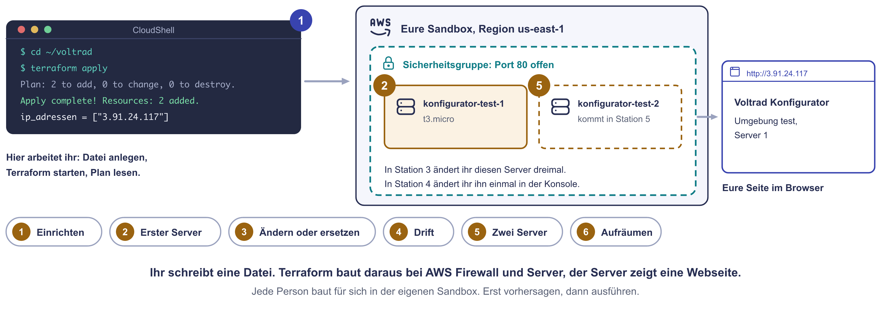

# Praxis: Der Konfigurator als Code

Der Konfigurator der Voltrad GmbH läuft in der Cloud. Im Frühjahr braucht er
bis zu vier Server, außerhalb der Saison reicht einer. Bisher hat Frau Vogt
aus der IT jeden Server in der Konsole zusammengeklickt. Das soll sich ändern:
Ab jetzt steht der Konfigurator in einer Textdatei. Terraform baut ihn
daraus auf.

Ihr baut heute genau das. Erst einen Server aus einer Datei, dann ändert ihr
ihn, deckt eine Änderung von Hand auf, macht aus einem Server zwei und löscht
am Ende alles mit einem einzigen Befehl.

!!! abstract "Ziel"
    Am Ende könnt ihr:

    - eine Terraform-Datei lesen: Provider, Variable, Ressource und Ausgabe
    - mit `init`, `plan`, `apply` und `destroy` Infrastruktur bauen und löschen
    - vor jeder Änderung im Plan vorhersagen, ob Terraform ändert oder ersetzt
    - erklären, was die State-Datei ist und was bei Änderungen von Hand passiert
    - in der Dokumentation nachschlagen, was man bei einer Ressource eintragen kann

    Für die Schnellen gibt es drei kurze Bonus-Aufgaben und eine Denkaufgabe.

!!! info "Heute arbeiten alle im selben Terminal"
    Alle Befehle laufen in **CloudShell**, dem Terminal in der AWS-Konsole.
    CloudShell ist ein Linux im Browser. Die Befehle sind deshalb für alle
    gleich, egal ob ihr Windows oder macOS nutzt. Auf eurem eigenen Rechner
    installiert ihr nichts.

## Womit ihr hier arbeitet

| Baustein | Was er tut |
|---|---|
| **Sandbox** | Ein echtes, leeres AWS-Konto für vier Stunden, gestartet über Pluralsight. Danach löscht Pluralsight alles darin. Für euch entstehen keine Kosten. |
| **CloudShell** | Ein Linux-Terminal direkt in der AWS-Konsole. Ihr seid dort schon angemeldet. Was im Home-Verzeichnis liegt, bleibt erhalten, alles andere ist nach der Sitzung weg. |
| **Terraform** | Ein Programm, das Infrastruktur aus Textdateien baut, ändert und löscht. Ihr beschreibt, was es geben soll. Terraform vergleicht das mit dem Bestand und erledigt den Unterschied. |
| **Provider** | Der Baustein, mit dem Terraform eine bestimmte Cloud ansteuert, ähnlich wie ein Druckertreiber. Heute ist das der Provider für AWS, in der Datei steht er als `hashicorp/aws`. HashiCorp ist die Firma hinter Terraform und gehört seit 2025 zu IBM. |
| **Variable** | Ein Wert in der Datei, der sich ändern darf. Heute sind es zwei: die Umgebung (`test` oder `produktion`) und die Anzahl der Server. |
| **Startskript** | Befehle, die ein neuer Server beim ersten Start einmal ausführt. In der Konsole heißt das Feld **Benutzerdaten**, in Terraform `user_data`. Unser Skript installiert den Webserver und schreibt die Startseite. |
| **State-Datei** | `terraform.tfstate`, das Gedächtnis von Terraform. Darin steht, welche Ressourcen Terraform gebaut hat und wie sie bei AWS heißen. |
| **nano** | Ein einfacher Texteditor im Terminal. Damit ändert ihr eure Datei. |

Für die Prüfung zählt Infrastruktur als Code als Weg, Umgebungen wiederholbar
und dokumentiert aufzubauen. Im Beruf begegnet euch Terraform in fast jeder
Firma, die ihre Cloud ernsthaft betreibt. Es steuert auch Azure, Google
Cloud, VMware und Proxmox an.

## Was ihr gleich baut

Ihr schreibt in CloudShell eine Datei. Terraform liest sie und baut daraus bei
AWS zwei Dinge: eine **Firewall**, die Port 80 für Webseiten öffnet, und einen
**Server**. Der Server installiert beim ersten Start einen Webserver und zeigt
eine kleine Seite, die ihr im Browser öffnet. Danach ändert ihr die Datei
Schritt für Schritt und schaut zu, was Terraform daraus macht.

Ihr arbeitet heute jede und jeder für sich, jeweils in der **eigenen
Sandbox**. Gebaut wird die Testumgebung, euer erster Server heißt
`konfigurator-test-1`.

{ .diagramm }

**Erst vorhersagen, dann ausführen.** Bei jeder Änderung schreibt ihr erst
auf, was der Plan zeigen wird. Erst dann lasst ihr ihn laufen. So lernt ihr
den Plan lesen, darum geht es heute.

---

## Station 1: Sandbox und Terraform einrichten (10 Minuten)

**Was ihr hier tut:** Ihr startet die Sandbox, öffnet CloudShell und
installiert Terraform in euer Home-Verzeichnis. Dort bleibt es, auch wenn
CloudShell zwischendurch neu startet.

1. Startet die Sandbox wie beim ersten Server: Pluralsight, **Cloud
   Sandboxes**, bei **AWS Sandbox** auf **Open Sandbox** und **Start
   Sandbox**. Dann mit der **rechten Maustaste** auf **Open Sandbox** und den
   Link in einem **privaten Fenster** öffnen. Benutzer `cloud_user`, das
   Passwort kopiert ihr aus Pluralsight.
2. Prüft oben rechts die Region: **USA (Nord-Virginia)**, also `us-east-1`.
3. Öffnet **CloudShell**: das Symbol `>_` oben in der Leiste der Konsole. Der
   erste Start dauert etwa eine halbe Minute, das Willkommensfenster schließt
   ihr mit **Schließen**.
4. Kopiert den Block unten komplett und fügt ihn in CloudShell ein (++ctrl+v++,
   auf macOS ++cmd+v++). CloudShell fragt bei mehreren Zeilen nach, ob ihr
   wirklich einfügen wollt. Bestätigt mit **Einfügen** (Paste).

```bash
mkdir -p ~/bin
curl -sLo /tmp/terraform.zip https://releases.hashicorp.com/terraform/1.16.7/terraform_1.16.7_linux_amd64.zip
unzip -o /tmp/terraform.zip terraform -d ~/bin
echo 'export PATH=$HOME/bin:$PATH' >> ~/.bashrc
echo 'export TF_DATA_DIR=/tmp/terraform-daten' >> ~/.bashrc
source ~/.bashrc
terraform -version
```

Die Zeilen laden Terraform herunter, packen es nach `~/bin` aus und tragen
zwei Einstellungen in `~/.bashrc` ein, die bei jedem Start von CloudShell
gelesen wird. Die zweite Einstellung legt die großen Dateien des AWS-Providers
nach `/tmp`. Der Provider ist entpackt über 800 MB groß, im Home-Verzeichnis
habt ihr nur 1 GB.

**Geschafft, wenn** die letzte Zeile so etwas zeigt:

```text
Terraform v1.16.7
on linux_amd64
```

---

## Station 2: Der erste Server aus einer Datei (15 Minuten)

**Was ihr hier tut:** Ihr legt einen Ordner und darin die Datei `main.tf`
an. Sie beschreibt eine Sicherheitsgruppe und einen Webserver. Dann lasst ihr
Terraform den Plan zeigen und baut.

1. Legt den Ordner an und wechselt hinein:

    ```bash
    mkdir -p ~/voltrad && cd ~/voltrad
    ```

2. Kopiert den ganzen Block unten und fügt ihn in CloudShell ein. Er schreibt
   die Datei `main.tf`. Alles zwischen der ersten und der letzten Zeile landet
   in der Datei. Die Zeilen mit `#` sind Kommentare, Terraform überliest sie.

    ```bash
    cat > main.tf <<'ENDE'
    # Voltrad Konfigurator: Webserver in der AWS-Sandbox

    terraform {
      required_providers {
        aws = {
          source  = "hashicorp/aws"
          version = "~> 6.0"
        }
      }
    }

    provider "aws" {
      region = "us-east-1"
    }

    # Variablen: Werte, die sich ändern dürfen
    variable "umgebung" {
      description = "test oder produktion"
      type        = string
      default     = "test"
    }

    variable "anzahl_server" {
      description = "Wie viele Server sollen laufen?"
      type        = number
      default     = 1
    }

    # Das neueste Amazon Linux 2023 suchen (baut nichts, sucht nur)
    data "aws_ami" "amazon_linux" {
      most_recent = true
      owners      = ["amazon"]

      filter {
        name   = "name"
        values = ["al2023-ami-2023.*-x86_64"]
      }
    }

    # Die Firewall: Port 80 aus dem Internet erlaubt, nach außen alles
    resource "aws_security_group" "web" {
      name        = "konfigurator-${var.umgebung}"
      description = "HTTP fuer den Konfigurator"

      ingress {
        from_port   = 80
        to_port     = 80
        protocol    = "tcp"
        cidr_blocks = ["0.0.0.0/0"]
      }

      egress {
        from_port   = 0
        to_port     = 0
        protocol    = "-1"
        cidr_blocks = ["0.0.0.0/0"]
      }
    }

    # Die Server
    resource "aws_instance" "web" {
      count                  = var.anzahl_server
      ami                    = data.aws_ami.amazon_linux.id
      instance_type          = "t3.micro"
      availability_zone      = "us-east-1a"
      vpc_security_group_ids = [aws_security_group.web.id]

      # Startskript: läuft beim ersten Start einmal (in der Konsole: Benutzerdaten)
      user_data = <<-SKRIPT
        #!/bin/bash
        dnf install -y httpd
        echo "<h1>Voltrad Konfigurator</h1><p>Umgebung ${var.umgebung}, Server ${count.index + 1}</p>" > /var/www/html/index.html
        systemctl enable --now httpd
      SKRIPT

      tags = {
        Name = "konfigurator-${var.umgebung}-${count.index + 1}"
      }
    }

    # Nach dem Bauen anzeigen: die öffentlichen IP-Adressen
    output "ip_adressen" {
      value = aws_instance.web[*].public_ip
    }
    ENDE
    ```

    Drei Dinge in der Datei sind neu für euch:

    - `count = var.anzahl_server` heißt: Baue so viele Server, wie in der
      Variable steht. `count.index` zählt dabei mit, beim ersten Server ist
      es 0. Deshalb steht im Namen `count.index + 1`.
    - `user_data` ist das Startskript. Alles zwischen `<<-SKRIPT` und
      `SKRIPT` sind Befehle, die der Server beim ersten Start ausführt:
      Webserver installieren, Startseite schreiben, Webserver starten.
    - `aws_instance.web[*].public_ip` heißt: die öffentliche IP-Adresse aller
      Server dieses Blocks.

3. Jetzt die drei Befehle, einer nach dem anderen:

    ```bash
    terraform init
    ```

    `init` lädt den AWS-Provider herunter. Das dauert beim ersten Mal etwa
    eine Minute.

    ```bash
    terraform plan
    ```

    `plan` zeigt, was Terraform tun würde, ändert aber noch nichts. Lest die
    letzte Zeile.

    ```bash
    terraform apply
    ```

    `apply` zeigt denselben Plan noch einmal und fragt nach. Tippt `yes` und
    drückt ++enter++. Nach etwa einer Minute steht unten eure IP-Adresse.

4. Öffnet im Browser `http://` und die Adresse, zum Beispiel
   `http://3.91.24.117`. Der Webserver installiert sich nach dem Start noch,
   wartet notfalls zwei Minuten und ladet neu.

**Frage 1:** Wie viele Ressourcen wollte der Plan anlegen? Welche waren es?
Warum taucht das Amazon-Linux-Abbild nicht darunter auf?

**Frage 2:** Öffnet in der Konsole EC2 und eure Instanz. Findet ihr den
Namen aus der Datei wieder? Welche Datei liegt jetzt neu im Ordner? Der Befehl
`ls` zeigt es.

??? tip "Hinweise zu Station 2"
    1. Die Zeile, auf die es ankommt, beginnt mit `Plan:`. Darüber steht jede
       Ressource mit einem Pluszeichen.
    2. `data` und `resource` sind zwei verschiedene Arten von Blöcken. Der eine
       baut etwas, der andere sucht nur.
    3. Neu im Ordner ist eine Datei, deren Name auf `.tfstate` endet.

    Die Lösung besprechen wir gemeinsam nach der Praxiszeit.

---

## Station 3: Ändern oder ersetzen? (15 Minuten)

**Was ihr hier tut:** Ihr ändert die Datei dreimal. Vor jedem `apply` sagt
ihr voraus, was passieren wird. Im Plan steht vor jeder Ressource ein Zeichen:

| Zeichen | Bedeutung |
|---|---|
| `+` | wird neu angelegt |
| `~` | wird im laufenden Betrieb geändert |
| `-/+` | wird gelöscht und neu angelegt, also ersetzt |
| `-` | wird gelöscht |

Öffnet die Datei für jede Änderung mit `nano main.tf`, dann `terraform apply`.
Lest den Plan, bevor ihr `yes` tippt.

!!! tip "So bedient ihr nano"
    Bewegen mit den Pfeiltasten, tippen wie in jedem Editor.
    **Speichern:** ++ctrl+o++ und dann ++enter++.
    **Schließen:** ++ctrl+x++.
    Auch auf macOS nehmt ihr hier ++ctrl++, nicht ++cmd++.
    Drückt nie ++ctrl+w++: Der Browser schließt damit den ganzen Reiter.

**Änderung A:** Der Vertrieb ist für den Konfigurator zuständig. Ergänzt bei
`tags` eine zweite Zeile, so dass der Block so aussieht:

```hcl
  tags = {
    Name      = "konfigurator-${var.umgebung}-${count.index + 1}"
    Abteilung = "Vertrieb"
  }
```

**Änderung B:** Der Server ist zu klein. Macht ihn größer: `instance_type`
von `"t3.micro"` auf `"t3.small"`.

**Änderung C:** Der Server soll in ein anderes Rechenzentrum derselben
Region: `availability_zone` von `"us-east-1a"` auf `"us-east-1b"`.

**Frage 3:** Schreibt vor jedem `apply` eure Vorhersage auf: Welches Zeichen
zeigt der Plan? Bleibt die Adresse gleich? Vergleicht danach mit dem, was
wirklich passiert ist.

??? tip "Hinweise zu Station 3"
    1. Etiketten wie `tags` kann AWS an einem laufenden Server ändern.
    2. Erinnert euch an euren ersten Server bei AWS: Was passierte beim
       Vergrößern mit der öffentlichen IP-Adresse?
    3. Kann ein laufender Server von einem Rechenzentrum ins andere umziehen?
       Achtet im Plan auf den Hinweis `# forces replacement`. Das ist kein
       Befehl: Terraform schreibt ihn selbst hinter die Zeile, die einen
       neuen Server erzwingt.

    Die Lösung besprechen wir gemeinsam nach der Praxiszeit.

---

## Station 4: Jemand hat geklickt (8 Minuten)

**Was ihr hier tut:** Ihr ändert den Server von Hand in der Konsole, so wie
es nachts im Störfall passieren könnte. Dann schaut ihr, was Terraform dazu
sagt. Eine solche Abweichung zwischen Datei und Wirklichkeit heißt **Drift**.

1. Öffnet in der Konsole **EC2**, dann **Instances** und klickt auf eure
   Instanz.
2. Unten die Registerkarte **Tags**, dann **Tags verwalten** (Manage tags).
3. Ändert den Wert von `Abteilung` von `Vertrieb` auf `Einkauf` und klickt
   auf **Speichern** (Save).
4. Zurück in CloudShell:

    ```bash
    terraform plan
    ```

**Frage 4:** Was will Terraform tun? Wer hat am Ende recht, die Datei oder
die Konsole? Führt danach `terraform apply` aus und prüft den Tag in der
Konsole.

**Frage 5:** Frau Vogt ändert nachts im Störfall etwas in der Konsole und
vergisst es. Was passiert beim nächsten `apply` ihrer Kollegin? Was sollte
die IT von Voltrad deshalb als Regel festlegen?

??? tip "Hinweise zu Station 4"
    1. Vor dem Plan liest Terraform den echten Zustand bei AWS ein. Im Plan
       seht ihr beide Werte nebeneinander, getrennt durch `->`.
    2. Terraform kennt nur ein Ziel: das, was in der Datei steht.

    Die Lösung besprechen wir gemeinsam nach der Praxiszeit.

---

## Station 5: Aus einem Server werden zwei (10 Minuten)

**Was ihr hier tut:** Im Frühjahr braucht der Konfigurator mehr Server. Dafür
ändert ihr genau eine Zahl.

1. Öffnet `nano main.tf` und setzt bei `variable "anzahl_server"` den Wert
   `default = 1` auf `default = 2`.
2. Sagt den Plan voraus, dann:

    ```bash
    terraform apply
    ```

3. Öffnet beide Adressen im Browser. Die Seite zeigt, welcher Server
   antwortet.

**Frage 6:** Was stand in der Zeile `Plan:`? Warum legt Terraform nur einen
Server neu an und nicht zwei?

**Frage 7:** Was müsstet ihr ändern, damit es im Frühjahr vier Server sind und
im Juni wieder einer? Wie lange hätte das in der Konsole gedauert?

??? tip "Hinweise zu Station 5"
    1. Terraform vergleicht wieder Datei und Wirklichkeit: Wie viele Server
       gibt es schon, wie viele sollen es sein?
    2. Der neue Server heißt `aws_instance.web[1]`. Was war dann
       `aws_instance.web[0]`?

    Die Lösung besprechen wir gemeinsam nach der Praxiszeit.

---

## Nachschlagen: Was man eintragen kann

In der Datei stehen Einträge wie `instance_type` oder `public_ip`. Woher weiß
man, welche es gibt? Jede Ressource hat in der **Terraform Registry** eine
eigene Seite. Dort steht unter **Argument Reference**, was man eintragen kann,
und unter **Attribute Reference**, was Terraform nach dem Bauen weiß und man
an anderer Stelle verwenden kann.

- Server: [aws_instance](https://registry.terraform.io/providers/hashicorp/aws/latest/docs/resources/instance)
- Firewall: [aws_security_group](https://registry.terraform.io/providers/hashicorp/aws/latest/docs/resources/security_group)
- Abbild suchen: [aws_ami](https://registry.terraform.io/providers/hashicorp/aws/latest/docs/data-sources/ami)

Jeder Provider hat seine eigenen Ressourcen und Einträge. Ein Server heißt bei
AWS `aws_instance`, bei Azure `azurerm_linux_virtual_machine` und bei Google
Cloud `google_compute_instance`. Jeder hat andere Felder. Die Idee bleibt
gleich, die Namen muss man je Provider nachschlagen.

**Server (`aws_instance`): was ihr eintragen könnt**

| Eintrag | Was er festlegt | Beispiel |
|---|---|---|
| `ami` | das Abbild, aus dem die Festplatte entsteht, also das Betriebssystem | `data.aws_ami.amazon_linux.id` |
| `instance_type` | die Größe: CPUs und Arbeitsspeicher | `"t3.micro"`, `"t3.small"` |
| `availability_zone` | das Rechenzentrum innerhalb der Region | `"us-east-1a"` |
| `vpc_security_group_ids` | welche Firewalls vor dem Server stehen | `[aws_security_group.web.id]` |
| `user_data` | das Startskript für den ersten Start | Skript zwischen `<<-SKRIPT` und `SKRIPT` |
| `tags` | Etiketten, darunter der Name in der Konsole | `{ Name = "konfigurator-test-1" }` |
| `count` | wie viele Server aus diesem Block entstehen | `var.anzahl_server` |
| `key_name` | ein Schlüsselpaar für die Anmeldung per SSH | `"voltrad-admin"` |

**Server: was Terraform danach weiß**

| Attribut | Was drinsteht |
|---|---|
| `id` | die Instanz-ID bei AWS, zum Beispiel `i-0a1b2c3d4e5f67890` |
| `public_ip` | die öffentliche IP-Adresse |
| `private_ip` | die Adresse im internen Netz |
| `public_dns` | der öffentliche DNS-Name des Servers |
| `instance_state` | der Zustand, zum Beispiel `running` oder `stopped` |

**Firewall (`aws_security_group`)**

| Eintrag | Was er festlegt | Beispiel |
|---|---|---|
| `name` | der Name der Gruppe, lässt sich später nicht ändern | `"konfigurator-test"` |
| `ingress` | eine Regel für eingehenden Verkehr | Port 80 aus dem Internet |
| `egress` | eine Regel für ausgehenden Verkehr | alles erlaubt, damit der Server Pakete laden kann |
| `from_port`, `to_port` | der Portbereich der Regel | `80` und `80` |
| `protocol` | das Protokoll, `"-1"` steht für alle | `"tcp"` |
| `cidr_blocks` | aus welchem Netz der Verkehr kommen darf | `["0.0.0.0/0"]` für das ganze Internet |

!!! warning "Achtung bei egress"
    Legt ihr eine Sicherheitsgruppe in der Konsole an, ist ausgehender
    Verkehr automatisch erlaubt. Terraform entfernt diese Regel. Ohne den
    Block `egress` kann der Server deshalb nichts aus dem Internet laden, und
    das Startskript scheitert.

---

## Bonus für die Schnellen

Erledigt die Bonus-Aufgaben **vor** Station 6, denn danach ist alles weg.

### Bonus 1: Ins Gedächtnis schauen (5 Minuten)

```bash
terraform state list
```

```bash
terraform state show 'aws_instance.web[0]'
```

Sucht in der Ausgabe die `id` des Servers und vergleicht sie mit der
Instanz-ID in der Konsole. Was würde passieren, wenn jemand die Datei
`terraform.tfstate` löscht und danach `terraform apply` ausführt?

??? tip "Musterlösung"
    `state list` zeigt alles, was Terraform verwaltet: die Datenquelle für
    das Abbild, die Sicherheitsgruppe und die beiden Server
    `aws_instance.web[0]` und `aws_instance.web[1]`. Die `id` beginnt mit
    `i-` und ist dieselbe wie in der Konsole. So verbindet die State-Datei
    den Namen in eurer Datei mit dem echten Server.

    Ohne State-Datei weiß Terraform nicht mehr, dass es die Server schon
    gebaut hat. `apply` würde alles noch einmal anlegen. Bei der
    Sicherheitsgruppe scheitert es, weil es den Namen schon gibt, die Server
    entstünden doppelt. Deshalb wird die State-Datei gesichert wie eine
    Datenbank.

### Bonus 2: Was wäre im März? (5 Minuten)

Lasst Terraform durchspielen, was vier Server bedeuten würden, ohne etwas zu
ändern:

```bash
terraform plan -var anzahl_server=4
```

Sagt vorher voraus, was in der Zeile `Plan:` steht. Führt **kein** `apply`
aus.

??? tip "Musterlösung"
    `Plan: 2 to add, 0 to change, 0 to destroy.` Zwei Server laufen schon,
    vier sollen es sein. Mit `-var` überschreibt ihr eine Variable für
    diesen einen Aufruf, ohne die Datei zu ändern. So kann Frau Vogt im März
    erst prüfen und dann mit `terraform apply -var anzahl_server=4` bauen.
    Im Betrieb trägt man den Wert besser in die Datei ein, damit er in Git
    nachvollziehbar bleibt.

### Bonus 3: Fehler lesen (5 Minuten)

Macht absichtlich einen Tippfehler: Ändert in `main.tf` die Zeile
`instance_type` in `instance_typ`. Dann:

```bash
terraform validate
```

Lest die Fehlermeldung: In welcher Datei und Zeile steht der Fehler? Was
sagt Terraform dazu? Schaut in der Tabelle oben nach, wie der Eintrag richtig
heißt. Macht den Fehler danach rückgängig und prüft mit `terraform validate`,
dass wieder `Success!` erscheint. Probiert zum Schluss `terraform fmt`. Was
macht der Befehl mit euren Einrückungen?

??? tip "Musterlösung"
    `validate` meldet `Unsupported argument` mit Dateiname und Zeilennummer
    und sagt, dass ein Argument namens `instance_typ` hier nicht erwartet
    wird. Terraform prüft die Datei, bevor es AWS überhaupt fragt.
    `terraform fmt` richtet Einrückungen und Gleichheitszeichen einheitlich
    aus und nennt die Dateien, die es geändert hat. In Teams sorgt das dafür,
    dass alle Dateien gleich aussehen.

### Denkaufgabe: Drei Personen, eine Datei (15 Minuten)

Frau Vogt und ihre zwei Kolleginnen in der IT betreuen den Konfigurator ab
jetzt gemeinsam mit Terraform. Heute liegen `main.tf` und `terraform.tfstate`
nur in der CloudShell von Frau Vogt. Überlegt euch:

1. Wo sollte `main.tf` liegen, damit alle drei daran arbeiten und jede
   Änderung nachvollziehbar ist?
2. Wo sollte die State-Datei liegen? Was passiert, wenn zwei Personen
   gleichzeitig `apply` ausführen?
3. Was gehört auf keinen Fall in ein gemeinsames Git-Repository?
4. Welche Regel braucht das Team für Änderungen in der Konsole?

??? tip "Musterlösung"
    1. **In einem Git-Repository**, wie jeder andere Code. Jede Änderung hat
       einen Autor, ein Datum und eine Beschreibung. Vor dem `apply` schaut
       eine zweite Person auf die Änderung und den Plan (Vier-Augen-Prinzip).
    2. **An einem gemeinsamen Ort**, nicht auf einem einzelnen Rechner. Bei
       AWS üblich ist ein S3-Bucket, Terraform nennt das ein Backend. Dazu
       gehört eine Sperre: Solange eine Person `apply` ausführt, muss die
       zweite warten. Ohne Sperre schreiben beide gleichzeitig in die
       State-Datei. Terraform verliert dann den Überblick über die Server.
    3. **Die State-Datei und alle Zugangsdaten.** In der State-Datei stehen
       alle Werte der Ressourcen, bei Datenbanken auch Passwörter im
       Klartext. Zugangsschlüssel für AWS gehören nie in eine Datei im
       Repository.
    4. **Geändert wird nur über die Datei.** In der Konsole wird gelesen,
       nicht geklickt. Muss im Störfall doch etwas von Hand passieren, wird
       es sofort in `main.tf` nachgezogen. Sonst macht das nächste `apply`
       die Änderung rückgängig, wie in Station 4.

---

## Station 6: Mit einem Befehl aufräumen (5 Minuten)

**Was ihr hier tut:** Was Terraform gebaut hat, löscht es auch wieder.
Spätestens um 20:20 Uhr räumt ihr ab.

```bash
terraform destroy
```

Sagt vorher voraus, was in der Zeile `Plan:` stehen wird. Tippt dann `yes`.

**Frage 8:** Prüft in der Konsole unter **Instances** und
**Sicherheitsgruppen** (Security Groups), dass alles weg ist. Wie viele
Schritte wären das in der Konsole gewesen?

??? tip "Hinweise zu Station 6"
    1. Gelöscht wird genau das, was in der State-Datei steht. Die
       Datenquelle für das Abbild baut nichts, sie wird nicht gelöscht.
    2. Die Instanzen stehen danach als **Beendet** (Terminated) in der Liste.
       Sie verschwinden nach etwa einer Stunde von selbst.

    Die Lösung besprechen wir gemeinsam nach der Praxiszeit.

---

## Wenn es klemmt

| Was ihr seht | Woran es liegt | Was hilft |
|---|---|---|
| `terraform: command not found` | Die Einstellungen aus Station 1 sind in diesem Terminal noch nicht geladen | `source ~/.bashrc` eingeben. Hilft das nicht, Station 1 wiederholen. |
| `no space left on device` beim `init` | Der Provider landet im Home-Verzeichnis statt in `/tmp` | `echo $TF_DATA_DIR` muss `/tmp/terraform-daten` zeigen. Sonst `source ~/.bashrc`, dann `rm -rf ~/voltrad/.terraform` und noch einmal `terraform init`. |
| `Required plugins are not installed` oder `Inconsistent dependency lock file` | CloudShell hat neu gestartet und `/tmp` geleert | Im Ordner `~/voltrad` noch einmal `terraform init`. Eure Datei und die State-Datei sind noch da. |
| `No valid credential sources found` oder `expired` | Die Anmeldung von CloudShell ist abgelaufen | Die Seite der Konsole neu laden und CloudShell noch einmal öffnen. |
| `UnauthorizedOperation` | Die Sandbox erlaubt diesen Typ oder diese Region nicht | `t3.micro` oder `t3.small` nehmen, Region `us-east-1`. |
| `InvalidGroup.Duplicate` | Eine Sicherheitsgruppe mit diesem Namen gibt es schon, etwa aus einem früheren Versuch | In der Konsole unter **Sicherheitsgruppen** die alte Gruppe löschen oder bei `umgebung` einen anderen Wert eintragen, etwa `test2`. |
| `Error: Unsupported argument` oder `Invalid expression` | Tippfehler in `main.tf` | Datei und Zeile stehen in der Meldung. Mit `nano main.tf` dorthin und korrigieren. |
| Die Seite lädt nicht | Der Webserver installiert sich noch, oder `https://` statt `http://` | Zwei Minuten warten, die Adresse mit `http://` öffnen. |
| CloudShell reagiert nicht mehr, der Befehl hängt | Ein Befehl wartet auf Eingabe oder läuft noch | Nachsehen, ob `yes` erwartet wird. Abbrechen mit ++ctrl+c++. |

## Was ihr zur Auswertung mitbringt

- eure drei Vorhersagen aus Station 3 und was wirklich passiert ist
- was der Plan in Station 4 nach der Änderung in der Konsole wollte
- die Zeile `Plan:` aus Station 5 und eure Erklärung dazu
- eure Meinung in einem Satz: Würdet ihr im Betrieb lieber klicken oder
  Dateien schreiben?

## Wie es weitergeht

Die Theorie zu dieser Übung steht auf der Seite
[Infrastruktur als Code](infrastruktur-als-code.md).
